# Regulatory Intelligence Platform
# Engineering Deliverable 02 — Workflow Diagrams and State Machines

**Document Version:** 1.0  
**Status:** Draft — Not Yet Approved  
**Document Type:** Workflow and Process Engineering Specification  
**Architecture:** Universal, Jurisdiction-Neutral  
**Initial Implementation Environment:** Texas HCS  
**Governing Document:** Engineering Deliverable 01 — Master Workflow Catalog  
**Implementation Authorization:** Not Granted

---

# 1. Purpose

This document translates the Master Workflow Catalog into visual and technical workflow specifications.

It establishes how the Regulatory Intelligence Platform performs its business processes and how independent engineering domains interact.

The document defines:

- End-to-end workflow diagrams.
- Decision flow diagrams.
- Workflow state machines.
- Domain interaction diagrams.
- Service sequence diagrams.
- Exception and recovery paths.
- Approval and authorization points.
- Workflow completion conditions.
- Historical traceability requirements.

The diagrams are intended to communicate system behavior to architects, developers, testers, product owners, and independently assigned engineering teams.

The workflows are jurisdiction-neutral. Regulatory and financial Knowledge Packs provide the authoritative requirements and methodologies applicable to a particular customer, jurisdiction, or program.

# 2. Governing Workflow Principles

## 2.1 Domain ownership

Every workflow must have one accountable domain owner.

The domain owner is responsible for the business process, its records, and its lifecycle.

Other domains may participate through defined contracts but cannot assume the owner's authority.

## 2.2 Knowledge authority

The platform maintains two independent knowledge authorities:

**Regulatory Knowledge Engine**
- Regulatory sources.
- Regulatory provisions.
- Obligations.
- Regulatory interpretations.
- Regulatory applicability.
- Regulatory Knowledge Packs.

**Financial Knowledge Engine**
- Financial sources.
- Financial concepts.
- Classifications.
- Allowability.
- Allocation methodologies.
- Rates and formulas.
- Reporting definitions.
- Financial Knowledge Packs.

Neither authority may independently establish determinations belonging to the other.

## 2.3 Operational ownership

Operational domains own the records representing actual business activity.

Examples include:
- Residential Operations.
- ISS Operations.
- Workforce Operations.
- Financial Operations.

Operational domains provide verified facts to intelligence workflows.

They do not independently determine regulatory compliance or financial allowability.

## 2.4 Shared service responsibility

Shared services provide reusable capabilities:

- Evidence Management.
- Validation Execution.
- Document Management.
- Audit and Traceability.
- Change and Version Management.
- Approval Management.
- Reporting Infrastructure.
- Binder Management.

Shared services execute approved definitions and maintain the necessary controls. They do not become additional knowledge authorities.

## 2.5 Historical preservation

Every consequential workflow must preserve:
- Original inputs.
- Actor and system attribution.
- Execution timestamp.
- Applicable knowledge versions.
- Definition versions.
- Decision results.
- Approval records.
- Supporting evidence references.
- Previous and resulting states.

A new execution creates a new historical result rather than overwriting an earlier result.

# 3. Visual Diagram Standards

All diagrams in this document use Mermaid notation.

Engineering teams must preserve consistent visual conventions.

| Diagram element | Meaning |
|---|---|
| Rounded start/end node | Workflow initiation or completion |
| Rectangle | Activity or system operation |
| Diamond | Decision |
| Document/data node | Information or record |
| Subprocess | Independently owned workflow |
| Arrow | Workflow sequence |
| Labeled arrow | Decision outcome or event |
| State diagram | Lifecycle and permitted transitions |
| Sequence diagram | Interaction between actors and services |

## 3.1 Domain identification

Diagrams must identify the responsible domain.

The following abbreviations are used:

| Abbreviation | Domain |
|---|---|
| PF | Platform Foundation |
| ORG | Customer and Organization |
| RKE | Regulatory Knowledge Engine |
| FKE | Financial Knowledge Engine |
| OPS | Operational Domains |
| EV | Evidence Management |
| VAL | Shared Validation |
| CI | Compliance Intelligence |
| FI | Financial Intelligence |
| BM | Binder Management |
| SW | Survey Workspace |
| AUD | Audit and Traceability |
| APR | Approval Management |
| REP | Reporting Infrastructure |

These are diagram labels, not final Nx project names or service names.

# 4. WF-01 — Regulatory Knowledge Lifecycle

**Accountable owner:** Regulatory Knowledge Engine.

**Purpose:** Transform authoritative regulatory sources into validated, approved, certified, and published operational knowledge.

## 4.1 End-to-end workflow

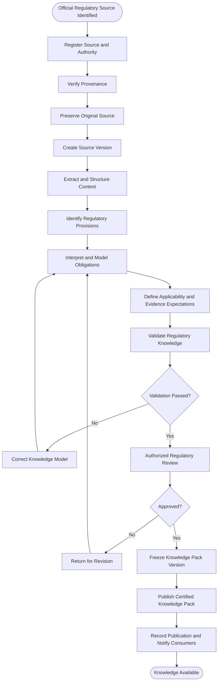

### Workflow ownership

| Stage | Owner | Output |
|---|---|---|
| Source registration | RKE | Registered source |
| Source preservation | RKE / Document Management | Original source artifact |
| Extraction | RKE | Structured source content |
| Interpretation | RKE | Regulatory knowledge model |
| Validation | RKE / Shared Validation | Validation results |
| Approval | Authorized regulatory approver | Approval decision |
| Publication | RKE | Certified Knowledge Pack |

## 4.2 Source acquisition and preservation

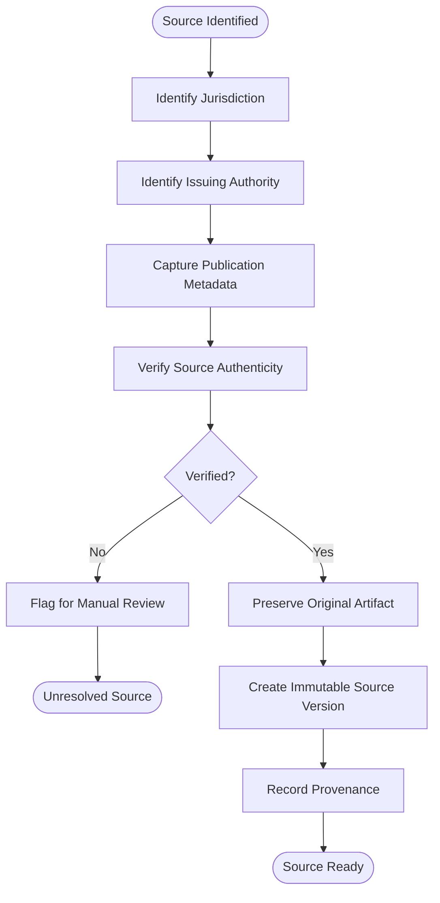

Required controls:

- Original source preservation.
- Source identity.
- Issuing authority.
- Jurisdiction.
- Publication date where available.
- Effective date where available.
- Source version.
- Retrieval timestamp.
- Provenance.
- Source location references.

An unverified source cannot be treated as authoritative.

## 4.3 Extraction and interpretation

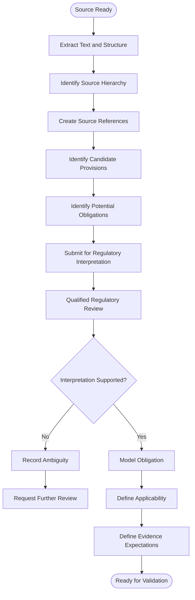

AI may assist with extraction and proposed interpretation.

AI-generated output must remain distinguishable from an approved regulatory determination.

## 4.4 Regulatory knowledge validation and approval

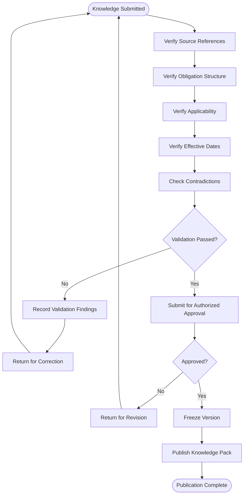

Validation and approval are distinct activities.

Passing validation does not itself authorize publication.

## 4.5 Regulatory Knowledge state machine

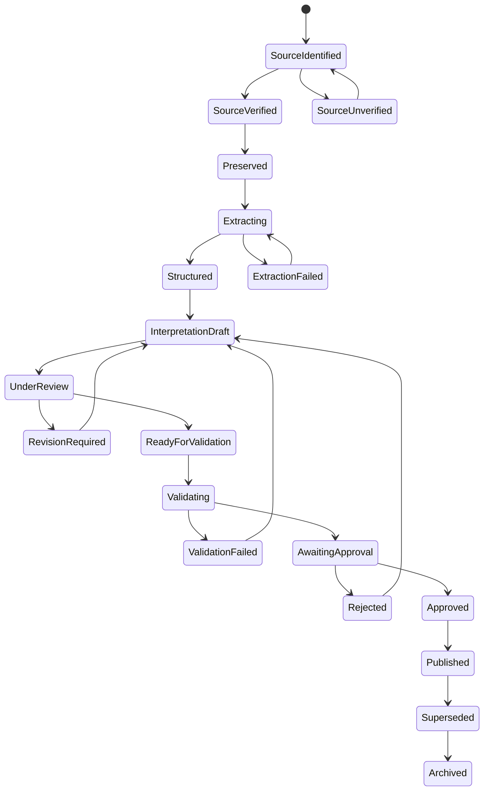

A published Knowledge Pack version must be immutable.

## 4.6 Regulatory change monitoring

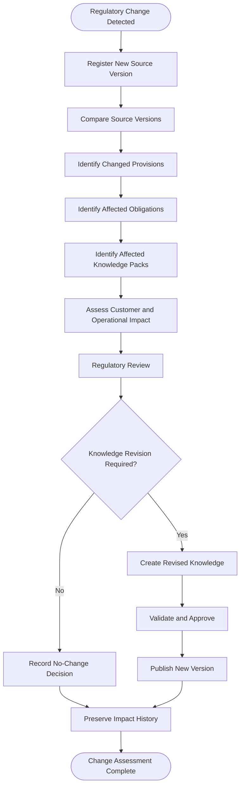

## 4.7 Regulatory applicability determination

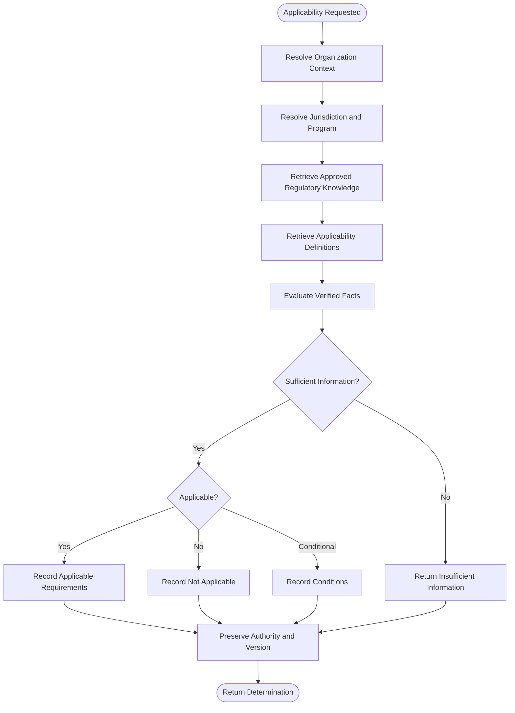

The Regulatory Knowledge Engine exclusively owns this determination.

---

# 5. WF-02 — Financial Knowledge Lifecycle

**Accountable owner:** Financial Knowledge Engine.

**Purpose:** Govern financial concepts, classifications, methodologies, calculations, and reporting definitions.

## 5.1 End-to-end workflow

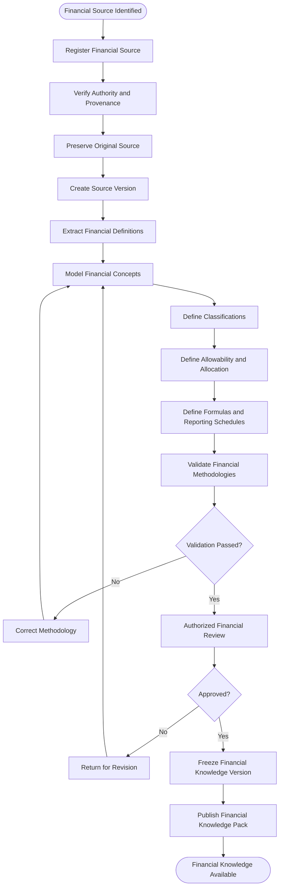

## 5.2 Financial methodology modeling

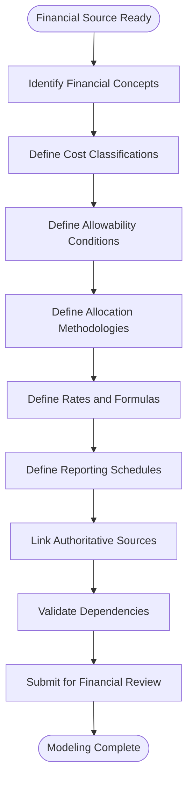

## 5.3 Financial methodology validation

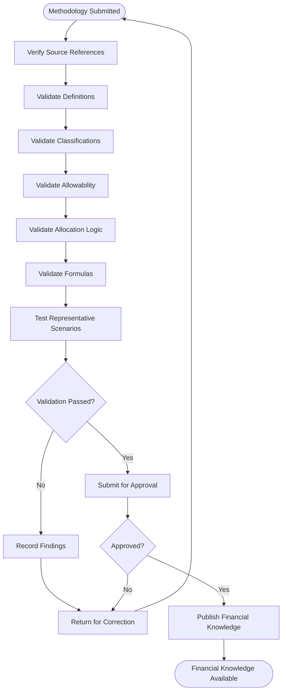

## 5.4 Financial Knowledge state machine

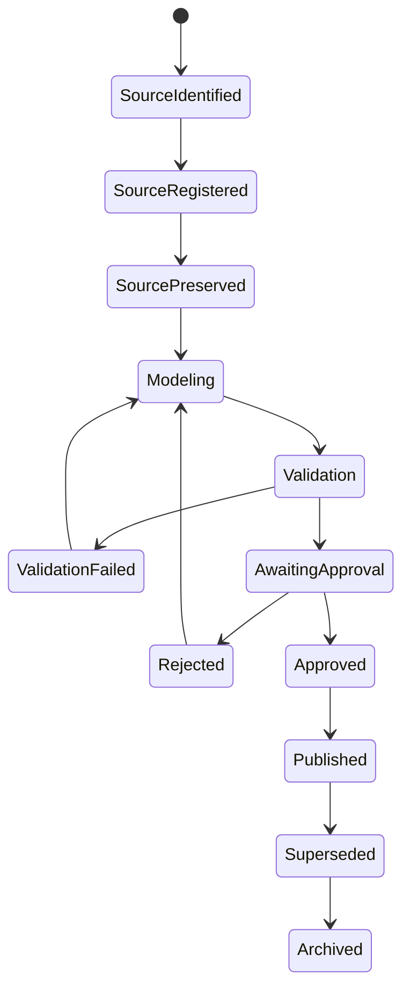

## 5.5 Financial applicability

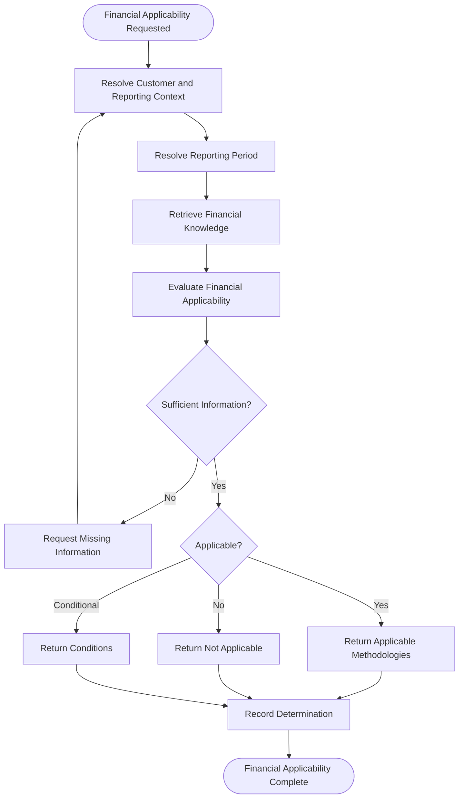

The Financial Knowledge Engine exclusively owns financial applicability.

---

# 6. WF-03 — Customer and Organization Lifecycle

**Accountable owner:** Customer and Organization domain, supported by Platform Foundation.

## 6.1 Customer onboarding

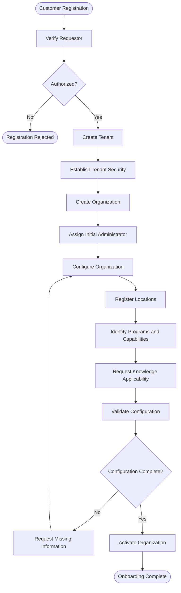

## 6.2 Customer onboarding state machine

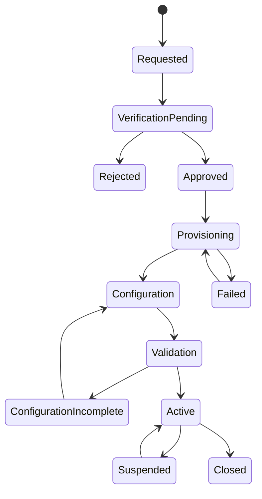

## 6.3 Knowledge applicability configuration

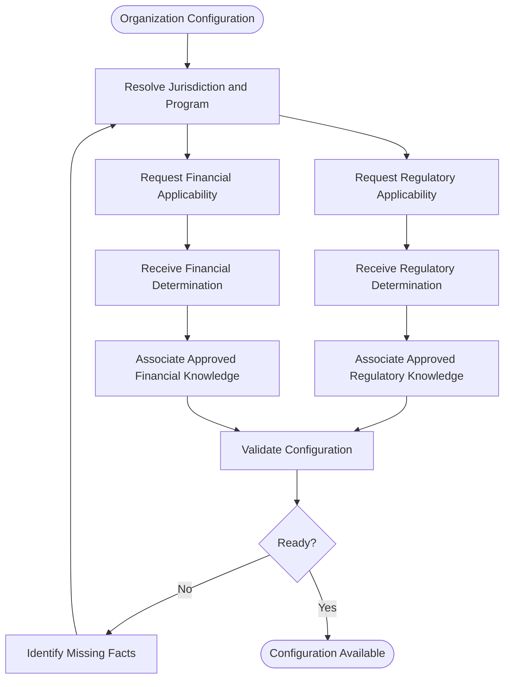

The customer does not independently declare regulatory or financial applicability.

## 6.4 User identity and access lifecycle

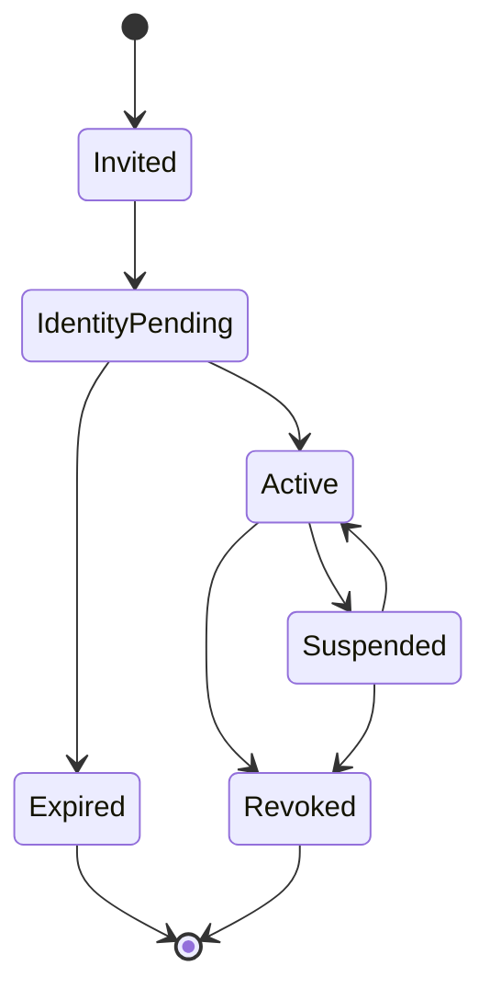

User membership, role assignments, permission changes, and access revocation must be audited.

---

# 7. WF-04 — Operational Management

**Accountable owner:** The applicable operational domain.

## 7.1 General operational record workflow

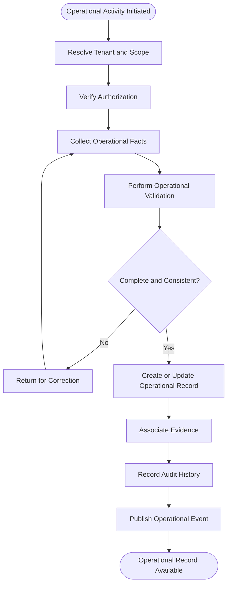

Operational validation does not establish compliance.

## 7.2 Residential Operations workflow

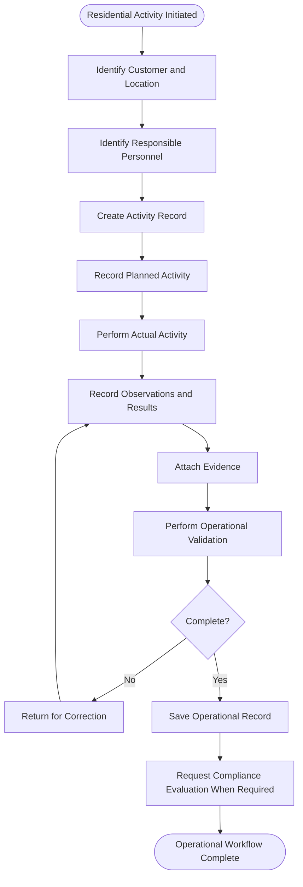

Examples include:

- Residential location management.
- Fire drills.
- Emergency plans.
- Safety inspections.
- Environmental monitoring.
- Operational documentation.
- Corrective actions.

These are reusable Residential Operations capabilities, not Texas-only platform architecture.

## 7.3 ISS Operations workflow

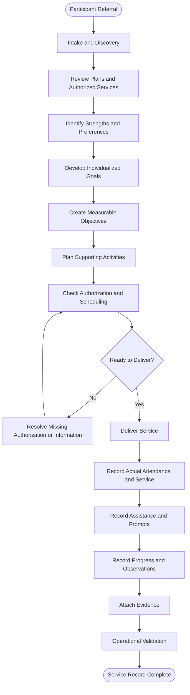

### ISS-specific requirements

- Individual goals must be individualized.
- Templates are starting structures, not automatically assigned goals.
- Objectives must be observable and measurable.
- Planned activities must remain distinct from delivered services.
- Actual assistance and prompts must be recorded.
- Authorization and service limits must be checked under applicable approved requirements.
- Operational records remain customer-owned.
- Compliance evaluation is a separate process.

## 7.4 ISS state machines

Participant planning:

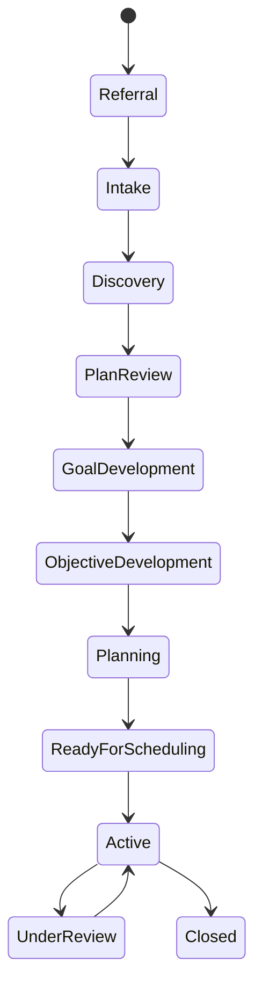

Individual service record:

```mermaid
stateDiagram-v2
    [*] --> Draft
    Draft --> Scheduled
    Scheduled --> Delivered
    Scheduled --> Cancelled
    Scheduled --> NotAttended
    Delivered --> DocumentationPending
    DocumentationPending --> OperationalValidation
    OperationalValidation --> CorrectionRequired
    CorrectionRequired --> DocumentationPending
    OperationalValidation --> Completed
    Completed --> [*]
```

Cancelled and not-attended records must never be represented as delivered services.

## 7.5 Workforce Operations

```mermaid
flowchart TD
    A([Workforce Registration]) --> B[Establish Identity]
    B --> C[Assign Organization]
    C --> D[Record Qualifications]
    D --> E[Record Credentials]
    E --> F[Record Training]
    F --> G[Assign Authorized Role]
    G --> H[Validate Requirements]
    H --> I{Ready?}
    I -- No --> J[Identify Deficiencies]
    J --> D
    I -- Yes --> K[Activate Workforce Record]
    K --> L([Workforce Ready])
```

Credential status and training status must be tracked independently.

## 7.6 Financial Operations

```mermaid
flowchart TD
    A([Financial Transaction Received]) --> B[Identify Source]
    B --> C[Identify Customer and Period]
    C --> D[Preserve Original Transaction]
    D --> E[Record Financial Facts]
    E --> F[Associate Supporting Documents]
    F --> G[Operational Completeness Validation]
    G --> H{Complete?}
    H -- No --> I[Request Correction]
    I --> E
    H -- Yes --> J[Submit to Financial Intelligence]
    J --> K([Financial Record Available])
```

Financial Operations records facts. Financial Intelligence applies approved financial methodologies.

---

# 8. WF-05 — Compliance Intelligence

**Accountable owner:** Compliance Intelligence.

**Authority dependency:** Regulatory Knowledge Engine.

## 8.1 End-to-end compliance evaluation

```mermaid
flowchart TD
    A([Compliance Evaluation Requested]) --> B[Verify Authorization]
    B --> C[Resolve Customer and Organizational Scope]
    C --> D[Identify Operational Domain]
    D --> E[Request Regulatory Applicability]
    E --> F[Retrieve Applicable Requirements]
    F --> G[Retrieve Operational Facts]
    G --> H[Retrieve Supporting Evidence]
    H --> I{Sufficient Inputs?}
    I -- No --> J[Record Insufficient Information]
    J --> K[Request Missing Information]
    K --> G
    I -- Yes --> L[Execute Regulatory Validation]
    L --> M[Evaluate Requirements]
    M --> N{Satisfied?}
    N -- Yes --> O[Record Satisfied Result]
    N -- No --> P[Create or Update Finding]
    N -- Insufficient --> Q[Record Unresolved Result]
    P --> R[Corrective Action Workflow]
    O --> S[Preserve Evaluation History]
    Q --> S
    R --> S
    S --> T([Evaluation Complete])
```

## 8.2 Regulatory evaluation state machine

```mermaid
stateDiagram-v2
    [*] --> Requested
    Requested --> ResolvingContext
    ResolvingContext --> InsufficientInformation
    InsufficientInformation --> ResolvingContext
    ResolvingContext --> Ready
    Ready --> Evaluating
    Evaluating --> Satisfied
    Evaluating --> NotSatisfied
    Evaluating --> PendingReview
    Evaluating --> ExecutionFailed
    ExecutionFailed --> Ready
    PendingReview --> Evaluating
    Satisfied --> Recorded
    NotSatisfied --> Recorded
    Recorded --> [*]
```

An execution failure is not a regulatory result.

## 8.3 Finding and corrective action workflow

```mermaid
flowchart TD
    A([Unmet Requirement Identified]) --> B[Verify Finding Criteria]
    B --> C[Create Finding]
    C --> D[Identify Requirement and Evidence]
    D --> E[Assign Responsible Owner]
    E --> F[Create Corrective Action]
    F --> G[Define Corrective Steps]
    G --> H[Track Completion]
    H --> I[Submit for Review]
    I --> J{Accepted?}
    J -- No --> K[Return for Correction]
    K --> H
    J -- Yes --> L[Request Reassessment]
    L --> M[Execute New Evaluation]
    M --> N{Requirement Satisfied?}
    N -- No --> O[Keep Finding Open]
    O --> F
    N -- Yes --> P[Authorized Finding Closure]
    P --> Q([Finding Closed])
```

## 8.4 Finding state machine

```mermaid
stateDiagram-v2
    [*] --> Open
    Open --> Assigned
    Assigned --> InProgress
    InProgress --> AwaitingReview
    AwaitingReview --> InProgress
    AwaitingReview --> ResolvedPendingVerification
    ResolvedPendingVerification --> Closed
    ResolvedPendingVerification --> Reopened
    Reopened --> Assigned
    Closed --> [*]
```

A corrective action completion does not automatically close the originating finding.

## 8.5 Regulatory change impact workflow

```mermaid
flowchart TD
    A([New Regulatory Knowledge Published]) --> B[Identify Changed Requirements]
    B --> C[Identify Affected Applicability]
    C --> D[Identify Affected Customers]
    D --> E[Identify Affected Operational Domains]
    E --> F[Identify Open Findings]
    F --> G[Identify Evaluations Requiring Reassessment]
    G --> H[Notify Authorized Users]
    H --> I[Record Impact Assessment]
    I --> J([Impact Assessment Complete])
```

Previous evaluations remain historically unchanged.

---

# 9. WF-06 — Financial Intelligence

**Accountable owner:** Financial Intelligence.

**Authority dependency:** Financial Knowledge Engine.

## 9.1 End-to-end financial reporting workflow

```mermaid
flowchart TD
    A([Reporting Period Initiated]) --> B[Resolve Financial Applicability]
    B --> C[Retrieve Financial Knowledge]
    C --> D[Acquire Financial Records]
    D --> E[Validate Intake]
    E --> F[Classify Financial Information]
    F --> G[Evaluate Allowability]
    G --> H[Execute Cost Allocation]
    H --> I[Execute Calculations]
    I --> J[Perform Financial Validation]
    J --> K{Exceptions?}
    K -- Yes --> L[Exception Resolution]
    L --> J
    K -- No --> M[Assemble Reporting Schedules]
    M --> N[Assemble Financial Report]
    N --> O[Assemble Financial Binder]
    O --> P[Financial Review]
    P --> Q[Required Approval]
    Q --> R{Approved?}
    R -- No --> S[Return for Revision]
    S --> N
    R -- Yes --> T[Release or Certify]
    T --> U[Preserve Historical Version]
    U --> V([Reporting Complete])
```

This is the target orchestration for HCS Cost Reporting. The exact cost-reporting rules will be defined in the Financial Knowledge Engine.

## 9.2 Financial classification

```mermaid
flowchart TD
    A([Financial Dataset Ready]) --> B[Retrieve Approved Definitions]
    B --> C[Evaluate Transaction Facts]
    C --> D{Classification Clear?}
    D -- No --> E[Create Classification Exception]
    E --> F[Authorized Review]
    F --> G{Resolved?}
    G -- No --> H[Remain Unresolved]
    G -- Yes --> I[Record Classification]
    D -- Yes --> I
    I --> J[Preserve Methodology Version]
    J --> K([Classification Complete])
```

## 9.3 Allowability evaluation

```mermaid
flowchart TD
    A([Allowability Requested]) --> B[Retrieve Applicable Methodology]
    B --> C[Retrieve Transaction and Evidence]
    C --> D[Evaluate Conditions]
    D --> E{Sufficient Information?}
    E -- No --> F[Insufficient Information]
    E -- Yes --> G{Allowable?}
    G -- Yes --> H[Record Allowable]
    G -- No --> I[Record Not Allowable]
    G -- Conditional --> J[Record Conditions]
    F --> K[Preserve Decision Context]
    H --> K
    I --> K
    J --> K
    K --> L([Evaluation Complete])
```

## 9.4 Cost allocation

```mermaid
flowchart TD
    A([Allocation Requested]) --> B[Identify Costs]
    B --> C[Retrieve Approved Methodology]
    C --> D[Retrieve Allocation Inputs]
    D --> E{Inputs Complete?}
    E -- No --> F[Request Missing Inputs]
    F --> D
    E -- Yes --> G[Execute Allocation Formula]
    G --> H[Validate Totals]
    H --> I{Reconciled?}
    I -- No --> J[Create Allocation Exception]
    J --> K[Review and Correction]
    K --> G
    I -- Yes --> L[Record Allocation Result]
    L --> M[Preserve Inputs and Formula Version]
    M --> N([Allocation Complete])
```

## 9.5 Financial reporting state machine

```mermaid
stateDiagram-v2
    [*] --> Requested
    Requested --> DataAssembly
    DataAssembly --> Validation
    Validation --> Exceptions
    Exceptions --> DataAssembly
    Validation --> UnderReview
    UnderReview --> RevisionRequired
    RevisionRequired --> DataAssembly
    UnderReview --> AwaitingApproval
    AwaitingApproval --> Rejected
    Rejected --> RevisionRequired
    AwaitingApproval --> Approved
    Approved --> Released
    Released --> Archived
```

## 9.6 Financial reconciliation

```mermaid
flowchart TD
    A([Reconciliation Requested]) --> B[Identify Source and Destination]
    B --> C[Retrieve Original Amounts]
    C --> D[Apply Approved Methodology]
    D --> E[Compare Results]
    E --> F{Difference?}
    F -- No --> G[Record Reconciled Result]
    F -- Yes --> H[Create Exception]
    H --> I[Authorized Review]
    I --> J[Record Approved Adjustment or Explanation]
    J --> K[Reconcile Again]
    K --> E
    G --> L([Reconciliation Complete])
```

---

# 10. WF-07 — Binder and Survey Management

**Accountable owner:** Binder Management for common lifecycle and controls.

**Type-specific authority:** Relevant business domain.

## 10.1 Binder creation and assembly

```mermaid
flowchart TD
    A([Binder Requested]) --> B[Identify Binder Family]
    B --> C[Resolve Customer and Owner]
    C --> D[Resolve Scope and Period]
    D --> E[Create Binder Instance]
    E --> F[Load Binder Configuration]
    F --> G[Identify Required Contents]
    G --> H[Retrieve Authorized Source References]
    H --> I[Assemble Binder]
    I --> J[Validate Completeness]
    J --> K{Complete?}
    K -- No --> L[Identify Missing Items]
    L --> I
    K -- Yes --> M[Submit for Review]
    M --> N([Binder Under Review])
```

## 10.2 Binder lifecycle state machine

```mermaid
stateDiagram-v2
    [*] --> Draft
    Draft --> Assembling
    Assembling --> UnderReview
    UnderReview --> Draft
    UnderReview --> Approved
    Approved --> Released
    Released --> Closed
    Closed --> Archived
    Archived --> [*]
```

Binder families may define additional states and transitions.

## 10.3 Binder approval and release

```mermaid
flowchart TD
    A([Binder Under Review]) --> B[Verify Completeness]
    B --> C[Review Source References]
    C --> D[Review Exceptions]
    D --> E[Identify Required Approvals]
    E --> F[Collect Authorized Decisions]
    F --> G{All Required Approvals?}
    G -- No --> H[Remain Under Review]
    H --> F
    G -- Yes --> I[Freeze Binder Version]
    I --> J[Record Release]
    J --> K[Apply Access Controls]
    K --> L([Binder Released])
```

Automated assembly does not replace required human review or certification.

## 10.4 Survey event and binder workflow

```mermaid
flowchart TD
    A([Survey Event Created]) --> B[Define Survey Scope]
    B --> C[Identify Provider]
    C --> D[Identify Locations and Records]
    D --> E[Create Applicable Binder Instances]
    E --> F[Assemble Survey Records]
    F --> G[Validate Completeness]
    G --> H[Provider Review]
    H --> I[Approve Survey Release]
    I --> J[Establish Surveyor Access]
    J --> K([Survey Ready])
```

One survey event may involve multiple binders without merging their ownership or access boundaries.

## 10.5 Surveyor identity and access

```mermaid
flowchart TD
    A([Surveyor Invited]) --> B[Establish Individual External Identity]
    B --> C[Verify Identity]
    C --> D[Authenticate with MFA]
    D --> E[Assign Survey Event]
    E --> F[Assign Provider and Location Scope]
    F --> G[Assign Record-Level Permissions]
    G --> H{Authorized?}
    H -- No --> I[Reject Access]
    H -- Yes --> J[Grant Time-Limited Access]
    J --> K[Audit Activity]
    K --> L{Access Expired or Revoked?}
    L -- No --> K
    L -- Yes --> M[Terminate Access]
    M --> N([Access Closed])
```

Surveyor identity must remain separate from provider employee identity.

## 10.6 Survey Workspace interaction

```mermaid
sequenceDiagram
    actor Surveyor
    participant SW as Survey Workspace
    participant AUTH as Identity and Authorization
    participant BM as Binder Management
    participant DOC as Document Management
    participant AUD as Audit Service
    participant Provider as Provider User

    Surveyor->>SW: Open survey event
    SW->>AUTH: Verify identity and scope
    AUTH-->>SW: Authorized scope
    SW->>BM: Retrieve authorized binders
    BM-->>SW: Binder references
    SW->>DOC: Request secure document presentation
    DOC-->>SW: Authorized document content
    SW->>AUD: Record access activity
    Surveyor->>SW: Submit information request
    SW->>Provider: Notify provider
    Provider->>SW: Submit response and evidence
    SW->>AUD: Record request and response
    SW-->>Surveyor: Make response available
```

## 10.7 Financial Binder

```mermaid
flowchart TD
    A([Financial Binder Requested]) --> B[Identify Reporting Period]
    B --> C[Retrieve Financial Records]
    C --> D[Retrieve Calculations and Reconciliations]
    D --> E[Retrieve Supporting Evidence]
    E --> F[Assemble Reporting Schedules]
    F --> G[Validate Completeness]
    G --> H{Complete?}
    H -- No --> I[Resolve Missing Items]
    I --> C
    H -- Yes --> J[Financial Review]
    J --> K[Required Financial Approval]
    K --> L{Approved?}
    L -- No --> M[Return for Correction]
    M --> F
    L -- Yes --> N[Release or Certify]
    N --> O([Financial Binder Complete])
```

## 10.8 Binder retention and legal hold

```mermaid
flowchart TD
    A([Binder Closure or Retention Event]) --> B[Identify Binder Retention Policy]
    B --> C[Identify Source Record Policies]
    C --> D[Check Legal Holds]
    D --> E{Legal Hold Active?}
    E -- Yes --> F[Prevent Restricted Disposal]
    F --> G[Record Hold]
    E -- No --> H[Apply Authorized Retention Action]
    H --> I[Preserve Required Audit History]
    G --> J([Retention Controlled])
    I --> J
```

A binder cannot shorten the retention period of its source records.

---

# 11. WF-08 — Platform Governance and Intelligence

**Accountable owner:** Platform Foundation or the relevant shared capability owner.

## 11.1 Identity and authorization

```mermaid
flowchart TD
    A([Request Received]) --> B[Authenticate Identity]
    B --> C[Resolve Tenant Membership]
    C --> D[Resolve Role and Permissions]
    D --> E[Resolve Organization Scope]
    E --> F[Resolve Record-Level Scope]
    F --> G{Authorized?}
    G -- No --> H[Deny Request]
    H --> I[Record Security Event]
    G -- Yes --> J[Permit Operation]
    J --> K[Record Required Audit Event]
    I --> L([Request Complete])
    K --> L
```

Authorization must be enforced by backend services.

## 11.2 Approval management

```mermaid
flowchart TD
    A([Approval Required]) --> B[Identify Object and Version]
    B --> C[Identify Governing Authority]
    C --> D[Resolve Approval Policy]
    D --> E[Identify Authorized Approvers]
    E --> F[Create Approval Request]
    F --> G[Collect Decisions]
    G --> H{Approval Conditions Met?}
    H -- No --> I[Reject or Return for Revision]
    H -- Yes --> J[Record Approval]
    J --> K[Publish Approval Event]
    I --> L([Approval Workflow Complete])
    K --> L
```

Approval must be tied to the correct object, version, authority, and scope.

## 11.3 Audit and traceability

```mermaid
flowchart TD
    A([Auditable Activity]) --> B[Identify Actor or System]
    B --> C[Identify Affected Object]
    C --> D[Capture Action and Timestamp]
    D --> E[Capture Execution Context]
    E --> F[Link Related Records]
    F --> G[Persist Audit Record]
    G --> H[Protect Audit History]
    H --> I([Audit Record Available])
```

Mandatory audit failure must follow a defined failure policy rather than being silently ignored.

## 11.4 Cross-domain reporting

```mermaid
flowchart TD
    A([Reporting Request]) --> B[Identify Purpose and Scope]
    B --> C[Identify Source Domains]
    C --> D[Authorize Source Access]
    D --> E[Retrieve Source Data]
    E --> F[Apply Approved Definitions]
    F --> G[Identify Authority Decisions]
    G --> H[Assemble Report]
    H --> I[Execute Reporting Validation]
    I --> J[Obtain Required Review]
    J --> K[Obtain Required Approval]
    K --> L[Release Report]
    L --> M[Preserve Version and Traceability]
    M --> N([Report Complete])
```

Management indicators must remain distinguishable from official regulatory determinations and financial certifications.

## 11.5 AI-assisted workflow support

```mermaid
flowchart TD
    A([AI Assistance Requested]) --> B[Verify User Authorization]
    B --> C[Retrieve Authorized Context]
    C --> D[Generate Proposed Output]
    D --> E[Record AI Provenance]
    E --> F[Submit for Human Review]
    F --> G{Accepted?}
    G -- No --> H[Reject or Request Revision]
    H --> F
    G -- Yes --> I[Authorized Human Decision]
    I --> J[Record Final Decision]
    J --> K([Workflow Continues])
```

AI cannot independently publish authoritative knowledge, determine financial allowability, approve official reports, or bypass authorization.

---

# 12. Cross-Domain Integration Diagrams

These diagrams show how the platform coordinates independent domains.

## 12.1 Regulatory Knowledge to Compliance Intelligence

```mermaid
flowchart LR
    subgraph RKE["Regulatory Knowledge Engine"]
        A[Regulatory Sources]
        B[Obligations]
        C[Applicability]
        D[Certified Knowledge Packs]
        A --> B --> C --> D
    end

    subgraph OPS["Operational Domains"]
        E[Operational Records]
        F[Verified Facts]
        G[Evidence References]
        E --> F --> G
    end

    subgraph SHARED["Shared Intelligence Services"]
        H[Evidence Management]
        I[Validation Execution]
        J[Audit and Traceability]
    end

    subgraph CI["Compliance Intelligence"]
        K[Evaluation]
        L[Findings]
        M[Corrective Actions]
        K --> L --> M
    end

    D --> C
    C --> K
    F --> K
    G --> H
    H --> K
    I --> K
    K --> J
```

Regulatory Knowledge owns requirements and applicability. Operational domains own facts. Compliance Intelligence coordinates the evaluation.

## 12.2 Financial Knowledge to Financial Intelligence

```mermaid
flowchart LR
    subgraph FKE["Financial Knowledge Engine"]
        A[Financial Sources]
        B[Concepts and Classifications]
        C[Allowability]
        D[Allocation and Formulas]
        E[Financial Knowledge Packs]
        A --> B --> C --> D --> E
    end

    subgraph OPS["Financial Operations"]
        F[Transactions]
        G[Supporting Records]
    end

    subgraph FI["Financial Intelligence"]
        H[Classification]
        I[Allowability Evaluation]
        J[Cost Allocation]
        K[Calculation]
        L[Financial Validation]
        M[Financial Reporting]
        H --> I --> J --> K --> L --> M
    end

    subgraph SHARED["Shared Services"]
        N[Evidence]
        O[Audit]
        P[Approval]
        Q[Binder Management]
    end

    E --> H
    F --> H
    G --> N
    N --> I
    M --> P
    M --> Q
    L --> O
```

Financial Knowledge owns methodologies. Financial Intelligence executes them against customer financial facts.

## 12.3 Survey Binder and Survey Workspace

```mermaid
flowchart TD
    A[Survey Event] --> B[Binder Management]
    B --> C[Provider Survey Binder]
    B --> D[Residential Survey Binder]
    B --> E[Personnel Survey Binder]
    B --> F[ISS Survey Binder]

    C --> G[Survey Workspace]
    D --> G
    E --> G
    F --> G

    G --> H[Surveyor Identity]
    H --> I[Record-Level Authorization]
    I --> J[Secure Document Presentation]
    J --> K[Information Requests]
    K --> L[Provider Responses]
    L --> M[Evidence and Audit History]
```

Binder Management governs the binder instances. Survey Workspace provides the controlled interaction environment. Source ownership remains with originating domains.

## 12.4 LevelUp Adventures and ISS Operations

```mermaid
flowchart TD
    A[Regulatory Knowledge Engine] --> B[Texas ISS Knowledge Pack]
    B --> C[ISS Applicability and Requirements]

    D[Reusable ISS Operations] --> E[Participant Records]
    D --> F[Individualized Goals]
    D --> G[Objectives and Activities]
    D --> H[Service Delivery Records]

    C --> I[Compliance Intelligence]
    E --> I
    F --> I
    G --> I
    H --> I

    J[LevelUp Adventures Tenant] --> D
    K[Other Authorized Customers] --> D
```

ISS Operations is reusable. The Texas ISS Knowledge Pack is independently governed. LevelUp Adventures is a customer tenant, not the owner of the reusable ISS platform capability.

---

# 13. Service Interaction Sequence Diagrams

The following diagrams establish expected interactions. They do not prescribe the final implementation technology or exact API names.

## 13.1 Regulatory Knowledge publication

```mermaid
sequenceDiagram
    actor Analyst
    participant UI as Knowledge Workbench
    participant RKE as Regulatory Knowledge
    participant VAL as Validation Service
    participant APR as Approval Service
    participant AUD as Audit Service
    participant EVT as Event Delivery

    Analyst->>UI: Submit Knowledge Pack
    UI->>RKE: Request validation
    RKE->>VAL: Execute approved validation definitions
    VAL-->>RKE: Validation results

    alt Validation failed
        RKE->>AUD: Record validation failure
        RKE-->>UI: Return findings
    else Validation passed
        RKE->>APR: Request authorized approval
        APR-->>UI: Approval task
        Analyst->>UI: Submit approval decision
        UI->>APR: Record decision
        APR-->>RKE: Approved
        RKE->>RKE: Freeze Knowledge Pack version
        RKE->>AUD: Record publication activity
        RKE->>EVT: Publish knowledge event
        EVT-->>RKE: Delivery status
        RKE-->>UI: Publication result
    end
```

## 13.2 Compliance evaluation

```mermaid
sequenceDiagram
    actor User
    participant CI as Compliance Intelligence
    participant ORG as Organization Domain
    participant RKE as Regulatory Knowledge
    participant OPS as Operational Domain
    participant EV as Evidence Service
    participant VAL as Validation Service
    participant AUD as Audit Service

    User->>CI: Request evaluation
    CI->>ORG: Resolve organization context
    ORG-->>CI: Verified context
    CI->>RKE: Request applicable requirements
    RKE-->>CI: Applicability and requirement versions
    CI->>OPS: Retrieve operational facts
    OPS-->>CI: Operational records
    CI->>EV: Retrieve evidence references
    EV-->>CI: Authorized evidence
    CI->>VAL: Execute regulatory validation
    VAL-->>CI: Validation results
    CI->>AUD: Record execution context and result
    CI-->>User: Return evaluation result
```

## 13.3 Financial reporting

```mermaid
sequenceDiagram
    actor Analyst
    participant FI as Financial Intelligence
    participant FKE as Financial Knowledge
    participant OPS as Financial Operations
    participant VAL as Validation Service
    participant BM as Binder Management
    participant APR as Approval Service
    participant AUD as Audit Service

    Analyst->>FI: Initiate reporting period
    FI->>FKE: Resolve financial applicability and definitions
    FKE-->>FI: Applicable methodologies
    FI->>OPS: Retrieve financial records
    OPS-->>FI: Financial dataset
    FI->>FI: Classify and calculate
    FI->>VAL: Execute financial validation
    VAL-->>FI: Validation results
    FI->>BM: Assemble Financial Binder
    BM-->>FI: Binder assembly result
    FI->>APR: Request financial approval
    APR-->>FI: Approval decision
    FI->>AUD: Record report and approval history
    FI-->>Analyst: Return reporting result
```

## 13.4 Surveyor interaction

```mermaid
sequenceDiagram
    actor Surveyor
    actor Provider
    participant SW as Survey Workspace
    participant AUTH as Identity and Authorization
    participant BM as Binder Management
    participant DOC as Document Management
    participant AUD as Audit Service

    Surveyor->>SW: Open survey event
    SW->>AUTH: Authenticate and authorize
    AUTH-->>SW: Authorized scope
    SW->>BM: Retrieve permitted binder references
    BM-->>SW: Binder references
    SW->>DOC: Request secure document presentation
    DOC-->>SW: Authorized document content
    SW->>AUD: Record access

    Surveyor->>SW: Submit document request
    SW->>AUD: Record request
    SW->>Provider: Notify provider

    Provider->>SW: Submit response
    SW->>DOC: Preserve response evidence
    DOC-->>SW: Evidence reference
    SW->>AUD: Record provider response
    SW-->>Surveyor: Make response available
```

---

# 14. Workflow Exceptions and Recovery

All workflows must account for failures and incomplete processes.

| Exception | Required behavior |
|---|---|
| Unauthorized request | Deny and audit |
| Missing information | Await information or return insufficient information |
| Invalid input | Record validation failure |
| Unverified regulatory source | Stop authoritative processing |
| Unapproved Knowledge Pack | Prevent publication and authoritative use |
| Missing financial methodology | Stop affected calculation |
| Rejected approval | Return to appropriate correction state |
| Incomplete evidence | Identify missing evidence |
| External system unavailable | Preserve request and retry safely |
| Duplicate request | Apply idempotency controls |
| Concurrent modification | Prevent lost updates |
| Failed event delivery | Retry through reliable delivery mechanism |
| Calculation failure | Preserve failure details and prevent false results |
| Tenant scope mismatch | Deny access |
| Expired survey access | Deny access |
| Audit failure | Apply mandatory audit failure policy |
| Conflicting source interpretation | Route for authorized review |

## 14.1 Retry and recovery rules

Retries must:

- Preserve original request identity.
- Prevent duplicate consequential records.
- Prevent duplicate financial postings.
- Prevent duplicate approvals.
- Preserve failure and retry history.
- Avoid silently changing previously supplied inputs.

## 14.2 Long-running workflows

Workflows involving external review, customer responses, or survey activity must support:

- Persistent execution state.
- Deadlines and expiration.
- Notifications.
- Escalation.
- Suspension.
- Resumption.
- Cancellation.
- Complete audit history.

## 14.3 Compensation and partial completion

When a workflow crosses multiple domains, a partial failure must not cause an uncontrolled reversal of completed work.

The workflow specification must identify:

- Completed subordinate activities.
- Failed activities.
- Activities that may safely be retried.
- Activities requiring authorized compensation.
- Records that must remain preserved.
- Whether the overall workflow can resume.

Financial postings, approvals, publication, and other consequential actions must not be reversed through arbitrary deletion.

---

# 15. Workflow State Machine Requirements

Each workflow state machine must eventually define:

1. Unique state identifiers.
2. Permitted transitions.
3. Transition authority.
4. Preconditions.
5. Required inputs.
6. Validation rules.
7. Side effects.
8. Published events.
9. Audit requirements.
10. Failure behavior.
11. Retry behavior.
12. Cancellation behavior.
13. Reopening conditions.
14. Concurrency behavior.

Frontend applications may display workflow state and request actions.

The backend must enforce transition rules and authorization.

A frontend must never be allowed to change a record's status simply by submitting an arbitrary status value.

---

# 16. Workflow and Event Integration

The following event names are proposed for contract design.

| Workflow | Candidate event |
|---|---|
| Regulatory source acquisition | RegulatorySourceRegistered |
| Source versioning | RegulatorySourceVersionCreated |
| Regulatory validation | RegulatoryKnowledgeValidated |
| Regulatory approval | RegulatoryKnowledgeApproved |
| Regulatory publication | RegulatoryKnowledgePublished |
| Regulatory applicability | RegulatoryApplicabilityDetermined |
| Financial source acquisition | FinancialSourceRegistered |
| Financial approval | FinancialKnowledgeApproved |
| Financial publication | FinancialKnowledgePublished |
| Financial applicability | FinancialApplicabilityDetermined |
| Customer registration | CustomerRegistered |
| Organization activation | OrganizationConfigured |
| Operational record creation | OperationalRecordCreated |
| Evidence association | OperationalEvidenceAdded |
| Compliance evaluation | ComplianceEvaluationCompleted |
| Finding creation | FindingCreated |
| Corrective action completion | CorrectiveActionCompleted |
| Financial intake | FinancialDataReceived |
| Financial classification | FinancialClassificationCompleted |
| Financial calculation | FinancialCalculationCompleted |
| Financial validation | FinancialValidationCompleted |
| Financial report assembly | FinancialReportAssembled |
| Financial report approval | FinancialReportApproved |
| Binder creation | BinderCreated |
| Binder assembly | BinderAssemblyCompleted |
| Binder approval | BinderApproved |
| Binder release | BinderReleased |
| Survey creation | SurveyEventCreated |
| Surveyor access | SurveyorAccessGranted |
| Survey request | SurveyRequestSubmitted |
| Provider response | ProviderResponseSubmitted |
| Surveyor revocation | SurveyorAccessRevoked |
| Approval workflow | ApprovalCompleted |
| Audit workflow | AuditEventRecorded |

Final event payloads, versioning, delivery guarantees, and consumer contracts will be specified separately.

# 17. Workflow-to-Domain Ownership Matrix

| Workflow | Accountable domain | Participating domains |
|---|---|---|
| WF-01 Regulatory Knowledge | Regulatory Knowledge Engine | Platform Foundation, Shared Intelligence |
| WF-02 Financial Knowledge | Financial Knowledge Engine | Platform Foundation, Shared Intelligence |
| WF-03 Customer and Organization | Customer and Organization | Platform Foundation, Operational Domains |
| WF-04 Residential Operations | Residential Operations | Platform Foundation, Shared Intelligence |
| WF-04 ISS Operations | ISS Operations | Platform Foundation, Shared Intelligence |
| WF-04 Workforce Operations | Workforce Operations | Platform Foundation, Shared Intelligence |
| WF-04 Financial Operations | Financial Operations | Platform Foundation, Financial Intelligence |
| WF-05 Compliance Intelligence | Compliance Intelligence | Regulatory Knowledge, Operational Domains |
| WF-06 Financial Intelligence | Financial Intelligence | Financial Knowledge, Financial Operations |
| WF-07 Binder Management | Binder Management | All applicable business domains |
| WF-07 Survey Workspace | Survey Workspace | Binder Management, Identity, Document Management |
| WF-08 Platform Governance | Platform Foundation / Shared Services | All domains |

Each workflow must have one accountable owner, even when multiple teams participate.

# 18. Engineering Handoff Requirements

Each workflow must eventually map to its engineering implementation.

| Design element | Engineering specification |
|---|---|
| Workflow owner | Accountable business domain |
| Nx project scope | Owning domain and library boundaries |
| Backend module | NestJS module responsibilities |
| Frontend feature | Angular feature library |
| Data ownership | Entity and persistence ownership |
| State management | Workflow state and NgRx or local state requirements |
| API | Request and response contracts |
| Events | Publisher and consumer contracts |
| Authorization | Required permissions and scope |
| Validation | Operational, regulatory, or financial responsibility |
| Audit | Required activity history |
| Tests | Unit, integration, contract, and end-to-end tests |

These mappings will be completed through the subsequent engineering specifications.

# 19. Workflow Acceptance Criteria

A workflow is ready for engineering implementation when:

- Its purpose and ownership are defined.
- Its complete workflow diagram is documented.
- Decision authority is established.
- Its state machine is defined.
- Inputs and outputs are identified.
- Participating domains are identified.
- Required approvals are defined.
- Exception and recovery paths are defined.
- Audit requirements are specified.
- Security and tenant scope are defined.
- Entity dependencies are identified.
- API and event contracts are defined.
- Automated tests and acceptance criteria are documented.

A workflow that has not met these conditions remains in design.

# 20. Relationship to Subsequent Engineering Deliverables

This document is the workflow design foundation for the remaining engineering specifications.

| Next deliverable | How it uses this document |
|---|---|
| 03 — Master Entity Catalog | Identifies entities created, changed, and consumed by workflows |
| 04 — Entity Relationship Model | Defines relationships and ownership |
| 05 — Nx Workspace Architecture | Maps domain ownership to enforceable project boundaries |
| 06 — Technology Implementation Standards | Defines implementation practices within the existing technology stack |
| 07 — Service and Module Catalog | Identifies services required to execute workflows |
| 08 — API and Event Contracts | Defines inter-domain communication |
| 09 — Authorization and Permission Matrix | Defines access requirements |
| 10 — User Interface and Workspace Specification | Defines workflow screens and user actions |
| 11 — Data Architecture | Defines persistence and historical data requirements |
| 12 — Testing and Quality Strategy | Defines workflow verification |
| 13 — Team Work Packages | Assigns domain ownership to engineering teams |
| 14 — Sprint Implementation Packages | Sequences implementation work |

# 21. Draft Completion Status

This document establishes the proposed visual and state-machine design for all eight workflow families.

It provides end-to-end diagrams, decision flows, lifecycle state machines, domain interactions, and service sequence diagrams.

The diagrams are engineering design artifacts. They do not authorize implementation or establish final API, database, or service contracts.

**Document Status:** Draft — Not Yet Approved.

**Document Version:** 1.0.

**Implementation Authorization:** Not Granted.

**Next Deliverable:** Engineering Deliverable 03 — Master Entity Catalog.