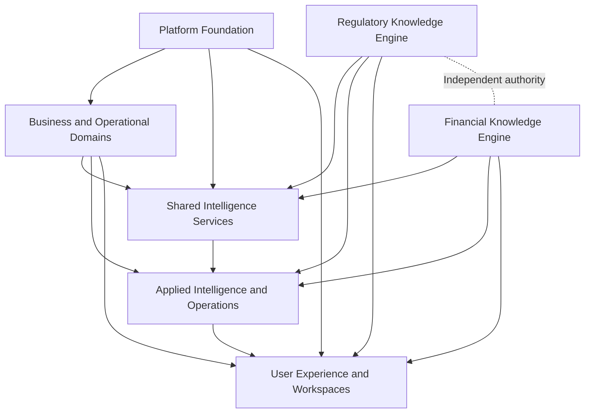
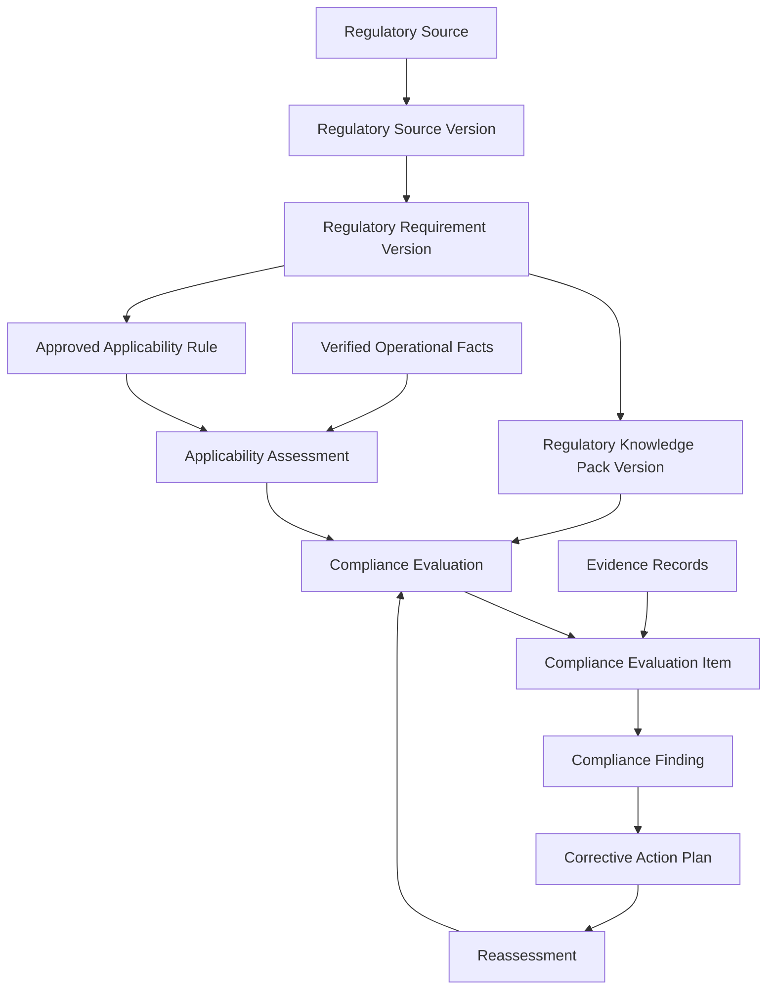
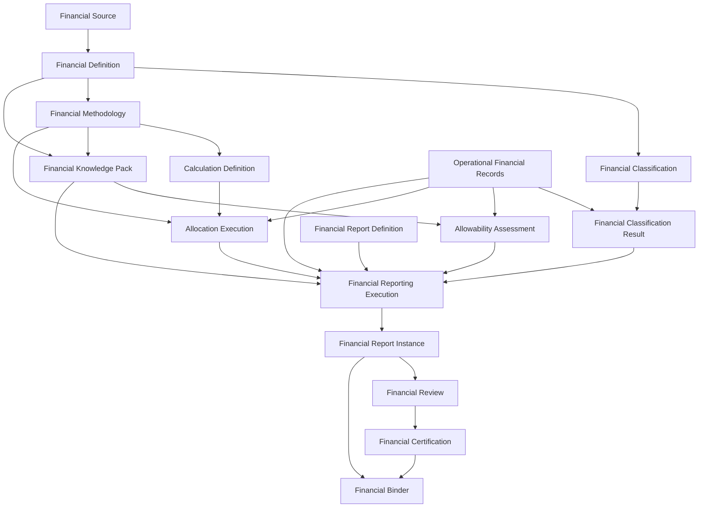
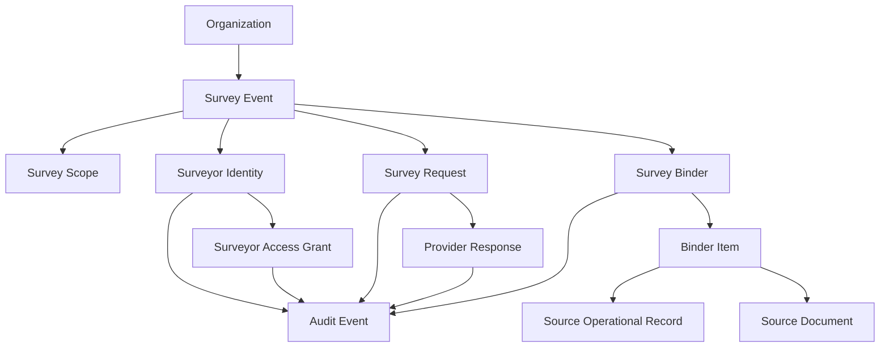

# Engineering Deliverable 04 — Entity Relationship Model

**Project:** Regulatory Intelligence Platform  
**Organization:** McCaskill Projects  
**Document ID:** ENG-004  
**Version:** 1.0  
**Status:** Draft — Engineering Blueprint  
**Implementation Authorization:** Not Granted  
**Predecessors:**
- ENG-001 — Master Workflow Catalog
- ENG-002 — Workflow Diagrams and State Machines
- ENG-003 — Master Entity Catalog

---

# 1. Purpose

This document defines the logical relationship model for the Regulatory Intelligence Platform.

It translates the Master Entity Catalog into a structured relationship architecture that establishes:

- How platform entities relate to one another.
- Which domain owns each relationship.
- How tenant and organizational boundaries are enforced.
- How the two knowledge authorities remain independent.
- How operational records connect to regulatory and financial intelligence.
- How evidence, validation, approval, audit, and binder services interact.
- How historical versions and decisions remain reproducible.
- How cross-domain references are managed without transferring ownership.

This is a logical data model. It is not yet a physical PostgreSQL schema or an implementation specification.

# 2. Foundational Relationship Principles

The following principles govern all relationships in this document.

## 2.1 Single Domain Ownership

Every entity has one owning domain.

Relationships do not transfer ownership.

For example:

- Residential Operations owns FireDrill.
- Regulatory Knowledge Engine owns RegulatoryRequirement.
- Financial Knowledge Engine owns FinancialMethodology.
- Shared Intelligence Services owns EvidenceRecord.
- Compliance Intelligence owns ComplianceFinding.

A compliance evaluation may reference a FireDrill and a RegulatoryRequirement, but it does not own either.

## 2.2 Independent Knowledge Authorities

The platform has two independent knowledge authorities:

**Regulatory Knowledge Engine**
- Owns regulatory sources.
- Owns regulatory requirements.
- Owns regulatory interpretations.
- Owns regulatory applicability.
- Owns regulatory knowledge packs.

**Financial Knowledge Engine**
- Owns financial sources.
- Owns financial definitions.
- Owns financial classifications.
- Owns financial methodologies.
- Owns financial calculations.
- Owns financial reporting definitions.
- Owns financial applicability.

Neither authority may establish the authority of the other.

## 2.3 Operational Facts Remain in Operational Domains

Operational domains record what actually happened.

Examples:

- A fire drill occurred.
- An employee completed training.
- An individual received a service.
- A transaction was recorded.
- A payment was made.
- A service statistic was recorded.

Knowledge authorities define how those facts must be interpreted or evaluated.

## 2.4 Cross-Domain Relationships

Cross-domain relationships must use explicit references and defined contracts.

A domain may consume an authorized reference to another domain's entity, but it must not directly control that entity's lifecycle.

## 2.5 Historical Reproducibility

A historical evaluation, calculation, report, or certification must preserve the exact versions of the source records and knowledge definitions used at execution time.

A new version must not silently rewrite a historical result.

---

# 3. Relationship Notation and Cardinality

The following notation is used throughout this document.

| Notation | Meaning |
|---|---|
| 1:1 | One record relates to one record |
| 1:N | One record may relate to many records |
| M:N | Multiple records may relate to multiple records |
| 0..1 | Optional single relationship |
| 1..1 | Required single relationship |
| 0..N | Optional multiple relationship |
| 1..N | One or more related records |

Relationships must be validated against lifecycle and business rules before being converted into database constraints.

# 4. Platform Foundation Relationship Model

**Owner: DOM-01 — Platform Foundation**

## 4.1 Tenant and Organization Relationships

| Parent | Relationship | Child | Cardinality |
|---|---|---|---|
| PlatformTenant | governs | Organization | 1:N |
| PlatformTenant | configures | TenantConfiguration | 1:N |
| Organization | has | OrganizationRegistration | 1:N |
| Organization | has | OrganizationContact | 1:N |
| Organization | participates in | OrganizationRelationship | 1:N |
| Organization | operates | BusinessLocation | 1:N |
| Organization | owns | BusinessUnit | 1:N |

### Relationship Rules

1. A tenant may contain multiple organizations.
2. An organization must belong to an authorized tenant context.
3. Organization relationships must not bypass tenant isolation.
4. Organization records must retain their own identity independently of user accounts.
5. A tenant's configuration cannot override platform security or authority requirements.

## 4.2 Identity Relationships

| Parent | Relationship | Child | Cardinality |
|---|---|---|---|
| UserAccount | has | UserProfile | 1:0..1 |
| UserAccount | has | AuthenticationSession | 1:N |
| UserAccount | has | AuthenticationCredential | 1:N |
| UserAccount | enrolls in | MultiFactorAuthentication | 1:N |
| UserAccount | links to | ExternalIdentity | 1:N |
| UserAccount | may initiate | AccountRecoveryRequest | 1:N |
| UserAccount | generates | SecurityEvent | 1:N |

## 4.3 Authorization Relationships

| Parent | Relationship | Child | Cardinality |
|---|---|---|---|
| Role | includes | RolePermission | 1:N |
| Permission | appears in | RolePermission | 1:N |
| UserAccount | receives | UserRoleAssignment | 1:N |
| Role | assigned through | UserRoleAssignment | 1:N |
| UserAccount | receives | AccessAssignment | 1:N |
| AccessPolicy | governs | AccessAssignment | 1:N |
| AccessAssignment | may produce | AccessRevocation | 1:0..N |

### Authorization Rules

1. Role membership does not automatically grant access outside its assigned scope.
2. Authorization must evaluate tenant, organization, resource, record, and applicable scope.
3. Access revocation must invalidate future access.
4. Sensitive access decisions must be auditable.
5. External surveyor access must be independently scoped and time-limited.
6. The existing security implementation is the designated foundation for this architecture.

# 5. Business and Operational Relationship Model

**Owner: DOM-02 — Business and Operational Domains**

## 5.1 Organization and Location

| Parent | Relationship | Child | Cardinality |
|---|---|---|---|
| Organization | operates | BusinessLocation | 1:N |
| BusinessLocation | belongs to | BusinessUnit | 0..N:0..1 |
| BusinessLocation | has | LocationRelationship | 1:N |
| Organization | offers | ServiceDefinition | 1:N |
| ServiceDefinition | assigned through | ServiceAssignment | 1:N |
| BusinessLocation | receives service through | ServiceAssignment | 1:N |
| Organization | maintains | Contract | 1:N |
| Contract | contains | ContractService | 1:N |
| ServiceDefinition | referenced by | ContractService | 1:N |
| Contract | has | ContractAmendment | 1:N |
| Contract | includes | ContractParty | 1:N |

The physical model must distinguish the identity of an organization, the location where work occurs, and the service being delivered.

## 5.2 Person Relationships

| Parent | Relationship | Child | Cardinality |
|---|---|---|---|
| Person | has | PersonIdentifier | 1:N |
| Person | has | PersonContact | 1:N |
| Person | has | PersonRelationship | 1:N |
| Person | has | PersonLegalRepresentative | 1:N |
| Person | has | PersonAuthorization | 1:N |
| Person | has | PersonPlan | 1:N |
| PersonPlan | preserves | PersonPlanVersion | 1:N |
| Person | has | PersonPreference | 1:N |
| Person | has | PersonSupportNeed | 1:N |
| Person | has | PersonOutcome | 1:N |

### Person Data Rules

- Person identity must be independent of service enrollment.
- A person may participate in multiple operational programs where authorized.
- Historical plans must preserve their versions.
- Access to sensitive person records must be restricted.
- A person record must not be duplicated merely because a different operational domain references the person.

## 5.3 Workforce Relationships

| Parent | Relationship | Child | Cardinality |
|---|---|---|---|
| Organization | employs or engages | Employee | 1:N |
| Employee | has | EmployeeProfile | 1:0..1 |
| Employee | has | EmploymentRelationship | 1:N |
| Position | assigned through | EmployeeAssignment | 1:N |
| Employee | receives | EmployeeAssignment | 1:N |
| Employee | holds | EmployeeQualification | 1:N |
| Qualification | referenced by | EmployeeQualification | 1:N |
| Employee | completes | TrainingCompletion | 1:N |
| TrainingDefinition | completed through | TrainingCompletion | 1:N |
| Employee | participates in | CompetencyAssessment | 1:N |
| Employee | assigned to | StaffSchedule | 1:N |
| Employee | records | StaffAttendance | 1:N |

Training definitions and qualifications may be used by multiple programs. Regulatory requirements governing them remain owned by the Regulatory Knowledge Engine.

# 6. Residential Operations Relationships

**Owner: Residential Operations within DOM-02**

| Parent | Relationship | Child | Cardinality |
|---|---|---|---|
| Organization | operates | ResidentialLocation | 1:N |
| ResidentialLocation | has | ResidentialOccupancy | 1:N |
| Person | participates through | ResidentialOccupancy | 1:N |
| Person | has | ResidentialAssignment | 1:N |
| ResidentialLocation | has | ResidentialAssignment | 1:N |
| ResidentialLocation | receives | ResidentialSafetyInspection | 1:N |
| ResidentialLocation | records | EnvironmentalMonitoringRecord | 1:N |
| ResidentialLocation | conducts | FireDrill | 1:N |
| ResidentialLocation | maintains | EmergencyPlan | 1:N |
| EmergencyPlan | preserves | EmergencyPlanVersion | 1:N |
| ResidentialLocation | records | EmergencyEvent | 1:N |
| EmergencyEvent | generates | EmergencyResponseRecord | 1:N |
| ResidentialLocation | contains | SafetyEquipment | 1:N |
| SafetyEquipment | receives | EquipmentInspection | 1:N |
| ResidentialLocation | receives | MaintenanceRecord | 1:N |
| EquipmentInspection | may generate | CorrectiveMaintenanceAction | 1:N |

### Residential Relationship Rules

1. Residential operational records belong to Residential Operations.
2. Regulatory requirements are referenced, not copied into residential entities as independent authority.
3. A FireDrill record must represent an actual event.
4. EmergencyPlan versions must preserve historical state.
5. Inspections and monitoring records must retain their source and execution dates.
6. A corrective maintenance action must reference the relevant inspection or identified issue when applicable.

# 7. ISS Operations Relationships

**Owner: ISS Operations within DOM-02**

ISS Operations is independent of Residential Operations.

| Parent | Relationship | Child | Cardinality |
|---|---|---|---|
| Organization | operates | ISSServiceProgram | 1:N |
| Person | participates through | ISSParticipant | 1:N |
| ISSServiceProgram | includes | ISSParticipant | 1:N |
| ISSParticipant | has | ISSEnrollment | 1:N |
| ISSParticipant | develops | ISSIndividualizedGoal | 1:N |
| ISSIndividualizedGoal | contains | ISSGoalObjective | 1:N |
| ISSGoalTemplate | may inform creation of | ISSIndividualizedGoal | 1:N |
| ISSActivityDefinition | used in | ISSActivitySession | 1:N |
| ISSParticipant | participates in | ISSActivitySession | 1:N |
| ISSParticipant | receives | ISSServiceDeliveryRecord | 1:N |
| ISSActivitySession | may support | ISSGoalObjective | M:N |
| ISSParticipant | receives | ISSSupportObservation | 1:N |
| ISSGoalObjective | receives progress evidence through | ISSProgressRecord | 1:N |
| ISSActivitySession | occurs at | ISSCommunityLocation | N:0..1 |
| Employee | assigned through | ISSStaffAssignment | 1:N |
| ISSParticipant | reviewed through | ISSReviewRecord | 1:N |

### ISS Relationship Rules

1. A participant may have multiple individualized goals.
2. Each individualized goal may have multiple measurable objectives.
3. A goal template may inform many individualized goals, but does not own them.
4. An activity may support multiple objectives.
5. A planned activity must not automatically generate a service-delivery record.
6. A service-delivery record must represent actual service delivery.
7. Support observations must be distinguishable from activity plans.
8. Progress records must reference the objective being measured.
9. Regulatory applicability is determined by the Regulatory Knowledge Engine.
10. Customer-specific templates cannot override regulatory requirements.

# 8. Financial Operations Relationships

**Owner: Financial Operations within DOM-02**

| Parent | Relationship | Child | Cardinality |
|---|---|---|---|
| Organization | maintains | FinancialAccount | 1:N |
| FinancialAccount | records | FinancialTransaction | 1:N |
| FinancialTransaction | contains | FinancialTransactionLine | 1:N |
| FinancialTransaction | supported by | FinancialDocument | 1:N |
| Organization | maintains | FinancialPeriod | 1:N |
| FinancialPeriod | contains | FinancialTransaction | 1:N |
| Organization | maintains | Budget | 1:N |
| Budget | contains | BudgetLine | 1:N |
| Employee | associated with | PayrollRecord | 1:N |
| PayrollRecord | contains | PayrollLine | 1:N |
| Vendor | issues | VendorInvoice | 1:N |
| VendorInvoice | may result in | PaymentRecord | 1:N |
| FinancialTransaction | may generate | CostAllocationRecord | 1:N |
| ServiceDefinition | measured through | ServiceStatistic | 1:N |
| Organization | records | RevenueRecord | 1:N |

### Financial Operations Rules

1. Financial transactions represent operational financial facts.
2. Financial classifications reference Financial Knowledge Engine definitions.
3. Operational allocation records do not become authoritative allocation methodologies.
4. Payroll and vendor records must retain source references.
5. Reporting calculations must reference approved financial methodology versions.
6. Historical financial results must preserve the source transaction versions used.

# 9. Regulatory Knowledge Engine Relationships

**Owner: DOM-03 — Regulatory Knowledge Engine**

## 9.1 Jurisdiction and Source Relationships

| Parent | Relationship | Child | Cardinality |
|---|---|---|---|
| RegulatoryJurisdiction | contains | RegulatoryAuthority | 1:N |
| RegulatoryAuthority | governs or issues | RegulatoryProgram | 1:N |
| RegulatoryAuthority | issues | RegulatoryInstrument | 1:N |
| RegulatoryFramework | organizes | RegulatoryInstrument | 1:N |
| RegulatoryInstrument | published through | RegulatorySource | 1:N |
| RegulatorySource | preserves | RegulatorySourceVersion | 1:N |
| RegulatorySourceVersion | contains | RegulatorySourceLocation | 1:N |
| RegulatorySourceVersion | supports | RegulatoryCitation | 1:N |

## 9.2 Requirement Relationships

| Parent | Relationship | Child | Cardinality |
|---|---|---|---|
| RegulatoryInstrument | establishes | RegulatoryRequirement | 1:N |
| RegulatoryRequirement | preserves | RegulatoryRequirementVersion | 1:N |
| RegulatoryRequirementVersion | contains | RequirementComponent | 1:N |
| RegulatoryRequirementVersion | has | RequirementCondition | 1:N |
| RegulatoryRequirementVersion | has | RequirementException | 1:N |
| RegulatoryRequirementVersion | defines | RequirementEvidenceDefinition | 1:N |
| RegulatoryRequirementVersion | governed by | RequirementEvaluationDefinition | 1:N |
| RegulatoryRequirementVersion | supported by | RegulatoryCitation | M:N |
| RegulatoryRequirementVersion | relates to | RequirementDependency | M:N |

## 9.3 Interpretation and Governance Relationships

| Parent | Relationship | Child | Cardinality |
|---|---|---|---|
| RegulatoryRequirement | interpreted through | RegulatoryInterpretation | 1:N |
| RegulatoryInterpretation | preserves | InterpretationVersion | 1:N |
| InterpretationVersion | supported by | InterpretationSource | 1:N |
| RegulatoryIssue | may concern | RegulatoryRequirement | N:0..1 |
| RegulatoryReview | reviews | RegulatoryKnowledgePackVersion | N:1 |
| RegulatoryApproval | approves | RegulatoryKnowledgePackVersion | N:1 |
| RegulatoryChange | affects | RegulatorySourceVersion | N:1 |
| RegulatoryChange | assessed through | RegulatoryImpactAssessment | 1:N |
| RegulatoryRequirementVersion | may supersede | RegulatoryRequirementVersion | 0..1:0..1 |

## 9.4 Knowledge Pack Relationships

| Parent | Relationship | Child | Cardinality |
|---|---|---|---|
| RegulatoryKnowledgePack | preserves | RegulatoryKnowledgePackVersion | 1:N |
| RegulatoryKnowledgePackVersion | includes | KnowledgePackRequirement | 1:N |
| RegulatoryRequirementVersion | included through | KnowledgePackRequirement | 1:N |
| RegulatoryKnowledgePackVersion | has | KnowledgePackDependency | 1:N |
| RegulatoryKnowledgePackVersion | receives | KnowledgePackValidation | 1:N |
| RegulatoryKnowledgePackVersion | receives | KnowledgePackRelease | 1:N |
| RegulatoryKnowledgePackVersion | defines | KnowledgePackApplicability | 1:N |

### Regulatory Authority Rules

1. Regulatory source versions must be preserved.
2. Approved requirement versions must not be silently overwritten.
3. Knowledge pack versions must reference exact requirement versions.
4. A published pack must retain its source and approval history.
5. Requirement applicability must reference the applicable requirement version.
6. An interpretation must preserve its supporting citations.
7. Regulatory evaluations must reference the pack version used.

# 10. Financial Knowledge Engine Relationships

**Owner: DOM-04 — Financial Knowledge Engine**

## 10.1 Financial Source Relationships

| Parent | Relationship | Child | Cardinality |
|---|---|---|---|
| FinancialJurisdiction | contains | FinancialAuthority | 1:N |
| FinancialAuthority | establishes | FinancialFramework | 1:N |
| FinancialAuthority | issues | FinancialInstrument | 1:N |
| FinancialInstrument | published through | FinancialSource | 1:N |
| FinancialSource | preserves | FinancialSourceVersion | 1:N |
| FinancialSourceVersion | supports | FinancialCitation | 1:N |

## 10.2 Definitions and Methodologies

| Parent | Relationship | Child | Cardinality |
|---|---|---|---|
| FinancialFramework | organizes | FinancialDefinition | 1:N |
| FinancialDefinition | preserves | FinancialDefinitionVersion | 1:N |
| FinancialDefinitionVersion | supports | FinancialClassificationVersion | M:N |
| FinancialClassification | preserves | FinancialClassificationVersion | 1:N |
| FinancialClassificationVersion | includes | FinancialCategory | 1:N |
| FinancialFramework | defines | CostCategory | 1:N |
| FinancialFramework | defines | CostPrinciple | 1:N |
| FinancialFramework | defines | AllowabilityDefinition | 1:N |
| FinancialMethodology | preserves | FinancialMethodologyVersion | 1:N |
| FinancialMethodologyVersion | defines | AllocationMethodVersion | 1:N |
| CalculationDefinition | preserves | CalculationVersion | 1:N |
| CalculationVersion | defines | CalculationParameter | 1:N |
| FinancialRate | preserves | FinancialRateVersion | 1:N |
| ReimbursementDefinition | defines | ReimbursementRate | 1:N |

## 10.3 Financial Reporting Knowledge

| Parent | Relationship | Child | Cardinality |
|---|---|---|---|
| FinancialReportDefinition | preserves | FinancialReportVersion | 1:N |
| FinancialReportVersion | contains | FinancialReportLine | 1:N |
| FinancialReportLine | receives mapping through | FinancialReportMapping | 1:N |
| FinancialReportVersion | defines | FinancialReportingSchedule | 1:N |
| FinancialReportVersion | governed by | FinancialReportingRule | 1:N |
| FinancialReportingRule | evaluated through | FinancialValidationDefinition | 1:N |
| FinancialReportVersion | may use | FinancialReconciliationDefinition | 1:N |

## 10.4 Financial Knowledge Pack Relationships

| Parent | Relationship | Child | Cardinality |
|---|---|---|---|
| FinancialKnowledgePack | preserves | FinancialKnowledgePackVersion | 1:N |
| FinancialKnowledgePackVersion | includes | FinancialPackDefinition | 1:N |
| FinancialKnowledgePackVersion | includes | FinancialPackMethodology | 1:N |
| FinancialKnowledgePackVersion | receives | FinancialPackValidation | 1:N |
| FinancialKnowledgePackVersion | receives | FinancialPackApproval | 1:N |
| FinancialKnowledgePackVersion | defines | FinancialApplicabilityAssessment | 1:N |

### Financial Authority Rules

1. Financial source versions must be preserved.
2. Financial definition versions must be immutable after publication.
3. Financial methodologies must have explicit effective dates and version references.
4. Calculation executions must preserve their calculation version and inputs.
5. Reporting line definitions must preserve the exact report version.
6. Financial applicability must be established by the Financial Knowledge Engine.
7. Financial reporting must preserve all applicable source and methodology references.

# 11. Shared Intelligence Services Relationships

**Owner: DOM-05 — Shared Intelligence Services**

## 11.1 Evidence Relationships

| Parent | Relationship | Child | Cardinality |
|---|---|---|---|
| EvidenceRecord | preserves | EvidenceVersion | 1:N |
| EvidenceRecord | classified through | EvidenceClassification | 1:N |
| EvidenceRecord | verified through | EvidenceVerification | 1:N |
| EvidenceCollection | contains | EvidenceCollectionItem | 1:N |
| EvidenceRecord | included through | EvidenceCollectionItem | 1:N |
| EvidenceRequest | receives | EvidenceResponse | 1:N |
| EvidenceResponse | references | EvidenceRecord | 1:N |
| EvidenceRecord | linked through | EvidenceRelationship | 1:N |

Evidence may support both regulatory and financial processes without transferring ownership of the source record.

## 11.2 Document Relationships

| Parent | Relationship | Child | Cardinality |
|---|---|---|---|
| DocumentRecord | preserves | DocumentVersion | 1:N |
| DocumentRecord | has | DocumentMetadata | 1:N |
| DocumentRecord | has | DocumentClassification | 1:N |
| DocumentRecord | linked through | DocumentRelationship | 1:N |
| DocumentRecord | governed by | DocumentRetentionPolicy | N:1 |
| DocumentRecord | may receive | DocumentHold | 1:N |
| DocumentRecord | produces | DocumentAccessRecord | 1:N |

## 11.3 Validation Relationships

| Parent | Relationship | Child | Cardinality |
|---|---|---|---|
| ValidationExecution | produces | ValidationResult | 1:N |
| ValidationResult | may identify | ValidationIssue | 1:N |
| ValidationExecution | may receive | ValidationException | 1:N |
| ValidationResult | supported through | ValidationEvidenceLink | 1:N |
| ValidationDefinitionReference | governs | ValidationExecution | 1:N |

A ValidationDefinitionReference must identify its owning authority and exact approved definition version.

## 11.4 Change and Approval Relationships

| Parent | Relationship | Child | Cardinality |
|---|---|---|---|
| ChangeRecord | preserves | ChangeVersion | 1:N |
| ChangeRecord | assessed through | ChangeImpactAssessment | 1:N |
| ChangeRecord | receives | ChangeApproval | 1:N |
| ChangeRecord | implemented through | ChangeImplementationRecord | 1:N |
| ChangeRecord | preserves | ChangeHistory | 1:N |
| ApprovalDefinition | governs | ApprovalRequest | 1:N |
| ApprovalRequest | assigned through | ApprovalAssignment | 1:N |
| ApprovalRequest | receives | ApprovalDecision | 1:N |
| ApprovalRequest | requires | ApprovalCondition | 1:N |
| ApprovalRequest | preserves | ApprovalHistory | 1:N |

## 11.5 Audit and Traceability Relationships

| Parent | Relationship | Child | Cardinality |
|---|---|---|---|
| AuditEvent | contains | AuditEventDetail | 1:N |
| AuditEvent | correlated through | AuditCorrelation | 1:N |
| DecisionTrace | preserves | ProvenanceRecord | 1:N |
| DecisionTrace | may reference | HistoricalSnapshot | 1:N |
| ExecutionTrace | records | ValidationExecution | N:0..1 |

Audit records must preserve the actor, resource, action, outcome, and relevant correlation identifiers.

# 12. Binder Management Relationships

**Owner: DOM-05 — Shared Intelligence Services**

## 12.1 Binder Structure

| Parent | Relationship | Child | Cardinality |
|---|---|---|---|
| BinderDefinition | defines | BinderInstance | 1:N |
| BinderInstance | preserves | BinderVersion | 1:N |
| BinderVersion | contains | BinderSection | 1:N |
| BinderSection | contains | BinderItem | 1:N |
| BinderItem | preserves | BinderItemVersion | 1:N |
| BinderInstance | receives | BinderAccessAssignment | 1:N |
| BinderInstance | receives | BinderReview | 1:N |
| BinderInstance | receives | BinderApproval | 1:N |
| BinderInstance | receives | BinderRelease | 1:N |
| BinderInstance | receives | BinderClosure | 1:0..1 |
| BinderInstance | receives | BinderArchiveRecord | 1:0..1 |
| BinderInstance | may receive | BinderLegalHold | 1:N |

## 12.2 Binder-to-Source Relationships

A BinderItem references an authorized source object.

Examples include:

- Operational records.
- Documents.
- Evidence records.
- Compliance findings.
- Corrective action records.
- Financial reports.
- Financial certifications.
- Survey requests and responses.

### Binder Relationship Rules

1. BinderItem must preserve the source reference.
2. The source domain retains ownership.
3. Binder access does not automatically grant source access.
4. Binder versioning must preserve the exact included references.
5. Source record changes must not silently alter a previously released binder.
6. A released binder must retain its release history.
7. Legal holds must be respected independently of ordinary binder lifecycle.
8. Financial Binder and Survey Binder must remain separate first-class binder families.

# 13. Survey Workspace Relationships

**Ownership:** Platform Foundation, Shared Intelligence Services, and Applied Operations according to entity responsibility.

## 13.1 Survey Event Relationships

| Parent | Relationship | Child | Cardinality |
|---|---|---|---|
| Organization | participates in | SurveyEvent | 1:N |
| SurveyEvent | defines | SurveyScope | 1:N |
| SurveyEvent | assigns | SurveyAssignment | 1:N |
| SurveyorIdentity | receives | SurveyAssignment | 1:N |
| SurveyEvent | contains | SurveyRequest | 1:N |
| SurveyRequest | contains | SurveyRequestItem | 1:N |
| SurveyRequest | receives | SurveyResponse | 1:N |
| SurveyResponse | contains | SurveyResponseItem | 1:N |
| SurveyEvent | records | SurveyCommunication | 1:N |
| SurveyEvent | records | SurveyReviewNote | 1:N |
| SurveyEvent | records | SurveyActivityRecord | 1:N |
| SurveyEvent | creates | SurveySession | 1:N |
| SurveyorIdentity | receives | SurveyorAccessGrant | 1:N |
| SurveyorAccessGrant | may receive | SurveyorAccessRevocation | 1:0..N |
| SurveyorIdentity | enrolls in | SurveyorMFAEnrollment | 1:N |

## 13.2 Survey Binder Relationships

A survey event may reference multiple binder instances.

Examples:

- Provider Survey Binder.
- Residential Survey Binder.
- ISS Survey Binder.
- Personnel Survey Binder.

The survey event does not merge these binders into a single source of authority.

### Survey Security Rules

1. SurveyorIdentity is separate from Employee.
2. SurveyorAccessGrant must identify the event and authorized scope.
3. Surveyor access must expire or be revoked.
4. Surveyor access must be checked at the backend for every protected resource.
5. Document viewing and downloading must be auditable.
6. A SurveyorAccessGrant does not automatically grant access to all records in a binder.
7. Survey requests and provider responses must preserve their communication history.

# 14. Applied Intelligence Relationships

**Owner: DOM-06 — Applied Intelligence and Operations**

## 14.1 Compliance Intelligence

| Parent | Relationship | Child | Cardinality |
|---|---|---|---|
| ComplianceEvaluation | produces | ComplianceEvaluationItem | 1:N |
| ComplianceEvaluationItem | references | RegulatoryRequirementVersion | N:1 |
| ComplianceEvaluationItem | references | RegulatoryKnowledgePackVersion | N:1 |
| ComplianceEvaluationItem | references | ValidationExecution | 0..1:1 |
| ComplianceEvaluationItem | supported by | EvidenceRecord | M:N |
| ComplianceEvaluation | may produce | ComplianceFinding | 1:N |
| ComplianceFinding | assigned through | FindingAssignment | 1:N |
| ComplianceFinding | addressed through | CorrectiveActionPlan | 1:N |
| CorrectiveActionPlan | contains | CorrectiveAction | 1:N |
| CorrectiveAction | supported by | CorrectiveActionEvidence | 1:N |
| ComplianceFinding | reassessed through | ComplianceReassessment | 1:N |
| ComplianceFinding | preserves | ComplianceStatusHistory | 1:N |

### Compliance Rules

- ComplianceEvaluation references approved regulatory knowledge.
- ComplianceEvaluation does not own regulatory requirements.
- ComplianceFinding records an evaluation outcome.
- CorrectiveActionPlan addresses findings but cannot change the underlying requirement.
- Reassessment creates a new traceable evaluation.
- Historical findings remain linked to the requirement version used at the time.

## 14.2 Financial Intelligence

| Parent | Relationship | Child | Cardinality |
|---|---|---|---|
| FinancialAnalysis | contains | FinancialAnalysisItem | 1:N |
| FinancialAnalysisItem | references | FinancialTransaction | N:1 |
| FinancialAnalysisItem | produces | FinancialClassificationResult | 1:N |
| FinancialClassificationResult | references | FinancialClassificationVersion | N:1 |
| FinancialAnalysisItem | receives | FinancialAllowabilityAssessment | 1:N |
| FinancialAllowabilityAssessment | references | AllowabilityDefinition | N:1 |
| FinancialAllocationExecution | references | FinancialMethodologyVersion | N:1 |
| FinancialAllocationExecution | uses | FinancialTransaction | M:N |
| FinancialReportingExecution | references | FinancialReportVersion | N:1 |
| FinancialReportingExecution | produces | FinancialReportInstance | 1:1 |
| FinancialReportInstance | contains | FinancialReportLineResult | 1:N |
| FinancialReportLineResult | references | FinancialReportLine | N:1 |
| FinancialReconciliation | contains | FinancialReconciliationItem | 1:N |
| FinancialReportInstance | receives | FinancialReview | 1:N |
| FinancialReportInstance | may receive | FinancialCertification | 1:N |
| FinancialReportInstance | may be included in | FinancialBinderInstance | M:N |

### Financial Rules

1. Financial analysis references operational financial facts.
2. Financial classification references approved definition versions.
3. Allowability assessments reference approved allowability definitions.
4. Allocation executions reference approved methodology versions.
5. Report executions reference exact report definitions.
6. Report line results preserve their input and calculation trace.
7. Certification records are distinct from report generation.
8. Financial Binder references source financial records and reports without taking ownership.

# 15. Reporting and Executive Intelligence Relationships

| Parent | Relationship | Child | Cardinality |
|---|---|---|---|
| ReportDefinition | produces | ReportExecution | 1:N |
| ReportExecution | produces | ReportInstance | 1:1 |
| ReportInstance | receives | ReportApproval | 1:N |
| ReportInstance | receives | ReportRelease | 1:0..1 |
| ManagementIndicator | records | IndicatorValue | 1:N |
| DashboardDefinition | produces | DashboardSnapshot | 1:N |
| DashboardDefinition | configures | DashboardLayout | 1:N |

Management reporting may reference both regulatory and financial outputs, but must preserve their separate authority and approval references.

A management indicator must not be presented as an official regulatory or financial determination unless the appropriate authority and approval requirements have been satisfied.

# 16. User Experience and Workspace Relationships

**Owner: DOM-07 — User Experience and Workspaces**

| Parent | Relationship | Child | Cardinality |
|---|---|---|---|
| WorkspaceDefinition | creates | WorkspaceInstance | 1:N |
| WorkspaceInstance | assigned through | WorkspaceAssignment | 1:N |
| UserAccount | receives | WorkspaceAssignment | 1:N |
| UserAccount | maintains | WorkspacePreference | 1:N |
| WorkspaceInstance | uses | NavigationDefinition | 1:N |
| DashboardDefinition | uses | DashboardLayout | 1:N |
| UserAccount | maintains | SavedView | 1:N |
| WorkQueue | contains | WorkQueueItem | 1:N |
| UserAccount | may receive | WorkQueueItem | 1:N |

Workspace relationships must not transfer ownership of operational, financial, or regulatory records.

# 17. Cross-Domain Applicability Relationship Model

Applicability is a controlled relationship between authoritative knowledge and verified operational facts.

## 17.1 Regulatory Applicability Flow

1. Regulatory Knowledge Engine owns RegulatoryApplicabilityRule.
2. An operational domain supplies relevant verified facts.
3. The shared Applicability Contract executes the approved definition.
4. RegulatoryApplicabilityAssessment records the result.
5. RegulatoryApplicabilityEvidence preserves the supporting facts.
6. Compliance Intelligence consumes the assessment.

The result must preserve:

- Requirement version.
- Regulatory pack version.
- Applicability rule version.
- Subject reference.
- Input facts.
- Evidence references.
- Effective date.
- Execution date.
- Result.
- Traceability reference.

## 17.2 Financial Applicability Flow

1. Financial Knowledge Engine owns the financial applicability definition.
2. Financial Operations supplies verified financial facts.
3. The shared Applicability Contract executes the approved definition.
4. FinancialApplicabilityAssessment records the result.
5. Financial Intelligence consumes the result.

The result must preserve:

- Financial definition or rule version.
- Financial pack version.
- Subject reference.
- Input facts.
- Effective date.
- Execution date.
- Result.
- Traceability reference.

## 17.3 Prohibited Cross-Authority Determinations

- Regulatory Knowledge cannot declare financial allowability.
- Financial Knowledge cannot declare regulatory compliance.
- Operational domains cannot declare compliance or allowability.
- AI cannot establish an authoritative determination.
- Missing facts cannot be silently replaced with assumptions.

# 18. Shared Identity and Security Continuity

The platform will retain the existing security foundation wherever it satisfies the approved architecture.

The relationship model must accommodate existing identity and authorization capabilities rather than create unnecessary duplicates.

## 18.1 Existing Security Capabilities to Preserve

- User accounts.
- Authentication.
- JWT-based sessions where applicable.
- Roles.
- Permissions.
- Role-permission relationships.
- User-role assignments.
- Authorization services.
- Authorization guards.
- Existing security controls.

## 18.2 Required Extensions

The architecture must support any missing capabilities needed for:

- Tenant and organization-scoped authorization.
- Record-level authorization.
- Location and program scope.
- External surveyor identity.
- Surveyor MFA.
- Event-specific access grants.
- Time-limited access.
- Access revocation.
- Document-level authorization.
- Security audit and traceability.

## 18.3 No Duplicate Identity Systems

The platform must not create a second general identity or authorization system.

External surveyor identity is a distinct user population and access context, not a replacement identity architecture.

The implementation mapping will determine which existing entities and services can be retained, extended, or replaced based on verified gaps.

# 19. Tenant and Organization Isolation

Tenant isolation is a foundational relationship constraint.

## 19.1 Tenant-Owned Records

Tenant-owned business and operational records must be associated with the appropriate tenant context.

Examples include:

- Organizations.
- Locations.
- People.
- Employees.
- Operational records.
- Financial records.
- Reports.
- Binders.
- Workspace instances.

## 19.2 Shared Authority Records

Regulatory and financial knowledge packs are centrally governed authority records.

They may be made available to multiple tenants according to their approved applicability and access policy.

A tenant must not be able to modify centrally governed authority records through ordinary customer operations.

## 19.3 Cross-Tenant Restrictions

The platform must prevent:

- Direct cross-tenant record access.
- Cross-tenant binder references without authorized platform governance.
- Cross-tenant document access.
- Cross-tenant workspace assignment.
- Cross-tenant report exposure.
- Cross-tenant evidence exposure.

Tenant isolation must be enforced at the backend and data access boundaries, not merely through frontend filtering.

# 20. Primary Keys and Relationship Integrity

The final physical data model must define a consistent key strategy.

## 20.1 Entity Identity

Each independently managed entity must have a stable unique identifier.

The implementation may use UUID identifiers where appropriate, consistent with the existing platform's established database conventions.

## 20.2 Foreign Keys

Within a domain-owned relational model, ordinary foreign-key constraints should enforce valid relationships where appropriate.

Cross-domain relationships must use explicit contracts and authorized references.

The physical design must not create circular schema ownership merely to enforce a cross-domain relationship.

## 20.3 Composite Constraints

Where applicable, constraints must protect:

- Tenant-scoped uniqueness.
- Organization-scoped uniqueness.
- Version uniqueness within an authority.
- Binder item uniqueness within a binder version.
- Assignment uniqueness within its effective period.
- Report line uniqueness within a report version.
- Knowledge pack membership uniqueness.

## 20.4 Relationship Integrity

The implementation must prevent:

- Orphaned authoritative versions.
- Unauthorized cross-tenant references.
- Invalid lifecycle transitions.
- Duplicate active assignments where prohibited.
- References to nonexistent source versions.
- Release of incomplete or unapproved artifacts.

# 21. Deletion, Retention, and Legal Holds

The platform must distinguish between ordinary business updates and legally significant record retention.

## 21.1 Deletion Principles

1. Published knowledge versions must not be physically deleted through ordinary user operations.
2. Historical evaluation and calculation records must be preserved.
3. Audit records must not be silently deleted.
4. Released binders must preserve their release history.
5. Source records must follow their own retention policy.
6. A binder cannot shorten the retention period of its source records.

## 21.2 Legal Holds

Legal holds may apply to:

- Source documents.
- Operational records.
- Financial records.
- Evidence records.
- Binder instances.
- Historical reports.

A hold on a binder does not automatically replace the hold policy for every source record, and vice versa.

# 22. Historical Version and Snapshot Relationships

The platform must distinguish between an entity's current state and the state used in a historical execution.

## 22.1 Authority Versions

Regulatory and financial authority records must use immutable published versions.

## 22.2 Operational Record Versions

Operational records must preserve historical state where their changes affect an evaluation, report, or decision.

## 22.3 Execution Snapshots

Important executions must capture the versions and inputs used at execution time.

Examples:

- Compliance evaluations.
- Financial calculations.
- Financial report executions.
- Applicability assessments.
- Validation executions.
- Binder releases.
- Certifications.

## 22.4 Reproducibility Rule

A historical execution must remain explainable using its original:

- Source records.
- Knowledge versions.
- Applicability results.
- Calculation definitions.
- Evidence references.
- Validation definitions.
- Approval decisions.

A later execution may produce a different result because knowledge or source facts have changed. That does not alter the historical result.

# 23. Logical Domain Relationship Diagram

The diagram represents logical relationships and data flow. It does not require separate microservices or databases.

# 24. Regulatory Evaluation Relationship Diagram

# 25. Financial Reporting Relationship Diagram

# 26. Binder and Survey Relationship Diagram

# 27. Domain Ownership and Dependency Matrix

| Domain | Owns | May Reference | Must Not Own |
|---|---|---|---|
| Platform Foundation | Identity, tenancy, authorization | All authorized domains | Regulatory or financial requirements |
| Business and Operational Domains | Business facts and operational records | Knowledge and shared services | Compliance or financial authority |
| Regulatory Knowledge Engine | Regulatory authority and applicability | Operational facts through approved contracts | Financial authority |
| Financial Knowledge Engine | Financial authority and applicability | Operational financial facts | Regulatory authority |
| Shared Intelligence Services | Evidence, validation execution, audit, approval, binders | All authorized domains | Regulatory or financial definitions |
| Applied Intelligence | Evaluations, findings, calculations, reports | All authorized authorities and operational records | Source authority records |
| User Experience and Workspaces | Workspace configuration and preferences | Authorized platform records | Business or knowledge records |

# 28. Nx Domain Boundary Implications

The logical relationship model must be reflected in Nx project boundaries.

1. Domain ownership determines which library owns an entity.
2. Domain ownership determines which services may create or modify that entity.
3. Cross-domain relationships must be represented through approved contracts.
4. Shared services must not import private domain implementation details.
5. Applied Intelligence must consume domain contracts rather than directly control domain persistence.
6. Frontend workspaces must consume approved data-access and domain interfaces.
7. Circular dependencies must be prohibited.
8. CI must enforce dependency constraints.
9. Nx Console must provide a clear visual representation of the project graph and ownership boundaries.

Exact project names, tags, and dependency rules are defined in ENG-005.

# 29. Physical Database Design — Deferred Decisions

The following items require separate engineering decisions before implementation:

- PostgreSQL schema-per-domain versus shared schema with domain ownership.
- Physical foreign-key strategy across logical domain boundaries.
- UUID and composite key conventions.
- Tenant isolation implementation.
- Database indexing and partitioning.
- Version storage strategy.
- Document and evidence storage references.
- Transaction boundaries.
- Event persistence and delivery guarantees.
- Soft deletion versus controlled archival.
- Retention and legal hold implementation.
- Historical snapshot storage.

These decisions must align with the existing PostgreSQL and TypeORM environment. They must not introduce unnecessary infrastructure redesign.

# 30. Relationship Model Acceptance Criteria

ENG-004 is ready for formal approval when:

- [ ] Every entity has a single owning domain.
- [ ] Tenant and organization relationships are defined.
- [ ] Identity and authorization relationships are defined.
- [ ] Existing security capabilities are preserved as the foundation.
- [ ] Residential Operations relationships are defined.
- [ ] ISS Operations relationships are defined independently.
- [ ] Financial Operations is separate from Financial Knowledge.
- [ ] Regulatory and Financial Knowledge Engines remain independent.
- [ ] Knowledge version relationships are defined.
- [ ] Regulatory and financial applicability remain independently governed.
- [ ] Evidence and validation relationships are defined.
- [ ] Compliance and Financial Intelligence relationships are defined.
- [ ] Binder relationships preserve source ownership.
- [ ] Surveyor identity and scoped access are defined.
- [ ] Historical reproducibility is supported.
- [ ] Retention and legal hold relationships are established.
- [ ] Cross-domain references have explicit boundaries.
- [ ] No existing repository structure has dictated the new logical model.
- [ ] The model is ready to inform Nx architecture and physical data design.

# 31. Implementation Authorization

This document is an engineering design artifact only.

Approval does not authorize:

- Database schema creation.
- TypeORM entity creation.
- Migrations.
- NestJS service implementation.
- API implementation.
- Frontend implementation.
- Changes to existing security components.
- Changes to existing application modules.

The physical implementation must be planned through the approved engineering blueprint and sprint packages.

Existing security infrastructure is to be preserved and evaluated for extensions. Existing operational code will be compared against the new approved design only after the architecture and engineering blueprint are complete.

# 32. Document Control

| Field | Value |
|---|---|
| Document ID | ENG-004 |
| Document Name | Entity Relationship Model |
| Version | 1.0 |
| Status | Draft |
| Owner | McCaskill Projects |
| Architecture Authority | Regulatory Intelligence Platform |
| Implementation Authorization | Not Granted |
| Next Deliverable | ENG-005 — Nx Workspace Architecture and Domain Boundaries |

**End of Document**