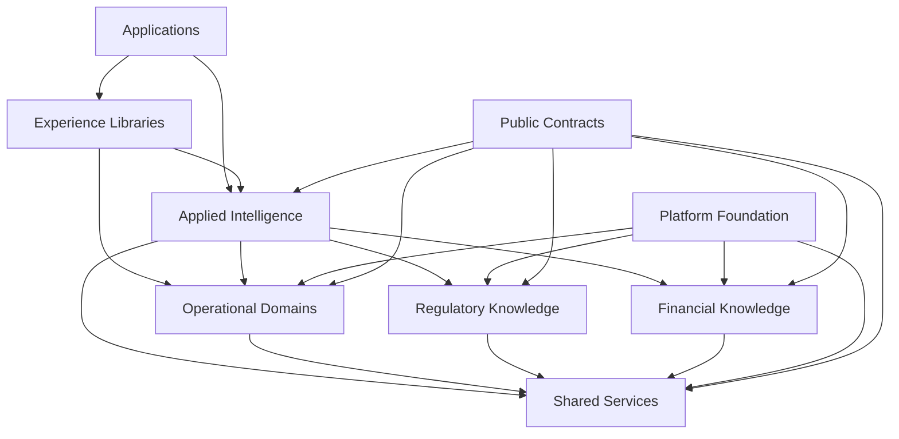

# Engineering Deliverable 05 — Nx Workspace Architecture and Domain Boundaries

**Project:** Regulatory Intelligence Platform  
**Organization:** McCaskill Projects  
**Document ID:** ENG-005  
**Version:** 1.0  
**Status:** Draft — Engineering Blueprint  
**Implementation Authorization:** Not Granted  
**Predecessors:**
- ENG-001 — Master Workflow Catalog
- ENG-002 — Workflow Diagrams and State Machines
- ENG-003 — Master Entity Catalog
- ENG-004 — Entity Relationship Model

---

# 1. Purpose

This document establishes the Nx workspace architecture and domain boundary enforcement model for the Regulatory Intelligence Platform.

It defines how the platform's logical architecture becomes an organized, governed, maintainable software workspace using the existing development environment.

The purpose is to establish:

- Domain-owned libraries and applications.
- Clear frontend and backend separation.
- Independent Regulatory and Financial Knowledge Engines.
- Shared service ownership.
- Controlled cross-domain communication.
- Consistent project naming.
- Nx project tagging standards.
- Dependency enforcement.
- CI/CD boundary enforcement.
- Team ownership and independent development.

This document does not authorize implementation or changes to the existing repository.

# 2. Existing Technology Environment

The platform will continue using the existing technology environment.

| Technology | Existing Responsibility |
|---|---|
| Nx | Monorepo and project organization |
| Nx Console | Visual project and dependency management |
| Angular | Frontend application framework |
| NgRx | Frontend state management |
| NestJS | Backend application framework |
| PostgreSQL | Relational database |
| TypeORM | Persistence and database mapping |
| Vercel | Frontend deployment |
| Render | Backend deployment |
| Existing CI/CD | Automated build, test, and deployment pipeline |

No new infrastructure architecture is proposed in this document.

The objective is to organize and standardize the existing environment around the approved Regulatory Intelligence Platform architecture.

Exact package versions and configuration details will be confirmed during implementation planning.

# 3. Nx Architectural Principles

## 3.1 Domain Ownership Determines Library Ownership

Every domain must own its implementation libraries.

A library must have one clearly defined responsibility and one owning domain.

Domain ownership determines:

- Which team owns the library.
- Which entities the library may implement.
- Which services the library may expose.
- Which other libraries it may depend on.
- Which libraries may depend on it.
- Which team approves changes.

## 3.2 Dependency Direction

Dependencies must flow through approved architectural contracts.

A domain must not reach into another domain's private implementation.

For example:

- Compliance Intelligence may consume Regulatory Knowledge contracts.
- Compliance Intelligence may consume operational domain contracts.
- Regulatory Knowledge must not import Compliance Intelligence implementation.
- Financial Knowledge must not import Regulatory Knowledge implementation.
- Shared services must not become owners of regulatory or financial rules.

## 3.3 Explicit Public Interfaces

Every domain exposes controlled public interfaces.

Other domains consume those interfaces through approved library entry points.

Internal implementation files must not become cross-domain dependencies.

## 3.4 No Circular Dependencies

Circular dependencies are prohibited.

The architecture must prevent dependency cycles between:

- Domains.
- Knowledge engines.
- Shared services.
- Frontend and backend projects.
- Applied Intelligence and operational domains.

## 3.5 Applications Are Composition Roots

Applications assemble capabilities.

They must not become the owners of business rules, regulatory knowledge, financial methodologies, or operational domain logic.

# 4. Proposed Nx Workspace Organization

The following structure is the proposed logical organization.

It is a target architecture, not a claim that these projects already exist.

```text
apps/
├── platform-web/
├── platform-api/
└── platform-worker/

libs/
├── platform/
│   ├── identity/
│   ├── authorization/
│   ├── tenancy/
│   ├── security/
│   ├── configuration/
│   └── observability/
│
├── business/
│   ├── organization/
│   ├── people/
│   ├── workforce/
│   ├── contracts/
│   └── locations/
│
├── operations/
│   ├── residential/
│   ├── iss/
│   ├── financial-operations/
│   └── workforce-operations/
│
├── regulatory/
│   └── knowledge/
│
├── financial/
│   └── knowledge/
│
├── shared/
│   ├── evidence/
│   ├── validation/
│   ├── documents/
│   ├── change-management/
│   ├── approvals/
│   ├── audit/
│   ├── reporting/
│   └── binders/
│
├── intelligence/
│   ├── compliance/
│   ├── financial/
│   └── executive/
│
├── survey/
│   ├── management/
│   └── workspace/
│
├── experience/
│   ├── provider-center/
│   ├── regulatory-workbench/
│   ├── financial-workbench/
│   ├── residential-workspace/
│   ├── iss-workspace/
│   ├── financial-binder/
│   ├── survey-binder/
│   └── knowledge-administration/
│
└── contracts/
    ├── platform/
    ├── business/
    ├── operations/
    ├── regulatory/
    ├── financial/
    ├── shared/
    └── intelligence/
```

The exact number of projects and their decomposition will be determined by implementation responsibility and dependency analysis. This structure does not require every folder to become a single library.

# 5. Nx Project Classification

Every Nx project must have explicit classification tags.

The tags establish the project's architectural identity.

## 5.1 Required Tags

| Tag | Purpose | Example |
|---|---|---|
| `scope:*` | Identifies the owning domain | `scope:regulatory` |
| `type:*` | Identifies the technical responsibility | `type:data-access` |
| `layer:*` | Identifies the architectural layer | `layer:knowledge` |
| `platform:*` | Identifies the execution environment | `platform:backend` |
| `visibility:*` | Identifies project visibility | `visibility:public` |
| `owner:*` | Identifies the accountable team | `owner:regulatory-team` |

## 5.2 Scope Tags

Approved scope vocabulary:

```text
scope:platform
scope:business
scope:operations
scope:regulatory
scope:financial
scope:shared
scope:compliance
scope:intelligence
scope:survey
scope:experience
scope:contracts
```

A project must have one primary scope.

Projects must not use multiple ownership scopes merely because they reference multiple domains.

## 5.3 Type Tags

Approved technical classifications:

```text
type:app
type:feature
type:ui
type:data-access
type:domain
type:service
type:util
type:contract
type:testing
type:integration
```

The final type vocabulary must be applied consistently across frontend and backend projects.

## 5.4 Layer Tags

Approved logical layer classifications:

```text
layer:foundation
layer:business
layer:operations
layer:knowledge
layer:shared
layer:applied
layer:experience
```

Layer tags describe architectural responsibility. They do not create additional architectural layers.

## 5.5 Platform Tags

```text
platform:frontend
platform:backend
platform:shared
platform:worker
```

Frontend-only code must not be imported into backend projects.

Backend-only implementation must not be imported into Angular projects.

Shared contracts must remain independent of runtime-specific implementation.

# 6. Library Naming Standards

Libraries must have consistent names that communicate ownership and responsibility.

## 6.1 Naming Pattern

```text
[domain]-[capability]-[type]
```

Examples:

```text
regulatory-knowledge-domain
regulatory-knowledge-data-access
regulatory-knowledge-contract
regulatory-knowledge-feature

financial-knowledge-domain
financial-knowledge-data-access
financial-knowledge-contract
financial-knowledge-feature

residential-operations-domain
residential-operations-data-access

iss-operations-domain
iss-operations-data-access

shared-evidence-service
shared-validation-service
shared-audit-service
shared-binder-service

compliance-intelligence-domain
financial-intelligence-domain
```

These names are proposed conventions, not existing project names.

## 6.2 Naming Rules

1. Names must identify the owning domain.
2. Names must describe the capability.
3. Names must avoid generic names such as `common`, `misc`, or `everything`.
4. Domain implementation libraries must not be disguised as shared libraries.
5. A shared library must have a genuinely shared responsibility.
6. Frontend and backend implementations must be distinguishable.
7. Public contracts must be clearly identified.

# 7. Domain Library Architecture

Each major domain should be organized by responsibility rather than by arbitrary file type.

A domain may expose separate libraries for:

- Domain model.
- Business rules.
- Application services.
- Data access.
- Public contracts.
- Frontend features.
- UI components.
- Testing utilities.

The number of libraries should be justified by meaningful ownership or dependency boundaries.

## 7.1 Regulatory Knowledge Engine

Owner: Regulatory Knowledge Team.

Proposed capabilities:

```text
regulatory-knowledge-domain
regulatory-knowledge-application
regulatory-knowledge-data-access
regulatory-knowledge-contract
regulatory-knowledge-feature
regulatory-knowledge-testing
```

Responsibilities:

- Regulatory sources.
- Regulatory requirements.
- Regulatory interpretations.
- Regulatory applicability.
- Regulatory knowledge packs.
- Versioning and publication.
- Knowledge validation.

The Regulatory Knowledge Engine must not import Financial Knowledge implementation.

## 7.2 Financial Knowledge Engine

Owner: Financial Knowledge Team.

Proposed capabilities:

```text
financial-knowledge-domain
financial-knowledge-application
financial-knowledge-data-access
financial-knowledge-contract
financial-knowledge-feature
financial-knowledge-testing
```

Responsibilities:

- Financial definitions.
- Financial classifications.
- Cost principles.
- Allowability.
- Allocation methodologies.
- Calculation definitions.
- Reimbursement rates.
- Financial reporting definitions.
- Financial knowledge packs.

The Financial Knowledge Engine must not import Regulatory Knowledge implementation.

## 7.3 Operational Domains

Operational domains own actual business activity and records.

Examples:

```text
residential-operations-domain
residential-operations-application
residential-operations-data-access

iss-operations-domain
iss-operations-application
iss-operations-data-access

financial-operations-domain
financial-operations-application
financial-operations-data-access

workforce-operations-domain
workforce-operations-application
workforce-operations-data-access
```

Each domain owns its records and business processes.

Operational domains must not independently implement regulatory or financial authority.

## 7.4 Shared Intelligence Services

Shared services provide reusable execution and infrastructure capabilities.

Examples:

```text
shared-evidence-service
shared-validation-service
shared-document-service
shared-change-service
shared-approval-service
shared-audit-service
shared-reporting-service
shared-binder-service
```

Shared services may consume approved contracts and execute defined processes.

They must not independently create regulatory or financial requirements.

## 7.5 Applied Intelligence

Examples:

```text
compliance-intelligence-domain
compliance-intelligence-application

financial-intelligence-domain
financial-intelligence-application

executive-intelligence-domain
executive-intelligence-application
```

Applied Intelligence consumes operational facts, authoritative knowledge, and shared service capabilities.

It owns evaluation results, findings, financial analysis, and applied reporting processes.

# 8. Public API and Library Entry Points

Every library must explicitly control what it exposes.

A domain's public entry point is the supported integration boundary.

Example:

```typescript
// Example only: regulatory knowledge public API

export * from './lib/models/regulatory-requirement';
export * from './lib/contracts/regulatory-knowledge.contract';
export * from './lib/interfaces/regulatory-applicability.interface';
```

The public entry point must expose only approved interfaces.

It must not expose:

- Private repository implementations.
- Internal database entities where not required.
- Private service implementation details.
- Internal helper functions.
- Unapproved cross-domain dependencies.

Other projects must import through the library's public entry point.

Direct imports into another project's internal `src/lib` directories are prohibited.

# 9. Dependency Architecture

The dependency architecture must follow approved ownership and layer rules.

## 9.1 General Dependency Flow



This is a logical dependency illustration. Actual dependencies must be refined by library responsibility and must not introduce cycles.

## 9.2 Prohibited Dependencies

The following are prohibited:

- Regulatory Knowledge importing Financial Knowledge implementation.
- Financial Knowledge importing Regulatory Knowledge implementation.
- Operational domains importing Compliance Intelligence implementation.
- Operational domains importing Financial Intelligence implementation.
- Shared services importing private domain repositories.
- Frontend libraries importing backend implementation.
- Backend libraries importing Angular components.
- Domain libraries importing application entry points.
- Applications becoming shared domain dependencies.
- Circular dependencies between domain libraries.

## 9.3 Approved Cross-Domain Access

Cross-domain access must use:

- Public contracts.
- Approved application interfaces.
- Explicit integration events.
- Authorized API boundaries.
- Shared service contracts.

A direct import is acceptable only when the dependency is explicitly allowed by the approved Nx boundary matrix.

# 10. Nx Module Boundary Enforcement

Nx must enforce architecture rules through project tags and module boundary constraints.

The primary enforcement mechanism is:

```text
@nx/enforce-module-boundaries
```

The rules must be maintained as code and enforced during CI.

## 10.1 Boundary Policy

The enforcement policy must establish:

1. Which scopes may depend on other scopes.
2. Which project types may depend on other types.
3. Which layers may depend on other layers.
4. Which runtime platforms may depend on one another.
5. Which libraries may be imported publicly.
6. Which dependencies are prohibited.

## 10.2 Illustrative ESLint Configuration

The following is an illustrative policy example. It is not a drop-in configuration and must be reconciled with the installed Nx and ESLint versions.

```javascript
{
  rules: {
    '@nx/enforce-module-boundaries': [
      'error',
      {
        enforceBuildableLibDependency: true,
        allow: [],
        depConstraints: [
          {
            sourceTag: 'scope:regulatory',
            onlyDependOnLibsWithTags: [
              'scope:platform',
              'scope:shared',
              'scope:contracts'
            ]
          },
          {
            sourceTag: 'scope:financial',
            onlyDependOnLibsWithTags: [
              'scope:platform',
              'scope:shared',
              'scope:contracts'
            ]
          },
          {
            sourceTag: 'scope:operations',
            onlyDependOnLibsWithTags: [
              'scope:platform',
              'scope:shared',
              'scope:contracts'
            ]
          },
          {
            sourceTag: 'scope:compliance',
            onlyDependOnLibsWithTags: [
              'scope:platform',
              'scope:shared',
              'scope:operations',
              'scope:regulatory',
              'scope:contracts'
            ]
          },
          {
            sourceTag: 'scope:intelligence',
            onlyDependOnLibsWithTags: [
              'scope:platform',
              'scope:shared',
              'scope:operations',
              'scope:regulatory',
              'scope:financial',
              'scope:contracts'
            ]
          }
        ]
      }
    ]
  }
}
```

This example illustrates scope restrictions. It does not define the complete final policy.

The final matrix must include every approved scope, type, layer, and platform constraint.

# 11. Frontend Architecture

**Platform:** Angular

The frontend must reflect domain ownership without duplicating backend authority.

## 11.1 Frontend Responsibilities

Frontend libraries own:

- User interface components.
- Feature presentation.
- Routing and navigation.
- Workspace layouts.
- Client-side state.
- Form interaction.
- Display validation.
- User interaction workflows.

Frontend libraries do not own:

- Regulatory authority.
- Financial authority.
- Backend authorization decisions.
- Official compliance determinations.
- Official financial calculations.

## 11.2 Angular Feature Organization

Each major workspace should be organized around a domain capability.

Examples:

```text
experience/
├── provider-center/
├── regulatory-workbench/
├── financial-workbench/
├── residential-workspace/
├── iss-workspace/
├── survey-workspace/
├── financial-binder/
└── knowledge-administration/
```

Features must use approved domain contracts and data-access libraries.

## 11.3 Angular Standards

- Use standalone components.
- Organize routes by workspace and capability.
- Lazy-load appropriate feature routes.
- Keep components focused on presentation and interaction.
- Keep business rules outside presentation components.
- Use typed forms.
- Use shared design-system components.
- Apply accessibility standards.
- Use consistent error and loading states.
- Avoid duplicated API logic in components.
- Keep feature ownership explicit.

# 12. NgRx Architecture

NgRx state must be organized around meaningful business capabilities.

## 12.1 State Ownership

Examples:

- Regulatory Knowledge State.
- Financial Knowledge State.
- Residential Operations State.
- ISS Operations State.
- Compliance Intelligence State.
- Financial Intelligence State.
- Survey Workspace State.
- Binder State.

## 12.2 State Management Standards

- Use feature-scoped state.
- Keep selectors pure.
- Use effects for asynchronous operations.
- Keep actions explicit and meaningful.
- Avoid duplicate ownership of the same data.
- Avoid storing sensitive information unnecessarily.
- Clear scoped data when access is revoked or a user changes tenant.
- Keep server authority on the backend.
- Do not treat client state as authorization evidence.

# 13. Backend Architecture

**Platform:** NestJS

Backend modules must follow domain ownership.

## 13.1 Backend Responsibilities

- Authentication integration.
- Authorization enforcement.
- Domain application services.
- Business rule execution.
- Database access.
- Transaction management.
- Event processing.
- API contracts.
- Audit and traceability.
- Integration orchestration.

## 13.2 NestJS Module Standards

Each domain module should separate:

- Domain models.
- Application services.
- Persistence.
- API controllers.
- DTOs and validation.
- Public contracts.
- Integration handlers.

Controllers must not become owners of business logic.

Repositories must not become owners of regulatory or financial authority.

## 13.3 Domain Data Access

Each domain owns its persistence operations.

A domain must not directly modify another domain's database records.

Cross-domain operations must use approved application contracts or integration mechanisms.

# 14. Existing Security Foundation

The existing security implementation is to be preserved wherever it satisfies the approved architecture.

## 14.1 Capabilities to Retain and Map

- Existing user identity.
- Authentication.
- JWT implementation.
- Roles.
- Permissions.
- Role-permission relationships.
- User-role assignments.
- Authorization services.
- Authorization guards.
- Existing security controls.

## 14.2 Required Security Extensions

Evaluate and implement only verified gaps:

- Tenant-scoped authorization.
- Organization-scoped authorization.
- Record-level authorization.
- Location and program restrictions.
- External surveyor identity.
- Surveyor MFA.
- Event-specific access.
- Expiration and revocation.
- Document-level authorization.
- Security audit coverage.

## 14.3 Security Boundary

No duplicate identity system or unnecessary replacement of working authentication infrastructure.

The security foundation is shared platform infrastructure.

# 15. Survey Workspace Boundary

Survey Workspace must be isolated as a controlled external collaboration capability.

Its libraries may consume:

- Platform identity and authorization contracts.
- Shared document capabilities.
- Shared binder capabilities.
- Survey management contracts.
- Approved operational record references.

It must not bypass source-record authorization.

Surveyor access must be validated by the backend on every protected resource request.

# 16. Testing Architecture

Each domain must own its tests.

## 16.1 Test Types

- Unit tests.
- Domain service tests.
- API contract tests.
- Integration tests.
- Authorization tests.
- Tenant isolation tests.
- Database tests.
- End-to-end tests.
- Cross-domain integration tests.

## 16.2 Boundary Tests

The CI pipeline must identify prohibited imports and dependency cycles.

Tests must verify that:

- Regulatory Knowledge cannot access Financial Knowledge internals.
- Financial Knowledge cannot access Regulatory Knowledge internals.
- Operational domains cannot write knowledge authority records.
- Shared services cannot create authoritative rules.
- Frontend code cannot bypass backend authorization.
- Tenant data cannot cross isolation boundaries.

# 17. Nx Console Governance

Nx Console will be the visual workspace management experience.

It will support:

- Project discovery.
- Project graph inspection.
- Library creation using approved generators.
- Tag visibility.
- Dependency analysis.
- Build and test execution.
- Boundary troubleshooting.
- Ownership review.

Nx Console is a management interface, not a replacement for source-controlled architectural enforcement.

All boundary rules must remain in repository configuration and CI.

# 18. CI/CD Architecture Enforcement

The existing CI/CD pipeline will enforce workspace architecture.

Required checks:

1. Nx project configuration validation.
2. Module boundary linting.
3. Dependency cycle detection.
4. Affected project tests.
5. Domain unit tests.
6. Integration tests.
7. Build verification.
8. Contract compatibility checks.
9. Security tests.
10. Deployment eligibility checks.

A project must not be deployed when required architecture or quality checks fail.

## 18.1 Change Scope

The CI pipeline should run affected tests and builds where supported.

Changes to shared contracts or platform foundation may require broader downstream validation.

# 19. Team Ownership

Each domain must have an accountable engineering owner.

| Team | Primary Ownership |
|---|---|
| Platform Foundation Team | Identity, authorization, tenancy, security |
| Regulatory Knowledge Team | Regulatory Knowledge Engine |
| Financial Knowledge Team | Financial Knowledge Engine |
| Operations Team | Residential, ISS, Workforce, Financial Operations |
| Shared Services Team | Evidence, validation, documents, audit, approvals, binders |
| Intelligence Team | Compliance and Financial Intelligence |
| Experience Team | Angular workspaces and NgRx |
| Quality and Release Team | Testing, CI/CD, architecture enforcement |

Teams may collaborate across domains, but ownership of code and data must remain explicit.

# 20. Software Change Register

Every sprint must maintain a software change register.

The register must capture:

| Field | Purpose |
|---|---|
| Change ID | Unique change reference |
| Sprint | Sprint containing the change |
| Domain | Owning domain |
| Project or Library | Affected Nx project |
| Change Type | New, modify, refactor, retire |
| Reason | Business or technical justification |
| Dependencies | Affected projects and contracts |
| Security Impact | Security implications |
| Data Impact | Persistence or migration implications |
| Approval | Required approval reference |
| Test Evidence | Verification results |
| Release Status | Planned, approved, deployed |

No unapproved cross-domain change may bypass the change register.

# 21. Implementation Sequence

Nx architecture implementation must follow a controlled sequence:

1. Approve the logical domain and dependency model.
2. Confirm the existing Nx environment and project configuration.
3. Map existing security infrastructure.
4. Define the final project tag vocabulary.
5. Establish project naming standards.
6. Define the complete dependency matrix.
7. Implement boundary rules in a controlled branch after authorization.
8. Validate existing projects against the policy.
9. Identify and document conflicts.
10. Resolve conflicts through approved change packages.
11. Establish team ownership.
12. Verify CI enforcement.
13. Approve the workspace architecture baseline.

The implementation must preserve all existing uncommitted repository changes.

# 22. Explicitly Prohibited Practices

The following are prohibited:

- Designing domains around existing module names.
- Creating duplicate identity systems.
- Importing private libraries across domains.
- Allowing circular dependencies.
- Placing regulatory rules in frontend components.
- Placing financial formulas in UI components.
- Using shared libraries as dumping grounds.
- Creating one universal library for unrelated capabilities.
- Allowing operational domains to own authority records.
- Allowing application projects to own domain logic.
- Bypassing Nx boundary enforcement.
- Treating Nx Console as the only enforcement mechanism.
- Introducing unnecessary infrastructure changes.

# 23. Acceptance Criteria

ENG-005 is ready for approval when:

- [ ] Every logical domain has an identified Nx ownership scope.
- [ ] Project naming standards are defined.
- [ ] Required project tags are defined.
- [ ] Frontend and backend boundaries are defined.
- [ ] Regulatory and Financial Knowledge Engine isolation is defined.
- [ ] Operational domain ownership is defined.
- [ ] Shared service boundaries are defined.
- [ ] Applied Intelligence dependency rules are defined.
- [ ] Public library entry points are required.
- [ ] Circular dependencies are prohibited.
- [ ] Nx module boundary enforcement is specified.
- [ ] Nx Console governance is defined.
- [ ] CI/CD architecture checks are defined.
- [ ] Existing security infrastructure is preserved as the foundation.
- [ ] Team ownership is defined.
- [ ] The software change register is included.
- [ ] No existing application structure has dictated the new design.
- [ ] The workspace architecture is ready for technology implementation standards.

# 24. Implementation Authorization

This document is an engineering design artifact only.

Approval does not authorize:

- Nx project creation.
- Library generation.
- Project renaming.
- Tag changes.
- ESLint configuration changes.
- Boundary enforcement changes.
- CI/CD changes.
- Application refactoring.
- Backend module creation.
- Frontend implementation.
- Security replacement.

All implementation must follow explicit authorization and an approved software change register.

The existing application and its working security foundation must be preserved while the new architecture is developed and mapped.

# 25. Document Control

| Field | Value |
|---|---|
| Document ID | ENG-005 |
| Document Name | Nx Workspace Architecture and Domain Boundaries |
| Version | 1.0 |
| Status | Draft |
| Owner | McCaskill Projects |
| Architecture Authority | Regulatory Intelligence Platform |
| Implementation Authorization | Not Granted |
| Next Deliverable | ENG-006 — Technology Implementation Standards |

**End of Document**