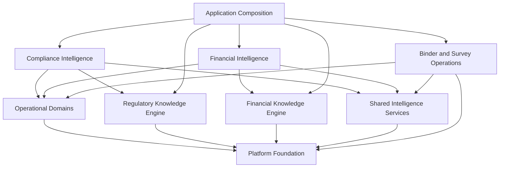
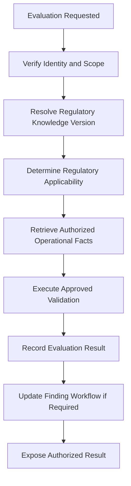
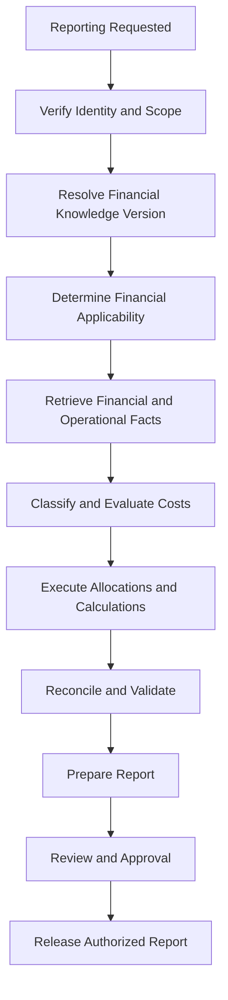
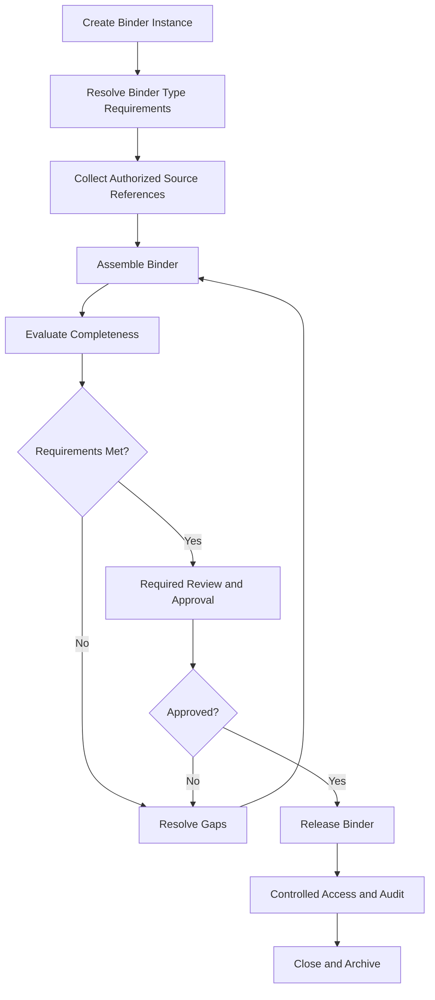

# ENG-008 — Service and Module Catalog

**Document ID:** ENG-008  
**Version:** 1.0  
**Status:** Engineering Blueprint — Draft  
**Platform:** Regulatory Intelligence Platform  
**Organization:** McCaskill Projects  
**Document Location:** `docs/engineering/08-service-and-module-catalog.md`  
**Implementation Authorization:** Not Granted

---

# 1. Purpose and Scope

## 1.1 WHAT

This document defines the target backend service and module architecture for the Regulatory Intelligence Platform.

It identifies:

- Required platform modules.
- Service responsibilities.
- Domain ownership.
- Service boundaries.
- Execution triggers.
- Dependencies.
- Input and output contracts.
- Cross-domain coordination.
- Failure and recovery expectations.
- Verification requirements.

This catalog defines logical services and NestJS module responsibilities. It does not require every service to become a separately deployed application or microservice.

## 1.2 WHEN

This catalog is used:

1. Before creating or modifying backend modules.
2. Before creating application or domain services.
3. Before defining API and event contracts.
4. During Nx project boundary design.
5. During team work-package preparation.
6. During sprint planning.
7. During architecture and implementation review.

## 1.3 WHERE

Services are organized within the existing Nx monorepo and NestJS backend environment.

The architecture consists of:

1. Platform Foundation.
2. Business and Operational Domains.
3. Regulatory Knowledge Engine and Financial Knowledge Engine.
4. Shared Intelligence Services.
5. Applied Intelligence and Operations.
6. User Experience and Intelligence integration.

The sixth layer is primarily frontend-facing. Its backend coordination responsibilities are defined through the owning application services and approved APIs.

## 1.4 WHY

A complete service catalog prevents teams from independently creating overlapping modules or placing business logic in the wrong domain.

It also establishes what must exist before implementation begins.

## 1.5 HOW

Each service definition must identify:

- Service identifier.
- Module.
- Owner.
- Purpose.
- Execution timing.
- Architectural location.
- Inputs.
- Outputs.
- Dependencies.
- Authorization requirements.
- Failure behavior.
- Verification.

The detailed API schemas, event payloads, and method signatures are specified in ENG-009.

## 1.6 VERIFICATION

The catalog is complete when every approved workflow in ENG-001 and ENG-002 can be mapped to a responsible service, and every approved entity in ENG-003 and ENG-004 has an identifiable owning domain.

---

# 2. Service Architecture Rules

## 2.1 WHAT

The service architecture separates business authority, operational data, shared execution infrastructure, and applied intelligence.

## 2.2 WHEN

These rules apply whenever a new service or module is designed or an existing service is evaluated for reuse.

## 2.3 WHERE

The rules apply across all backend Nx projects and NestJS modules.

## 2.4 WHY

Without clear boundaries, services may duplicate business logic, bypass authorization, or create conflicting regulatory and financial determinations.

## 2.5 HOW

The following rules are mandatory.

**Rule 1 — One primary owner per service**

Every service must have one responsible domain.

**Rule 2 — No duplicate knowledge authority**

Regulatory Knowledge owns regulatory requirements and applicability.

Financial Knowledge owns financial definitions, methodologies, and applicability.

**Rule 3 — Operational domains own operational facts**

Operational services create and maintain business records. They do not independently establish regulatory compliance or financial allowability.

**Rule 4 — Shared services execute; they do not invent authority**

Shared validation, approval, evidence, reporting, and binder services provide reusable mechanisms.

**Rule 5 — Applied Intelligence coordinates**

Compliance Intelligence and Financial Intelligence coordinate approved knowledge and operational facts to produce traceable results.

**Rule 6 — Public contracts govern dependencies**

Services communicate through approved interfaces rather than accessing another domain's private implementation.

**Rule 7 — Backend authorization is mandatory**

Every protected service operation must enforce the appropriate tenant, role, permission, resource, and workflow scope.

**Rule 8 — Historical execution context is preserved**

Determinations, calculations, approvals, and released artifacts must preserve the versions and inputs needed for historical explanation.

**Rule 9 — Services are logical boundaries**

A logical service may be implemented as an injectable NestJS provider within an existing backend application. Separate deployment is not implied.

**Rule 10 — Existing security infrastructure is preserved**

The existing authentication and authorization foundation must be mapped and reused. No duplicate security system may be introduced.

## 2.6 VERIFICATION

Every proposed service must pass an ownership and dependency review before implementation approval.

---

# 3. Service Identification and Naming

## 3.1 WHAT

Every cataloged service receives a stable identifier independent of its eventual TypeScript class name or Nx project path.

## 3.2 WHEN

Identifiers are assigned during service design, before implementation.

## 3.3 WHERE

Identifiers are maintained in this catalog and referenced by API contracts, workflows, tests, and sprint packages.

## 3.4 WHY

Stable identifiers allow architectural documentation to remain consistent when implementation names or project structures evolve.

## 3.5 HOW

The following prefixes are used:

| Prefix | Service family |
|---|---|
| PF | Platform Foundation |
| OP | Operational Domains |
| RK | Regulatory Knowledge |
| FK | Financial Knowledge |
| SI | Shared Intelligence |
| CI | Compliance Intelligence |
| FI | Financial Intelligence |
| BM | Binder and Survey Operations |
| UX | Application Composition |

Example:

`RK-04 — Regulatory Applicability Service`

Identifiers describe logical responsibilities, not necessarily one class per identifier.

## 3.6 VERIFICATION

Each identifier must map to one documented responsibility and one primary owner.

---

# 4. Platform Foundation Service Catalog

## 4.1 WHAT

Platform Foundation services provide identity, access control, tenant context, configuration, and technical infrastructure required by the rest of the platform.

## 4.2 WHEN

These services are used throughout application startup, authenticated requests, background operations, tenant switching, and protected data access.

## 4.3 WHERE

They belong to Platform Foundation and the existing backend security and infrastructure projects.

## 4.4 WHY

Security and tenancy must be consistently enforced across every business capability.

## 4.5 HOW

| ID | Logical service | Primary responsibility |
|---|---|---|
| PF-01 | Identity Service | User identity and account relationships |
| PF-02 | Authentication Service | Authentication and session verification |
| PF-03 | Authorization Service | Permission and resource access decisions |
| PF-04 | Tenant Context Service | Resolve and validate tenant context |
| PF-05 | Organization Access Service | User-to-organization access relationships |
| PF-06 | Configuration Service | Approved platform configuration |
| PF-07 | Integration Coordination Service | Approved external integration execution |
| PF-08 | Background Execution Service | Controlled asynchronous work |
| PF-09 | Correlation and Diagnostics Service | Request and execution correlation |

### PF-01 — Identity Service

**WHAT:** Manages user identities and their relationships to organizations and approved account types.

**WHEN:** During onboarding, account administration, identity lookup, and account lifecycle changes.

**WHERE:** Existing Platform Foundation identity capability.

**WHY:** All platform users require consistent identity ownership.

**HOW:** Preserve and reuse existing identity entities and services where they satisfy approved requirements. Extend only verified gaps.

**Inputs:** Identity registration or management requests, authorized account context.

**Outputs:** Identity records, account status, approved identity references.

**Dependencies:** Existing identity persistence and authorization infrastructure.

**VERIFICATION:** Identity uniqueness, lifecycle, account isolation, and authorized administration tests.

### PF-02 — Authentication Service

**WHAT:** Authenticates users and validates sessions.

**WHEN:** During sign-in, session verification, renewal, and sign-out.

**WHERE:** Existing authentication implementation.

**WHY:** Authentication must remain centralized and consistent.

**HOW:** Preserve the existing JWT and authentication infrastructure. Any required changes must follow the security architecture and be approved.

**Inputs:** Authentication credentials or approved session proof.

**Outputs:** Authenticated identity and session context.

**Dependencies:** PF-01 and existing security infrastructure.

**VERIFICATION:** Authentication, expiration, invalid-session, and revocation tests.

### PF-03 — Authorization Service

**WHAT:** Determines whether an authenticated actor may perform an operation on a resource.

**WHEN:** Before every protected operation and protected record access.

**WHERE:** Existing authorization services and backend guards.

**WHY:** Frontend visibility and route restrictions are insufficient security controls.

**HOW:** Evaluate role, permission, tenant, organization, resource scope, and workflow context.

**Inputs:** Actor, operation, resource, tenant context.

**Outputs:** Permit or deny decision with appropriate diagnostic context.

**Dependencies:** PF-01, PF-04, permission and assignment records.

**VERIFICATION:** Permission, cross-tenant, record-level, and revoked-access tests.

### PF-04 — Tenant Context Service

**WHAT:** Resolves and validates the active tenant context.

**WHEN:** During authenticated requests, tenant selection, and cross-domain operations.

**WHERE:** Platform Foundation.

**WHY:** Every tenant-owned operation must be correctly scoped.

**HOW:** Derive authorized tenant context from verified identity and access relationships, not merely a client-provided identifier.

**Inputs:** Authenticated actor, requested context.

**Outputs:** Verified tenant context.

**Dependencies:** PF-01, PF-03, PF-05.

**VERIFICATION:** Unauthorized tenant substitution and isolation tests.

### PF-05 — Organization Access Service

**WHAT:** Manages relationships between users and organizations.

**WHEN:** During onboarding, access assignment, organizational changes, and access review.

**WHERE:** Platform Foundation.

**WHY:** A user may have different responsibilities across organizations.

**HOW:** Maintain approved organization assignments and enforce their lifecycle.

**Inputs:** Organization, user, access assignment.

**Outputs:** Authorized organization relationships.

**Dependencies:** Identity, authorization, organization records.

**VERIFICATION:** Assignment, revocation, and scope tests.

### PF-06 — Configuration Service

**WHAT:** Provides governed platform configuration.

**WHEN:** When services require approved operational configuration.

**WHERE:** Platform Foundation.

**WHY:** Configuration should not be scattered through unrelated service implementations.

**HOW:** Separate deployment configuration, platform configuration, tenant configuration, and knowledge authority definitions.

Configuration must not override regulatory or financial knowledge authority.

**VERIFICATION:** Configuration scope, access, and change tests.

### PF-07 — Integration Coordination Service

**WHAT:** Coordinates approved external integrations.

**WHEN:** During external data exchange or integration-triggered workflows.

**WHERE:** Platform Foundation integration infrastructure.

**WHY:** External connectivity needs consistent security, failure handling, and traceability.

**HOW:** Use explicit provider contracts, credentials management, retries, and audit context.

**VERIFICATION:** Integration contract, failure, and recovery tests.

### PF-08 — Background Execution Service

**WHAT:** Provides controlled execution of asynchronous tasks.

**WHEN:** During scheduled or long-running processing.

**WHERE:** Existing backend infrastructure, extended only as required.

**WHY:** Long-running work should not depend on an open browser request.

**HOW:** Support controlled execution, status, retry, idempotency, and recovery. Do not assume a new queue product is required.

**VERIFICATION:** Retry, duplicate execution, and recovery tests.

### PF-09 — Correlation and Diagnostics Service

**WHAT:** Connects requests, jobs, events, and execution records through traceable identifiers.

**WHEN:** Throughout backend execution.

**WHERE:** Shared technical infrastructure.

**WHY:** Cross-domain failures must be diagnosable.

**HOW:** Propagate approved correlation identifiers and safe diagnostic metadata.

**VERIFICATION:** Trace continuity and sensitive-data exclusion tests.

## 4.6 VERIFICATION

Platform Foundation is acceptable when all protected domain operations can rely on the existing security foundation and verified context contracts.

---

# 5. Business and Operational Domain Catalog

## 5.1 WHAT

Operational domains own business records and processes independently of regulatory and financial knowledge authority.

## 5.2 WHEN

They operate whenever customers manage organizations, locations, people, employees, services, transactions, and day-to-day activities.

## 5.3 WHERE

They belong to Business and Operational Domains, organized by independent domain ownership.

## 5.4 WHY

Operational capabilities must remain reusable across jurisdictions, programs, and customers.

## 5.5 HOW

| ID | Service | Owner | Responsibility |
|---|---|---|---|
| OP-01 | Organization Management | Organization Domain | Organization records and structure |
| OP-02 | Location Management | Location Domain | Facilities, sites, and locations |
| OP-03 | Person Management | Person Domain | Individual/person records |
| OP-04 | Workforce Management | Workforce Domain | Employee and workforce records |
| OP-05 | Service Management | Service Operations | Service definitions and delivery records |
| OP-06 | Contract Management | Contract Domain | Business contract records |
| OP-07 | Financial Transaction Management | Financial Operations | Financial transaction records |
| OP-08 | Payroll Operations | Workforce/Payroll Operations | Payroll source records and execution |
| OP-09 | Service Statistics | Service Operations | Service utilization and statistics |
| OP-10 | Residential Operations | Residential Domain | Residential operational workflows |
| OP-11 | ISS Operations | ISS Domain | Individualized Skills and Socialization workflows |
| OP-12 | Operational Record Validation | Owning Operational Domain | Completeness and consistency checks |

### OP-01 — Organization Management

**WHAT:** Maintains customer organization structures and business identity records.

**WHEN:** During onboarding, organizational administration, and business relationship changes.

**WHERE:** Organization Domain.

**WHY:** Organization records are shared context for multiple operational capabilities.

**HOW:** Provide approved create, read, update, and lifecycle operations with tenant isolation.

**VERIFICATION:** Organization ownership and tenant isolation tests.

### OP-02 — Location Management

**WHAT:** Maintains operational locations, sites, and facility relationships.

**WHEN:** When organizations establish or manage operating locations.

**WHERE:** Location Domain.

**WHY:** Multiple workflows depend on consistent location identity.

**HOW:** Manage location records, organization relationships, status, and approved attributes.

**VERIFICATION:** Location lifecycle, ownership, and relationship tests.

### OP-03 — Person Management

**WHAT:** Maintains person identity and approved relationships to services and organizations.

**WHEN:** During intake, enrollment, assignment, and ongoing service management.

**WHERE:** Person Domain.

**WHY:** A person should not be independently recreated by every operational feature.

**HOW:** Maintain canonical person records and approved relationships. Apply record-level authorization.

**VERIFICATION:** Identity consistency, relationship, and privacy tests.

### OP-04 — Workforce Management

**WHAT:** Maintains employee and workforce operational records.

**WHEN:** During hiring, assignment, credential management, and workforce changes.

**WHERE:** Workforce Domain.

**WHY:** Workforce information is reused by service delivery, compliance, and financial reporting.

**HOW:** Manage workforce identity, employment relationships, qualifications, and assignments through approved contracts.

**VERIFICATION:** Workforce lifecycle and access tests.

### OP-05 — Service Management

**WHAT:** Maintains operational service definitions, authorizations where owned by the service domain, and delivered service records.

**WHEN:** During service setup, authorization recording, scheduling, and service delivery.

**WHERE:** Service Operations.

**WHY:** Service delivery facts must be separate from regulatory evaluation and financial reporting methodology.

**HOW:** Preserve actual delivery, individual, staff, location, time, and supporting evidence as applicable.

**VERIFICATION:** Service record integrity and authorization relationship tests.

### OP-06 — Contract Management

**WHAT:** Maintains business contract records and their operational lifecycle.

**WHEN:** During contract onboarding, renewal, modification, and termination.

**WHERE:** Contract Domain.

**WHY:** Contracts affect operations and reporting but should not be duplicated across modules.

**HOW:** Maintain contract identity, parties, dates, scope, and status.

**VERIFICATION:** Contract lifecycle and relationship tests.

### OP-07 — Financial Transaction Management

**WHAT:** Maintains operational financial transactions.

**WHEN:** When financial activity is recorded, imported, classified operationally, or reconciled.

**WHERE:** Financial Operations.

**WHY:** Financial transactions are source facts, while authoritative classification and methodology belong to Financial Knowledge.

**HOW:** Preserve source records, transaction history, adjustments, and approved operational relationships.

**VERIFICATION:** Transaction integrity, reconciliation, and audit tests.

### OP-08 — Payroll Operations

**WHAT:** Maintains payroll operational records and execution history.

**WHEN:** During payroll preparation, processing, adjustments, and reporting.

**WHERE:** Payroll Operations, coordinated with Workforce and Financial Operations.

**WHY:** Payroll facts are used in financial reporting but should not be recreated by reporting services.

**HOW:** Preserve employee relationships, pay periods, compensation records, deductions, and adjustment history as applicable.

**VERIFICATION:** Payroll source integrity, authorization, and reconciliation tests.

### OP-09 — Service Statistics

**WHAT:** Produces and maintains authorized service activity statistics from operational facts.

**WHEN:** During utilization reporting and financial reporting preparation.

**WHERE:** Service Operations or an approved service-statistics capability.

**WHY:** Statistical inputs must be traceable to actual service records.

**HOW:** Aggregate verified service activity and preserve source references. Financial interpretation of those statistics belongs to Financial Knowledge.

**VERIFICATION:** Source-to-statistic reconciliation tests.

### OP-10 — Residential Operations

**WHAT:** Manages reusable residential operational activities.

**WHEN:** During residential service delivery, safety management, emergency planning, inspections, fire drills, and corrective action.

**WHERE:** Residential Operations Domain.

**WHY:** Residential operations should not be implemented as Texas-only compliance features.

**HOW:** Support operational records and workflows independently of the applicable regulatory knowledge pack.

**VERIFICATION:** Operational workflow tests and jurisdiction-neutral boundary review.

### OP-11 — ISS Operations

**WHAT:** Manages reusable Individualized Skills and Socialization operational workflows.

**WHEN:** During participant intake, individualized planning, activity delivery, support recording, and progress review.

**WHERE:** ISS Operations Domain.

**WHY:** ISS operations must be reusable across customers and applicable programs.

**HOW:** Support participant goals, individualized objectives, activity planning, service records, support observations, and progress evidence. Knowledge packs govern applicable requirements.

**VERIFICATION:** Individualization, service-record, tenant-isolation, and knowledge-boundary tests.

### OP-12 — Operational Record Validation

**WHAT:** Performs operational completeness and consistency checks.

**WHEN:** Before saving, submitting, or advancing operational records where required.

**WHERE:** The owning operational domain.

**WHY:** Ordinary record validation should not be confused with regulatory or financial validation.

**HOW:** Define and execute domain-owned operational checks through approved validation mechanisms.

**VERIFICATION:** Operational validation tests distinguish incomplete records from regulatory or financial failures.

## 5.6 VERIFICATION

Operational services are complete when their records and workflows have defined owners and can supply verified facts through approved interfaces without creating independent knowledge authority.

---

# 6. Regulatory Knowledge Engine Service Catalog

## 6.1 WHAT

The Regulatory Knowledge Engine governs authoritative regulatory knowledge throughout its lifecycle.

## 6.2 WHEN

These services operate when regulatory sources are acquired, structured, reviewed, validated, approved, published, queried, changed, or retired.

## 6.3 WHERE

All services in this family belong to the Regulatory Knowledge Engine.

## 6.4 WHY

Regulatory requirements must be centrally governed, versioned, and traceable rather than embedded throughout application code.

## 6.5 HOW

| ID | Service | Responsibility |
|---|---|---|
| RK-01 | Regulatory Source Management | Register and govern authoritative sources |
| RK-02 | Regulatory Extraction | Produce structured extraction candidates |
| RK-03 | Requirement Structuring | Represent requirements in governed models |
| RK-04 | Regulatory Applicability | Determine applicable regulatory requirements |
| RK-05 | Knowledge Pack Management | Assemble and manage regulatory knowledge packs |
| RK-06 | Knowledge Validation | Validate regulatory knowledge structure and integrity |
| RK-07 | Knowledge Review and Certification | Coordinate authority-specific review and certification |
| RK-08 | Knowledge Publication | Publish approved knowledge versions |
| RK-09 | Regulatory Change Monitoring | Identify potential source changes |
| RK-10 | Knowledge Version Resolution | Resolve governing versions and effective dates |
| RK-11 | Regulatory Requirement Query | Provide approved regulatory knowledge to consumers |

### RK-01 — Regulatory Source Management

**WHAT:** Registers and maintains authoritative regulatory sources.

**WHEN:** Before extracting or structuring regulatory requirements.

**WHERE:** Regulatory Knowledge Engine.

**WHY:** Every requirement must be traceable to its source.

**HOW:** Preserve source identity, citation, authority, jurisdiction, retrieval details, and version relationships.

**VERIFICATION:** Source provenance and version tests.

### RK-02 — Regulatory Extraction

**WHAT:** Produces candidate structured information from source material.

**WHEN:** After source acquisition and before governed requirement approval.

**WHERE:** Regulatory Knowledge Engine.

**WHY:** Source documents must be translated into structured knowledge without losing provenance.

**HOW:** Produce traceable extraction candidates and retain source references. AI assistance, if used, remains subject to review.

**VERIFICATION:** Extraction provenance and review-gate tests.

### RK-03 — Requirement Structuring

**WHAT:** Converts reviewed regulatory content into structured requirement models.

**WHEN:** After extraction and before knowledge validation.

**WHERE:** Regulatory Knowledge Engine.

**WHY:** Execution requires explicit structured requirements.

**HOW:** Populate approved models for applicability, evidence, effective dates, requirement relationships, and validation definitions.

**VERIFICATION:** Model completeness and integrity tests.

### RK-04 — Regulatory Applicability

**WHAT:** Determines which approved regulatory requirements apply to a supplied operational context.

**WHEN:** Before regulatory evaluation or when an authorized user requests applicability information.

**WHERE:** Regulatory Knowledge Engine.

**WHY:** Applicability is regulatory authority, not an operational or financial decision.

**HOW:** Evaluate approved applicability definitions against verified operational facts and effective dates.

**Inputs:** Verified context, regulatory knowledge version, evaluation date.

**Outputs:** Applicable requirements, nonapplicable requirements where determined, or insufficient-information results.

**VERIFICATION:** Applicability decision, missing-context, and version tests.

### RK-05 — Knowledge Pack Management

**WHAT:** Manages regulatory knowledge pack composition and lifecycle.

**WHEN:** During knowledge development, review, publication, and maintenance.

**WHERE:** Regulatory Knowledge Engine.

**WHY:** Knowledge packs provide governed collections of regulatory knowledge.

**HOW:** Manage pack identity, versions, requirements, dependencies, and lifecycle.

**VERIFICATION:** Pack integrity and lifecycle tests.

### RK-06 — Knowledge Validation

**WHAT:** Validates knowledge models and pack integrity.

**WHEN:** Before certification and publication, and whenever relevant knowledge changes.

**WHERE:** Regulatory Knowledge Engine.

**WHY:** Invalid or incomplete knowledge must not become certified authority.

**HOW:** Validate schema, references, effective dates, dependencies, and required knowledge relationships.

**VERIFICATION:** Positive, negative, and edge-case validation tests.

### RK-07 — Knowledge Review and Certification

**WHAT:** Coordinates regulatory knowledge review and certification.

**WHEN:** After required validation and before publication.

**WHERE:** Regulatory Knowledge Engine, using Shared Approval infrastructure where appropriate.

**WHY:** Knowledge authority requires governed human approval.

**HOW:** Enforce review responsibilities, approval requirements, and certification state transitions.

**VERIFICATION:** Approval authorization and lifecycle tests.

### RK-08 — Knowledge Publication

**WHAT:** Makes approved regulatory knowledge versions available for execution.

**WHEN:** After successful certification and required publication checks.

**WHERE:** Regulatory Knowledge Engine.

**WHY:** Draft knowledge must not silently become active authority.

**HOW:** Publish immutable or otherwise historically preserved approved versions with effective-date handling.

**VERIFICATION:** Publication gating and version resolution tests.

### RK-09 — Regulatory Change Monitoring

**WHAT:** Identifies potential changes to authoritative regulatory sources.

**WHEN:** During scheduled monitoring or authorized source review.

**WHERE:** Regulatory Knowledge Engine.

**WHY:** Knowledge must remain current without automatically treating detected changes as certified requirements.

**HOW:** Record detected changes and initiate governed review workflows.

**VERIFICATION:** Change detection, review initiation, and nonautomatic-publication tests.

### RK-10 — Knowledge Version Resolution

**WHAT:** Resolves the appropriate knowledge version for a specific evaluation context.

**WHEN:** Before evaluation and during historical reproduction.

**WHERE:** Regulatory Knowledge Engine.

**WHY:** Effective dates and historical versions can change which requirements govern a result.

**HOW:** Resolve approved knowledge versions using jurisdiction, program, scope, and relevant dates.

**VERIFICATION:** Historical and effective-date tests.

### RK-11 — Regulatory Requirement Query

**WHAT:** Exposes approved regulatory knowledge through controlled read contracts.

**WHEN:** When Compliance Intelligence, Knowledge Administration, or authorized users request regulatory knowledge.

**WHERE:** Regulatory Knowledge Engine.

**WHY:** Consumers must access authoritative knowledge without bypassing governance.

**HOW:** Provide approved requirement and knowledge metadata with authorization and version context.

**VERIFICATION:** Query contract and access tests.

## 6.6 VERIFICATION

The Regulatory Knowledge Engine must support a complete governed lifecycle from authoritative source to published, versioned, executable knowledge.

---

# 7. Financial Knowledge Engine Service Catalog

## 7.1 WHAT

The Financial Knowledge Engine governs financial definitions, classifications, methodologies, rates, formulas, reporting structures, and financial applicability.

## 7.2 WHEN

These services operate during financial knowledge acquisition, structuring, review, validation, approval, publication, and execution support.

## 7.3 WHERE

All services in this family belong to the Financial Knowledge Engine.

## 7.4 WHY

Financial authority must be independently governed and must not be embedded inside Financial Operations or Financial Intelligence.

## 7.5 HOW

| ID | Service | Responsibility |
|---|---|---|
| FK-01 | Financial Source Management | Register authoritative financial sources |
| FK-02 | Financial Definition Management | Govern financial definitions |
| FK-03 | Classification Management | Govern account and cost classifications |
| FK-04 | Financial Applicability | Determine applicable financial rules |
| FK-05 | Cost Principle Management | Govern cost and allowability principles |
| FK-06 | Allocation Methodology Management | Govern allocation methodologies |
| FK-07 | Rate and Formula Management | Govern reimbursement rates and calculations |
| FK-08 | Reporting Structure Management | Govern schedules, lines, and reporting definitions |
| FK-09 | Financial Knowledge Validation | Validate financial knowledge integrity |
| FK-10 | Financial Review and Approval | Govern approval of financial knowledge |
| FK-11 | Financial Knowledge Publication | Publish approved financial knowledge |
| FK-12 | Financial Version Resolution | Resolve applicable methodology versions |
| FK-13 | Financial Knowledge Query | Expose approved financial knowledge |

### FK-01 — Financial Source Management

**WHAT:** Registers authoritative financial source materials.

**WHEN:** Before financial definitions and methodologies are structured.

**WHERE:** Financial Knowledge Engine.

**WHY:** Financial rules must remain traceable to their governing sources.

**HOW:** Preserve source identity, authority, effective dates, versions, and references.

**VERIFICATION:** Source provenance tests.

### FK-02 — Financial Definition Management

**WHAT:** Manages structured financial definitions.

**WHEN:** During financial knowledge development and maintenance.

**WHERE:** Financial Knowledge Engine.

**WHY:** Financial terms must have consistent, governed meanings.

**HOW:** Represent definitions with identity, source, applicability, effective period, version, and lifecycle.

**VERIFICATION:** Definition integrity and version tests.

### FK-03 — Classification Management

**WHAT:** Governs account and cost classification definitions.

**WHEN:** When transactions or costs must be classified for an approved financial purpose.

**WHERE:** Financial Knowledge Engine.

**WHY:** Classification authority must not be invented independently by transaction services.

**HOW:** Define classification criteria, mappings, exceptions, effective dates, and version relationships.

**VERIFICATION:** Classification tests using approved examples and edge cases.

### FK-04 — Financial Applicability

**WHAT:** Determines which approved financial definitions and methodologies apply.

**WHEN:** Before financial calculations, classification, or reporting.

**WHERE:** Financial Knowledge Engine.

**WHY:** Financial applicability must remain separate from regulatory applicability.

**HOW:** Evaluate approved financial applicability definitions against verified context.

**VERIFICATION:** Applicability, missing-context, and version tests.

### FK-05 — Cost Principle Management

**WHAT:** Governs cost treatment and allowability principles.

**WHEN:** When financial processes require authoritative cost treatment.

**WHERE:** Financial Knowledge Engine.

**WHY:** Allowability cannot be established by operational transaction records alone.

**HOW:** Maintain approved cost principles, exceptions, applicability, sources, and versions.

**VERIFICATION:** Allowability definition and effective-date tests.

### FK-06 — Allocation Methodology Management

**WHAT:** Governs allocation methodologies.

**WHEN:** When costs must be allocated across programs, services, reporting categories, or other approved dimensions.

**WHERE:** Financial Knowledge Engine.

**WHY:** Allocation calculations must be consistent and reproducible.

**HOW:** Maintain approved allocation bases, formulas, input requirements, rounding rules, effective periods, and version history.

**VERIFICATION:** Methodology validation and calculation fixture tests.

### FK-07 — Rate and Formula Management

**WHAT:** Governs financial rates and calculation formulas.

**WHEN:** When a financial workflow requires an approved rate or formula.

**WHERE:** Financial Knowledge Engine.

**WHY:** Rates and formulas must not be hardcoded into unrelated reporting services.

**HOW:** Maintain effective-dated rates, formulas, source references, and approval history.

**VERIFICATION:** Boundary-date, formula, and version tests.

### FK-08 — Reporting Structure Management

**WHAT:** Governs official reporting schedules, lines, definitions, and mappings.

**WHEN:** During financial report configuration and execution.

**WHERE:** Financial Knowledge Engine.

**WHY:** Report structures are part of financial reporting authority.

**HOW:** Define approved schedule structures, line mappings, statistical requirements, and effective periods.

**VERIFICATION:** Reporting structure and mapping tests.

### FK-09 — Financial Knowledge Validation

**WHAT:** Validates financial knowledge models and relationships.

**WHEN:** Before approval, publication, and after relevant changes.

**WHERE:** Financial Knowledge Engine.

**WHY:** Invalid financial knowledge must not be used in authoritative calculations.

**HOW:** Validate definitions, dependencies, formulas, effective periods, and required references.

**VERIFICATION:** Positive, negative, and edge-case validation tests.

### FK-10 — Financial Review and Approval

**WHAT:** Governs approval of financial knowledge.

**WHEN:** After required validation and before publication.

**WHERE:** Financial Knowledge Engine, using Shared Approval infrastructure where appropriate.

**WHY:** Financial methodology authority requires controlled approval.

**HOW:** Enforce approver roles, decisions, and lifecycle transitions.

**VERIFICATION:** Approval authorization and lifecycle tests.

### FK-11 — Financial Knowledge Publication

**WHAT:** Publishes approved financial knowledge versions.

**WHEN:** After successful approval and publication checks.

**WHERE:** Financial Knowledge Engine.

**WHY:** Draft methodologies must not become active authority.

**HOW:** Publish approved, historically preserved versions.

**VERIFICATION:** Publication gating and historical version tests.

### FK-12 — Financial Version Resolution

**WHAT:** Resolves the governing financial knowledge version.

**WHEN:** Before calculation and during historical reproduction.

**WHERE:** Financial Knowledge Engine.

**WHY:** Financial rules may differ by period, program, or reporting context.

**HOW:** Resolve approved methodologies using effective periods and verified context.

**VERIFICATION:** Version and period boundary tests.

### FK-13 — Financial Knowledge Query

**WHAT:** Exposes approved financial knowledge through controlled read contracts.

**WHEN:** When Financial Intelligence or authorized administration tools request definitions or methodologies.

**WHERE:** Financial Knowledge Engine.

**WHY:** Consumers must use governed financial knowledge.

**HOW:** Provide approved definitions, versions, and source references.

**VERIFICATION:** Query contract and access tests.

## 7.6 VERIFICATION

The Financial Knowledge Engine must support a complete governed lifecycle from authoritative source to approved, versioned, executable financial knowledge.

---

# 8. Shared Intelligence Service Catalog

## 8.1 WHAT

Shared Intelligence Services provide reusable execution and governance infrastructure.

## 8.2 WHEN

They are used whenever multiple domains require common evidence, validation, document, audit, approval, reporting, or binder capabilities.

## 8.3 WHERE

They belong to Shared Intelligence, with separate ownership for each capability.

## 8.4 WHY

Common technical mechanisms should be reusable without becoming new regulatory or financial authorities.

## 8.5 HOW

| ID | Service | Responsibility |
|---|---|---|
| SI-01 | Evidence Registration | Register evidence references and provenance |
| SI-02 | Evidence Relationship | Manage evidence-to-record relationships |
| SI-03 | Validation Execution | Execute approved validation definitions |
| SI-04 | Document Management | Manage document metadata and lifecycle |
| SI-05 | Document Access | Enforce secure document retrieval |
| SI-06 | Change and Version Management | Govern controlled change records |
| SI-07 | Audit Recording | Preserve important activity history |
| SI-08 | Traceability Query | Reconstruct execution relationships |
| SI-09 | Approval Workflow | Execute approved approval processes |
| SI-10 | Reporting Infrastructure | Assemble reports from authorized sources |
| SI-11 | Binder Type Management | Govern binder families and definitions |
| SI-12 | Binder Instance Management | Manage binder instances and lifecycle |
| SI-13 | Binder Assembly | Assemble approved source references |
| SI-14 | Binder Completeness | Evaluate binder-specific completeness |
| SI-15 | Retention and Legal Hold | Coordinate retention and hold policies |

### SI-01 — Evidence Registration

**WHAT:** Registers evidence and provenance metadata.

**WHEN:** When operational records, validations, findings, or reports require supporting evidence.

**WHERE:** Shared Evidence capability.

**WHY:** Evidence must be reusable without losing its origin.

**HOW:** Register source references, evidence type, provenance, version, and access context.

**VERIFICATION:** Evidence provenance and authorization tests.

### SI-02 — Evidence Relationship

**WHAT:** Maintains relationships between evidence and supported business records.

**WHEN:** During evidence attachment, evaluation, review, and binder assembly.

**WHERE:** Shared Evidence capability.

**WHY:** Evidence may support multiple workflows while remaining owned by its original source.

**HOW:** Maintain controlled relationships without duplicating authoritative records.

**VERIFICATION:** Relationship integrity and access tests.

### SI-03 — Validation Execution

**WHAT:** Executes approved validation definitions.

**WHEN:** During operational, regulatory, and financial validation workflows.

**WHERE:** Shared Validation infrastructure.

**WHY:** Execution mechanisms can be shared without merging authority.

**HOW:** Accept approved definitions and verified inputs, execute the appropriate validation, and preserve result context.

**VERIFICATION:** Validation type, authority, version, and execution tests.

### SI-04 — Document Management

**WHAT:** Manages document registration, metadata, versions, and lifecycle.

**WHEN:** During document creation, upload, reference, revision, and retention.

**WHERE:** Shared Document Management.

**WHY:** Document infrastructure should be consistent across domains.

**HOW:** Maintain document references, classification, source ownership, versions, and audit metadata.

**VERIFICATION:** Document lifecycle and source ownership tests.

### SI-05 — Document Access

**WHAT:** Provides controlled access to protected documents.

**WHEN:** Whenever a user or service requests document content.

**WHERE:** Shared Document Management, coordinated with backend authorization.

**WHY:** Access to a binder or workspace must not automatically grant access to every referenced document.

**HOW:** Enforce identity, tenant, resource, and workflow scope before access.

**VERIFICATION:** Unauthorized access, revocation, and download restriction tests.

### SI-06 — Change and Version Management

**WHAT:** Maintains controlled change records and version relationships.

**WHEN:** During governed updates to knowledge, configurations, or controlled artifacts.

**WHERE:** Shared Change and Version capability.

**WHY:** Changes must be traceable and historically explainable.

**HOW:** Record proposals, impact, review, approval, effective dates, and version relationships.

**VERIFICATION:** Change lifecycle and historical integrity tests.

### SI-07 — Audit Recording

**WHAT:** Records important platform actions.

**WHEN:** During protected access, business transitions, approvals, and important execution events.

**WHERE:** Shared Audit capability.

**WHY:** The platform must preserve defensible activity history.

**HOW:** Record actor, action, scope, time, outcome, and relevant references.

**VERIFICATION:** Audit completeness and sensitive-data exclusion tests.

### SI-08 — Traceability Query

**WHAT:** Reconstructs relationships among sources, records, knowledge versions, executions, and results.

**WHEN:** During review, investigation, reporting, or historical reproduction.

**WHERE:** Shared Traceability capability.

**WHY:** A result must be explainable from its supporting information.

**HOW:** Resolve approved references across domain contracts while preserving authorization.

**VERIFICATION:** End-to-end trace reconstruction tests.

### SI-09 — Approval Workflow

**WHAT:** Executes approval steps defined by an owning domain.

**WHEN:** Before certification, publication, release, or closure where approval is required.

**WHERE:** Shared Approval infrastructure.

**WHY:** Approval execution can be reused while approval authority remains domain-owned.

**HOW:** Enforce configured approval requirements, record decisions, and preserve history.

**VERIFICATION:** Unauthorized approval and incomplete-approval tests.

### SI-10 — Reporting Infrastructure

**WHAT:** Provides reusable report assembly and execution infrastructure.

**WHEN:** During management reporting, regulatory reporting, or financial reporting.

**WHERE:** Shared Reporting infrastructure.

**WHY:** Cross-domain reporting should preserve source ownership and authority-specific approvals.

**HOW:** Retrieve authorized source information, preserve references, assemble output, and record report versions.

**VERIFICATION:** Source lineage and report access tests.

### SI-11 — Binder Type Management

**WHAT:** Defines governed binder families and their supported capabilities.

**WHEN:** When a new binder family is introduced or its approved configuration changes.

**WHERE:** Shared Binder Management.

**WHY:** The platform must support additional binder types without redesigning the architecture.

**HOW:** Manage binder type identity, lifecycle rules, required relationships, and approved extensions.

**VERIFICATION:** Binder type governance and compatibility tests.

### SI-12 — Binder Instance Management

**WHAT:** Manages individual binder instances.

**WHEN:** During binder creation, review, release, closure, and archival.

**WHERE:** Shared Binder Management.

**WHY:** A binder family can have multiple independent instances for different periods or events.

**HOW:** Manage identity, type, owner, scope, period, lifecycle, and relationships.

**VERIFICATION:** Instance lifecycle and isolation tests.

### SI-13 — Binder Assembly

**WHAT:** Assembles references to authorized source records and evidence.

**WHEN:** During binder preparation and refresh.

**WHERE:** Shared Binder Management.

**WHY:** Binders organize source information without taking ownership of it.

**HOW:** Resolve approved source relationships and record assembly status.

**VERIFICATION:** Source relationship and authorization tests.

### SI-14 — Binder Completeness

**WHAT:** Evaluates binder completeness against approved binder requirements.

**WHEN:** Before review, approval, release, or closure as required by binder type.

**WHERE:** Shared Binder execution, using requirements owned by the applicable binder capability or knowledge authority.

**WHY:** Completeness must be evaluated consistently without creating independent regulatory or financial authority.

**HOW:** Execute approved completeness definitions and preserve results.

**VERIFICATION:** Missing-item, requirement-version, and approval-gate tests.

### SI-15 — Retention and Legal Hold

**WHAT:** Coordinates retention and legal-hold controls.

**WHEN:** During retention review, archival, disposal eligibility, and legal-hold operations.

**WHERE:** Shared records governance capability, with source ownership retained by responsible domains.

**WHY:** Binder retention must not shorten source-record retention or bypass legal holds.

**HOW:** Apply approved policies to source records and binder instances independently.

**VERIFICATION:** Retention conflict, legal hold, and disposal prevention tests.

## 8.6 VERIFICATION

Shared services must demonstrate reusable execution without assuming ownership of regulatory requirements, financial methodologies, or operational source records.

---

# 9. Compliance Intelligence Service Catalog

## 9.1 WHAT

Compliance Intelligence evaluates authorized operational facts against approved regulatory knowledge.

## 9.2 WHEN

These services operate when compliance evaluations are requested, scheduled, reviewed, remediated, or reassessed.

## 9.3 WHERE

They belong to Compliance Intelligence and Compliance Operations.

## 9.4 WHY

Regulatory evaluation must be separated from both knowledge authoring and operational record ownership.

## 9.5 HOW

| ID | Service | Responsibility |
|---|---|---|
| CI-01 | Compliance Evaluation Coordination | Coordinate evaluation execution |
| CI-02 | Regulatory Fact Resolution | Retrieve verified operational facts |
| CI-03 | Compliance Result Management | Persist evaluation results |
| CI-04 | Finding Management | Manage findings |
| CI-05 | Corrective Action Management | Manage corrective action workflows |
| CI-06 | Reassessment Coordination | Coordinate re-evaluation |
| CI-07 | Compliance Dashboard Query | Provide authorized compliance views |

### CI-01 — Compliance Evaluation Coordination

**WHAT:** Coordinates regulatory evaluation.

**WHEN:** When an evaluation is requested or scheduled.

**WHERE:** Compliance Intelligence.

**WHY:** Evaluation requires knowledge, applicability, operational facts, and validation execution.

**HOW:** Resolve governing knowledge, retrieve authorized facts, execute approved definitions, and preserve execution context.

**VERIFICATION:** Evaluation traceability and authority tests.

### CI-02 — Regulatory Fact Resolution

**WHAT:** Retrieves operational facts required for evaluation.

**WHEN:** After determining applicable requirements and required evidence.

**WHERE:** Compliance Intelligence coordination, consuming operational domain contracts.

**WHY:** Compliance evaluation must not directly own operational records.

**HOW:** Request verified facts from owning domains with appropriate authorization.

**VERIFICATION:** Fact provenance and access tests.

### CI-03 — Compliance Result Management

**WHAT:** Maintains recorded compliance evaluation results.

**WHEN:** After evaluation execution.

**WHERE:** Compliance Intelligence.

**WHY:** Results require lifecycle, history, and query capabilities independent of knowledge definitions.

**HOW:** Preserve result identity, knowledge version, input references, status, and execution time.

**VERIFICATION:** Result integrity and historical reproduction tests.

### CI-04 — Finding Management

**WHAT:** Manages findings derived from evaluation results or approved review processes.

**WHEN:** When a compliance issue requires investigation or action.

**WHERE:** Compliance Operations.

**WHY:** Findings require workflow management separate from evaluation execution.

**HOW:** Manage finding identity, source, severity, status, assignment, and history.

**VERIFICATION:** Finding lifecycle and authorization tests.

### CI-05 — Corrective Action Management

**WHAT:** Coordinates corrective action planning and completion.

**WHEN:** After a finding requires remediation.

**WHERE:** Compliance Operations.

**WHY:** Remediation is an operational workflow, not a rewrite of the original determination.

**HOW:** Manage action plans, assignments, evidence, approvals, and status transitions.

**VERIFICATION:** Corrective action lifecycle and evidence tests.

### CI-06 — Reassessment Coordination

**WHAT:** Coordinates re-evaluation after relevant changes or remediation.

**WHEN:** When a finding or requirement is ready for reassessment.

**WHERE:** Compliance Intelligence.

**WHY:** Reassessment must produce a new traceable execution rather than silently changing the original result.

**HOW:** Resolve current applicable knowledge and facts, execute validation, and link new results to prior history.

**VERIFICATION:** Reassessment history and version tests.

### CI-07 — Compliance Dashboard Query

**WHAT:** Provides authorized compliance views and summaries.

**WHEN:** When users access compliance dashboards or workbenches.

**WHERE:** Compliance Intelligence query capability.

**WHY:** The frontend requires efficient views without independently calculating authoritative status.

**HOW:** Compose approved result and finding information while preserving source references.

**VERIFICATION:** Query authorization and result consistency tests.

## 9.6 VERIFICATION

Compliance Intelligence must produce traceable results from approved regulatory knowledge and authorized operational facts, with no independent rule authority.

---

# 10. Financial Intelligence Service Catalog

## 10.1 WHAT

Financial Intelligence executes approved financial methodologies against verified operational and financial facts.

## 10.2 WHEN

These services operate during classification, allocation, calculation, reconciliation, report preparation, review, and release.

## 10.3 WHERE

They belong to Financial Intelligence and Financial Reporting.

## 10.4 WHY

Financial reporting requires authoritative methodologies, verified source facts, and reproducible execution.

## 10.5 HOW

| ID | Service | Responsibility |
|---|---|---|
| FI-01 | Financial Execution Coordination | Coordinate financial workflows |
| FI-02 | Financial Fact Resolution | Retrieve verified financial and operational facts |
| FI-03 | Financial Classification Execution | Apply approved classifications |
| FI-04 | Cost Allowability Evaluation | Apply approved cost principles |
| FI-05 | Cost Allocation Execution | Execute approved allocation methodologies |
| FI-06 | Financial Calculation Execution | Execute approved formulas |
| FI-07 | Financial Reconciliation | Reconcile inputs and outputs |
| FI-08 | Cost Report Preparation | Prepare financial reporting outputs |
| FI-09 | Financial Result Management | Preserve calculation results and versions |
| FI-10 | Financial Review and Release | Coordinate report approval and release |
| FI-11 | Financial Workbench Query | Provide authorized financial views |

### FI-01 — Financial Execution Coordination

**WHAT:** Coordinates financial execution workflows.

**WHEN:** When a financial calculation or reporting process is initiated.

**WHERE:** Financial Intelligence.

**WHY:** Financial execution requires multiple authoritative definitions and operational inputs.

**HOW:** Resolve financial applicability, methodology versions, source facts, validation, and execution sequence.

**VERIFICATION:** Workflow sequencing and traceability tests.

### FI-02 — Financial Fact Resolution

**WHAT:** Retrieves verified financial and operational inputs.

**WHEN:** Before classification, allocation, calculation, or reporting.

**WHERE:** Financial Intelligence coordination, consuming operational domain contracts.

**WHY:** Financial Intelligence must not duplicate operational source records.

**HOW:** Retrieve authorized transactions, payroll facts, service statistics, and other required inputs.

**VERIFICATION:** Source lineage and reconciliation tests.

### FI-03 — Financial Classification Execution

**WHAT:** Applies approved classification definitions.

**WHEN:** During financial preparation and reporting.

**WHERE:** Financial Intelligence.

**WHY:** Classification must use Financial Knowledge authority.

**HOW:** Execute approved classifications and preserve versioned results.

**VERIFICATION:** Classification fixture and traceability tests.

### FI-04 — Cost Allowability Evaluation

**WHAT:** Evaluates cost allowability under approved financial principles.

**WHEN:** When a reporting workflow requires allowability determination.

**WHERE:** Financial Intelligence.

**WHY:** Operational transactions alone cannot establish allowability.

**HOW:** Apply approved Financial Knowledge principles to verified facts.

**VERIFICATION:** Allowability tests and missing-information handling.

### FI-05 — Cost Allocation Execution

**WHAT:** Executes approved allocation methodologies.

**WHEN:** When costs must be distributed across approved reporting dimensions.

**WHERE:** Financial Intelligence.

**WHY:** Allocation must be consistent and reproducible.

**HOW:** Resolve the governing methodology, execute calculations, and preserve bases, inputs, rounding, and results.

**VERIFICATION:** Allocation reconciliation and historical reproduction tests.

### FI-06 — Financial Calculation Execution

**WHAT:** Executes approved financial formulas.

**WHEN:** During cost reporting and other approved financial calculations.

**WHERE:** Financial Intelligence.

**WHY:** Calculations must not be independently defined inside reporting screens or operational services.

**HOW:** Execute approved formulas using verified inputs and versioned definitions.

**VERIFICATION:** Formula, precision, rounding, and boundary tests.

### FI-07 — Financial Reconciliation

**WHAT:** Reconciles financial source facts and calculated outputs.

**WHEN:** Before review, certification, or release where required.

**WHERE:** Financial Intelligence.

**WHY:** Reporting outputs must be supported by consistent source information.

**HOW:** Compare required totals, relationships, exceptions, and source references.

**VERIFICATION:** Reconciliation exception and resolution tests.

### FI-08 — Cost Report Preparation

**WHAT:** Prepares financial reports using approved reporting structures.

**WHEN:** After required classification, allocation, calculation, and validation.

**WHERE:** Financial Reporting.

**WHY:** Official report structures must be governed by Financial Knowledge.

**HOW:** Populate approved schedules and lines, preserve source relationships, and produce reviewable report versions.

**VERIFICATION:** Schedule mapping and completeness tests.

### FI-09 — Financial Result Management

**WHAT:** Maintains financial execution results and their history.

**WHEN:** After calculations and reporting execution.

**WHERE:** Financial Intelligence.

**WHY:** Results must remain reproducible after methodologies change.

**HOW:** Preserve input references, methodology versions, outputs, execution time, and status.

**VERIFICATION:** Historical result integrity tests.

### FI-10 — Financial Review and Release

**WHAT:** Coordinates review, approval, and release of financial outputs.

**WHEN:** After required validations and reconciliations.

**WHERE:** Financial Reporting, using Shared Approval infrastructure.

**WHY:** Preparation and certification must remain separate responsibilities.

**HOW:** Enforce report-specific approval requirements and preserve release history.

**VERIFICATION:** Unauthorized release and incomplete-approval tests.

### FI-11 — Financial Workbench Query

**WHAT:** Provides authorized financial workflow and result views.

**WHEN:** When users access the Financial Workbench.

**WHERE:** Financial Intelligence query capability.

**WHY:** The frontend should consume authoritative results rather than independently calculate them.

**HOW:** Provide report status, calculations, exceptions, review history, and source references.

**VERIFICATION:** Query authorization and result consistency tests.

## 10.6 VERIFICATION

Financial Intelligence must produce traceable and reproducible results from approved Financial Knowledge and verified operational facts.

---

# 11. Binder and Survey Operations Catalog

## 11.1 WHAT

Binder and Survey Operations provide the business-specific workflows for financial binders, survey binders, and external surveyor interaction.

## 11.2 WHEN

These services operate during binder preparation, review, release, survey activity, response handling, closure, and archival.

## 11.3 WHERE

They belong to the appropriate Binder and Survey Operations capabilities while using shared Binder Management, Document Management, Authorization, and Audit services.

## 11.4 WHY

Binder organization is reusable, but financial and survey workflows have different business responsibilities.

## 11.5 HOW

| ID | Service | Responsibility |
|---|---|---|
| BM-01 | Financial Binder Coordination | Coordinate financial binder workflows |
| BM-02 | Survey Binder Coordination | Coordinate survey binder workflows |
| BM-03 | Survey Event Management | Manage survey event records |
| BM-04 | Surveyor Assignment | Manage event-specific surveyor access |
| BM-05 | Survey Workspace Access | Enforce survey workspace authorization |
| BM-06 | Survey Request Management | Manage surveyor requests |
| BM-07 | Survey Response Management | Manage provider responses |
| BM-08 | Survey Activity Recording | Record survey workspace activity |
| BM-09 | Survey Closure Coordination | Coordinate survey closure and access expiration |

### BM-01 — Financial Binder Coordination

**WHAT:** Coordinates Financial Binder preparation, review, approval, release, and closure.

**WHEN:** During financial reporting and financial evidence preparation.

**WHERE:** Financial Binder business capability.

**WHY:** Financial Binder requirements differ from survey binder requirements.

**HOW:** Use shared Binder Management while enforcing financial-specific completeness and approval requirements.

**VERIFICATION:** Financial binder lifecycle and approval tests.

### BM-02 — Survey Binder Coordination

**WHAT:** Coordinates Survey Binder preparation and release.

**WHEN:** During survey preparation and survey events.

**WHERE:** Survey Binder business capability.

**WHY:** Survey binders require provider review and controlled surveyor access.

**HOW:** Use shared Binder Management and enforce survey-specific workflow requirements.

**VERIFICATION:** Survey binder release and access tests.

### BM-03 — Survey Event Management

**WHAT:** Maintains survey event identity, scope, status, and lifecycle.

**WHEN:** When a survey is scheduled, opened, conducted, or closed.

**WHERE:** Survey Operations.

**WHY:** Multiple binders and surveyor assignments may relate to one event.

**HOW:** Maintain event scope, organization, locations, dates, assignments, and lifecycle.

**VERIFICATION:** Event lifecycle and scope tests.

### BM-04 — Surveyor Assignment

**WHAT:** Manages surveyor access assignments.

**WHEN:** Before a surveyor can access protected survey resources.

**WHERE:** Survey Operations, coordinated with Platform Authorization.

**WHY:** Surveyor access must be individual, limited, and revocable.

**HOW:** Maintain event, provider, location, record, permission, start, and expiration scope.

**VERIFICATION:** Assignment, expiration, and revocation tests.

### BM-05 — Survey Workspace Access

**WHAT:** Enforces protected survey workspace operations.

**WHEN:** Whenever a surveyor requests access to a workspace, binder, record, or document.

**WHERE:** Survey Workspace backend capability.

**WHY:** Binder membership does not automatically grant underlying record access.

**HOW:** Enforce individual identity, MFA requirements, event assignment, tenant scope, resource scope, and document authorization.

**VERIFICATION:** Cross-tenant, unauthorized document, and revoked-access tests.

### BM-06 — Survey Request Management

**WHAT:** Manages surveyor requests for information or records.

**WHEN:** During an active authorized survey workflow.

**WHERE:** Survey Operations.

**WHY:** Requests require controlled assignment, response, and audit history.

**HOW:** Maintain request identity, scope, due dates, status, and relationships.

**VERIFICATION:** Request lifecycle and authorization tests.

### BM-07 — Survey Response Management

**WHAT:** Manages provider responses to survey requests.

**WHEN:** After an authorized survey request is received.

**WHERE:** Survey Operations.

**WHY:** Responses must preserve source relationships and review history.

**HOW:** Maintain response records, document references, status, and submission history.

**VERIFICATION:** Response lifecycle and evidence access tests.

### BM-08 — Survey Activity Recording

**WHAT:** Records important survey workspace activity.

**WHEN:** During protected survey access and interaction.

**WHERE:** Survey Operations, using Shared Audit infrastructure.

**WHY:** Survey activity must be traceable.

**HOW:** Record views, requests, responses, downloads, access changes, and relevant workflow actions.

**VERIFICATION:** Audit completeness tests.

### BM-09 — Survey Closure Coordination

**WHAT:** Coordinates survey closure and access expiration.

**WHEN:** At the conclusion of a survey event or when access must be terminated.

**WHERE:** Survey Operations.

**WHY:** Surveyor access must not continue indefinitely.

**HOW:** Enforce closure prerequisites, expire assignments, preserve required history, and coordinate binder lifecycle.

**VERIFICATION:** Closure, revocation, and retained-history tests.

## 11.6 VERIFICATION

Survey operations must support individual, scoped, time-limited, auditable access without weakening source-record ownership or tenant isolation.

---

# 12. Application Composition Services

## 12.1 WHAT

Application Composition services provide authorized, user-oriented views across multiple domain capabilities.

## 12.2 WHEN

They are used when a workspace requires information from more than one domain.

## 12.3 WHERE

They belong to approved application query or composition boundaries, not to a new knowledge authority.

## 12.4 WHY

Frontend applications should not independently reconstruct complex business relationships from unrelated private service internals.

## 12.5 HOW

| ID | Service | Responsibility |
|---|---|---|
| UX-01 | Provider Intelligence Query | Provider-wide authorized intelligence views |
| UX-02 | Regulatory Workbench Query | Regulatory workflow presentation |
| UX-03 | Financial Workbench Composition | Financial workflow presentation |
| UX-04 | Executive Intelligence Query | Cross-domain management indicators |
| UX-05 | Knowledge Administration Query | Knowledge lifecycle presentation |

### UX-01 — Provider Intelligence Query

**WHAT:** Provides provider-wide intelligence views.

**WHEN:** When authorized users access the Provider Intelligence Center.

**WHERE:** Approved application composition boundary.

**WHY:** Provider-wide dashboards must not require an arbitrary location identifier.

**HOW:** Compose authorized summaries across relevant domains and preserve source references.

**VERIFICATION:** Provider-scope and tenant-isolation tests.

### UX-02 — Regulatory Workbench Query

**WHAT:** Provides regulatory knowledge and compliance workflow views.

**WHEN:** During regulatory administration and compliance review.

**WHERE:** Approved application composition boundary.

**WHY:** Users need coherent workflows without transferring ownership of underlying data.

**HOW:** Compose approved regulatory knowledge and compliance results.

**VERIFICATION:** Authority, authorization, and consistency tests.

### UX-03 — Financial Workbench Composition

**WHAT:** Provides financial knowledge, execution, reporting, and binder views.

**WHEN:** During financial reporting workflows.

**WHERE:** Approved application composition boundary.

**WHY:** Financial workspaces need coordinated information from several domains.

**HOW:** Compose authorized results and workflow status from owning services.

**VERIFICATION:** Financial result consistency and access tests.

### UX-04 — Executive Intelligence Query

**WHAT:** Provides management indicators across authorized domains.

**WHEN:** During executive review and operational oversight.

**WHERE:** Approved application composition boundary.

**WHY:** Management reporting must remain distinct from official regulatory and financial determinations.

**HOW:** Aggregate approved indicators with source references and clear classification.

**VERIFICATION:** Indicator lineage and access tests.

### UX-05 — Knowledge Administration Query

**WHAT:** Provides knowledge lifecycle and review views.

**WHEN:** During regulatory or financial knowledge administration.

**WHERE:** Approved application composition boundary.

**WHY:** Administrators need consistent visibility without merging the two knowledge authorities.

**HOW:** Compose authorized lifecycle information while preserving independent regulatory and financial ownership.

**VERIFICATION:** Knowledge separation and authorization tests.

## 12.6 VERIFICATION

Application composition services must provide authorized read-oriented views without assuming ownership of source records or authoritative business rules.

---

# 13. Service Dependency Architecture

## 13.1 WHAT

The dependency architecture defines which service families may rely on other families.

## 13.2 WHEN

It is applied during Nx project design, service implementation, and code review.

## 13.3 WHERE

Dependencies are enforced through approved public contracts and Nx module boundaries.

## 13.4 WHY

Uncontrolled dependencies can create circular relationships and duplicate authority.

## 13.5 HOW

The following logical dependency flow is approved as the target pattern:

The diagram represents logical consumption, not mandatory direct TypeScript imports or separate network services.

Dependencies must be implemented through approved contracts.

Regulatory Knowledge and Financial Knowledge remain independent authorities.

## 13.6 VERIFICATION

Nx dependency checks and architecture reviews must confirm that implementation dependencies respect approved ownership.

---

# 14. Service Communication Standards

## 14.1 WHAT

Service communication defines how capabilities exchange requests, results, and events.

## 14.2 WHEN

It applies whenever a workflow crosses service or domain boundaries.

## 14.3 WHERE

Communication occurs through approved NestJS service contracts, application interfaces, APIs, and events.

## 14.4 WHY

Services must coordinate without bypassing domain ownership.

## 14.5 HOW

### Synchronous communication

Use synchronous contracts when an operation requires an immediate response.

Examples:

- Authorization decisions.
- Knowledge version resolution.
- Record retrieval.
- Applicability queries.

### Asynchronous communication

Use asynchronous execution when work is long-running, event-triggered, or requires independent processing.

Examples:

- Large financial report generation.
- Knowledge change monitoring.
- Binder assembly.
- Background evaluations.

### Contract requirements

Every cross-domain contract must identify:

- Producer or provider.
- Consumer.
- Purpose.
- Inputs.
- Outputs.
- Authorization context.
- Error behavior.
- Versioning.
- Idempotency requirements where applicable.

### Failure handling

Cross-domain workflows must define:

- Timeout behavior.
- Retry eligibility.
- Duplicate execution handling.
- Partial failure behavior.
- Recovery procedure.
- Audit requirements.

## 14.6 VERIFICATION

Integration tests must verify communication contracts, failures, retries, and authorization.

---

# 15. Standard Service Execution Patterns

## 15.1 Regulatory Evaluation

**WHEN:** During scheduled or user-requested regulatory evaluation.

**WHERE:** Compliance Intelligence coordinates the workflow.

**WHY:** Authority, facts, execution, and workflow management must remain separate.

**VERIFICATION:** Every result retains its governing requirement, source facts, version, and execution context.

## 15.2 Financial Reporting

**WHEN:** During financial reporting and cost-report preparation.

**WHERE:** Financial Intelligence coordinates the workflow.

**WHY:** Official financial outputs require approved methodologies, verified inputs, and controlled approval.

**VERIFICATION:** The report retains calculation lineage, knowledge versions, approvals, and release history.

## 15.3 Binder Assembly and Release

**WHEN:** During Financial Binder or Survey Binder workflows.

**WHERE:** Business-specific binder coordination uses Shared Binder Management.

**WHY:** Binders must preserve source ownership and approval requirements.

**VERIFICATION:** No binder is released without required checks and approvals.

---

# 16. Error Handling and Recovery

## 16.1 WHAT

Every service must define predictable behavior when required information is missing or execution fails.

## 16.2 WHEN

Failure handling applies during every service operation and cross-domain workflow.

## 16.3 WHERE

Error behavior belongs to the service that owns the operation, with shared technical support where appropriate.

## 16.4 WHY

A failed or incomplete operation must not be misrepresented as a successful authoritative result.

## 16.5 HOW

Required error categories include:

- Authentication failure.
- Authorization failure.
- Tenant or resource scope failure.
- Missing operational facts.
- Insufficient applicability information.
- Invalid knowledge version.
- Validation failure.
- Workflow state conflict.
- Data integrity failure.
- Integration failure.
- Infrastructure failure.

### Insufficient information

If required facts are unavailable, the service must return or record an explicit insufficient-information outcome where the domain contract requires it.

It must not invent missing facts.

### Partial execution

Partial execution must preserve completed steps and provide a controlled recovery path.

### Retries

Retries must be safe for the operation and account for duplicate execution.

## 16.6 VERIFICATION

Tests must demonstrate that failed or incomplete operations do not produce false authoritative success.

---

# 17. Security and Tenant Isolation

## 17.1 WHAT

Security controls protect every service operation and source record.

## 17.2 WHEN

Authorization is required before protected operations, including internal cross-domain operations where access context matters.

## 17.3 WHERE

The existing Platform Foundation security services and backend enforcement points.

## 17.4 WHY

A service boundary must not become a route around tenant or record-level authorization.

## 17.5 HOW

Every protected service contract must define:

- Actor identity.
- Tenant context.
- Organization scope.
- Required permission.
- Resource scope.
- Workflow scope where applicable.
- Audit expectations.

Internal service calls must preserve authorized context or use explicitly approved service identity.

## 17.6 VERIFICATION

Security tests must include direct service access, cross-tenant attempts, unauthorized record access, and revoked permissions.

---

# 18. Historical Reproducibility

## 18.1 WHAT

Historical reproducibility preserves the context necessary to explain past regulatory and financial results.

## 18.2 WHEN

It applies whenever a service executes a versioned knowledge definition or creates a governed result.

## 18.3 WHERE

Execution records, knowledge version references, source references, audit records, and approved result storage.

## 18.4 WHY

Later changes must not silently rewrite prior determinations.

## 18.5 HOW

Preserve applicable:

- Knowledge pack version.
- Requirement or methodology version.
- Source references.
- Input references.
- Effective date.
- Execution time.
- Validation results.
- Calculation results.
- Approval history.
- Report or binder version.

Corrections must be recorded as new or explicitly linked historical events rather than destructive overwrites.

## 18.6 VERIFICATION

Historical reproduction tests must demonstrate that a prior result can be explained using the original governing context.

---

# 19. Service Implementation Sequence

## 19.1 WHAT

This section defines the required sequence for implementing a service after authorization.

## 19.2 WHEN

Use this sequence during approved sprint implementation.

## 19.3 WHERE

The sequence applies to the owning Nx project and backend module.

## 19.4 WHY

Services must be designed from approved business responsibilities rather than created first and assigned ownership later.

## 19.5 HOW

| Step | Activity | Required output |
|---|---|---|
| 1 | Identify approved workflow | Workflow reference |
| 2 | Identify service owner | Domain ownership |
| 3 | Identify entities and records | Entity references |
| 4 | Identify authority dependencies | Regulatory, financial, or operational responsibility |
| 5 | Define service inputs and outputs | Contract draft |
| 6 | Define authorization | Access requirements |
| 7 | Define execution sequence | Service workflow |
| 8 | Define persistence requirements | Data ownership and transaction boundaries |
| 9 | Define events and integrations | Event contracts |
| 10 | Define failure and recovery | Error behavior |
| 11 | Define tests | Acceptance criteria |
| 12 | Validate Nx placement | Project and dependency review |
| 13 | Implement after approval | Working service |
| 14 | Run tests and CI | Verification evidence |
| 15 | Update Software Change Register | Recorded change |

## 19.6 VERIFICATION

A service cannot be accepted without documented ownership, contracts, authorization, failure behavior, tests, and change history.

---

# 20. Existing Repository Reconciliation

## 20.1 WHAT

Repository reconciliation compares the approved target service architecture against the actual existing codebase.

## 20.2 WHEN

This occurs after the target engineering blueprint is approved and before implementing or replacing the corresponding capabilities.

## 20.3 WHERE

The existing Nx monorepo.

## 20.4 WHY

The target architecture must not be dictated by historical implementation decisions.

At the same time, working code should not be discarded unnecessarily.

## 20.5 HOW

For each cataloged service, determine:

- Existing implementation found.
- Existing implementation not found.
- Existing implementation partially satisfies the target.
- Existing implementation requires extension.
- Existing implementation requires refactoring.
- Existing implementation conflicts with approved architecture.

Document the outcome before changes are authorized.

Preserve existing security infrastructure and reuse verified capabilities.

Do not create duplicate modules or services merely because the target architecture uses different terminology.

## 20.6 VERIFICATION

Every proposed implementation change must have a documented target-to-existing mapping and approved disposition.

---

# 21. Service Catalog Acceptance Criteria

The Service and Module Catalog is ready for implementation planning when:

- [ ] Every service has a stable identifier.
- [ ] Every service has one primary owner.
- [ ] Every service has a defined purpose.
- [ ] Execution timing is identified.
- [ ] Architectural placement is identified.
- [ ] Dependencies are identified.
- [ ] Required inputs and outputs are defined at the logical level.
- [ ] Authorization responsibilities are identified.
- [ ] Failure behavior is defined.
- [ ] Verification expectations are defined.
- [ ] No duplicate knowledge authority exists.
- [ ] Operational domains retain ownership of source records.
- [ ] Shared services do not create independent authority.
- [ ] Applied Intelligence coordinates approved execution.
- [ ] Binder and Survey responsibilities are separated appropriately.
- [ ] Existing security reuse is preserved.
- [ ] Cross-domain dependencies are reviewed.
- [ ] All approved workflows map to responsible services.
- [ ] All approved entities map to owning domains.

---

# 22. Relationship to Other Engineering Documents

| Document | Relationship |
|---|---|
| ENG-001 — Master Workflow Catalog | Defines workflows supported by services |
| ENG-002 — Workflow Diagrams and State Machines | Defines execution sequences and lifecycle transitions |
| ENG-003 — Master Entity Catalog | Defines business records owned by services |
| ENG-004 — Entity Relationship Model | Defines relationships among owned records |
| ENG-005 — Nx Workspace Architecture | Defines library placement and dependency boundaries |
| ENG-006 — Technology Implementation Standards | Defines implementation conventions |
| ENG-007 — Frontend State Management Architecture | Defines frontend consumption and state ownership |
| ENG-009 — API and Event Contracts | Defines precise service interfaces |
| ENG-010 — Authorization and Permission Matrix | Defines protected operations and access |
| ENG-011 — User Interface and Workspace Specification | Defines frontend workflows using these services |
| ENG-012 — Data Architecture | Defines persistence and data lifecycle |
| ENG-013 — Testing and Quality Strategy | Defines verification requirements |
| ENG-014 — Team Work Packages | Assigns service implementation ownership |
| ENG-015 — Sprint Implementation Packages | Sequences approved implementation work |

---

# 23. Implementation Authorization

**Status: Not Granted**

This document establishes the proposed logical service and module architecture.

It does not authorize:

- Creating or modifying NestJS modules.
- Creating or modifying application services.
- Creating or modifying domain services.
- Creating or modifying APIs.
- Creating or modifying entities.
- Changing database schemas.
- Changing authentication or authorization.
- Creating new Nx projects.
- Refactoring existing services.
- Beginning sprint implementation.

The engineering blueprint must be completed, reviewed, and explicitly approved before implementation begins.

---

**End of ENG-008 — Service and Module Catalog**