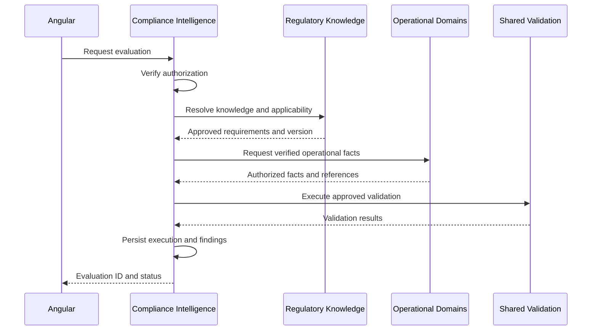
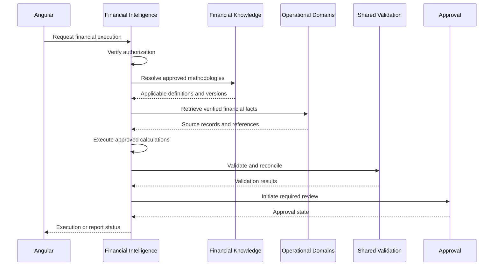
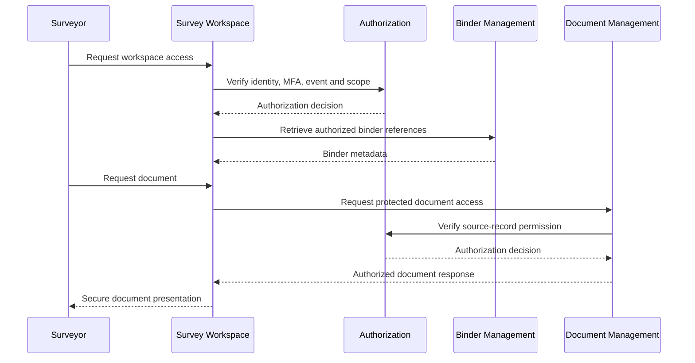

# ENG-009 — API and Event Contracts

**Document ID:** ENG-009  
**Version:** 1.0  
**Status:** Engineering Blueprint — Draft  
**Platform:** Regulatory Intelligence Platform  
**Organization:** McCaskill Projects  
**Document Location:** `docs/engineering/09-api-and-event-contracts.md`  
**Implementation Authorization:** Not Granted

---

# 1. Purpose and Scope

## 1.1 WHAT

This document establishes the API and event contract architecture for the Regulatory Intelligence Platform.

It defines how frontend applications, backend services, operational domains, knowledge engines, shared intelligence services, and applied intelligence capabilities communicate.

It specifies:

- API ownership and boundaries.
- HTTP interface conventions.
- Request and response envelopes.
- Authentication and authorization requirements.
- Tenant and resource scoping.
- API versioning.
- Validation and error contracts.
- Pagination, filtering, and concurrency.
- Synchronous service contracts.
- Asynchronous events.
- Event payloads and delivery behavior.
- Cross-domain workflow contracts.
- Historical traceability.
- Testing and compatibility requirements.

The endpoint examples and event schemas in this document are proposed contracts. They are not verified existing repository implementations.

## 1.2 WHEN

These standards apply before a team:

1. Creates a new API endpoint.
2. Modifies an existing API.
3. Exposes a service to another domain.
4. Publishes or consumes a business event.
5. Implements a frontend data-access service.
6. Implements an asynchronous workflow.
7. Changes an API request or response.
8. Changes an event payload.
9. Integrates an external system.
10. Introduces a breaking contract change.

## 1.3 WHERE

Contracts are owned by the domain providing the capability and exposed through approved NestJS modules and Nx public interfaces.

Frontend consumers use approved Angular data-access libraries.

Cross-domain communication occurs through public service contracts, approved application APIs, or events.

## 1.4 WHY

Without standardized contracts, independently developed services can become tightly coupled, duplicate authority, expose unauthorized records, or return inconsistent results.

The platform requires interfaces that are predictable, secure, versioned, and traceable.

## 1.5 HOW

Every API and event contract must answer:

| Question | Required definition |
|---|---|
| WHAT | What operation or event does the contract represent? |
| WHEN | What initiates the operation or event? |
| WHERE | Which domain owns the contract? |
| WHY | What business or technical requirement does it satisfy? |
| HOW | What inputs, outputs, permissions, and execution rules apply? |
| VERIFICATION | What tests prove the contract is correct? |

## 1.6 VERIFICATION

This document is ready for implementation planning when every cross-domain workflow has a defined communication mechanism and every externally exposed operation has an identifiable owner, authorization model, and contract.

---

# 2. API and Event Architecture Principles

## 2.1 WHAT

The platform uses three primary communication mechanisms.

| Mechanism | Purpose | Typical usage |
|---|---|---|
| HTTP API | Client-to-backend communication | Angular to NestJS |
| Internal service contract | Backend capability coordination | NestJS service-to-service calls |
| Domain event | Notification of completed business occurrences | Asynchronous cross-domain workflows |

## 2.2 WHEN

Use HTTP APIs when a client needs to request or submit information.

Use internal service contracts when backend capabilities require synchronous coordination within the approved application boundary.

Use events when another capability needs to react to a completed occurrence without controlling the producing domain.

## 2.3 WHERE

- HTTP controllers belong to the backend capability exposing the operation.
- Internal service contracts belong to the providing domain.
- Events belong to the producing domain.
- Shared integration infrastructure supports delivery and diagnostics.

## 2.4 WHY

These mechanisms allow services to coordinate without requiring every logical service to become a separately deployed microservice.

## 2.5 HOW

The following principles are mandatory.

**API-001 — Contract ownership**

Every contract has one primary owner.

**API-002 — Backend authority**

The backend validates and executes protected business operations.

**API-003 — Domain isolation**

Consumers cannot directly manipulate another domain's private implementation.

**API-004 — Knowledge separation**

Regulatory and financial knowledge remain independent authorities.

**API-005 — Verified tenant context**

Tenant scope is established from authorized identity and assignment relationships.

**API-006 — Explicit outcomes**

Operations return clear success, failure, conflict, or insufficient-information outcomes.

**API-007 — Historical context**

Authoritative results preserve applicable knowledge, methodology, input, and execution versions.

**API-008 — Contract compatibility**

Breaking changes require versioning or an approved migration.

**API-009 — Safe retries**

Retryable mutations must account for duplicate execution.

**API-010 — No implied deployment split**

Logical service boundaries do not require network calls or microservices.

## 2.6 VERIFICATION

Architecture review must confirm that each contract uses the correct communication mechanism and preserves ownership.

---

# 3. API Namespace and Versioning

## 3.1 WHAT

The API namespace provides consistent routing and compatibility management.

## 3.2 WHEN

It applies to every externally exposed backend HTTP endpoint.

## 3.3 WHERE

The existing NestJS API application.

## 3.4 WHY

Consistent routes simplify frontend integration, documentation, authorization, and future version changes.

## 3.5 HOW

Preserve the established API versioning convention:

`/api/v1`

Proposed target route groups include:

| Route group | Owning capability |
|---|---|
| `/api/v1/platform` | Platform Foundation |
| `/api/v1/organizations` | Organization Domain |
| `/api/v1/locations` | Location Domain |
| `/api/v1/people` | Person Domain |
| `/api/v1/workforce` | Workforce Domain |
| `/api/v1/services` | Service Operations |
| `/api/v1/contracts` | Contract Domain |
| `/api/v1/financial-operations` | Financial Operations |
| `/api/v1/residential` | Residential Operations |
| `/api/v1/iss` | ISS Operations |
| `/api/v1/regulatory-knowledge` | Regulatory Knowledge Engine |
| `/api/v1/financial-knowledge` | Financial Knowledge Engine |
| `/api/v1/evidence` | Shared Evidence |
| `/api/v1/documents` | Document Management |
| `/api/v1/validations` | Shared Validation |
| `/api/v1/compliance` | Compliance Intelligence |
| `/api/v1/financial-intelligence` | Financial Intelligence |
| `/api/v1/binders` | Binder Management |
| `/api/v1/surveys` | Survey Operations |
| `/api/v1/intelligence` | Application Composition |

These are target namespace proposals, not an instruction to replace existing working routes.

Before implementation, each route must be reconciled with existing API paths and approved for reuse, extension, or migration.

### Versioning rules

1. Compatible additions may remain within the current API version.
2. Breaking request or response changes require explicit review.
3. Existing consumers must not be broken without an approved migration.
4. Deprecated routes require documented replacement and retirement conditions.
5. Internal implementation refactoring does not automatically require a new external API version.

## 3.6 VERIFICATION

API compatibility tests must confirm that approved consumers remain functional after contract changes.

---

# 4. Standard HTTP Contract

## 4.1 WHAT

An HTTP contract defines the request and response behavior of an API endpoint.

## 4.2 WHEN

It is required before implementing an endpoint.

## 4.3 WHERE

The contract belongs to the endpoint's owning backend capability.

## 4.4 WHY

A predictable HTTP interface reduces inconsistent implementation and makes frontend integration easier.

## 4.5 HOW

### Standard request context

Every protected request must resolve:

- Authenticated actor.
- Verified tenant.
- Organization scope.
- Required permission.
- Resource scope.
- Correlation identifier.
- Relevant workflow context.

The backend must not trust an unverified client-supplied tenant identifier.

### Proposed successful response envelope

```json
{
  "data": {
    "id": "resource-identifier",
    "status": "ACTIVE"
  },
  "meta": {
    "requestId": "request-identifier",
    "version": 1
  }
}
```

### Proposed error response envelope

```json
{
  "error": {
    "code": "RESOURCE_NOT_FOUND",
    "message": "The requested resource was not found.",
    "details": []
  },
  "meta": {
    "requestId": "request-identifier"
  }
}
```

These envelopes are proposed standards. Existing compatible response conventions must be reviewed before adopting them.

### HTTP method conventions

| Method | Intended operation |
|---|---|
| GET | Retrieve information |
| POST | Create a resource or initiate an operation |
| PUT | Replace a resource representation where supported |
| PATCH | Modify selected fields or perform an approved partial update |
| DELETE | Delete or deactivate where the domain lifecycle permits |

For governed business records, lifecycle transitions should use explicit operations rather than arbitrary status-field changes.

For example, approving a financial report should not be equivalent to directly patching its status to `APPROVED`.

## 4.6 VERIFICATION

Contract tests must verify status codes, response schemas, error schemas, authorization, and business transition behavior.

---

# 5. API Contract Definition Template

Every proposed endpoint must have a contract record containing the following fields.

| Field | Required description |
|---|---|
| Contract ID | Stable API contract identifier |
| Owner | Responsible domain or capability |
| Service reference | ENG-008 service identifier |
| Purpose | Business operation |
| Trigger | When the operation is invoked |
| HTTP method | GET, POST, PATCH, etc. |
| Route | Proposed endpoint |
| Request DTO | Required and optional input |
| Response DTO | Expected output |
| Authentication | Required identity context |
| Authorization | Required permission and resource scope |
| Tenant context | Verified tenant behavior |
| Validation | Structural and business validation |
| Side effects | Records or workflows affected |
| Events | Events produced after completion |
| Idempotency | Duplicate request behavior |
| Concurrency | Version or conflict handling |
| Errors | Expected failure outcomes |
| Audit | Required traceability |
| Tests | Required verification |

A service identifier does not automatically imply one endpoint. A service may expose multiple operations or none directly.

---

# 6. Platform Foundation API Contracts

## 6.1 WHAT

Platform Foundation APIs expose authorized identity, tenant, organization-access, and configuration operations.

## 6.2 WHEN

They are used during session initialization, context selection, account administration, and protected application operations.

## 6.3 WHERE

Platform Foundation, reusing the existing security implementation.

## 6.4 WHY

All application capabilities require a consistent identity and authorization context.

## 6.5 HOW

| Contract | Proposed operation | Owner |
|---|---|---|
| API-PF-01 | GET `/platform/session` | Authentication |
| API-PF-02 | GET `/platform/organizations` | Organization Access |
| API-PF-03 | POST `/platform/tenant-context` | Tenant Context |
| API-PF-04 | GET `/platform/permissions` | Authorization |
| API-PF-05 | GET `/platform/configuration` | Configuration |

Paths in this and subsequent tables are relative to `/api/v1`.

### API-PF-03 — Select Tenant Context

**WHAT:** Select an authorized tenant context for the current session or operation.

**WHEN:** An authorized user changes their active organization.

**WHERE:** Platform Foundation.

**WHY:** Tenant selection must be verified rather than accepted directly from the browser.

**HOW:**

Request:

```json
{
  "requestedTenantId": "tenant-identifier"
}
```

Response:

```json
{
  "data": {
    "tenantId": "tenant-identifier",
    "organizationId": "organization-identifier",
    "authorized": true
  }
}
```

The backend must verify the user's assignment before establishing the context.

A context change must trigger appropriate frontend cache invalidation.

**VERIFICATION:** Unauthorized tenant selection and cross-tenant isolation tests.

## 6.6 VERIFICATION

No Platform Foundation API may bypass the existing security architecture or create a duplicate authentication mechanism.

---

# 7. Operational Domain API Contracts

## 7.1 WHAT

Operational APIs provide authorized access to business records and operational workflows.

## 7.2 WHEN

They are used during organization management, service delivery, workforce administration, financial operations, residential operations, and ISS activities.

## 7.3 WHERE

Each API belongs to the operational domain owning its records.

## 7.4 WHY

Operational records must remain independent of regulatory and financial evaluation authority.

## 7.5 HOW

| Contract | Proposed route | Service owner |
|---|---|---|
| API-OP-01 | GET/POST `/organizations` | OP-01 |
| API-OP-02 | GET/POST `/locations` | OP-02 |
| API-OP-03 | GET/POST `/people` | OP-03 |
| API-OP-04 | GET/POST `/workforce/employees` | OP-04 |
| API-OP-05 | GET/POST `/services/records` | OP-05 |
| API-OP-06 | GET/POST `/contracts` | OP-06 |
| API-OP-07 | GET/POST `/financial-operations/transactions` | OP-07 |
| API-OP-08 | GET/POST `/financial-operations/payroll-records` | OP-08 |
| API-OP-09 | GET `/services/statistics` | OP-09 |
| API-OP-10 | GET/POST `/residential/records` | OP-10 |
| API-OP-11 | GET/POST `/iss/records` | OP-11 |

These are logical endpoint families. The final resource structures must be derived from ENG-003 and ENG-004.

### Operational record contract

An operational record response should identify:

- Record ID.
- Owning tenant.
- Owning organization.
- Domain-specific data.
- Lifecycle status.
- Version.
- Creation and modification metadata.
- Relevant source relationships.

### Mutation rules

Mutations must enforce:

1. Authentication.
2. Authorization.
3. Tenant and record scope.
4. Structural validation.
5. Operational business validation.
6. Concurrency controls where applicable.
7. Audit requirements.

Operational APIs must not return independent compliance or financial allowability determinations.

## 7.6 VERIFICATION

Operational API tests must verify domain ownership, record integrity, tenant isolation, and lifecycle transitions.

---

# 8. Regulatory Knowledge API Contracts

## 8.1 WHAT

Regulatory Knowledge APIs expose governed regulatory source, requirement, pack, applicability, validation, review, and publication operations.

## 8.2 WHEN

They are used during regulatory knowledge administration and approved compliance evaluation.

## 8.3 WHERE

Regulatory Knowledge Engine.

## 8.4 WHY

Regulatory authority must be accessed through governed contracts rather than duplicated in consuming services.

## 8.5 HOW

| Contract | Method | Proposed route | Service |
|---|---|---|---|
| API-RK-01 | POST | `/regulatory-knowledge/sources` | RK-01 |
| API-RK-02 | POST | `/regulatory-knowledge/extractions` | RK-02 |
| API-RK-03 | POST | `/regulatory-knowledge/requirements` | RK-03 |
| API-RK-04 | POST | `/regulatory-knowledge/applicability/evaluate` | RK-04 |
| API-RK-05 | GET/POST | `/regulatory-knowledge/packs` | RK-05 |
| API-RK-06 | POST | `/regulatory-knowledge/packs/{id}/validate` | RK-06 |
| API-RK-07 | POST | `/regulatory-knowledge/packs/{id}/certify` | RK-07 |
| API-RK-08 | POST | `/regulatory-knowledge/packs/{id}/publish` | RK-08 |
| API-RK-09 | GET | `/regulatory-knowledge/changes` | RK-09 |
| API-RK-10 | POST | `/regulatory-knowledge/versions/resolve` | RK-10 |
| API-RK-11 | GET | `/regulatory-knowledge/requirements` | RK-11 |

### API-RK-04 — Regulatory Applicability

**WHAT:** Determine which approved regulatory requirements apply to verified operational context.

**WHEN:** Before compliance evaluation or during an authorized applicability inquiry.

**WHERE:** Regulatory Knowledge Engine.

**WHY:** Regulatory applicability must not be determined independently by operational services.

**HOW:**

Proposed request:

```json
{
  "jurisdiction": "TX",
  "program": "HCS",
  "evaluationDate": "2026-11-01",
  "contextReference": {
    "organizationId": "organization-identifier",
    "locationId": "location-identifier"
  }
}
```

The backend resolves the referenced context through authorized operational contracts. Client-supplied attributes must not automatically be treated as verified facts.

Proposed response:

```json
{
  "data": {
    "outcome": "DETERMINED",
    "knowledgePackId": "texas-hcs",
    "knowledgeVersion": "approved-version",
    "applicableRequirementIds": [
      "requirement-001"
    ],
    "unresolvedRequirementIds": [],
    "evaluatedAt": "2026-11-01T18:00:00Z"
  }
}
```

If required context is missing, the result must explicitly indicate insufficient information.

### Publication requirements

Certification and publication operations must:

- Verify the correct lifecycle state.
- Verify knowledge validation.
- Verify authorized approval.
- Preserve the published version.
- Prevent unauthorized direct status mutation.

## 8.6 VERIFICATION

Tests must verify applicability, version resolution, certification gates, publication authorization, and missing-information behavior.

---

# 9. Financial Knowledge API Contracts

## 9.1 WHAT

Financial Knowledge APIs expose governed financial definitions, classifications, methodologies, applicability, validation, approval, and publication.

## 9.2 WHEN

They are used during financial knowledge administration and financial intelligence execution.

## 9.3 WHERE

Financial Knowledge Engine.

## 9.4 WHY

Financial definitions and methodologies must remain independent of operational and regulatory authority.

## 9.5 HOW

| Contract | Method | Proposed route | Service |
|---|---|---|---|
| API-FK-01 | POST | `/financial-knowledge/sources` | FK-01 |
| API-FK-02 | GET/POST | `/financial-knowledge/definitions` | FK-02 |
| API-FK-03 | GET/POST | `/financial-knowledge/classifications` | FK-03 |
| API-FK-04 | POST | `/financial-knowledge/applicability/evaluate` | FK-04 |
| API-FK-05 | GET/POST | `/financial-knowledge/cost-principles` | FK-05 |
| API-FK-06 | GET/POST | `/financial-knowledge/allocation-methodologies` | FK-06 |
| API-FK-07 | GET/POST | `/financial-knowledge/rates-and-formulas` | FK-07 |
| API-FK-08 | GET/POST | `/financial-knowledge/reporting-structures` | FK-08 |
| API-FK-09 | POST | `/financial-knowledge/versions/{id}/validate` | FK-09 |
| API-FK-10 | POST | `/financial-knowledge/versions/{id}/approve` | FK-10 |
| API-FK-11 | POST | `/financial-knowledge/versions/{id}/publish` | FK-11 |
| API-FK-12 | POST | `/financial-knowledge/versions/resolve` | FK-12 |
| API-FK-13 | GET | `/financial-knowledge/approved` | FK-13 |

### API-FK-04 — Financial Applicability

**WHAT:** Determine which approved financial definitions and methodologies apply to a financial context.

**WHEN:** Before classification, allocation, calculation, or reporting.

**WHERE:** Financial Knowledge Engine.

**WHY:** Financial applicability is an independent financial authority.

**HOW:**

Proposed request:

```json
{
  "program": "HCS",
  "reportingPeriod": {
    "start": "2026-01-01",
    "end": "2026-12-31"
  },
  "organizationId": "organization-identifier",
  "reportType": "HCS_COST_REPORT"
}
```

Proposed response:

```json
{
  "data": {
    "outcome": "DETERMINED",
    "financialKnowledgeVersion": "approved-version",
    "applicableMethodologyIds": [
      "methodology-001"
    ],
    "unresolvedDefinitionIds": []
  }
}
```

Actual applicability must be determined from approved financial knowledge and verified context.

### Financial publication

Publishing a methodology must require:

- Completed validation.
- Authorized approval.
- Effective-period verification.
- Historical version preservation.

## 9.6 VERIFICATION

Tests must verify independent financial authority, effective-period resolution, approval, and publication behavior.

---

# 10. Shared Intelligence API Contracts

## 10.1 WHAT

Shared Intelligence APIs expose reusable evidence, document, validation, approval, reporting, audit, and binder operations.

## 10.2 WHEN

They are used when business workflows require shared technical capabilities.

## 10.3 WHERE

Shared Intelligence, with source ownership retained by the appropriate domain.

## 10.4 WHY

Common mechanisms should be reusable without becoming independent knowledge authorities.

## 10.5 HOW

| Contract | Method | Proposed route | Service |
|---|---|---|---|
| API-SI-01 | POST | `/evidence` | SI-01 |
| API-SI-02 | POST | `/evidence/{id}/relationships` | SI-02 |
| API-SI-03 | POST | `/validations/execute` | SI-03 |
| API-SI-04 | GET/POST | `/documents` | SI-04 |
| API-SI-05 | GET | `/documents/{id}/content` | SI-05 |
| API-SI-06 | GET | `/changes/{id}` | SI-06 |
| API-SI-07 | GET | `/audit/records` | SI-07 |
| API-SI-08 | GET | `/traceability/{executionId}` | SI-08 |
| API-SI-09 | POST | `/approvals/{workflowId}/decisions` | SI-09 |
| API-SI-10 | POST | `/reports/assemble` | SI-10 |
| API-SI-11 | GET | `/binders/types` | SI-11 |
| API-SI-12 | GET/POST | `/binders` | SI-12 |
| API-SI-13 | POST | `/binders/{id}/assemble` | SI-13 |
| API-SI-14 | POST | `/binders/{id}/check-completeness` | SI-14 |

Shared infrastructure operations must not be exposed directly to arbitrary users merely because an API route exists.

### API-SI-03 — Execute Validation

**WHAT:** Execute an approved validation definition.

**WHEN:** When an authorized workflow requests operational, regulatory, or financial validation.

**WHERE:** Shared Validation execution.

**WHY:** Execution is reusable while validation ownership remains separate.

**HOW:**

Proposed internal request:

```json
{
  "validationType": "REGULATORY",
  "definitionReference": {
    "authority": "REGULATORY_KNOWLEDGE",
    "definitionId": "requirement-001",
    "version": "approved-version"
  },
  "inputReferenceIds": [
    "operational-record-001"
  ],
  "executionContextId": "execution-context-001"
}
```

The service must verify that the definition is approved, that the caller is authorized, and that referenced inputs are accessible.

It must not accept arbitrary client-provided executable rule logic.

### API-SI-05 — Secure Document Access

**WHAT:** Retrieve protected document content.

**WHEN:** When an authorized user requests a document.

**WHERE:** Shared Document Management.

**WHY:** Document metadata visibility does not automatically authorize content access.

**HOW:** Enforce document ownership, tenant scope, resource scope, and workflow permissions.

Protected streaming or download behavior must follow the approved document-access policy.

### API-SI-09 — Approval Decision

**WHAT:** Record an authorized approval decision.

**WHEN:** During a governed approval workflow.

**WHERE:** Shared Approval infrastructure.

**WHY:** Approval execution is reusable, but approval authority belongs to the owning capability.

**HOW:** Validate approver assignment, workflow state, approval scope, and decision requirements.

The caller must not be able to select an arbitrary approval authority.

## 10.6 VERIFICATION

Tests must verify shared execution, domain ownership, source access, approval authorization, and traceability.

---

# 11. Compliance Intelligence API Contracts

## 11.1 WHAT

Compliance Intelligence APIs coordinate regulatory evaluation, findings, corrective action, and reassessment.

## 11.2 WHEN

They are used during compliance review and remediation workflows.

## 11.3 WHERE

Compliance Intelligence and Compliance Operations.

## 11.4 WHY

Compliance evaluation must use approved regulatory knowledge and verified operational facts.

## 11.5 HOW

| Contract | Method | Proposed route | Service |
|---|---|---|---|
| API-CI-01 | POST | `/compliance/evaluations` | CI-01 |
| API-CI-02 | GET | `/compliance/evaluations/{id}` | CI-03 |
| API-CI-03 | GET | `/compliance/findings` | CI-04 |
| API-CI-04 | POST | `/compliance/findings/{id}/corrective-actions` | CI-05 |
| API-CI-05 | POST | `/compliance/findings/{id}/reassess` | CI-06 |
| API-CI-06 | GET | `/compliance/dashboard` | CI-07 |

### API-CI-01 — Start Compliance Evaluation

**WHAT:** Initiate a regulatory compliance evaluation.

**WHEN:** On an authorized user request or approved scheduled trigger.

**WHERE:** Compliance Intelligence.

**WHY:** The workflow must coordinate knowledge, applicability, operational facts, and validation.

**HOW:**

Proposed request:

```json
{
  "organizationId": "organization-identifier",
  "scope": {
    "type": "PROVIDER"
  },
  "knowledgePackId": "texas-hcs",
  "evaluationDate": "2026-11-01"
}
```

The backend must:

1. Verify authorization.
2. Resolve regulatory knowledge.
3. Determine applicability.
4. Retrieve verified operational facts.
5. Execute approved validation.
6. Persist a traceable result.

Proposed response:

```json
{
  "data": {
    "evaluationId": "evaluation-identifier",
    "status": "QUEUED",
    "knowledgePackId": "texas-hcs"
  }
}
```

`QUEUED` is appropriate only if execution is asynchronous. A synchronous implementation must return the actual completed outcome.

Provider-wide evaluations must not require a location identifier unless the selected evaluation scope requires one.

## 11.6 VERIFICATION

Tests must verify authority, provider-wide scope, authorization, missing facts, result history, and reassessment behavior.

---

# 12. Financial Intelligence API Contracts

## 12.1 WHAT

Financial Intelligence APIs coordinate classification, calculation, reconciliation, reporting, approval, and release.

## 12.2 WHEN

They are used during financial reporting and cost-report workflows.

## 12.3 WHERE

Financial Intelligence and Financial Reporting.

## 12.4 WHY

Financial results must be produced from approved methodologies and verified inputs.

## 12.5 HOW

| Contract | Method | Proposed route | Service |
|---|---|---|---|
| API-FI-01 | POST | `/financial-intelligence/executions` | FI-01 |
| API-FI-02 | GET | `/financial-intelligence/executions/{id}` | FI-09 |
| API-FI-03 | POST | `/financial-intelligence/reconciliations` | FI-07 |
| API-FI-04 | POST | `/financial-intelligence/cost-reports` | FI-08 |
| API-FI-05 | GET | `/financial-intelligence/cost-reports/{id}` | FI-08 |
| API-FI-06 | POST | `/financial-intelligence/cost-reports/{id}/submit-review` | FI-10 |
| API-FI-07 | POST | `/financial-intelligence/cost-reports/{id}/release` | FI-10 |

### API-FI-01 — Start Financial Execution

**WHAT:** Initiate an approved financial calculation workflow.

**WHEN:** During financial preparation or reporting.

**WHERE:** Financial Intelligence.

**WHY:** Calculations must use approved Financial Knowledge and verified source records.

**HOW:**

Proposed request:

```json
{
  "organizationId": "organization-identifier",
  "reportType": "HCS_COST_REPORT",
  "reportingPeriod": {
    "start": "2026-01-01",
    "end": "2026-12-31"
  }
}
```

The backend must:

1. Verify authorization.
2. Resolve applicable financial knowledge.
3. Retrieve verified financial and operational facts.
4. Apply approved classifications.
5. Apply cost principles.
6. Execute allocations and formulas.
7. Reconcile results.
8. Preserve execution history.

Proposed response:

```json
{
  "data": {
    "executionId": "financial-execution-identifier",
    "status": "QUEUED",
    "reportType": "HCS_COST_REPORT"
  }
}
```

As with compliance evaluation, asynchronous status must reflect the actual execution model.

### Financial release

Release must be rejected when required:

- Validation is incomplete.
- Reconciliation is unresolved.
- Approval is missing.
- Report status is invalid.
- User authorization is insufficient.

## 12.6 VERIFICATION

Tests must verify calculation lineage, financial knowledge versioning, report approval, and release controls.

---

# 13. Binder and Survey API Contracts

## 13.1 WHAT

Binder and Survey APIs manage binder instances, survey events, surveyor assignments, requests, responses, and controlled access.

## 13.2 WHEN

They are used during financial binder preparation, survey preparation, active survey interaction, and closure.

## 13.3 WHERE

Binder Management and the relevant Binder or Survey Operations capability.

## 13.4 WHY

The platform must support secure, auditable workflows without transferring ownership of source records.

## 13.5 HOW

| Contract | Method | Proposed route | Service |
|---|---|---|---|
| API-BM-01 | POST | `/binders` | SI-12 |
| API-BM-02 | POST | `/binders/{id}/assemble` | SI-13 |
| API-BM-03 | POST | `/binders/{id}/submit-review` | BM-01/BM-02 |
| API-BM-04 | POST | `/binders/{id}/release` | BM-01/BM-02 |
| API-BM-05 | POST | `/surveys/events` | BM-03 |
| API-BM-06 | POST | `/surveys/events/{id}/surveyor-assignments` | BM-04 |
| API-BM-07 | GET | `/surveys/events/{id}/workspace` | BM-05 |
| API-BM-08 | POST | `/surveys/events/{id}/requests` | BM-06 |
| API-BM-09 | POST | `/surveys/requests/{id}/responses` | BM-07 |
| API-BM-10 | POST | `/surveys/events/{id}/close` | BM-09 |

### API-BM-01 — Create Binder

**WHAT:** Create a binder instance of an approved type.

**WHEN:** When an authorized user begins a binder workflow.

**WHERE:** Shared Binder Management.

**WHY:** Binder types are reusable, while individual instances have independent scopes and lifecycles.

**HOW:**

Proposed request:

```json
{
  "binderType": "FINANCIAL",
  "organizationId": "organization-identifier",
  "scope": {
    "reportingPeriod": {
      "start": "2026-01-01",
      "end": "2026-12-31"
    }
  }
}
```

The backend must validate binder type, ownership, scope, and applicable lifecycle requirements.

### API-BM-06 — Assign Surveyor

**WHAT:** Grant an individual surveyor approved event-specific access.

**WHEN:** Before the surveyor accesses protected survey resources.

**WHERE:** Survey Operations and Platform Authorization.

**WHY:** External surveyor access must be individual, scoped, time-limited, and revocable.

**HOW:**

Proposed request:

```json
{
  "surveyorUserId": "surveyor-identity",
  "permissions": [
    "SURVEY_VIEW",
    "SURVEY_REQUEST"
  ],
  "scope": {
    "organizationId": "organization-identifier",
    "locationIds": [
      "location-identifier"
    ]
  },
  "expiresAt": "2026-12-01T23:59:59Z"
}
```

The backend must validate the surveyor identity, MFA requirements, event relationship, scope, and assigning user's authority.

### API-BM-07 — Survey Workspace Access

**WHAT:** Retrieve authorized survey workspace information.

**WHEN:** When an assigned surveyor opens the workspace.

**WHERE:** Survey Workspace backend capability.

**WHY:** Surveyor access must not depend solely on frontend navigation restrictions.

**HOW:** Verify individual identity, event assignment, tenant scope, record scope, expiration, and revocation.

Every protected document access requires its own authorization check.

## 13.6 VERIFICATION

Tests must verify binder lifecycle, source-record authorization, surveyor access, expiration, revocation, and audit recording.

---

# 14. Application Composition API Contracts

## 14.1 WHAT

Application Composition APIs provide authorized, read-oriented views across multiple platform domains.

## 14.2 WHEN

They are used when frontend workspaces require information from multiple services.

## 14.3 WHERE

Approved application query boundaries.

## 14.4 WHY

Frontend applications should not reconstruct complex cross-domain relationships through uncontrolled private service access.

## 14.5 HOW

| Contract | Method | Proposed route | Owner |
|---|---|---|---|
| API-UX-01 | GET | `/intelligence/provider-dashboard` | UX-01 |
| API-UX-02 | GET | `/intelligence/regulatory-workbench` | UX-02 |
| API-UX-03 | GET | `/intelligence/financial-workbench` | UX-03 |
| API-UX-04 | GET | `/intelligence/executive` | UX-04 |
| API-UX-05 | GET | `/intelligence/knowledge-administration` | UX-05 |

Application Composition APIs must:

- Enforce authorized scope.
- Preserve source references.
- Distinguish management indicators from official determinations.
- Avoid independent regulatory or financial calculations.
- Respect domain-owned query contracts.

## 14.6 VERIFICATION

Tests must verify authorized composition, data consistency, source lineage, and tenant isolation.

---

# 15. API Authentication and Authorization Contracts

## 15.1 WHAT

Authorization contracts define which actors may invoke operations and access resources.

## 15.2 WHEN

They apply before every protected API operation.

## 15.3 WHERE

Existing Platform Foundation security services and backend enforcement points.

## 15.4 WHY

An authenticated user is not automatically authorized to access every organization, location, person, document, or workflow.

## 15.5 HOW

Each protected contract must specify:

1. Actor type.
2. Authentication requirement.
3. Required permission.
4. Tenant scope.
5. Organization scope.
6. Resource scope.
7. Workflow-state restrictions.
8. Additional security conditions.

### Actor categories

Proposed logical categories include:

- Platform administrator.
- Knowledge administrator.
- Provider administrator.
- Provider employee.
- Financial reviewer.
- Compliance reviewer.
- External surveyor.
- Approved service identity.

These are logical actor categories, not instructions to create new roles or replace the existing permission model.

ENG-010 will define the detailed authorization matrix.

### Authorization decision

A protected request must be denied if the user lacks required access, even if the frontend exposes the action.

### Service identity

Internal background jobs and integrations must use approved service identity or execution context.

They must not bypass authorization simply because they are internal.

## 15.6 VERIFICATION

Tests must cover unauthorized access, cross-tenant access, record-level scope, workflow restrictions, and revoked permissions.

---

# 16. Pagination, Filtering, Sorting, and Query Safety

## 16.1 WHAT

Query contracts control how clients retrieve collections.

## 16.2 WHEN

They apply to APIs returning potentially large record sets.

## 16.3 WHERE

The owning domain's query API.

## 16.4 WHY

Unbounded queries can create performance problems and excessive data exposure.

## 16.5 HOW

Collection endpoints must define:

- Pagination mechanism.
- Maximum page size.
- Supported filters.
- Supported sort fields.
- Default ordering.
- Authorization-aware filtering.
- Response metadata.

Example:

`GET /api/v1/compliance/findings?page=1&pageSize=25&status=OPEN`

Proposed response:

```json
{
  "data": [],
  "meta": {
    "page": 1,
    "pageSize": 25,
    "total": 0,
    "requestId": "request-identifier"
  }
}
```

The final pagination standard must be chosen consistently across the platform. Cursor pagination may be preferable for large or frequently changing datasets.

Client-provided sort fields and filters must be validated against approved fields.

## 16.6 VERIFICATION

Tests must verify page boundaries, maximum limits, stable ordering, authorized filtering, and query safety.

---

# 17. Idempotency and Concurrency Contracts

## 17.1 WHAT

Idempotency prevents repeated requests from unintentionally creating duplicate business effects.

Concurrency controls prevent conflicting updates from silently overwriting one another.

## 17.2 WHEN

They are required for operations vulnerable to retries, duplicate submissions, or concurrent modification.

## 17.3 WHERE

The owning backend service and its persistence boundary.

## 17.4 WHY

Network retries and simultaneous users can otherwise produce duplicate records or lost updates.

## 17.5 HOW

### Idempotency

For approved mutation operations, support an idempotency key or equivalent domain-specific duplicate protection.

The service must define:

- Key scope.
- Retention period.
- Duplicate request behavior.
- Payload mismatch behavior.
- Result replay behavior.

### Concurrency

Where appropriate, use:

- Record versions.
- Optimistic locking.
- Explicit state transition checks.
- Transaction boundaries.
- Database constraints.

### High-risk operations

Approval, publication, certification, release, and financial execution must have explicit duplicate and concurrency behavior.

## 17.6 VERIFICATION

Tests must verify repeated submissions, conflicting updates, and concurrent state transitions.

---

# 18. Standard Error Contract

## 18.1 WHAT

The error contract provides predictable failure information without exposing internal implementation details.

## 18.2 WHEN

It applies whenever an API operation cannot complete successfully.

## 18.3 WHERE

The backend API boundary, using shared exception handling and domain-owned error definitions.

## 18.4 WHY

Clients must distinguish invalid input, unauthorized access, missing information, conflicts, and infrastructure failures.

## 18.5 HOW

Proposed error categories:

| Code | Meaning | Typical HTTP status |
|---|---|---|
| `VALIDATION_FAILED` | Invalid request structure or fields | 400 |
| `UNAUTHENTICATED` | Authentication required or invalid | 401 |
| `FORBIDDEN` | Insufficient authorization | 403 |
| `RESOURCE_NOT_FOUND` | Resource unavailable or undisclosed | 404 |
| `STATE_CONFLICT` | Invalid lifecycle transition | 409 |
| `VERSION_CONFLICT` | Concurrent modification | 409 |
| `KNOWLEDGE_NOT_APPROVED` | Required knowledge is not approved | 409 or domain-specific |
| `INSUFFICIENT_INFORMATION` | Required business facts are missing | Domain-specific outcome |
| `RATE_LIMITED` | Request limit exceeded | 429 |
| `INTERNAL_ERROR` | Unexpected server failure | 500 |
| `DEPENDENCY_UNAVAILABLE` | Required dependency unavailable | 503 |

Insufficient information is often a valid domain outcome rather than an HTTP transport failure. The owning contract must distinguish these cases.

Error responses must not expose credentials, stack traces, protected record details, or unnecessary personal information.

## 18.6 VERIFICATION

Tests must verify consistent error structures and safe disclosure behavior.

---

# 19. Event Contract Architecture

## 19.1 WHAT

Domain events represent business occurrences that have already happened.

An event communicates a fact. It is not an instruction for another domain to violate its ownership rules.

## 19.2 WHEN

Events are produced after the owning domain completes an important business transition.

Examples include:

- Knowledge published.
- Operational record updated.
- Compliance evaluation completed.
- Financial calculation completed.
- Binder released.
- Survey access revoked.

## 19.3 WHERE

Each event belongs to the producing domain.

Delivery infrastructure is shared technical infrastructure.

## 19.4 WHY

Events allow independent capabilities to respond to changes without tightly coupling their internal implementations.

## 19.5 HOW

### Proposed standard event envelope

```json
{
  "eventId": "event-identifier",
  "eventType": "regulatory.knowledge.published",
  "eventVersion": 1,
  "occurredAt": "2026-11-01T18:00:00Z",
  "producer": "REGULATORY_KNOWLEDGE",
  "tenantId": null,
  "correlationId": "correlation-identifier",
  "subject": {
    "type": "KNOWLEDGE_PACK",
    "id": "texas-hcs"
  },
  "data": {
    "version": "approved-version"
  }
}
```

### Required event metadata

Every event must identify:

- Unique event ID.
- Event type.
- Event version.
- Occurrence time.
- Producing domain.
- Subject reference.
- Correlation ID.
- Tenant scope when applicable.
- Minimum required event data.

### Event rules

1. Publish events only after the underlying business transition is committed.
2. Do not include unnecessary sensitive information.
3. Consumers must handle duplicate delivery.
4. Consumers must not assume global event ordering.
5. Failed processing must have an approved retry or recovery strategy.
6. Event schemas must be versioned.
7. Consumers must respect authorization and tenant context.
8. Event processing must be auditable where required.

## 19.6 VERIFICATION

Event tests must verify schema, ownership, duplicate handling, delivery failure, and recovery.

---

# 20. Master Event Catalog

## 20.1 WHAT

The Master Event Catalog identifies proposed domain events required to coordinate platform workflows.

## 20.2 WHEN

Events are finalized during detailed service contract design and implementation planning.

## 20.3 WHERE

Events are owned by their producing domains.

## 20.4 WHY

A central catalog prevents inconsistent event names and duplicate notifications.

## 20.5 HOW

### Platform Foundation events

| Event ID | Event name | Producer |
|---|---|---|
| EVT-PF-01 | `platform.user.created` | Identity |
| EVT-PF-02 | `platform.user.access-changed` | Authorization |
| EVT-PF-03 | `platform.tenant.access-revoked` | Tenant Access |

### Operational events

| Event ID | Event name | Producer |
|---|---|---|
| EVT-OP-01 | `operations.organization.created` | Organization |
| EVT-OP-02 | `operations.location.updated` | Location |
| EVT-OP-03 | `operations.person.updated` | Person |
| EVT-OP-04 | `operations.workforce.assignment-changed` | Workforce |
| EVT-OP-05 | `operations.service.recorded` | Service Operations |
| EVT-OP-06 | `operations.transaction.recorded` | Financial Operations |
| EVT-OP-07 | `operations.payroll.completed` | Payroll Operations |
| EVT-OP-08 | `operations.residential.record-updated` | Residential Operations |
| EVT-OP-09 | `operations.iss.service-recorded` | ISS Operations |

### Regulatory Knowledge events

| Event ID | Event name | Producer |
|---|---|---|
| EVT-RK-01 | `regulatory.source.registered` | Regulatory Knowledge |
| EVT-RK-02 | `regulatory.knowledge.validated` | Regulatory Knowledge |
| EVT-RK-03 | `regulatory.knowledge.certified` | Regulatory Knowledge |
| EVT-RK-04 | `regulatory.knowledge.published` | Regulatory Knowledge |
| EVT-RK-05 | `regulatory.source.change-detected` | Regulatory Knowledge |

### Financial Knowledge events

| Event ID | Event name | Producer |
|---|---|---|
| EVT-FK-01 | `financial.definition.created` | Financial Knowledge |
| EVT-FK-02 | `financial.methodology.validated` | Financial Knowledge |
| EVT-FK-03 | `financial.methodology.approved` | Financial Knowledge |
| EVT-FK-04 | `financial.knowledge.published` | Financial Knowledge |

### Shared Intelligence events

| Event ID | Event name | Producer |
|---|---|---|
| EVT-SI-01 | `evidence.registered` | Evidence |
| EVT-SI-02 | `document.version-created` | Document Management |
| EVT-SI-03 | `approval.completed` | Approval Workflow |
| EVT-SI-04 | `binder.assembled` | Binder Management |
| EVT-SI-05 | `binder.released` | Binder Management |

### Compliance Intelligence events

| Event ID | Event name | Producer |
|---|---|---|
| EVT-CI-01 | `compliance.evaluation.completed` | Compliance Intelligence |
| EVT-CI-02 | `compliance.finding.created` | Compliance Operations |
| EVT-CI-03 | `compliance.corrective-action.completed` | Compliance Operations |
| EVT-CI-04 | `compliance.reassessment.completed` | Compliance Intelligence |

### Financial Intelligence events

| Event ID | Event name | Producer |
|---|---|---|
| EVT-FI-01 | `financial.execution.completed` | Financial Intelligence |
| EVT-FI-02 | `financial.reconciliation.completed` | Financial Intelligence |
| EVT-FI-03 | `financial.cost-report.prepared` | Financial Reporting |
| EVT-FI-04 | `financial.cost-report.released` | Financial Reporting |

### Survey events

| Event ID | Event name | Producer |
|---|---|---|
| EVT-BM-01 | `survey.event.created` | Survey Operations |
| EVT-BM-02 | `survey.surveyor.assigned` | Survey Operations |
| EVT-BM-03 | `survey.request.created` | Survey Operations |
| EVT-BM-04 | `survey.response.submitted` | Survey Operations |
| EVT-BM-05 | `survey.access.revoked` | Survey Operations |
| EVT-BM-06 | `survey.event.closed` | Survey Operations |

These event identifiers are candidates. Their final relationship to the workflow events in ENG-001 and ENG-002 must be reconciled before implementation.

## 20.6 VERIFICATION

Every approved event must map to a real business transition and have an identified producer and at least one justified consumer or audit requirement.

---

# 21. Event Delivery, Reliability, and Recovery

## 21.1 WHAT

Event reliability defines how events remain consistent with committed business records and how consumers handle failures.

## 21.2 WHEN

It applies whenever a workflow uses asynchronous event communication.

## 21.3 WHERE

The producing domain, shared delivery infrastructure, and consuming service.

## 21.4 WHY

A database transaction may succeed while an event delivery fails, or an event may be delivered more than once.

The platform must prevent these conditions from silently corrupting workflows.

## 21.5 HOW

### Transactional consistency

Where a committed database change must produce an event, use an approved reliable publication pattern, such as a transactional outbox or an equivalent mechanism compatible with the existing environment.

Do not assume that writing a database record and publishing an external event are one atomic operation.

### Delivery semantics

Consumers must be designed for possible duplicate delivery.

Exactly-once delivery must not be assumed.

### Consumer idempotency

Consumers should identify previously processed event IDs or otherwise enforce idempotent behavior.

### Failure handling

Define:

- Retry policy.
- Maximum attempts.
- Failure recording.
- Recovery or replay process.
- Escalation conditions.
- Audit requirements.

### Ordering

Where ordering matters, use an approved ordering strategy based on aggregate identity or version.

Do not assume global ordering across all domains.

## 21.6 VERIFICATION

Tests must simulate duplicate events, failed delivery, delayed delivery, out-of-order events, and recovery.

---

# 22. Cross-Domain Workflow Contracts

## 22.1 WHAT

Cross-domain contracts define the sequence of interactions required for workflows involving multiple owners.

## 22.2 WHEN

They apply to compliance evaluation, financial reporting, binder assembly, and survey workflows.

## 22.3 WHERE

Coordination belongs to the appropriate Applied Intelligence or business workflow capability.

## 22.4 WHY

Cross-domain workflows must not erase ownership boundaries.

## 22.5 HOW

### Regulatory evaluation contract



### Financial reporting contract



### Survey access contract



These diagrams show logical interactions. They do not require separate network services for every participant.

## 22.6 VERIFICATION

Integration tests must confirm authority selection, domain ownership, authorization, failure handling, and traceability.

---

# 23. API and Event Security

## 23.1 WHAT

API and event security protects identity, tenant context, resource access, and confidential information.

## 23.2 WHEN

It applies to every protected request and every event containing tenant or business context.

## 23.3 WHERE

The existing security foundation and each producing or consuming service.

## 23.4 WHY

A secure frontend cannot compensate for an insecure backend contract.

## 23.5 HOW

### API security

Require:

- Authentication.
- Authorization.
- Verified tenant context.
- Resource-level scope.
- Input validation.
- Appropriate rate limiting.
- Safe error responses.
- Audit where required.

### Event security

Events must:

- Avoid unnecessary sensitive payloads.
- Identify appropriate tenant scope.
- Use approved producer and consumer relationships.
- Prevent unauthorized cross-tenant processing.
- Preserve correlation and traceability.

### External integrations

External consumers require approved identity, scope, and access policies.

They must not receive unrestricted internal event streams.

## 23.6 VERIFICATION

Security tests must cover API access, event consumption, tenant isolation, and sensitive-data exposure.

---

# 24. API and Event Observability

## 24.1 WHAT

Observability provides diagnostic visibility across requests, services, jobs, and events.

## 24.2 WHEN

It applies throughout development, testing, and production operation.

## 24.3 WHERE

Existing backend diagnostics and approved shared technical infrastructure.

## 24.4 WHY

Cross-domain failures must be traceable without exposing sensitive information.

## 24.5 HOW

Record applicable:

- Request ID.
- Correlation ID.
- Event ID.
- Producer.
- Consumer.
- Domain.
- Operation.
- Tenant context.
- Execution status.
- Error category.
- Timestamp.

Avoid logging confidential payloads or authentication secrets.

## 24.6 VERIFICATION

A cross-domain operation must be traceable through its request, internal execution, and emitted events.

---

# 25. API and Event Testing Strategy

## 25.1 WHAT

Contract testing verifies that independently developed components communicate correctly.

## 25.2 WHEN

Testing begins during contract implementation and continues through integration and release.

## 25.3 WHERE

Tests belong with the owning API, event producer, consumer, or integration boundary.

## 25.4 WHY

An API may work independently while breaking downstream consumers or weakening authorization.

## 25.5 HOW

### API contract tests

Verify:

- Required fields.
- Optional fields.
- Response schemas.
- HTTP status codes.
- Validation errors.
- Authorization.
- Tenant isolation.
- Pagination.
- Version compatibility.
- Idempotency.
- Concurrency.

### Event contract tests

Verify:

- Event schema.
- Event version.
- Producer ownership.
- Required metadata.
- Duplicate handling.
- Retry behavior.
- Out-of-order behavior.
- Consumer compatibility.

### Cross-domain integration tests

Verify:

- Knowledge resolution.
- Operational fact retrieval.
- Shared validation.
- Financial calculation.
- Binder assembly.
- Survey authorization.
- Audit and traceability.

### Security tests

Verify:

- Unauthorized requests.
- Cross-tenant access.
- Resource scope.
- Expired access.
- Revoked permissions.
- Sensitive-data protection.

## 25.6 VERIFICATION

Required tests must pass through the existing Nx and CI workflow.

---

# 26. API and Event Implementation Sequence

## 26.1 WHAT

This section defines the engineering sequence for implementing an approved API or event.

## 26.2 WHEN

Use this sequence after implementation authorization.

## 26.3 WHERE

The owning Nx project and backend module.

## 26.4 WHY

Contracts must be designed from approved business workflows and ownership, not invented while coding.

## 26.5 HOW

| Step | Activity | Required output |
|---|---|---|
| 1 | Identify workflow | ENG-001/ENG-002 reference |
| 2 | Identify owning service | ENG-008 service ID |
| 3 | Identify entities | ENG-003/ENG-004 references |
| 4 | Identify authority | Regulatory, financial, or operational |
| 5 | Define contract | Request, response, or event schema |
| 6 | Define authorization | Actor, tenant, permission, resource scope |
| 7 | Define validation | Structural and business rules |
| 8 | Define execution | Synchronous or asynchronous behavior |
| 9 | Define failure behavior | Error and recovery contracts |
| 10 | Define concurrency | Version and idempotency rules |
| 11 | Define audit | Traceability requirements |
| 12 | Define tests | Contract and integration tests |
| 13 | Review Nx boundaries | Approved project dependencies |
| 14 | Implement after approval | Working contract |
| 15 | Run tests and CI | Verification evidence |
| 16 | Update change register | Documented implementation change |

## 26.6 VERIFICATION

An API or event cannot be accepted without documented ownership, authorization, schema, failure behavior, compatibility, tests, and change history.

---

# 27. Repository Reconciliation

## 27.1 WHAT

Repository reconciliation compares approved target API and event contracts with the existing implementation.

## 27.2 WHEN

After the engineering blueprint is approved and before corresponding implementation changes.

## 27.3 WHERE

The existing Nx monorepo.

## 27.4 WHY

The target architecture must be designed independently of historical code while preserving useful working implementations.

## 27.5 HOW

For every target contract, identify:

- Existing equivalent.
- Existing partial equivalent.
- No existing equivalent.
- Compatibility conflict.
- Security gap.
- Required extension.
- Required migration.
- Proposed deprecation.

Preserve existing working routes where they satisfy the approved contract.

Do not introduce duplicate endpoints simply because the target catalog uses different names.

## 27.6 VERIFICATION

Every implementation proposal must include an approved target-to-existing mapping.

---

# 28. Contract Acceptance Criteria

The API and Event Contract architecture is ready for implementation planning when:

- [ ] Every API has a primary owner.
- [ ] Every event has a producing domain.
- [ ] Every contract maps to an ENG-008 service.
- [ ] Request and response structures are defined.
- [ ] Event payload structures are defined.
- [ ] Authentication requirements are identified.
- [ ] Authorization and tenant scope are identified.
- [ ] Error behavior is defined.
- [ ] Idempotency and concurrency are considered.
- [ ] Versioning and compatibility are defined.
- [ ] Required audit and traceability are identified.
- [ ] Knowledge authority boundaries are preserved.
- [ ] Operational record ownership is preserved.
- [ ] Shared services do not invent authority.
- [ ] Cross-domain workflow interactions are defined.
- [ ] Security and integration tests are identified.
- [ ] Existing infrastructure and security reuse are preserved.

Detailed endpoint-specific schemas, field constraints, permissions, and consumer mappings must be completed and approved before each contract is implemented.

---

# 29. Relationship to Other Engineering Documents

| Document | Relationship |
|---|---|
| ENG-001 — Master Workflow Catalog | Defines workflows requiring contracts |
| ENG-002 — Workflow Diagrams and State Machines | Defines interaction sequences |
| ENG-003 — Master Entity Catalog | Defines authoritative business entities |
| ENG-004 — Entity Relationship Model | Defines relationships and ownership |
| ENG-005 — Nx Workspace Architecture | Defines dependency boundaries |
| ENG-006 — Technology Implementation Standards | Defines implementation conventions |
| ENG-007 — Frontend State Management Architecture | Defines frontend contract consumption |
| ENG-008 — Service and Module Catalog | Defines contract owners and responsibilities |
| ENG-010 — Authorization and Permission Matrix | Defines detailed access requirements |
| ENG-011 — User Interface and Workspace Specification | Defines user-facing API needs |
| ENG-012 — Data Architecture | Defines persistence and lifecycle requirements |
| ENG-013 — Testing and Quality Strategy | Defines verification requirements |
| ENG-014 — Team Work Packages | Assigns contract implementation work |
| ENG-015 — Sprint Implementation Packages | Sequences implementation |

---

# 30. Implementation Authorization

**Status: Not Granted**

This document defines the proposed API and event architecture.

It does not authorize:

- Creating new controllers.
- Creating or modifying API endpoints.
- Changing request or response DTOs.
- Publishing new domain events.
- Introducing messaging infrastructure.
- Modifying authorization behavior.
- Creating new Nx projects.
- Changing database schemas.
- Refactoring existing integrations.
- Beginning sprint implementation.

Implementation begins only after the engineering blueprint is completed, reviewed, and explicitly approved.

---

**End of ENG-009 — API and Event Contracts**