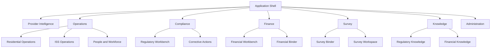
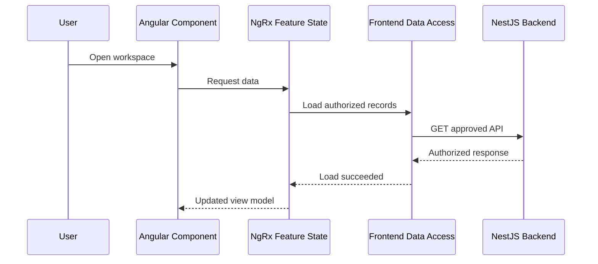
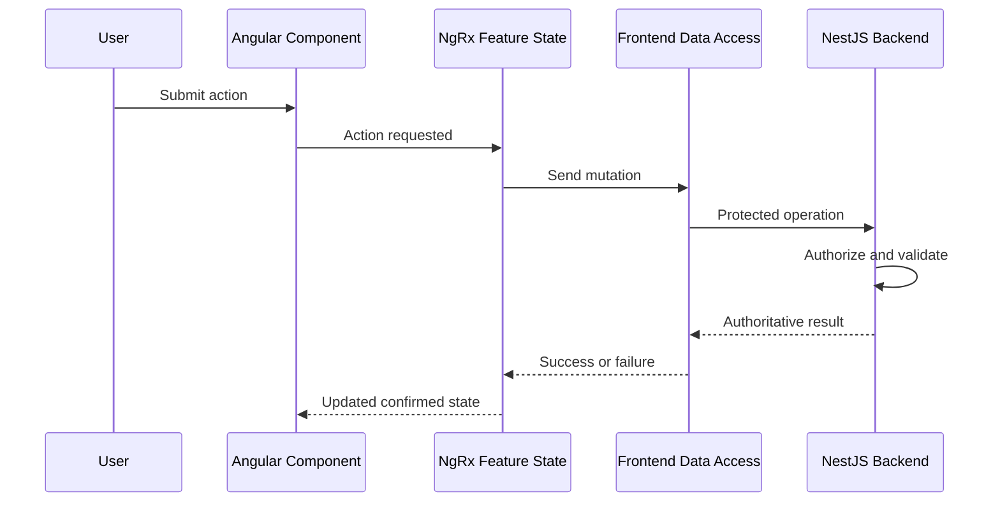

# ENG-011 — User Interface and Workspace Specification

**Document ID:** ENG-011  
**Version:** 1.0  
**Status:** Engineering Blueprint — Draft  
**Platform:** Regulatory Intelligence Platform  
**Organization:** McCaskill Projects  
**Document Location:** `docs/engineering/11-user-interface-and-workspace-specification.md`  
**Implementation Authorization:** Not Granted

---

# 1. Purpose and Scope

## 1.1 WHAT

This document defines the target user interface and workspace architecture for the Regulatory Intelligence Platform.

It establishes:

- Platform navigation and information architecture.
- Global application shell.
- Provider Intelligence Center.
- Regulatory Workbench.
- Financial Workbench.
- Regulatory Knowledge Administration.
- Financial Knowledge Administration.
- Operational Workspaces.
- Residential Operations Workspace.
- Individualized Skills and Socialization Workspace.
- Compliance Finding and Corrective Action Workspace.
- Financial Binder.
- Survey Binder and Survey Workspace.
- Executive Intelligence.
- Document and Evidence interfaces.
- User actions and workflow transitions.
- Role-aware presentation.
- Component and design standards.
- Frontend state and backend integration.
- Accessibility, responsiveness, and testing requirements.

This document defines the target experience. It does not assert that every screen, route, or component already exists.

## 1.2 WHEN

These standards apply before:

1. Creating an Angular page or component.
2. Adding navigation or routes.
3. Creating a new workspace.
4. Modifying an existing workflow.
5. Connecting a frontend feature to an API.
6. Adding a role-restricted action.
7. Introducing a dashboard or report.
8. Implementing a new knowledge administration interface.
9. Implementing binder or survey experiences.
10. Approving frontend implementation work.

## 1.3 WHERE

The user interface is implemented in the existing Angular 20 standalone frontend within the Nx monorepo.

Frontend state follows ENG-007.

Backend service integration follows ENG-008 and ENG-009.

Authorization follows ENG-010.

## 1.4 WHY

The platform serves multiple professional responsibilities. Users need coherent workflows rather than a collection of disconnected forms and dashboards.

The interface must make it easy to identify:

- What requires attention.
- Why it requires attention.
- Which records are affected.
- Which rule or methodology applies.
- What action is permitted.
- Who is responsible.
- Whether work is complete.
- What evidence supports the result.

## 1.5 HOW

The platform uses a consistent application shell with capability-specific workspaces.

Each workspace follows a common interaction pattern:

**Overview → Identify Work → Inspect Detail → Take Action → Validate → Review → Complete → Preserve History**

The exact steps depend on the governing business workflow.

## 1.6 VERIFICATION

A workspace is acceptable when its navigation, actions, data sources, permissions, loading behavior, error handling, and workflow transitions are documented and testable.

---

# 2. Product Experience Principles

## 2.1 WHAT

The platform uses an enterprise-grade, desktop-first design system with a clean, professional presentation.

The intended visual quality is comparable to a mature Fortune 100 enterprise application.

## 2.2 WHEN

These principles apply to every workspace and reusable component.

## 2.3 WHERE

The Angular application shell, shared UI components, feature pages, and design tokens.

## 2.4 WHY

The platform contains complex regulatory, financial, and operational information. Visual consistency reduces cognitive load and helps users distinguish facts, decisions, and actions.

## 2.5 HOW

The following principles are mandatory.

**UX-001 — Clarity before decoration**

Prioritize readable information, meaningful hierarchy, and clear actions.

**UX-002 — Work-oriented navigation**

Organize screens around user responsibilities and workflows.

**UX-003 — Progressive disclosure**

Present summaries first, with deeper detail available when needed.

**UX-004 — Consistent interaction patterns**

Tables, filters, forms, drawers, dialogs, and status indicators must behave consistently.

**UX-005 — Explainable intelligence**

Every authoritative determination must provide access to its governing knowledge, supporting facts, and execution history.

**UX-006 — Visible workflow status**

Users must distinguish draft, pending, under review, approved, released, completed, and failed states.

**UX-007 — Permission-aware presentation**

Display actions according to the user's effective permissions without treating the frontend as the security authority.

**UX-008 — No false completion**

Do not display an authoritative action as complete until the backend confirms it.

**UX-009 — Provider-wide context**

Provider dashboards must support organization-wide views without requiring a location identifier.

**UX-010 — Jurisdiction-neutral foundation**

Core components and operational workspaces must not be hardcoded to Texas HCS.

## 2.6 VERIFICATION

Design review and usability testing must confirm consistent behavior, terminology, and workflow clarity.

---

# 3. Application Information Architecture

## 3.1 WHAT

The application information architecture organizes capabilities into major navigation groups.

## 3.2 WHEN

It is used whenever users navigate between workspaces.

## 3.3 WHERE

The global Angular application shell.

## 3.4 WHY

Navigation must reflect the platform's logical capabilities without exposing unnecessary architectural complexity.

## 3.5 HOW

### Proposed primary navigation

| Navigation group | Workspace | Purpose |
|---|---|---|
| Intelligence | Provider Intelligence Center | Provider-wide command center |
| Intelligence | Executive Intelligence | Management and strategic indicators |
| Operations | Organization Management | Organizational records |
| Operations | People and Workforce | Person and employee records |
| Operations | Service Operations | Service delivery and statistics |
| Operations | Residential Operations | Residential workflows |
| Operations | ISS Operations | Individualized Skills and Socialization |
| Compliance | Regulatory Workbench | Regulatory evaluation and findings |
| Compliance | Corrective Actions | Remediation and reassessment |
| Finance | Financial Workbench | Financial execution and reporting |
| Finance | Financial Binder | Financial evidence and reporting binder |
| Survey | Survey Binder | Survey preparation |
| Survey | Survey Workspace | Active survey collaboration |
| Knowledge | Regulatory Knowledge Administration | Regulatory knowledge lifecycle |
| Knowledge | Financial Knowledge Administration | Financial knowledge lifecycle |
| Administration | Users and Access | Authorized user and permission administration |
| Administration | Configuration | Approved platform settings |

Navigation groups and labels are target UX definitions, not necessarily one-to-one Nx modules.

### Navigation hierarchy



## 3.6 VERIFICATION

Navigation must be permission-aware, support deep links, and preserve correct tenant context.

---

# 4. Global Application Shell

## 4.1 WHAT

The Application Shell provides the consistent structure surrounding all workspaces.

## 4.2 WHEN

It is active throughout authenticated application use.

## 4.3 WHERE

The Angular application-level layout and shared UI libraries.

## 4.4 WHY

Users should not need to relearn navigation and global controls when switching capabilities.

## 4.5 HOW

### Shell regions

| Region | Required behavior |
|---|---|
| Global header | Platform identity, current context, account access |
| Primary navigation | Permission-aware workspace navigation |
| Workspace header | Title, description, breadcrumbs, key actions |
| Context selector | Authorized tenant or organization selection |
| Main content | Active workspace |
| Notifications | Authorized alerts and workflow messages |
| Global search | Search only authorized indexed resources |
| User menu | Profile, session, preferences, sign-out |

### Proposed desktop layout

```text
┌─────────────────────────────────────────────────────────────────────────────┐
│ Platform Identity       Organization Context       Search       User Menu  │
├───────────────────┬─────────────────────────────────────────────────────────┤
│                   │ Breadcrumbs                                             │
│ INTELLIGENCE      │                                                         │
│ OPERATIONS        │ Workspace Title                         Primary Action  │
│ COMPLIANCE        │ Workspace Description                                   │
│ FINANCE           ├─────────────────────────────────────────────────────────┤
│ SURVEY            │                                                         │
│ KNOWLEDGE         │                   Workspace Content                     │
│ ADMINISTRATION    │                                                         │
│                   │                                                         │
└───────────────────┴─────────────────────────────────────────────────────────┘
```

### Context switching

When the active tenant changes:

1. Validate the new context through the backend.
2. Invalidate tenant-scoped state.
3. Cancel or disregard old-context requests.
4. Rebuild authorized navigation.
5. Load the new organization's information.

## 4.6 VERIFICATION

Test navigation, context switching, keyboard access, route guards, and session expiration.

---

# 5. Shared Workspace Layout Standard

## 5.1 WHAT

A shared layout standard defines the structure of business workspaces.

## 5.2 WHEN

It applies to operational, regulatory, financial, knowledge, and binder workspaces.

## 5.3 WHERE

Shared Angular UI components and feature-specific page compositions.

## 5.4 WHY

Consistent layouts improve usability and reduce duplicate component development.

## 5.5 HOW

### Standard workspace regions

1. Workspace title and purpose.
2. Scope and context.
3. Summary indicators.
4. Filters and search.
5. Main work queue or record table.
6. Detail panel or record workspace.
7. Primary and secondary actions.
8. Validation and workflow status.
9. History and traceability.

Not every workspace requires all nine regions.

### Standard screen states

Every data-driven workspace must support:

- Initial loading.
- Loaded with records.
- Loaded with no records.
- Filtered with no matches.
- Request failure.
- Permission denied.
- Stale or refresh-required data.
- Pending mutation.
- Completed mutation.
- Conflict requiring user action.

## 5.6 VERIFICATION

Each workspace must have documented behavior for applicable screen states.

---

# 6. Provider Intelligence Center

## 6.1 WHAT

The Provider Intelligence Center is the primary provider-wide command center.

It presents operational, compliance, financial, and workflow intelligence for the selected provider organization.

## 6.2 WHEN

It is used when provider administrators, compliance managers, executives, and other authorized users need a consolidated view of organizational activity.

## 6.3 WHERE

Frontend: Provider Intelligence Center feature.

Backend: UX-01 Provider Intelligence Query and approved domain services.

## 6.4 WHY

Users need to see what requires action across the organization without visiting every module separately.

## 6.5 HOW

### Main sections

| Section | Content |
|---|---|
| Provider overview | Organization context and selected reporting period |
| Compliance health | Authorized compliance results and open findings |
| Financial readiness | Financial workflow and reporting status |
| Operational alerts | Records or processes requiring attention |
| Upcoming deadlines | Authorized workflow deadlines |
| Work assignments | Items assigned to the current user |
| Recent activity | Relevant recent workflow changes |
| Quick navigation | Links to responsible workspaces |

### Dashboard layout

```text
┌───────────────────────────────────────────────────────────────────────────┐
│ PROVIDER INTELLIGENCE CENTER                                              │
│ Organization: Selected Provider                 Period: Selected Period    │
├─────────────────┬─────────────────┬─────────────────┬─────────────────────┤
│ Compliance      │ Financial       │ Open Work       │ Upcoming Deadlines  │
│ Overview        │ Readiness       │ Items           │                     │
├───────────────────────────────────┬───────────────────────────────────────┤
│ Priority Corrections              │ Financial Reporting Status            │
│                                   │                                       │
├───────────────────────────────────┴───────────────────────────────────────┤
│ Assigned Work and Recent Activity                                         │
└───────────────────────────────────────────────────────────────────────────┘
```

### Key user actions

- Open a compliance module.
- Open a finding.
- Open a financial reporting workflow.
- Open a binder.
- Review assigned work.
- Change reporting period.
- Filter by location when appropriate.
- Navigate to the responsible source record.

### Critical design rule

The dashboard is provider-wide by default.

A `locationId` is optional and must not be required merely to load the organization-wide dashboard.

### Deep linking

Each actionable result must preserve sufficient navigation metadata to open the correct workspace, record, and context.

### Authority

Management indicators must be distinguishable from official regulatory or financial determinations.

## 6.6 VERIFICATION

Test provider-wide loading, optional location filtering, permissions, deep links, and source-result consistency.

---

# 7. Regulatory Workbench

## 7.1 WHAT

The Regulatory Workbench provides the operational interface for regulatory compliance evaluation and remediation.

## 7.2 WHEN

It is used when users review compliance status, investigate findings, and coordinate corrections.

## 7.3 WHERE

Frontend: Regulatory Workbench.

Backend: Compliance Intelligence, Regulatory Knowledge Query, and authorized operational services.

## 7.4 WHY

Users need an actionable compliance experience rather than an unstructured list of regulatory citations.

## 7.5 HOW

### Main screens

| Screen ID | Screen | Purpose |
|---|---|---|
| UI-RG-01 | Regulatory Overview | Summary of applicable modules and findings |
| UI-RG-02 | Module Workbench | Correction areas within a module |
| UI-RG-03 | Requirement Detail | Governing rule and applicability |
| UI-RG-04 | Evaluation Detail | Result, facts, and execution history |
| UI-RG-05 | Finding Workspace | Finding investigation and remediation |
| UI-RG-06 | Reassessment History | Previous and current evaluation results |

### Module Workbench layout

The module workbench must prioritize correction areas.

For the Residential module, initial correction areas include:

- Fire Drills.
- Emergency Plans.
- Hot Water.
- Medication.

Affected locations appear beneath the relevant correction area.

```text
RESIDENTIAL COMPLIANCE

Correction Area         Open Findings      Affected Locations

Fire Drills                   4                    3
Emergency Plans               2                    2
Hot Water                     1                    1
Medication                    3                    2
```

Selecting a correction area opens its affected locations and associated findings.

### Requirement detail

Display:

- Requirement identity.
- Regulatory citation.
- Governing authority.
- Knowledge pack.
- Applicable version.
- Effective date.
- Applicability explanation.
- Required evidence.
- Related evaluations.

### Evaluation detail

Display:

- Evaluation status.
- Governing requirement.
- Operational facts considered.
- Evidence references.
- Execution date.
- Knowledge version.
- Validation outcome.
- Prior evaluation history.

### Key actions

- Execute authorized evaluation.
- Open finding.
- Assign corrective action.
- Attach evidence.
- Submit corrective action for review.
- Request reassessment.
- View historical results.

## 7.6 VERIFICATION

Test correction-area grouping, location drilldown, knowledge traceability, deep linking, and authorized actions.

---

# 8. Finding and Corrective Action Workspace

## 8.1 WHAT

The Finding Workspace manages a compliance issue from identification through corrective action and reassessment.

## 8.2 WHEN

It is used after an evaluation or authorized review identifies an issue requiring attention.

## 8.3 WHERE

Frontend: Compliance Finding Workspace.

Backend: CI-04, CI-05, CI-06 and Shared Evidence.

## 8.4 WHY

Findings require coordinated work, evidence, responsibility, and historical traceability.

## 8.5 HOW

### Workspace sections

1. Finding summary.
2. Governing requirement.
3. Affected organization, location, or person.
4. Evaluation history.
5. Corrective action plan.
6. Assigned responsibility.
7. Evidence.
8. Notes and activity history.
9. Review and reassessment.

### Proposed layout

```text
┌──────────────────────────────────────────────────────────────────────────┐
│ FINDING WORKSPACE                                                        │
│ Finding ID    Status    Severity    Assigned Owner                        │
├────────────────────────────────────┬─────────────────────────────────────┤
│ Finding and Requirement            │ Corrective Action Plan              │
│                                    │                                     │
├────────────────────────────────────┼─────────────────────────────────────┤
│ Evidence and Supporting Records    │ Review and Reassessment             │
├────────────────────────────────────┴─────────────────────────────────────┤
│ Activity Timeline                                                        │
└──────────────────────────────────────────────────────────────────────────┘
```

### Action behavior

Corrective action completion does not automatically mean the underlying requirement is compliant.

Reassessment must produce a separate authoritative evaluation.

### Traceability

Preserve links to the original finding, corrective actions, evidence, reviews, and reassessment results.

## 8.6 VERIFICATION

Test workflow transitions, evidence access, authorization, and preservation of original findings.

---

# 9. Financial Workbench

## 9.1 WHAT

The Financial Workbench is the primary workspace for financial execution, cost reporting, reconciliation, review, and release.

## 9.2 WHEN

It is used during financial reporting cycles and other approved financial intelligence workflows.

## 9.3 WHERE

Frontend: Financial Workbench.

Backend: Financial Intelligence, Financial Knowledge, Financial Operations, and Shared Reporting.

## 9.4 WHY

Financial reporting requires coordinated access to source facts, approved methodologies, calculations, exceptions, and approvals.

## 9.5 HOW

### Main screens

| Screen ID | Screen | Purpose |
|---|---|---|
| UI-FN-01 | Financial Overview | Reporting status and work queue |
| UI-FN-02 | Reporting Period Setup | Reporting context |
| UI-FN-03 | Source Data Review | Financial and operational inputs |
| UI-FN-04 | Classification Review | Approved classification outcomes |
| UI-FN-05 | Cost Allowability Review | Allowability outcomes and exceptions |
| UI-FN-06 | Allocation Review | Allocation methods and results |
| UI-FN-07 | Reconciliation Workspace | Exceptions and balances |
| UI-FN-08 | Cost Report Workspace | Reporting schedules and lines |
| UI-FN-09 | Financial Review | Approval workflow |
| UI-FN-10 | Financial Execution History | Historical calculations and versions |

### Financial Workbench layout

```text
┌──────────────────────────────────────────────────────────────────────────┐
│ FINANCIAL WORKBENCH                                                      │
│ Organization      Report Type      Reporting Period      Workflow Status │
├─────────────────┬──────────────────┬──────────────────┬──────────────────┤
│ Source Data     │ Classification   │ Reconciliation   │ Report Readiness │
├──────────────────────────────────────────────────────────────────────────┤
│ Financial Reporting Workflow                                            │
│                                                                          │
│ 1. Source Data → 2. Classification → 3. Allocation → 4. Reconciliation  │
│                       → 5. Report → 6. Review → 7. Release              │
├──────────────────────────────────────────────────────────────────────────┤
│ Exceptions and Assigned Work                                             │
└──────────────────────────────────────────────────────────────────────────┘
```

### Initial financial vertical slice

The first financial implementation target is HCS Cost Reporting.

The frontend must not hardcode the Financial Workbench to HCS. Report-specific fields and structures must be governed by the appropriate Financial Knowledge definitions.

### Source data review

Display:

- Source domain.
- Record count.
- Reporting period.
- Import or retrieval status.
- Missing records.
- Validation status.
- Reconciliation status.

### Calculation review

Display:

- Methodology identity.
- Financial Knowledge version.
- Source references.
- Input values.
- Calculation output.
- Exceptions.
- Execution history.

### Financial report release

The interface must distinguish:

- Draft.
- Processing.
- Ready for Review.
- Under Review.
- Approved.
- Released.
- Failed or Blocked.

These are proposed presentation labels; final workflow states must match the approved backend state machine.

Release must require backend confirmation.

## 9.6 VERIFICATION

Test reporting-period scope, methodology version visibility, calculation lineage, reconciliation, approval, and release restrictions.

---

# 10. Financial Binder Workspace

## 10.1 WHAT

The Financial Binder organizes financial reports, supporting records, evidence, approvals, and related artifacts.

## 10.2 WHEN

It is used during financial reporting preparation, review, release, and historical reference.

## 10.3 WHERE

Frontend: Financial Binder.

Backend: Binder Management, Financial Reporting, Document Management, and Authorization.

## 10.4 WHY

Financial reporting requires an organized, reviewable, historically preserved package of supporting information.

## 10.5 HOW

### Main screens

- Binder list.
- Binder creation.
- Binder overview.
- Section and document assembly.
- Completeness review.
- Approval workflow.
- Released binder view.
- Binder history.

### Binder layout

```text
FINANCIAL BINDER

Binder: HCS Cost Report — Reporting Period
Status: Under Review

Sections
  Financial Report
  Source Financial Records
  Payroll Support
  Service Statistics
  Classification and Allocation Support
  Reconciliation
  Review and Approval History
```

Sections are examples. Actual required content is determined by approved binder and reporting definitions.

### Required actions

- Create binder.
- Assemble authorized source references.
- Review completeness.
- Inspect supporting documents.
- Submit for review.
- Approve where authorized.
- Release where authorized.
- Close and archive under approved policies.

### Lifecycle

Draft → Assembling → Under Review → Approved → Released → Closed → Archived.

### Critical rule

Binder membership does not automatically authorize access to underlying protected records.

## 10.6 VERIFICATION

Test binder lifecycle, source-record access, approval gates, release, and historical preservation.

---

# 11. Survey Binder Workspace

## 11.1 WHAT

The Survey Binder provides a controlled collection of records and evidence prepared for survey review.

## 11.2 WHEN

It is used before and during an authorized survey event.

## 11.3 WHERE

Frontend: Survey Binder.

Backend: Shared Binder Management, Survey Operations, Document Management, and Authorization.

## 11.4 WHY

Survey preparation requires consistent organization, completeness, and controlled release.

## 11.5 HOW

### Supported binder families

The platform must support extensible binder types, including:

- Provider Survey Binder.
- Residential Survey Binder.
- ISS Survey Binder.
- Personnel Survey Binder.
- Financial Binder.

### Main screens

- Survey binder list.
- Binder creation.
- Binder type and scope selection.
- Section assembly.
- Completeness review.
- Approval.
- Release.
- History.

### User experience

The interface should show:

- Required sections.
- Completed sections.
- Missing records.
- Pending review.
- Approved content.
- Released content.
- Access restrictions.

### Binder composition

The binder stores controlled references and approved artifacts.

It does not take ownership of the original operational records.

## 11.6 VERIFICATION

Test binder type configuration, completeness, approval, release, and source authorization.

---

# 12. External Survey Workspace

## 12.1 WHAT

The Survey Workspace provides controlled access for individually authorized external surveyors.

## 12.2 WHEN

It is used during an active authorized survey event.

## 12.3 WHERE

Frontend: Survey Workspace.

Backend: Survey Operations, Platform Authorization, Binder Management, and Document Management.

## 12.4 WHY

External surveyors need efficient access to authorized information without receiving unrestricted provider-system access.

## 12.5 HOW

### Main screens

| Screen | Purpose |
|---|---|
| Survey Access | Authentication and access validation |
| Survey Overview | Event and assigned scope |
| Authorized Documents | Permitted binder and document references |
| Document Viewer | Secure document presentation |
| Information Requests | Surveyor requests |
| Provider Responses | Authorized responses |
| Survey Activity | Relevant event activity |

### Proposed layout

```text
┌──────────────────────────────────────────────────────────────────────────┐
│ SURVEY WORKSPACE                                                         │
│ Survey Event       Authorized Provider       Access Expiration           │
├──────────────────┬───────────────────────────────────────────────────────┤
│ Survey Overview  │ Authorized Documents                                  │
│ Documents        │                                                       │
│ Requests         │ Document Viewer / Request Detail                      │
│ Responses        │                                                       │
│ Activity         │                                                       │
└──────────────────┴───────────────────────────────────────────────────────┘
```

### Security behavior

The workspace must enforce:

1. Individual surveyor identity.
2. Required MFA.
3. Active survey event.
4. Valid assignment.
5. Tenant and provider scope.
6. Location, person, and record scope.
7. Document-level authorization.
8. Access expiration.
9. Revocation.
10. Auditable protected activity.

### Document viewer

The viewer must support approved protected document delivery and large-file streaming where required.

Download availability must be separate from view authorization.

### Requests and responses

Surveyors may create authorized information requests.

Provider users may prepare and submit responses according to assigned responsibilities.

### Closure

When the survey event closes, access must transition according to the approved security policy.

## 12.6 VERIFICATION

Test unauthorized access, expired assignment, revoked access, document restrictions, request/response lifecycle, and activity audit.

---

# 13. Regulatory Knowledge Administration

## 13.1 WHAT

Regulatory Knowledge Administration provides the interface for creating, reviewing, validating, certifying, publishing, and maintaining regulatory knowledge.

## 13.2 WHEN

It is used by authorized regulatory knowledge personnel.

## 13.3 WHERE

Frontend: Regulatory Knowledge Administration.

Backend: Regulatory Knowledge Engine.

## 13.4 WHY

Regulatory knowledge must pass through governed quality gates before becoming authoritative.

## 13.5 HOW

### Main screens

| Screen | Purpose |
|---|---|
| Source Registry | Authoritative regulatory sources |
| Source Detail | Source provenance and versions |
| Extraction Review | Review extracted candidate content |
| Requirement Editor | Structure draft requirements |
| Knowledge Pack Builder | Assemble knowledge packs |
| Validation Results | Inspect knowledge validation |
| Review Queue | Independent review |
| Certification Workspace | Governed certification |
| Publication Workspace | Publish approved versions |
| Change Monitoring | Review detected source changes |
| Version History | Inspect prior knowledge versions |

### Knowledge lifecycle

Official Source → Extraction Candidate → Structured Requirement → Validation → Review → Certification → Publication → Monitoring.

### Requirement editor

Display:

- Source citation.
- Jurisdiction.
- Authority.
- Program.
- Requirement identity.
- Applicability.
- Evidence expectations.
- Effective dates.
- Validation definition.
- Version relationships.

### Approval behavior

Draft authors cannot bypass required independent review.

Certification and publication require backend confirmation.

### AI assistance

AI may assist with extraction, classification suggestions, drafting, and explanation.

AI-generated output must remain a candidate until reviewed and approved through the knowledge lifecycle.

## 13.6 VERIFICATION

Test source provenance, validation, review separation, certification, publication, and version history.

---

# 14. Financial Knowledge Administration

## 14.1 WHAT

Financial Knowledge Administration provides governed management of financial definitions and methodologies.

## 14.2 WHEN

It is used by authorized financial knowledge personnel.

## 14.3 WHERE

Frontend: Financial Knowledge Administration.

Backend: Financial Knowledge Engine.

## 14.4 WHY

Financial classifications, cost principles, allocation methods, formulas, and reporting structures require controlled authority.

## 14.5 HOW

### Main screens

- Financial Source Registry.
- Financial Definition Catalog.
- Classification Management.
- Cost Principle Management.
- Allocation Methodology Editor.
- Rate and Formula Management.
- Reporting Structure Builder.
- Validation Results.
- Review Queue.
- Approval Workspace.
- Publication Workspace.
- Version History.

### Methodology detail

Display:

- Methodology identity.
- Governing source.
- Financial applicability.
- Effective period.
- Required inputs.
- Formula or calculation definition.
- Rounding and precision rules.
- Dependencies.
- Validation results.
- Approval status.
- Published version.

### Independence

Financial Knowledge approval and publication must remain independent of Regulatory Knowledge permissions.

### Execution boundary

The administration interface defines and governs knowledge.

It does not independently execute official financial reports.

## 14.6 VERIFICATION

Test methodology integrity, effective-period validation, approval separation, publication, and historical version retrieval.

---

# 15. Operational Workspaces

## 15.1 WHAT

Operational Workspaces allow customers to manage source business records.

## 15.2 WHEN

They are used during normal provider administration and service delivery.

## 15.3 WHERE

The owning operational frontend features and backend domains.

## 15.4 WHY

Operational records must be maintained independently of regulatory and financial determinations.

## 15.5 HOW

### Common operational workspaces

| Workspace | Primary records |
|---|---|
| Organization | Organizations and relationships |
| Locations | Sites and facilities |
| People | Individual and participant records |
| Workforce | Employees, assignments, credentials |
| Services | Service records and statistics |
| Contracts | Contract records |
| Financial Operations | Transactions and payroll source records |

### Standard operational record screen

```text
┌──────────────────────────────────────────────────────────────────────────┐
│ RECORD HEADER                                                            │
│ Identity       Status       Organization       Actions                   │
├──────────────────────────────────────────────────────────────────────────┤
│ Summary | Details | Relationships | Documents | History                  │
├──────────────────────────────────────────────────────────────────────────┤
│ Record Information                                                       │
│                                                                          │
│ Related Records                                                          │
│                                                                          │
│ Supporting Documents                                                     │
└──────────────────────────────────────────────────────────────────────────┘
```

### Required behavior

- Authorized create, read, and update.
- Clear record identity.
- Record-level access enforcement.
- Unsaved-change protection.
- Structural and operational validation.
- Version or concurrency handling.
- Supporting documents.
- Change history.

## 15.6 VERIFICATION

Test CRUD permissions, record relationships, validation, conflicts, and tenant isolation.

---

# 16. Residential Operations Workspace

## 16.1 WHAT

Residential Operations manages residential service and safety activities independently of any single jurisdiction's regulatory rules.

## 16.2 WHEN

It is used by authorized residential staff and administrators.

## 16.3 WHERE

Frontend: Residential Operations.

Backend: Residential Operations Domain.

## 16.4 WHY

Residential records are operational facts that may be evaluated against different regulatory knowledge packs.

## 16.5 HOW

### Main sections

- Residential location overview.
- Residential assignments.
- Fire drills.
- Emergency preparedness records.
- Hot water monitoring.
- Medication-related operational records.
- Supporting documents.
- Operational history.

### Fire drill workspace

The Texas HCS knowledge pack may require presentation or export aligned with HHSC Form 4719.

The reusable operational form must preserve underlying fire drill facts independently of a Texas-specific presentation.

### Emergency preparedness

Operational emergency plans and activities must be available to approved regulatory evaluations without embedding Texas-only compliance rules in the operational domain.

### Relationship to Regulatory Workbench

Residential Operations owns records.

The Regulatory Workbench displays evaluation results and directs users to the appropriate operational correction area.

## 16.6 VERIFICATION

Test operational record integrity, jurisdiction-neutral behavior, compliance deep links, and authorized source access.

---

# 17. ISS Operations Workspace

## 17.1 WHAT

ISS Operations supports individualized participant planning, skills development, community activities, service documentation, and progress review.

## 17.2 WHEN

It is used by authorized ISS providers and staff.

## 17.3 WHERE

Frontend: Reusable ISS Operations capability.

Backend: ISS Operations Domain.

## 17.4 WHY

ISS operations must support individualized service delivery while remaining reusable across providers and applicable programs.

LevelUp Adventures is a potential tenant using this capability, not the owner of the Texas ISS Knowledge Pack.

## 17.5 HOW

### Main screens

| Screen | Purpose |
|---|---|
| ISS Overview | Program activity and work queue |
| Participant Profile | Authorized participant information |
| Individualized Plan | Participant goals and plan relationships |
| Goal Library | Reusable skill-domain and objective templates |
| Activity Planner | Daily and weekly activity planning |
| Service Documentation | Actual service delivery records |
| Progress Review | Individualized goal progress |
| Community Activity Records | Community participation and support |
| ISS Reporting | Authorized operational summaries |

### Skill-development model

The target ISS experience supports:

- Nine skill domains.
- Seventy-two objective templates.
- Individualized measurable goals.
- Guided, Supported, and Independent progression.
- Participant-specific activities.
- Support and progress observations.
- PDP linkage where applicable.

The template library provides planning assistance. It does not replace individualized assessment or planning.

### Activity planning

The workspace may support a flexible six-hour conceptual adventure schedule.

A planned six-hour activity day does not establish six billable hours or override service authorization and documentation requirements.

### Goal progress

Display:

- Goal identity.
- Baseline.
- Target.
- Activity relationship.
- Support level.
- Progress observation.
- Review date.
- Relevant plan linkage.

### Regulatory integration

Texas ISS requirements are supplied through the applicable Regulatory Knowledge Pack after source verification and certification.

The operational workspace must not independently invent Texas regulatory requirements.

## 17.6 VERIFICATION

Test individualized goals, activity documentation, progression, plan linkage, tenant isolation, and regulatory separation.

---

# 18. Executive Intelligence Workspace

## 18.1 WHAT

Executive Intelligence provides management-oriented indicators across authorized business domains.

## 18.2 WHEN

It is used during leadership review and strategic decision-making.

## 18.3 WHERE

Frontend: Executive Intelligence.

Backend: UX-04 Executive Intelligence Query and authorized domain services.

## 18.4 WHY

Executives need a consolidated view of organizational performance without confusing management metrics with official determinations.

## 18.5 HOW

### Main sections

- Operational performance.
- Compliance trends.
- Financial reporting readiness.
- Workforce and service indicators.
- Open risks and issues.
- Upcoming milestones.
- Historical trends.

### Indicator requirements

Each indicator must identify:

- Business meaning.
- Source domain.
- Reporting period.
- Refresh timestamp.
- Scope.
- Relevant drilldown.
- Whether the value is a management indicator or an official result.

### Drilldown

Users may navigate from a summary to supporting records only when independently authorized.

## 18.6 VERIFICATION

Test indicator consistency, source lineage, period filtering, and authorization.

---

# 19. Document and Evidence User Experience

## 19.1 WHAT

Document and Evidence interfaces support controlled viewing, attachment, versioning, and traceability.

## 19.2 WHEN

They are used throughout operational, compliance, financial, binder, and survey workflows.

## 19.3 WHERE

Shared frontend document components and owning feature integrations.

## 19.4 WHY

Evidence is central to explaining decisions and supporting audits.

## 19.5 HOW

### Reusable components

- Document list.
- Document metadata panel.
- Secure document viewer.
- Evidence relationship selector.
- Upload control.
- Version history.
- Access-denied state.
- Download control where authorized.
- Provenance detail.

### Document display

Display relevant:

- Document title.
- Document type.
- Source owner.
- Related record.
- Version.
- Upload or creation date.
- Access restrictions.
- Retention or hold indicators where authorized.

### Security

Document metadata access does not imply content access.

Protected content must be retrieved through approved backend authorization.

## 19.6 VERIFICATION

Test document viewing, source authorization, version history, download permissions, and revocation.

---

# 20. Shared UI Component Catalog

## 20.1 WHAT

The shared UI catalog defines reusable interface components.

## 20.2 WHEN

Shared components are used when multiple workspaces require consistent interaction behavior.

## 20.3 WHERE

Approved shared Angular UI libraries within the Nx workspace.

## 20.4 WHY

Shared components reduce duplicated code and inconsistent behavior.

## 20.5 HOW

| Component | Responsibility |
|---|---|
| Application Shell | Global navigation and layout |
| Workspace Header | Title, context, and actions |
| Breadcrumb Navigation | Hierarchical navigation |
| Scope Selector | Authorized context selection |
| Data Table | Sorting, filtering, pagination |
| Status Indicator | Lifecycle and execution state |
| Summary Metric | Clearly labeled indicator |
| Work Queue | Assigned or actionable items |
| Detail Drawer | Contextual record detail |
| Record Form | Controlled data entry |
| Validation Summary | Validation outcomes |
| Approval Panel | Governed decision actions |
| Activity Timeline | Historical workflow activity |
| Document Viewer | Protected document presentation |
| Evidence Panel | Supporting evidence relationships |
| Version History | Historical versions |
| Empty State | No records or no matches |
| Error State | Failure and recovery |
| Loading State | Pending operations |
| Confirmation Dialog | High-impact action confirmation |
| Notification Center | Authorized workflow notifications |

### Shared component boundaries

Shared components may implement presentation behavior.

They must not embed domain-specific regulatory requirements or financial methodologies.

## 20.6 VERIFICATION

Shared components must have documented inputs, outputs, accessibility behavior, and tests.

---

# 21. Frontend Route and Deep-Link Architecture

## 21.1 WHAT

Routes and deep links allow users to navigate directly to authorized workspaces and records.

## 21.2 WHEN

They are used through menus, dashboards, notifications, findings, and shared links.

## 21.3 WHERE

Angular routing and approved feature route definitions.

## 21.4 WHY

Users need reliable navigation between intelligence summaries and source records.

## 21.5 HOW

### Proposed route families

| Route family | Workspace |
|---|---|
| `/intelligence` | Provider Intelligence |
| `/intelligence/executive` | Executive Intelligence |
| `/operations` | Operational overview |
| `/operations/residential` | Residential Operations |
| `/operations/iss` | ISS Operations |
| `/compliance` | Regulatory Workbench |
| `/compliance/findings/:findingId` | Finding Workspace |
| `/finance` | Financial Workbench |
| `/finance/binders/:binderId` | Financial Binder |
| `/surveys` | Survey Operations |
| `/surveys/events/:eventId` | Survey Workspace |
| `/knowledge/regulatory` | Regulatory Knowledge |
| `/knowledge/financial` | Financial Knowledge |

These are target route families. Existing routes must be reconciled before changes are approved.

### Deep-link requirements

A deep link must:

1. Identify the destination capability.
2. Identify the target record where appropriate.
3. Preserve required query context.
4. Revalidate authorization.
5. Handle missing or inaccessible records.
6. Avoid exposing confidential information in URLs.

### Existing compliance metadata

Where existing compliance results already store navigation metadata such as route commands and query parameters, that behavior should be evaluated for reuse.

## 21.6 VERIFICATION

Test direct navigation, refresh, authorization, invalid record IDs, and tenant context changes.

---

# 22. Frontend State and Backend Integration

## 22.1 WHAT

This section defines how workspaces consume backend capabilities.

## 22.2 WHEN

It applies whenever a screen loads or changes authoritative information.

## 22.3 WHERE

Angular feature components, NgRx state, frontend data-access libraries, and NestJS APIs.

## 22.4 WHY

Frontend presentation must remain separate from authoritative business execution.

## 22.5 HOW

### Standard read flow



### Standard mutation flow



### Rules

- Components do not bypass approved data-access contracts.
- NgRx follows ENG-007.
- API contracts follow ENG-009.
- Permissions follow ENG-010.
- Authoritative approval, certification, evaluation, and release must be backend-confirmed.
- Tenant switching invalidates tenant-scoped state.

## 22.6 VERIFICATION

Integration tests must verify request flow, state transitions, authorization, and stale-response protection.

---

# 23. Forms and Data Entry Standards

## 23.1 WHAT

Forms provide structured data entry and controlled business actions.

## 23.2 WHEN

They are used for operational records, knowledge authoring, corrective actions, financial preparation, and binder workflows.

## 23.3 WHERE

Angular feature components and reusable form components.

## 23.4 WHY

Consistent forms reduce data-entry errors and improve workflow reliability.

## 23.5 HOW

### Required form behavior

- Clear field labels.
- Required-field indicators.
- Contextual help where needed.
- Structural validation.
- Backend validation handling.
- Unsaved-change warnings.
- Explicit save or submit actions.
- Pending state during submission.
- Success or failure confirmation.
- Conflict handling.

### High-risk actions

Certification, publication, approval, release, and revocation require explicit user intent and backend confirmation.

### Form authority

Frontend validation improves usability but cannot replace backend validation.

## 23.6 VERIFICATION

Test valid submissions, invalid submissions, unsaved changes, duplicate submissions, and concurrency conflicts.

---

# 24. Tables, Filters, and Work Queues

## 24.1 WHAT

Tables and work queues organize records and actionable work.

## 24.2 WHEN

They are used throughout operational, compliance, financial, knowledge, and survey workspaces.

## 24.3 WHERE

Shared UI components and feature-specific configurations.

## 24.4 WHY

Users must efficiently locate relevant records and prioritize work.

## 24.5 HOW

### Standard table capabilities

- Search.
- Approved filters.
- Sorting.
- Pagination.
- Column labels.
- Status indicators.
- Row-level actions.
- Detail navigation.
- Empty and error states.
- Accessible keyboard behavior.

### Work queue fields

Where applicable:

- Work item.
- Owner.
- Priority.
- Status.
- Due date.
- Organization or location.
- Source capability.
- Required action.

### Security

Filtering must not expose unauthorized records.

Backend queries must enforce scope independently of client filters.

## 24.6 VERIFICATION

Test sorting, filtering, pagination, authorized data visibility, and navigation.

---

# 25. Notifications and Message Center

## 25.1 WHAT

The Message Center provides a centralized view of authorized workflow notifications and assigned work.

## 25.2 WHEN

Notifications may arise from completed evaluations, assigned findings, financial workflow changes, knowledge review requests, binder actions, or survey requests.

## 25.3 WHERE

Application Shell and approved notification or application composition capabilities.

## 25.4 WHY

Users should not need to visit every workspace to discover important changes.

## 25.5 HOW

### Notification information

Each notification should identify:

- Event or work item.
- Originating capability.
- Recipient scope.
- Status.
- Creation time.
- Required action where applicable.
- Authorized deep link.

### Notification rules

1. Notifications must not expose protected details to unauthorized recipients.
2. Deep links must revalidate access.
3. Read or dismissed status is presentation/workflow state, not authoritative business completion.
4. Notifications should be deduplicated where appropriate.
5. Changes in access must affect notification visibility.

## 25.6 VERIFICATION

Test recipient scope, notification deduplication, deep links, and permission revocation.

---

# 26. AI Assistance User Experience

## 26.1 WHAT

AI assistance supports users in understanding information, preparing drafts, and navigating complex workflows.

## 26.2 WHEN

It may be offered during knowledge extraction, document analysis, compliance explanation, financial explanation, and workflow guidance.

## 26.3 WHERE

Approved workspace-level assistance components and backend AI integration boundaries.

## 26.4 WHY

AI can improve productivity but must not replace authoritative knowledge or governed business decisions.

## 26.5 HOW

### Permitted assistance patterns

- Explain an approved regulatory requirement.
- Summarize authorized findings.
- Draft corrective action language.
- Explain an approved financial methodology.
- Suggest knowledge extraction candidates.
- Help users navigate a workflow.

### Required controls

- Identify AI-generated drafts or suggestions.
- Display authoritative sources where applicable.
- Require review before governed publication.
- Preserve user authorization scope.
- Avoid presenting suggestions as certified determinations.
- Do not grant AI independent approval or release authority.

## 26.6 VERIFICATION

Tests and reviews must confirm source grounding, authorization, draft labeling, and approval boundaries.

---

# 27. Accessibility and Responsive Design

## 27.1 WHAT

Accessibility and responsive design ensure workspaces remain usable across supported devices and interaction methods.

## 27.2 WHEN

These standards apply to every new or modified UI component.

## 27.3 WHERE

Angular application and shared UI libraries.

## 27.4 WHY

Complex enterprise interfaces must remain navigable and understandable for users with different access needs.

## 27.5 HOW

The target accessibility baseline is WCAG 2.2 AA, subject to formal product acceptance.

Required practices include:

- Semantic headings and controls.
- Keyboard navigation.
- Visible focus indicators.
- Accessible form labels.
- Sufficient contrast.
- Screen-reader-compatible status messages.
- Accessible dialogs.
- Error identification.
- Responsive layouts.
- Reduced-motion support where appropriate.

### Responsive priorities

The platform is desktop-first, but essential workflows must remain usable on supported smaller screens.

Wide financial tables and complex workspaces may use deliberate responsive patterns rather than compressing every column into an unreadable layout.

## 27.6 VERIFICATION

Accessibility testing must include automated checks and manual keyboard and assistive-technology review for critical workflows.

---

# 28. Performance and Data Loading

## 28.1 WHAT

Performance standards control page responsiveness and data loading behavior.

## 28.2 WHEN

They apply whenever a workspace loads records, renders large tables, or displays documents.

## 28.3 WHERE

Angular components, NgRx state, frontend data-access libraries, and approved APIs.

## 28.4 WHY

Large operational, financial, and regulatory datasets must remain usable without excessive rendering or network activity.

## 28.5 HOW

Use:

- Lazy-loaded feature routes.
- Appropriate pagination.
- Focused selectors.
- Controlled refresh behavior.
- Incremental data loading.
- Document streaming where required.
- Clear progress indicators.
- Appropriate caching and invalidation.
- Cancellation or rejection of stale requests.

Performance improvements must not weaken authorization or result freshness.

## 28.6 VERIFICATION

Performance tests must evaluate representative large datasets, route loading, table interaction, and document viewing.

---

# 29. Error, Empty, and Recovery Experiences

## 29.1 WHAT

The platform must provide understandable responses when data is unavailable or operations fail.

## 29.2 WHEN

These experiences are required whenever a screen cannot display or complete the expected operation.

## 29.3 WHERE

Shared UI components and feature-specific workflows.

## 29.4 WHY

A blank screen or unexplained failure leaves users uncertain about whether work was completed.

## 29.5 HOW

### Required conditions

| Condition | Expected interface behavior |
|---|---|
| No records | Explain that no records exist |
| No filter matches | Explain that filters returned no matches |
| Loading | Show progress without implying completion |
| Validation failure | Identify actionable field or business issues |
| Unauthorized | Show appropriate access-denied behavior |
| Missing record | Show not-found or unavailable state |
| Network failure | Offer safe recovery or retry |
| Concurrency conflict | Explain that the record changed |
| Knowledge unavailable | Explain that authoritative evaluation cannot proceed |
| Insufficient information | Identify missing required information |
| Workflow blocked | Explain unmet prerequisites |

### Critical rule

The interface must not transform an incomplete or failed authoritative operation into a success state.

## 29.6 VERIFICATION

Test each applicable failure and recovery state.

---

# 30. User Interface Security

## 30.1 WHAT

UI security protects confidential data and prevents misleading authorization behavior.

## 30.2 WHEN

It applies to every protected workspace and user action.

## 30.3 WHERE

Angular frontend, state management, routing, document components, and backend integration.

## 30.4 WHY

Sensitive information can be exposed through cached state, URLs, logs, exports, and improperly scoped views.

## 30.5 HOW

Required controls include:

- Permission-aware navigation.
- Backend-enforced access.
- Tenant-scoped state.
- Protected document delivery.
- Safe error messages.
- No sensitive information in unnecessary URLs.
- Controlled exports.
- Session expiration handling.
- Access revocation handling.
- No unauthorized cross-tenant cached data.

## 30.6 VERIFICATION

Security tests must cover direct routes, stale state, revoked permissions, protected documents, and cross-tenant navigation.

---

# 31. Workspace Ownership Matrix

## 31.1 WHAT

This matrix identifies the responsible frontend and backend capabilities for each major workspace.

## 31.2 WHEN

It is used during team assignment and implementation planning.

## 31.3 WHERE

The approved Nx frontend and backend project boundaries.

## 31.4 WHY

Each workspace needs one clear owner and defined dependencies.

## 31.5 HOW

| Workspace | Frontend owner | Primary backend contract |
|---|---|---|
| Provider Intelligence Center | Provider Intelligence Feature | UX-01 |
| Executive Intelligence | Executive Intelligence Feature | UX-04 |
| Regulatory Workbench | Compliance Feature | CI-01 through CI-07 |
| Finding Workspace | Compliance Operations Feature | CI-04 through CI-06 |
| Financial Workbench | Financial Intelligence Feature | FI-01 through FI-11 |
| Financial Binder | Financial Binder Feature | BM-01, SI-11 through SI-15 |
| Survey Binder | Survey Binder Feature | BM-02, SI-11 through SI-15 |
| Survey Workspace | Survey Workspace Feature | BM-03 through BM-09 |
| Regulatory Knowledge Administration | Regulatory Knowledge Feature | RK-01 through RK-11 |
| Financial Knowledge Administration | Financial Knowledge Feature | FK-01 through FK-13 |
| Residential Operations | Residential Operations Feature | OP-10 |
| ISS Operations | ISS Operations Feature | OP-11 |
| People and Workforce | Operational Features | OP-03, OP-04 |
| Service Operations | Service Operations Feature | OP-05, OP-09 |
| Document and Evidence UI | Shared UI Integration | SI-01, SI-02, SI-04, SI-05 |
| Administration | Platform Administration Feature | PF-01 through PF-06 |

These are logical ownership assignments. Physical Nx paths must be reconciled with the repository before implementation.

## 31.6 VERIFICATION

Every workspace must have a documented owner, API contract, permission model, and test responsibility.

---

# 32. UI Implementation Sequence

## 32.1 WHAT

This section defines the required engineering sequence for implementing a workspace after approval.

## 32.2 WHEN

It applies during authorized sprint implementation.

## 32.3 WHERE

The owning Angular feature and its approved Nx dependencies.

## 32.4 WHY

Screens should be built from approved workflows and contracts, not independently invented during coding.

## 32.5 HOW

| Step | Engineering activity | Required output |
|---|---|---|
| 1 | Identify workflow | ENG-001/ENG-002 reference |
| 2 | Identify owning domain | ENG-003/ENG-008 reference |
| 3 | Identify workspace | Approved screen specification |
| 4 | Identify user roles | ENG-010 authorization |
| 5 | Identify API contracts | ENG-009 references |
| 6 | Define state ownership | ENG-007 state design |
| 7 | Define navigation | Route and deep-link specification |
| 8 | Define page layout | Workspace composition |
| 9 | Define components | Shared and feature-specific UI |
| 10 | Define screen states | Loading, empty, error, success |
| 11 | Define actions | User-to-backend transitions |
| 12 | Define accessibility | Accessibility acceptance criteria |
| 13 | Define tests | Unit, integration, and E2E |
| 14 | Review Nx boundaries | ENG-005 compliance |
| 15 | Implement after approval | Working workspace |
| 16 | Run tests and CI | Verification evidence |
| 17 | Update Software Change Register | Recorded implementation change |

## 32.6 VERIFICATION

A workspace cannot be accepted without documented workflows, permissions, state ownership, API contracts, screen states, and tests.

---

# 33. UI Acceptance Criteria

The User Interface and Workspace Specification is ready for implementation planning when:

- [ ] Global navigation is defined.
- [ ] Application Shell behavior is defined.
- [ ] Tenant and organization context switching is defined.
- [ ] Shared workspace patterns are defined.
- [ ] Provider Intelligence Center is specified.
- [ ] Provider-wide dashboard does not require locationId.
- [ ] Regulatory Workbench is specified.
- [ ] Residential correction-area grouping is specified.
- [ ] Finding and Corrective Action Workspace is specified.
- [ ] Financial Workbench is specified.
- [ ] HCS Cost Reporting is identified as the first financial vertical slice.
- [ ] Financial Binder is specified.
- [ ] Survey Binder is specified.
- [ ] External Survey Workspace is specified.
- [ ] Regulatory Knowledge Administration is specified.
- [ ] Financial Knowledge Administration is specified.
- [ ] Residential Operations is specified.
- [ ] ISS Operations is specified.
- [ ] Executive Intelligence is specified.
- [ ] Shared document and evidence behavior is specified.
- [ ] Route and deep-link behavior is defined.
- [ ] Frontend state ownership is defined.
- [ ] Backend API integration is defined.
- [ ] Permission-aware presentation is defined.
- [ ] Loading, error, and recovery states are defined.
- [ ] Accessibility and performance requirements are defined.
- [ ] Workspace ownership and test responsibilities are defined.

Before individual screens are implemented, detailed field-level specifications, interaction designs, and approved acceptance tests must be completed for the relevant sprint package.

---

# 34. Relationship to Other Engineering Documents

| Document | Relationship |
|---|---|
| ENG-001 — Master Workflow Catalog | Defines user workflows |
| ENG-002 — Workflow Diagrams and State Machines | Defines business transitions |
| ENG-003 — Master Entity Catalog | Defines displayed and edited records |
| ENG-004 — Entity Relationship Model | Defines record relationships |
| ENG-005 — Nx Workspace Architecture | Defines frontend project boundaries |
| ENG-006 — Technology Implementation Standards | Defines frontend engineering conventions |
| ENG-007 — Frontend State Management Architecture | Defines NgRx and state ownership |
| ENG-008 — Service and Module Catalog | Defines backend capabilities |
| ENG-009 — API and Event Contracts | Defines frontend/backend communication |
| ENG-010 — Authorization and Permission Matrix | Defines role and resource access |
| ENG-012 — Data Architecture | Defines persistence and data lifecycle |
| ENG-013 — Testing and Quality Strategy | Defines quality verification |
| ENG-014 — Team Work Packages | Assigns implementation ownership |
| ENG-015 — Sprint Implementation Packages | Sequences implementation work |

---

# 35. Implementation Authorization

**Status: Not Granted**

This document defines the proposed user interface and workspace architecture.

It does not authorize:

- Creating or modifying Angular components.
- Changing routes or navigation.
- Creating new Nx libraries.
- Modifying NgRx state.
- Changing API contracts.
- Changing authorization behavior.
- Replacing existing workspaces.
- Beginning sprint implementation.

Existing working functionality must be preserved until approved implementation changes are scheduled and verified.

---

**End of ENG-011 — User Interface and Workspace Specification**