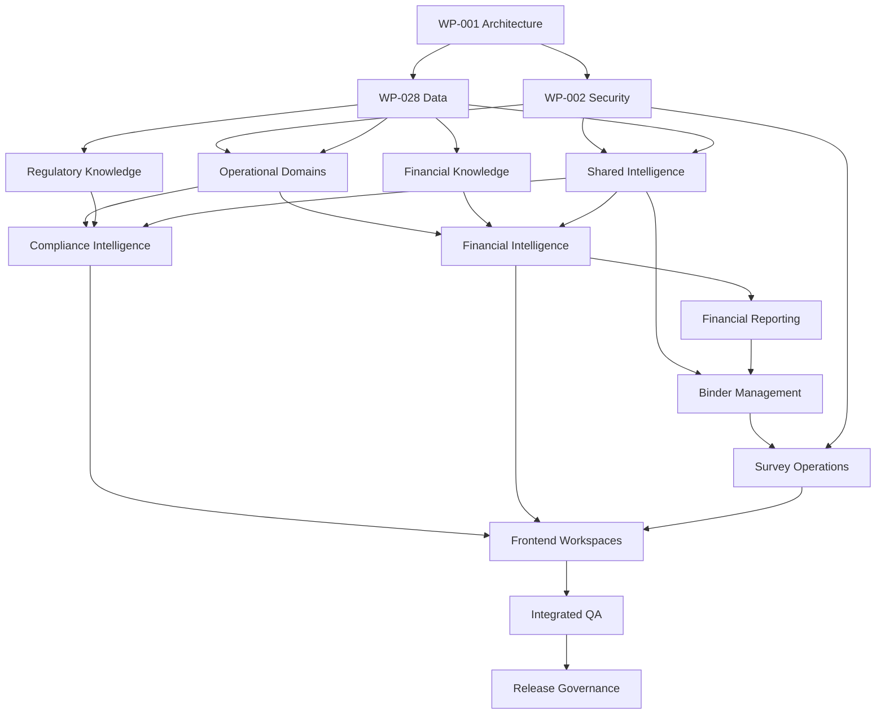

# ENG-014 — Team Work Packages

**Document ID:** ENG-014  
**Version:** 1.0  
**Status:** Engineering Blueprint — Draft  
**Platform:** Regulatory Intelligence Platform  
**Organization:** McCaskill Projects  
**Proposed Location:** `docs/engineering/14-team-work-packages.md`  
**Implementation Authorization:** Not Granted

---

# 1. Purpose and Scope

## 1.1 WHAT

This document defines the engineering team structure, capability ownership, work packages, dependencies, deliverables, verification responsibilities, and handoff requirements for the Regulatory Intelligence Platform.

It translates the architecture described in ENG-001 through ENG-013 into assignable engineering responsibilities.

This document establishes:

- Engineering workstreams.
- Capability and service ownership.
- Work package identifiers.
- Deliverables and acceptance requirements.
- Cross-team dependency management.
- Regulatory and financial knowledge governance responsibilities.
- Frontend and backend coordination.
- Database and migration ownership.
- Security and quality responsibilities.
- Integration and release handoffs.
- Software Change Register obligations.
- Work package completion standards.

Work packages are planning units. They are not authorization to begin coding.

## 1.2 WHEN

This document is used:

1. Before assigning implementation work.
2. During sprint planning.
3. When multiple teams depend on the same service.
4. When defining frontend/backend handoffs.
5. Before creating new Nx libraries.
6. Before modifying shared infrastructure.
7. During quality and architecture reviews.
8. Before accepting completed work.
9. When preparing release packages.
10. When transferring work between developers or AI-assisted development sessions.

## 1.3 WHERE

The work packages apply to the existing Nx monorepo and its supporting infrastructure.

The existing technology stack includes:

- Angular 20 standalone frontend.
- NgRx state management.
- NestJS backend.
- TypeORM.
- PostgreSQL.
- Nx workspace tooling.
- Git-based source control.
- Vercel frontend deployment.
- Render backend infrastructure.

Actual project names, library paths, and available infrastructure must be verified against the repository before implementation.

## 1.4 WHY

The platform spans multiple business and technical domains.

Without explicit ownership, engineering teams may:

- Duplicate services.
- Create conflicting domain logic.
- Implement features before governing knowledge exists.
- Introduce circular dependencies.
- Modify another team's authoritative records.
- Break existing security infrastructure.
- Produce frontend screens without approved APIs.
- Complete code without required testing.
- Lose track of unfinished work.

Work packages establish clear accountability and controlled handoffs.

## 1.5 HOW

Each work package must identify:

1. Package ID.
2. Owning team.
3. Objective.
4. Architectural layer.
5. Relevant service IDs.
6. Inputs and prerequisites.
7. Required deliverables.
8. Dependencies.
9. Acceptance tests.
10. Handoff requirements.
11. Software Change Register requirements.

## 1.6 VERIFICATION

A work package is ready for sprint scheduling only when its owner, dependencies, deliverables, and acceptance criteria are sufficiently defined.

---

# 2. Engineering Organization Model

## 2.1 WHAT

The engineering organization is divided into logical workstreams.

These are accountability boundaries, not a requirement to employ a separate person for every workstream.

## 2.2 WHEN

Workstream ownership is assigned during planning and maintained throughout implementation.

## 2.3 WHERE

Across the six architectural layers.

## 2.4 WHY

Each capability needs a clearly identified owner while allowing a small engineering team to cover multiple responsibilities.

## 2.5 HOW

### Proposed engineering workstreams

| Team ID | Workstream | Primary responsibility |
|---|---|---|
| TEAM-01 | Architecture and Technical Governance | Architecture, boundaries, standards |
| TEAM-02 | Platform Foundation and Security | Identity, tenancy, authorization, platform services |
| TEAM-03 | Operational Domains | Organization, people, services, workforce, residential, ISS |
| TEAM-04 | Regulatory Knowledge Engineering | Regulatory Knowledge Engine |
| TEAM-05 | Financial Knowledge Engineering | Financial Knowledge Engine |
| TEAM-06 | Shared Intelligence Engineering | Evidence, validation, audit, documents, approval, binders |
| TEAM-07 | Compliance Intelligence Engineering | Evaluations, findings, corrective action |
| TEAM-08 | Financial Intelligence Engineering | Financial execution, reporting, reconciliation |
| TEAM-09 | Frontend and Experience Engineering | Angular workspaces, NgRx, navigation |
| TEAM-10 | Data and Integration Engineering | PostgreSQL, TypeORM, imports, integration contracts |
| TEAM-11 | Quality and Security Assurance | Test strategy, verification, security testing |
| TEAM-12 | DevOps and Release Engineering | CI/CD, deployment, monitoring, recovery |
| TEAM-13 | Regulatory Knowledge Operations | Source verification, regulatory review, certification |
| TEAM-14 | Financial Knowledge Operations | Financial source review, methodology approval |
| TEAM-15 | Product and Workflow Governance | Business acceptance, prioritization, workflow approval |

### Staffing principle

One engineer may contribute to several workstreams.

However, required independent reviews and separation-of-duties controls must still be preserved.

## 2.6 VERIFICATION

Every active work package must have one accountable owner and identified reviewers.

---

# 3. Work Package Governance

## 3.1 WHAT

Work package governance establishes how implementation responsibilities are approved and controlled.

## 3.2 WHEN

It applies before and throughout every implementation sprint.

## 3.3 WHERE

Engineering planning, Git workflows, architecture review, and release management.

## 3.4 WHY

A work package must not become an informal authorization to modify unrelated code.

## 3.5 HOW

### Mandatory rules

**WP-001 — One accountable owner**

Every package has one accountable workstream.

**WP-002 — Explicit scope**

The package identifies what may be changed and what must remain untouched.

**WP-003 — Knowledge-first implementation**

Regulatory and financial features require their respective approved knowledge definitions.

**WP-004 — Preserve existing functionality**

Existing verified services, entities, routes, tests, and security infrastructure must be reused or extended where appropriate.

**WP-005 — Dependency readiness**

A package cannot begin implementation until required predecessor deliverables are available or a specifically approved parallel-development contract exists.

**WP-006 — Domain authority**

Only the owning domain may modify its authoritative records.

**WP-007 — Contract-first integration**

Cross-team integration uses approved APIs, events, DTOs, and public interfaces.

**WP-008 — Required testing**

Each package includes positive, negative, integration, and regression testing appropriate to its risk.

**WP-009 — Recorded changes**

Every implementation package updates the Software Change Register.

**WP-010 — Verified completion**

Completion requires evidence, not merely a statement that coding is finished.

## 3.6 VERIFICATION

Architecture and sprint reviews must confirm compliance with the work package rules.

---

# 4. Standard Work Package Contract

## 4.1 WHAT

Every engineering package follows a common specification.

## 4.2 WHEN

The contract is completed before implementation authorization.

## 4.3 WHERE

The approved sprint implementation package and associated engineering records.

## 4.4 WHY

Consistent specifications make work transferable between developers and development sessions.

## 4.5 HOW

### Required package fields

| Field | Description |
|---|---|
| Package ID | Stable identifier |
| Package name | Clear deliverable |
| Owner | Accountable workstream |
| Architectural layer | Primary layer |
| Service IDs | Relevant ENG-008 services |
| Workflow IDs | Relevant ENG-001 workflows |
| Objective | Intended business or technical result |
| Existing state | Verified repository status |
| Inputs | Required contracts and definitions |
| Scope | Authorized changes |
| Exclusions | Explicitly prohibited changes |
| Dependencies | Required predecessor work |
| Deliverables | Files, services, tests, documentation |
| Acceptance criteria | Measurable completion conditions |
| Test evidence | Required verification |
| Reviewer | Acceptance authority |
| Change Register | Required update reference |

### Package lifecycle

Proposed → Reviewed → Approved → Ready → In Progress → Verification → Accepted → Closed.

A package may also be Blocked or Rejected.

Approval and readiness are separate states.

## 4.6 VERIFICATION

No package is scheduled for implementation with unresolved critical dependencies or undefined acceptance criteria.

---

# 5. Master Work Package Register

## 5.1 WHAT

The Master Work Package Register identifies the proposed engineering deliverables.

## 5.2 WHEN

It is used for planning, dependency mapping, and sprint assignment.

## 5.3 WHERE

Engineering governance and ENG-015 sprint planning.

## 5.4 WHY

The register prevents missing ownership and duplicated implementation.

## 5.5 HOW

| Package | Name | Accountable team |
|---|---|---|
| WP-001 | Architecture and Repository Governance | TEAM-01 |
| WP-002 | Identity, Tenancy, and Authorization | TEAM-02 |
| WP-003 | Platform APIs and Infrastructure | TEAM-02 |
| WP-004 | Organization and Location Operations | TEAM-03 |
| WP-005 | People and Workforce Operations | TEAM-03 |
| WP-006 | Service, Contract, and Financial Source Operations | TEAM-03 |
| WP-007 | Residential Operations | TEAM-03 |
| WP-008 | ISS Operations | TEAM-03 |
| WP-009 | Regulatory Source and Knowledge Models | TEAM-04 |
| WP-010 | Regulatory Validation and Certification | TEAM-04 |
| WP-011 | Regulatory Publication and Change Management | TEAM-04 |
| WP-012 | Financial Source and Knowledge Models | TEAM-05 |
| WP-013 | Financial Methodology and Calculation Definitions | TEAM-05 |
| WP-014 | Financial Approval, Publication, and Versioning | TEAM-05 |
| WP-015 | Shared Evidence, Documents, and Audit | TEAM-06 |
| WP-016 | Shared Validation and Approval Infrastructure | TEAM-06 |
| WP-017 | Shared Binder Management | TEAM-06 |
| WP-018 | Compliance Evaluation Engine | TEAM-07 |
| WP-019 | Findings, Corrective Actions, and Reassessment | TEAM-07 |
| WP-020 | Financial Execution and Reconciliation | TEAM-08 |
| WP-021 | Financial Reporting and HCS Cost Report | TEAM-08 |
| WP-022 | Provider and Executive Intelligence | TEAM-09 |
| WP-023 | Regulatory and Compliance Workspaces | TEAM-09 |
| WP-024 | Financial Workbench and Financial Binder UI | TEAM-09 |
| WP-025 | Survey Binder and Survey Workspace UI | TEAM-09 |
| WP-026 | Operational Workspaces | TEAM-09 |
| WP-027 | Knowledge Administration Workspaces | TEAM-09 |
| WP-028 | Database Architecture and Migrations | TEAM-10 |
| WP-029 | Data Import and Integration | TEAM-10 |
| WP-030 | Automated Quality and Security Testing | TEAM-11 |
| WP-031 | CI/CD, Monitoring, and Recovery | TEAM-12 |
| WP-032 | Regulatory Knowledge Certification Operations | TEAM-13 |
| WP-033 | Financial Knowledge Approval Operations | TEAM-14 |
| WP-034 | Product Acceptance and Release Governance | TEAM-15 |
| WP-035 | Survey Event Backend and External Access | TEAM-06 with TEAM-02 |

The package IDs are planning identifiers and do not imply that corresponding code already exists.

## 5.6 VERIFICATION

Each package must map to an approved architecture capability and have an accountable owner.

---

# 6. WP-001 — Architecture and Repository Governance

**Owner:** TEAM-01  
**Layer:** Cross-layer governance

## WHAT

Maintain architectural consistency and verified repository alignment.

## WHEN

Before implementation and whenever architectural boundaries change.

## WHERE

Nx workspace configuration, architecture documentation, public library interfaces, and engineering governance records.

## WHY

The platform must remain jurisdiction-neutral and maintainable.

## HOW

### Deliverables

- Verified repository inventory.
- Existing-versus-target architecture mapping.
- Approved Nx dependency boundaries.
- Domain ownership register.
- Cross-domain contract review.
- Architecture decision records.
- Software Change Register governance.

### Dependencies

ENG-001 through ENG-013 and verified repository evidence.

### Exclusions

No unapproved restructuring of working libraries.

## VERIFICATION

Nx boundaries, project ownership, and architecture decisions must be documented and validated.

---

# 7. WP-002 — Identity, Tenancy, and Authorization

**Owner:** TEAM-02  
**Layer:** Platform Foundation

## WHAT

Preserve and extend the existing identity and authorization foundation.

## WHEN

Before protected workflows require new permissions or scopes.

## WHERE

Existing JWT, roles, permissions, authorization services, and guards.

## WHY

Every business capability depends on reliable identity and access enforcement.

## HOW

### Deliverables

- Verified security inventory.
- Tenant and organization context handling.
- Resource-level authorization extensions where required.
- Permission mappings.
- External access controls.
- Revocation behavior.
- Security audit integration.

### Dependencies

ENG-010 and WP-001.

### Exclusions

Do not replace working authentication or create a parallel permission system.

## VERIFICATION

Authentication, authorization, cross-tenant isolation, revocation, and privilege-escalation tests must pass.

---

# 8. WP-003 — Platform APIs and Infrastructure

**Owner:** TEAM-02  
**Layer:** Platform Foundation

## WHAT

Maintain shared backend infrastructure and platform-level service contracts.

## WHEN

When cross-domain capabilities require platform infrastructure.

## WHERE

NestJS backend and approved Platform Foundation libraries.

## WHY

Shared infrastructure must remain consistent and secure.

## HOW

### Deliverables

- API conventions.
- Request context propagation.
- Standard error handling.
- Correlation identifiers.
- Platform configuration interfaces.
- Authorized service identity support.
- Platform health endpoints.

### Dependencies

WP-001, WP-002, ENG-008, and ENG-009.

## VERIFICATION

API contract, security, error-handling, and integration tests must pass.

---

# 9. WP-004 — Organization and Location Operations

**Owner:** TEAM-03  
**Layer:** Operational Domains

## WHAT

Maintain authoritative organization and location records.

## WHEN

During customer onboarding and ongoing organizational administration.

## WHERE

Organization and Location Operational Domains.

## WHY

Provider-wide and location-specific workflows depend on accurate organizational relationships.

## HOW

### Deliverables

- Organization lifecycle.
- Location lifecycle.
- Provider-to-location relationships.
- Authorized organization queries.
- Location-scoped APIs.
- Operational validation.
- Audit integration.

### Dependencies

WP-002, WP-028, and approved API contracts.

## VERIFICATION

Tenant isolation, relationship integrity, unique constraints, and provider-wide query behavior must pass.

---

# 10. WP-005 — People and Workforce Operations

**Owner:** TEAM-03  
**Layer:** Operational Domains

## WHAT

Maintain authoritative person, employee, and assignment records.

## WHEN

During service administration and workforce management.

## WHERE

People and Workforce Operational Domains.

## WHY

Compliance and financial workflows rely on accurate person and employee information.

## HOW

### Deliverables

- Person records.
- Consumer relationships.
- Employee profiles.
- Assignments.
- Effective dates.
- Protected source queries.
- Record history.

### Dependencies

WP-002, WP-004, and WP-028.

## VERIFICATION

Record-level authorization, assignment integrity, historical relationships, and regression tests must pass.

---

# 11. WP-006 — Service, Contract, and Financial Source Operations

**Owner:** TEAM-03  
**Layer:** Operational Domains

## WHAT

Maintain service records, contract information, payroll source records, financial transactions, and service statistics.

## WHEN

During provider operations and financial reporting preparation.

## WHERE

Service, Contract, Payroll, and Financial Operations.

## WHY

Financial Intelligence requires trustworthy source data independent of financial methodology.

## HOW

### Deliverables

- Service records.
- Contract records.
- Payroll source contracts.
- Transaction source contracts.
- Service statistics.
- Operational validation.
- Reporting-period relationships.
- Source lineage.

### Dependencies

WP-004, WP-005, WP-028, and WP-029 where imports are required.

## VERIFICATION

Source integrity, reporting-period boundaries, authorization, and reconciliation inputs must be verified.

---

# 12. WP-007 — Residential Operations

**Owner:** TEAM-03  
**Layer:** Operational Domains

## WHAT

Maintain reusable residential operational records.

## WHEN

During residential service administration and safety documentation.

## WHERE

Residential Operations Domain.

## WHY

Residential records must remain operational facts rather than Texas-specific compliance conclusions.

## HOW

### Deliverables

- Residential location records.
- Residential assignments.
- Fire drill records.
- Emergency preparedness records.
- Hot water monitoring.
- Medication-related operational records.
- Supporting documents.
- Operational history.

### Dependencies

WP-004, WP-005, WP-015, and approved source contracts.

### Existing functionality

Preserve verified Residential Locations, assignments, Fire Drills, and existing Form 4719-related work.

## VERIFICATION

Operational record tests, location scope, assignment integrity, and compliance deep links must pass.

---

# 13. WP-008 — ISS Operations

**Owner:** TEAM-03  
**Layer:** Operational Domains

## WHAT

Develop the reusable Individualized Skills and Socialization operational capability.

## WHEN

After required operational foundations and approved scope are available.

## WHERE

ISS Operations Domain.

## WHY

ISS service delivery must support individualized planning without embedding customer-specific branding or unapproved regulatory interpretations.

## HOW

### Deliverables

- Participant relationships.
- Individualized plans.
- Skill-domain templates.
- Measurable goals.
- Activity planning.
- Service documentation.
- Guided/Supported/Independent progression.
- Progress reviews.
- PDP relationships.
- Authorized operational reporting.

### Dependencies

WP-004, WP-005, WP-015, WP-028, and relevant approved Regulatory Knowledge.

### Design constraints

The planned six-hour adventure day is a scheduling concept, not automatic billable authorization.

LevelUp Adventures remains a customer/tenant concept, not the owner of the universal ISS domain.

## VERIFICATION

Individualized goals, service documentation, tenant isolation, and knowledge separation must pass.

---

# 14. WP-009 — Regulatory Source and Knowledge Models

**Owner:** TEAM-04  
**Layer:** Regulatory Knowledge Authority

## WHAT

Maintain source provenance and structured regulatory knowledge models.

## WHEN

Before regulatory evaluation features are implemented.

## WHERE

Regulatory Knowledge Engine.

## WHY

Regulatory requirements must exist as governed knowledge before application features depend on them.

## HOW

### Deliverables

- Regulatory source models.
- Source versions.
- Structured requirements.
- Applicability definitions.
- Evidence definitions.
- Knowledge Pack models.
- Version relationships.

### Dependencies

WP-001, WP-028, and Regulatory Knowledge Operations.

## VERIFICATION

Schema, provenance, relationship, and versioning tests must pass.

---

# 15. WP-010 — Regulatory Validation and Certification

**Owner:** TEAM-04  
**Layer:** Regulatory Knowledge Authority

## WHAT

Implement knowledge validation and certification workflow support.

## WHEN

After required knowledge models and review requirements are defined.

## WHERE

Regulatory Knowledge Engine and Shared Validation/Approval infrastructure.

## WHY

Unvalidated or uncertified regulatory knowledge must not become authoritative.

## HOW

### Deliverables

- KnowledgePackValidator.
- Structural validation.
- Semantic validation rules.
- Applicability checks.
- Dependency checks.
- Review workflow integration.
- Certification records.
- Validation evidence.

### Dependencies

WP-009, WP-016, and WP-032.

### Existing progress

Preserve existing Regulatory Knowledge models, enums, exports, and validator work.

## VERIFICATION

Known-valid and known-invalid knowledge fixtures must produce approved outcomes.

---

# 16. WP-011 — Regulatory Publication and Change Management

**Owner:** TEAM-04  
**Layer:** Regulatory Knowledge Authority

## WHAT

Manage publication, effective versions, and regulatory source changes.

## WHEN

After validation and certification controls are available.

## WHERE

Regulatory Knowledge Engine.

## WHY

Customers must receive current approved guidance without losing historical knowledge.

## HOW

### Deliverables

- Publication workflow.
- Published version registry.
- Effective-date resolution.
- Change impact references.
- Supersession relationships.
- Historical retrieval.
- Publication audit.

### Dependencies

WP-009, WP-010, WP-015, and WP-032.

## VERIFICATION

Published versions must be immutable, retrievable, and correctly selected for applicable dates.

---

# 17. WP-012 — Financial Source and Knowledge Models

**Owner:** TEAM-05  
**Layer:** Financial Knowledge Authority

## WHAT

Establish independent financial knowledge persistence and source governance.

## WHEN

Before financial methodology execution.

## WHERE

Financial Knowledge Engine.

## WHY

Financial rules must not be embedded directly into reporting services.

## HOW

### Deliverables

- Financial source models.
- Financial definitions.
- Classification rules.
- Cost principles.
- Allocation definitions.
- Rate definitions.
- Formula definitions.
- Reporting definitions.
- Financial Knowledge versions.

### Dependencies

WP-001, WP-028, and WP-033.

## VERIFICATION

Model integrity, source provenance, effective periods, and version relationships must pass.

---

# 18. WP-013 — Financial Methodology and Calculation Definitions

**Owner:** TEAM-05  
**Layer:** Financial Knowledge Authority

## WHAT

Define approved financial calculations and reporting methodologies.

## WHEN

Before Financial Intelligence executes methodology-dependent operations.

## WHERE

Financial Knowledge Engine.

## WHY

Financial calculation authority must remain independent of the execution service.

## HOW

### Deliverables

- Classification definitions.
- Allowability rules.
- Allocation methodologies.
- Formula definitions.
- Rounding and precision rules.
- Reporting line definitions.
- Calculation dependencies.
- Golden test fixtures.

### Dependencies

WP-012, WP-033, and approved financial source references.

## VERIFICATION

Financial methodology tests must match independently verified expected results.

---

# 19. WP-014 — Financial Approval, Publication, and Versioning

**Owner:** TEAM-05  
**Layer:** Financial Knowledge Authority

## WHAT

Govern financial methodology approval and publication.

## WHEN

After financial definitions and validation are complete.

## WHERE

Financial Knowledge Engine and Shared Approval infrastructure.

## WHY

Unapproved financial methodologies must not drive authoritative financial reports.

## HOW

### Deliverables

- Financial review workflow.
- Approval records.
- Separation-of-duties controls.
- Publication workflow.
- Effective-period resolution.
- Historical version retrieval.
- Publication audit.

### Dependencies

WP-012, WP-013, WP-016, and WP-033.

## VERIFICATION

Unauthorized publication, self-approval where prohibited, and historical version mutation must be rejected.

---

# 20. WP-015 — Shared Evidence, Documents, and Audit

**Owner:** TEAM-06  
**Layer:** Shared Intelligence

## WHAT

Provide reusable evidence, document, and audit infrastructure.

## WHEN

When workflows require protected supporting records and traceability.

## WHERE

Shared Intelligence services.

## WHY

Evidence and audit capabilities must be reusable without duplicating source ownership.

## HOW

### Deliverables

- Evidence metadata.
- Evidence relationships.
- Document metadata.
- Protected document access.
- Document versioning.
- Audit events.
- Traceability queries.
- Storage integration contracts.

### Dependencies

WP-002, WP-028, and approved storage architecture.

## VERIFICATION

Document security, evidence integrity, audit accuracy, and tenant isolation must pass.

---

# 21. WP-016 — Shared Validation and Approval Infrastructure

**Owner:** TEAM-06  
**Layer:** Shared Intelligence

## WHAT

Provide common execution and governance infrastructure.

## WHEN

When Knowledge Engines or applied workflows require validation or approval execution.

## WHERE

Shared Validation and Approval services.

## WHY

Execution infrastructure should be reusable without becoming a third knowledge authority.

## HOW

### Deliverables

- Validation execution contracts.
- Validation result persistence.
- Approval workflow infrastructure.
- Review history.
- Decision audit.
- Failure handling.
- Idempotency and concurrency controls.

### Dependencies

WP-002, WP-015, and WP-028.

### Authority restriction

Regulatory definitions remain owned by Regulatory Knowledge.

Financial definitions remain owned by Financial Knowledge.

## VERIFICATION

Tests must demonstrate that shared services cannot independently create or change authoritative policy.

---

# 22. WP-017 — Shared Binder Management

**Owner:** TEAM-06  
**Layer:** Shared Intelligence

## WHAT

Provide reusable binder infrastructure.

## WHEN

Before Financial Binder and Survey Binder workflows are implemented.

## WHERE

Shared Binder Management.

## WHY

Binder types must share lifecycle infrastructure while supporting different business rules.

## HOW

### Deliverables

- Binder types.
- Binder definitions.
- Binder instances.
- Sections and items.
- Completeness validation.
- Approval integration.
- Release records.
- Historical preservation.
- Archive and retention controls.

### Dependencies

WP-015, WP-016, WP-028, and WP-002.

## VERIFICATION

Binder lifecycle, approval, release, source access, and historical integrity tests must pass.

---

# 23. WP-018 — Compliance Evaluation Engine

**Owner:** TEAM-07  
**Layer:** Applied Intelligence

## WHAT

Execute approved regulatory definitions against authorized operational records.

## WHEN

After applicable knowledge and source contracts are available.

## WHERE

Compliance Intelligence.

## WHY

Compliance determinations must come from approved knowledge and traceable operational facts.

## HOW

### Deliverables

- Evaluation orchestration.
- Applicability resolution.
- Knowledge version resolution.
- Operational input retrieval.
- Shared Validation integration.
- Compliance result persistence.
- Evidence lineage.
- Execution history.

### Dependencies

WP-010, WP-011, WP-016, relevant Operational Domains, and WP-028.

### Existing implementation

Preserve and reconcile existing evaluators, ComplianceResultsService, dashboard integration, and deep-link metadata.

## VERIFICATION

Approved compliant, noncompliant, not-applicable, and missing-information scenarios must pass.

---

# 24. WP-019 — Findings, Corrective Actions, and Reassessment

**Owner:** TEAM-07  
**Layer:** Applied Intelligence

## WHAT

Manage the lifecycle of compliance findings and remediation.

## WHEN

After compliance results can be generated and retrieved.

## WHERE

Compliance Intelligence and Compliance Operations.

## WHY

Compliance findings must lead to controlled correction and independent reassessment.

## HOW

### Deliverables

- Finding records.
- Assignment.
- Corrective action plans.
- Notes.
- Evidence relationships.
- Review transitions.
- Reassessment execution.
- Historical linking.

### Dependencies

WP-018, WP-015, WP-016, and WP-002.

## VERIFICATION

Corrective action completion must not silently overwrite the original compliance result.

---

# 25. WP-020 — Financial Execution and Reconciliation

**Owner:** TEAM-08  
**Layer:** Applied Intelligence

## WHAT

Execute approved financial methodologies against authorized financial and operational source data.

## WHEN

After Financial Knowledge publication and required source contracts are ready.

## WHERE

Financial Intelligence.

## WHY

Financial execution must remain separate from financial rule authority.

## HOW

### Deliverables

- Financial execution orchestration.
- Classification execution.
- Allowability execution.
- Allocation execution.
- Calculation results.
- Reconciliation.
- Exception management.
- Execution lineage.
- Historical reproducibility.

### Dependencies

WP-006, WP-013, WP-014, WP-016, and WP-028.

## VERIFICATION

Golden calculation fixtures, precision, reconciliation, authorization, and historical tests must pass.

---

# 26. WP-021 — Financial Reporting and HCS Cost Report

**Owner:** TEAM-08  
**Layer:** Applied Intelligence

## WHAT

Produce governed financial reports using approved methodologies and completed financial executions.

## WHEN

After required Financial Intelligence services are available.

## WHERE

Financial Reporting and Financial Intelligence.

## WHY

HCS Cost Reporting is the first financial vertical slice demonstrating end-to-end financial authority and execution.

## HOW

### Deliverables

- Reporting-period workflows.
- Report definition resolution.
- Report generation.
- Schedule and line calculations.
- Completeness checks.
- Review and approval.
- Release records.
- Financial Binder integration.
- Historical report retrieval.

### Dependencies

WP-020, WP-014, WP-017, WP-033, and approved reporting definitions.

## VERIFICATION

Independent financial accuracy review and complete HCS Cost Reporting E2E tests must pass.

---

# 27. WP-022 — Provider and Executive Intelligence

**Owner:** TEAM-09  
**Layer:** User Experience

## WHAT

Deliver provider-wide and executive intelligence workspaces.

## WHEN

After required query contracts and authorization are available.

## WHERE

Angular frontend and approved application composition services.

## WHY

Users need consolidated operational and management visibility.

## HOW

### Deliverables

- Provider Intelligence Center.
- Executive Intelligence.
- Summary indicators.
- Work queues.
- Filters.
- Deep links.
- Authorized drilldowns.
- Loading and error states.

### Dependencies

WP-002, approved UX query contracts, WP-018, WP-020 where financial data is shown, and ENG-007.

### Critical rule

Provider-wide dashboard loading must not require `locationId`.

## VERIFICATION

Provider-wide queries, optional location filters, tenant switching, and deep links must pass.

---

# 28. WP-023 — Regulatory and Compliance Workspaces

**Owner:** TEAM-09  
**Layer:** User Experience

## WHAT

Deliver Regulatory Workbench and Finding Workspace interfaces.

## WHEN

After required compliance contracts and knowledge queries are available.

## WHERE

Angular frontend.

## WHY

Users need actionable regulatory results and remediation workflows.

## HOW

### Deliverables

- Regulatory overview.
- Module Workbench.
- Correction-area grouping.
- Requirement detail.
- Evaluation detail.
- Finding Workspace.
- Corrective action UI.
- Reassessment history.

### Dependencies

WP-018, WP-019, WP-002, and approved APIs.

### Residential presentation

Correction areas appear first, with affected locations beneath them.

## VERIFICATION

Deep links, authorized actions, correction-area grouping, and historical result display must pass.

---

# 29. WP-024 — Financial Workbench and Financial Binder UI

**Owner:** TEAM-09  
**Layer:** User Experience

## WHAT

Deliver financial preparation, calculation review, reporting, and binder interfaces.

## WHEN

After Financial Intelligence and Binder contracts are available.

## WHERE

Angular frontend.

## WHY

Financial users need an integrated workflow from source review through release.

## HOW

### Deliverables

- Financial overview.
- Reporting-period selection.
- Source data review.
- Classification review.
- Allocation review.
- Reconciliation.
- Report review.
- Approval and release UI.
- Financial Binder UI.
- Historical execution views.

### Dependencies

WP-020, WP-021, WP-017, WP-002, and ENG-007.

## VERIFICATION

Financial workflow, authorization, server-confirmed approvals, and historical display tests must pass.

---

# 30. WP-025 — Survey Binder and Survey Workspace UI

**Owner:** TEAM-09  
**Layer:** User Experience

## WHAT

Deliver survey preparation and controlled external survey experiences.

## WHEN

After Binder Management and Survey Event backend contracts are available.

## WHERE

Angular frontend.

## WHY

Survey preparation and external review require different interfaces and permission models.

## HOW

### Deliverables

- Survey Binder.
- Binder completeness UI.
- Survey event overview.
- External surveyor workspace.
- Protected document viewer.
- Information requests.
- Provider responses.
- Access expiration messaging.

### Dependencies

WP-017, WP-035, WP-002, and WP-015.

## VERIFICATION

External access, document restrictions, revocation, and survey workflow tests must pass.

---

# 31. WP-026 — Operational Workspaces

**Owner:** TEAM-09  
**Layer:** User Experience

## WHAT

Deliver interfaces for authoritative operational records.

## WHEN

After owning domain contracts are available.

## WHERE

Angular frontend.

## WHY

Operational data entry must remain separate from regulatory and financial determinations.

## HOW

### Deliverables

- Organization Workspace.
- Location Workspace.
- People and Workforce Workspaces.
- Service Operations.
- Residential Operations.
- ISS Operations.
- Protected document integration.

### Dependencies

WP-004 through WP-008, WP-015, WP-002, and ENG-007.

## VERIFICATION

Record-level authorization, form validation, concurrency, and operational workflow tests must pass.

---

# 32. WP-027 — Knowledge Administration Workspaces

**Owner:** TEAM-09  
**Layer:** User Experience

## WHAT

Deliver governed administration interfaces for both Knowledge Engines.

## WHEN

After corresponding knowledge service contracts are available.

## WHERE

Angular frontend.

## WHY

Knowledge authors, reviewers, and approvers need controlled workflows.

## HOW

### Deliverables

- Regulatory source registry.
- Regulatory requirement editor.
- Knowledge Pack builder.
- Validation and certification views.
- Financial definition catalog.
- Financial methodology editor.
- Financial approval and publication views.
- Version history.

### Dependencies

WP-009 through WP-014, WP-002, and ENG-007.

### Independence

Regulatory and Financial Knowledge approvals remain separately authorized.

## VERIFICATION

Review, certification, approval, publication, and permission tests must pass.

---

# 33. WP-028 — Database Architecture and Migrations

**Owner:** TEAM-10  
**Layer:** Cross-layer persistence

## WHAT

Maintain physical data architecture and migration safety.

## WHEN

Whenever approved work changes persistent data structures.

## WHERE

PostgreSQL and existing TypeORM infrastructure.

## WHY

Schema changes must preserve data integrity and historical reproducibility.

## HOW

### Deliverables

- Verified physical schema inventory.
- Domain ownership mapping.
- Migration plans.
- Constraints and indexes.
- Data backfills where approved.
- Migration tests.
- Recovery procedures.

### Dependencies

ENG-003, ENG-004, ENG-012, WP-001, and owning domain approval.

## VERIFICATION

Migration compatibility, integrity, rollback or recovery strategy, and tenant isolation must pass.

---

# 34. WP-029 — Data Import and Integration

**Owner:** TEAM-10  
**Layer:** Operational integration

## WHAT

Provide controlled data ingestion and external integration contracts.

## WHEN

When operational or financial workflows require imported source data.

## WHERE

Existing import infrastructure and owning domain APIs.

## WHY

Imported data must be validated before becoming authoritative.

## HOW

### Deliverables

- Import staging.
- Source mapping.
- Validation.
- Duplicate detection.
- Idempotency.
- Commit to owning domain.
- Reconciliation.
- Import audit.

### Dependencies

WP-003, WP-028, and relevant Operational Domains.

### Existing functionality

Preserve verified import engine, provider onboarding, and CSV wizard capabilities.

## VERIFICATION

Malformed, duplicate, partial-failure, and cross-tenant import scenarios must pass.

---

# 35. WP-030 — Automated Quality and Security Testing

**Owner:** TEAM-11  
**Layer:** Cross-layer quality

## WHAT

Provide independent quality verification and automated testing standards.

## WHEN

Throughout every approved implementation sprint.

## WHERE

Nx test infrastructure, CI, integration environments, and E2E suites.

## WHY

Quality must be supported by execution evidence.

## HOW

### Deliverables

- Test traceability.
- Unit and integration test requirements.
- API and event contract tests.
- Security negative-case tests.
- Knowledge validation tests.
- Financial accuracy fixtures.
- Critical E2E suites.
- Regression coverage.
- Test reports.

### Dependencies

ENG-013 and relevant implementation packages.

## VERIFICATION

Required tests must execute successfully, and unresolved release-blocking defects must be addressed.

---

# 36. WP-031 — CI/CD, Monitoring, and Recovery

**Owner:** TEAM-12  
**Layer:** Platform operations

## WHAT

Maintain build, deployment, monitoring, and recovery capabilities.

## WHEN

During approved releases and infrastructure changes.

## WHERE

Git CI/CD, Nx tooling, Vercel, Render, PostgreSQL, and approved monitoring infrastructure.

## WHY

A verified feature must also be safely deployable and recoverable.

## HOW

### Deliverables

- CI quality gates.
- Build verification.
- Deployment configuration.
- Environment separation.
- Monitoring.
- Alerting.
- Backup verification.
- Recovery procedures.
- Release smoke tests.

### Dependencies

WP-001, WP-002, WP-028, and WP-030.

## VERIFICATION

Required build, deployment, smoke, and recovery tests must pass.

---

# 37. WP-032 — Regulatory Knowledge Certification Operations

**Owner:** TEAM-13  
**Layer:** Knowledge governance

## WHAT

Verify and certify authoritative regulatory knowledge.

## WHEN

Before regulatory knowledge publication.

## WHERE

Regulatory Knowledge Operations and approved administration workflows.

## WHY

Technical validation alone cannot establish the legal accuracy of regulatory interpretations.

## HOW

### Deliverables

- Verified official source references.
- Reviewed requirement interpretations.
- Applicability decisions.
- Evidence requirements.
- Certification decisions.
- Change impact reviews.
- Publication recommendations.

### Dependencies

WP-009, WP-010, WP-011, and approved regulatory sources.

## VERIFICATION

Required review, source verification, and certification evidence must be complete.

---

# 38. WP-033 — Financial Knowledge Approval Operations

**Owner:** TEAM-14  
**Layer:** Knowledge governance

## WHAT

Review and approve financial knowledge and methodology.

## WHEN

Before financial methodology publication.

## WHERE

Financial Knowledge Operations.

## WHY

Financial calculations must be based on approved source interpretation and independently verified methodology.

## HOW

### Deliverables

- Verified financial sources.
- Classification decisions.
- Allowability interpretations.
- Allocation methodology review.
- Rate and formula review.
- Reporting definition approval.
- Golden calculation fixtures.
- Publication recommendations.

### Dependencies

WP-012, WP-013, WP-014, and approved financial sources.

## VERIFICATION

Required financial review, calculation verification, and approval evidence must be complete.

---

# 39. WP-034 — Product Acceptance and Release Governance

**Owner:** TEAM-15  
**Layer:** Cross-layer governance

## WHAT

Control business acceptance and release authorization.

## WHEN

At sprint completion and release decision points.

## WHERE

Product governance and release records.

## WHY

Technical completion must be distinguished from business acceptance and production authorization.

## HOW

### Deliverables

- Approved scope.
- Business acceptance criteria.
- Dependency review.
- Stakeholder review.
- Release readiness decision.
- Risk acceptance records.
- Sprint acceptance.
- Software Change Register review.

### Dependencies

WP-030, WP-031, and the applicable implementation packages.

## VERIFICATION

No release proceeds without required technical, security, knowledge, and business acceptance evidence.

---

# 40. WP-035 — Survey Event Backend and External Access

**Owner:** TEAM-06  
**Security co-owner:** TEAM-02  
**Layer:** Shared Intelligence and Applied Survey Operations

## WHAT

Provide survey event management and protected external access.

## WHEN

After identity, authorization, document, and binder infrastructure are ready.

## WHERE

Survey Operations backend, Shared Binder Management, and Platform Authorization.

## WHY

Surveyors require individually scoped access without unrestricted provider-system permissions.

## HOW

### Deliverables

- Survey event records.
- Surveyor assignments.
- Event scope.
- Access expiration.
- Revocation.
- Information requests.
- Provider responses.
- Document access audit.
- Event closure.

### Dependencies

WP-002, WP-015, WP-017, WP-028, and ENG-010.

## VERIFICATION

Individual identity, MFA, scope, revocation, document access, and survey lifecycle tests must pass.

---

# 41. Cross-Team Dependency Architecture

## 41.1 WHAT

Cross-team dependencies establish the order in which work packages become executable.

## 41.2 WHEN

Dependencies are reviewed during sprint planning and whenever package scope changes.

## 41.3 WHERE

ENG-014 work package register and ENG-015 sprint plan.

## 41.4 WHY

A dependent team cannot reliably complete work when required upstream contracts are undefined.

## 41.5 HOW

### Dependency diagram

The diagram represents logical prerequisites, not a mandate to delay all parallel work.

### Parallel development

Parallel work is permitted when:

- Interfaces are approved.
- Dependencies are explicitly identified.
- Contract mocks are controlled.
- Integration ownership is assigned.
- Final acceptance includes real integration tests.

## 41.6 VERIFICATION

Every package must identify its blocking dependencies before entering Ready status.

---

# 42. Cross-Team Handoff Contracts

## 42.1 WHAT

Handoff contracts define the evidence required when one team supplies a capability to another.

## 42.2 WHEN

A handoff occurs when a package produces an API, event, data model, UI component, knowledge version, or shared service consumed elsewhere.

## 42.3 WHERE

Engineering records and approved cross-domain interfaces.

## 42.4 WHY

Informal handoffs create incompatible assumptions and integration defects.

## 42.5 HOW

### Backend-to-frontend handoff

Must include:

- Approved API contract.
- Request and response examples.
- Authorization requirements.
- Error behavior.
- Pagination or filtering.
- Workflow state transitions.
- Test evidence.

### Knowledge-to-execution handoff

Must include:

- Published knowledge version.
- Applicable definitions.
- Effective dates.
- Validation results.
- Certification or approval evidence.
- Expected-result fixtures.

### Data-to-domain handoff

Must include:

- Approved entity relationships.
- Migration evidence.
- Repository contracts.
- Data integrity tests.
- Tenant isolation tests.

### Shared-service handoff

Must include:

- Public interface.
- Service ownership.
- Failure behavior.
- Authorization.
- Idempotency where relevant.
- Consumer contract tests.

## 42.6 VERIFICATION

Receiving teams must confirm that the delivered contract meets the agreed acceptance criteria.

---

# 43. Cross-Team Responsibility Matrix

## 43.1 WHAT

This matrix identifies primary responsibility for major platform capabilities.

## 43.2 WHEN

It is used when resolving ownership questions.

## 43.3 WHERE

Engineering governance.

## 43.4 WHY

A capability may involve several teams but must have one accountable owner.

## 43.5 HOW

| Capability | Accountable | Supporting |
|---|---|---|
| Architecture | TEAM-01 | All engineering teams |
| Authentication and authorization | TEAM-02 | TEAM-11 |
| Operational records | TEAM-03 | TEAM-10 |
| Regulatory Knowledge Engine | TEAM-04 | TEAM-13 |
| Financial Knowledge Engine | TEAM-05 | TEAM-14 |
| Shared Intelligence | TEAM-06 | TEAM-02, TEAM-10 |
| Compliance Intelligence | TEAM-07 | TEAM-04, TEAM-03 |
| Financial Intelligence | TEAM-08 | TEAM-05, TEAM-03 |
| Frontend workspaces | TEAM-09 | Owning backend teams |
| Database migrations | TEAM-10 | Owning domain teams |
| Quality verification | TEAM-11 | All engineering teams |
| Deployment and recovery | TEAM-12 | TEAM-02, TEAM-10 |
| Regulatory certification | TEAM-13 | TEAM-04 |
| Financial approval | TEAM-14 | TEAM-05 |
| Business acceptance | TEAM-15 | QA and domain owners |
| Survey Operations | TEAM-06 | TEAM-02, TEAM-09 |

Accountability does not override domain authorization or separation-of-duties requirements.

## 43.6 VERIFICATION

Each package must identify its accountable owner and required reviewers.

---

# 44. Engineering Work Package Deliverable Standards

## 44.1 WHAT

Deliverable standards define what a completed engineering package must contain.

## 44.2 WHEN

They apply at package verification and acceptance.

## 44.3 WHERE

The repository, CI artifacts, and engineering documentation.

## 44.4 WHY

A package must be understandable and maintainable after its original developer leaves.

## 44.5 HOW

### Backend package deliverables

Where applicable:

- Approved service implementation.
- DTOs and public contracts.
- Authorization enforcement.
- Repository integration.
- Transactions.
- Audit behavior.
- Unit tests.
- Integration tests.
- Contract tests.
- Documentation.

### Frontend package deliverables

Where applicable:

- Approved Angular feature.
- Route configuration.
- State management.
- Data-access integration.
- Reusable components.
- Loading and error states.
- Authorization-aware actions.
- Component tests.
- Workspace tests.
- Accessibility verification.

### Knowledge package deliverables

Where applicable:

- Source provenance.
- Structured definitions.
- Validation results.
- Review evidence.
- Certification or approval.
- Published version.
- Historical version references.
- Golden fixtures.

### Database package deliverables

Where applicable:

- Entity changes.
- Migration.
- Constraint verification.
- Data backfill plan.
- Migration tests.
- Recovery strategy.

## 44.6 VERIFICATION

Required deliverables must be inspected and supported by execution evidence.

---

# 45. Work Package Testing and Acceptance

## 45.1 WHAT

Every work package requires a defined quality and acceptance process.

## 45.2 WHEN

During package verification and closure.

## 45.3 WHERE

ENG-013 quality infrastructure and the owning team's acceptance process.

## 45.4 WHY

A package must be evaluated against its intended outcome, not simply against successful compilation.

## 45.5 HOW

### Minimum acceptance checklist

- [ ] Approved package scope.
- [ ] Verified repository starting state.
- [ ] Required dependencies satisfied.
- [ ] Architecture boundaries respected.
- [ ] Existing functionality preserved.
- [ ] Required knowledge authority established.
- [ ] Public contracts implemented.
- [ ] Authorization verified.
- [ ] Unit tests passed.
- [ ] Integration tests passed.
- [ ] Contract tests passed where applicable.
- [ ] Critical E2E tests passed where applicable.
- [ ] Migration tests passed where applicable.
- [ ] Historical integrity verified where applicable.
- [ ] Required subject-matter review completed.
- [ ] No unresolved release-blocking defects.
- [ ] Software Change Register updated.
- [ ] Acceptance recorded.

## 45.6 VERIFICATION

The accountable owner and designated reviewer must confirm completion against actual evidence.

---

# 46. Software Change Register Requirements

## 46.1 WHAT

The Software Change Register records approved implementation changes.

## 46.2 WHEN

It is updated for every implementation sprint and material engineering change.

## 46.3 WHERE

The approved engineering governance location within the repository.

## 46.4 WHY

Future developers and AI-assisted development sessions need a reliable record of what actually changed.

## 46.5 HOW

### Required fields

| Field | Description |
|---|---|
| Change ID | Unique identifier |
| Sprint | Associated sprint |
| Work package | ENG-014 package ID |
| Date | Change date |
| Owner | Responsible engineer or team |
| Files changed | Verified paths |
| Purpose | Reason for change |
| Existing behavior | Baseline |
| New behavior | Implemented change |
| Migration | Database changes, if any |
| Tests | Executed tests and results |
| Dependencies | Affected packages |
| Risks | Known limitations |
| Status | Accepted, blocked, or incomplete |

### Integrity

The Change Register must distinguish:

- Planned work.
- Implemented work.
- Verified work.
- Accepted work.

A proposed file or unexecuted test must not be represented as completed.

## 46.6 VERIFICATION

Sprint closure must include a verified Change Register entry.

---

# 47. Repository Reconciliation Before Assignment

## 47.1 WHAT

Repository reconciliation determines which package deliverables already exist and which remain incomplete.

## 47.2 WHEN

Before a package receives implementation authorization.

## 47.3 WHERE

The existing Nx monorepo.

## 47.4 WHY

The platform already contains working features, services, models, and tests that should not be recreated unnecessarily.

## 47.5 HOW

For each package, inspect:

- Existing project or library.
- Actual file paths.
- Current implementation.
- Existing public interfaces.
- Build status.
- Test status.
- Missing functionality.
- Technical debt.
- Required extensions.
- Dependencies.

### Status classification

- Verified Complete.
- Verified Partial.
- Missing.
- Blocked.
- Not Yet Inspected.

### Existing platform priorities

Reconciliation must explicitly preserve and assess:

- Existing security infrastructure.
- Regulatory Knowledge models.
- KnowledgePackValidator progress.
- Compliance evaluation pipeline.
- Residential Operations.
- Fire Drill implementation.
- Provider-wide dashboard behavior.
- Import and onboarding infrastructure.
- Existing Nx library boundaries.

## 47.6 VERIFICATION

Work packages must be based on actual repository evidence, not assumptions about planned features.

---

# 48. Work Package Scheduling Principles

## 48.1 WHAT

Scheduling principles determine when packages are assigned to implementation sprints.

## 48.2 WHEN

During ENG-015 sprint planning.

## 48.3 WHERE

The approved 47-sprint roadmap.

## 48.4 WHY

Dependencies and authority must determine sequencing.

## 48.5 HOW

### Scheduling rules

1. Preserve the approved roadmap baseline.
2. Prioritize verified foundational gaps.
3. Complete required knowledge before dependent intelligence.
4. Permit parallel work when contracts are stable.
5. Avoid unnecessary redesign of existing functionality.
6. Reserve time for integration and regression testing.
7. Require quality gates before sprint closure.
8. Keep HCS Cost Reporting as the first financial vertical slice.
9. Keep Emergency Preparedness as the planned regulatory vertical slice.
10. Schedule ISS expansion according to approved dependencies.
11. Update the Software Change Register every sprint.

### Baseline roadmap

| Sprint range | Primary focus |
|---|---|
| 0–7 | Platform Foundation |
| 8–12 | Regulatory Knowledge |
| 13–17 | Shared Intelligence |
| 18–20 | Compliance Evaluation |
| 21–28 | Financial Knowledge and HCS Cost Reporting |
| 29–34 | Survey Workspace |
| 35–37 | Texas HCS Emergency Preparedness |
| 38–41 | Expansion |
| 42–47 | Enterprise Readiness |

The roadmap is the planning baseline. Actual completed status must be verified from the repository.

## 48.6 VERIFICATION

ENG-015 must map sprint deliverables to work packages, dependencies, and acceptance gates without assuming unverified completion.

---

# 49. Work Package Risk Management

## 49.1 WHAT

Risk management identifies conditions that may prevent successful delivery.

## 49.2 WHEN

During package planning, execution, and acceptance.

## 49.3 WHERE

Engineering governance and sprint records.

## 49.4 WHY

Cross-domain systems can fail through integration and governance problems even when individual components work.

## 49.5 HOW

### Principal risks

| Risk | Mitigation |
|---|---|
| Duplicate domain ownership | Architecture ownership review |
| Unverified repository assumptions | Current-state inventory |
| Regulatory rule embedded in application code | Knowledge-first gate |
| Financial methodology embedded in reporting service | Financial Knowledge gate |
| Cross-tenant access | Authorization negative tests |
| Broken API contract | Contract tests |
| Data loss during migration | Migration and recovery tests |
| Historical result mutation | Version integrity tests |
| Incomplete shared infrastructure | Dependency gates |
| Uncontrolled external survey access | Scoped assignment and revocation tests |
| Frontend/backend mismatch | Contract-first handoff |
| Missing approval independence | Separation-of-duties tests |
| Undocumented changes | Mandatory Change Register |

## 49.6 VERIFICATION

Critical unresolved risks must block package acceptance or require explicit approved disposition.

---

# 50. ENG-014 Acceptance Criteria

ENG-014 is ready for implementation planning when:

- [ ] Engineering workstreams are defined.
- [ ] Every major architectural capability has an accountable owner.
- [ ] Work package identifiers are established.
- [ ] Work package objectives are defined.
- [ ] Required inputs are identified.
- [ ] Dependencies are documented.
- [ ] Deliverables are defined.
- [ ] Verification responsibilities are defined.
- [ ] Knowledge authority separation is preserved.
- [ ] Existing security infrastructure is preserved.
- [ ] Operational domain ownership is preserved.
- [ ] Shared Intelligence ownership is defined.
- [ ] Compliance Intelligence ownership is defined.
- [ ] Financial Intelligence ownership is defined.
- [ ] Financial Binder ownership is defined.
- [ ] Survey Binder and Survey Workspace ownership are defined.
- [ ] Frontend workspace ownership is defined.
- [ ] Database and migration ownership is defined.
- [ ] QA and security testing responsibilities are defined.
- [ ] Deployment and recovery ownership is defined.
- [ ] Cross-team handoff requirements are defined.
- [ ] Software Change Register requirements are defined.
- [ ] Repository reconciliation is required before implementation.
- [ ] Work package scheduling rules are defined.
- [ ] The approved 47-sprint roadmap remains the baseline.
- [ ] No implementation is authorized by this document.

---

# 51. Relationship to Other Engineering Documents

| Document | Relationship |
|---|---|
| ENG-001 — Master Workflow Catalog | Defines work package business workflows |
| ENG-002 — Workflow Diagrams and State Machines | Defines required transitions |
| ENG-003 — Master Entity Catalog | Defines domain data responsibilities |
| ENG-004 — Entity Relationship Model | Defines ownership relationships |
| ENG-005 — Nx Workspace Architecture | Defines library boundaries |
| ENG-006 — Technology Implementation Standards | Defines engineering conventions |
| ENG-007 — Frontend State Management Architecture | Defines state responsibilities |
| ENG-008 — Service and Module Catalog | Defines service ownership |
| ENG-009 — API and Event Contracts | Defines integration handoffs |
| ENG-010 — Authorization and Permission Matrix | Defines security requirements |
| ENG-011 — User Interface and Workspace Specification | Defines frontend deliverables |
| ENG-012 — Data Architecture | Defines persistence and migration responsibilities |
| ENG-013 — Testing and Quality Strategy | Defines verification and acceptance |
| ENG-015 — Sprint Implementation Packages | Assigns work packages to sprint delivery |

---

# 52. Implementation Authorization

**Status: Not Granted**

This document defines proposed team responsibilities and engineering work packages.

It does not authorize:

- Creating or modifying Nx libraries.
- Changing application code.
- Creating database tables.
- Running migrations.
- Changing API contracts.
- Changing authorization behavior.
- Replacing existing services.
- Starting implementation sprints.
- Deploying new functionality.

Implementation requires:

1. Completion and review of the engineering blueprint.
2. Verified repository reconciliation.
3. Approved sprint scope.
4. Assigned work package ownership.
5. Explicit implementation authorization.
6. Required testing and release controls.

---

**End of ENG-014 — Team Work Packages**