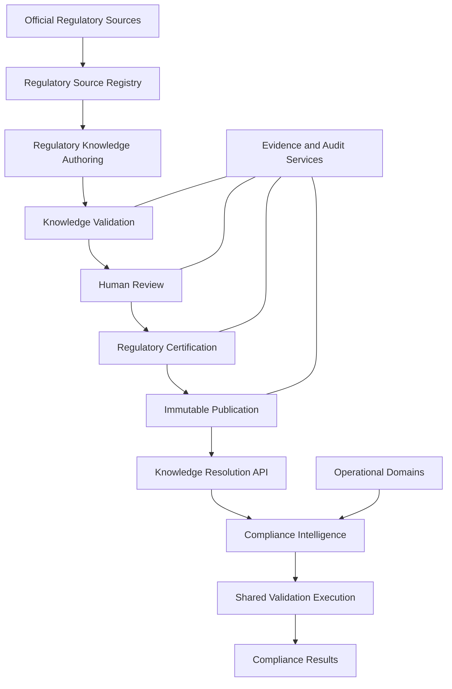
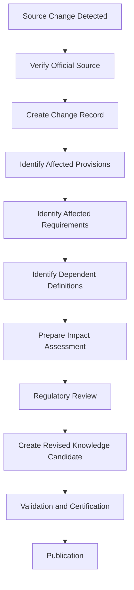
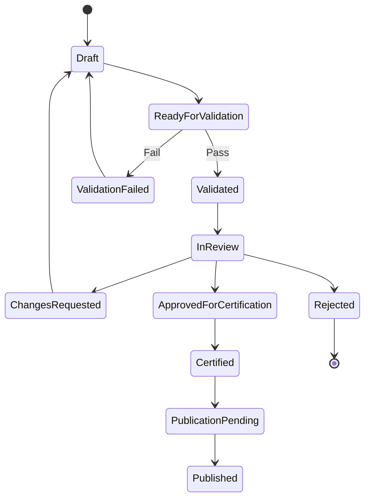
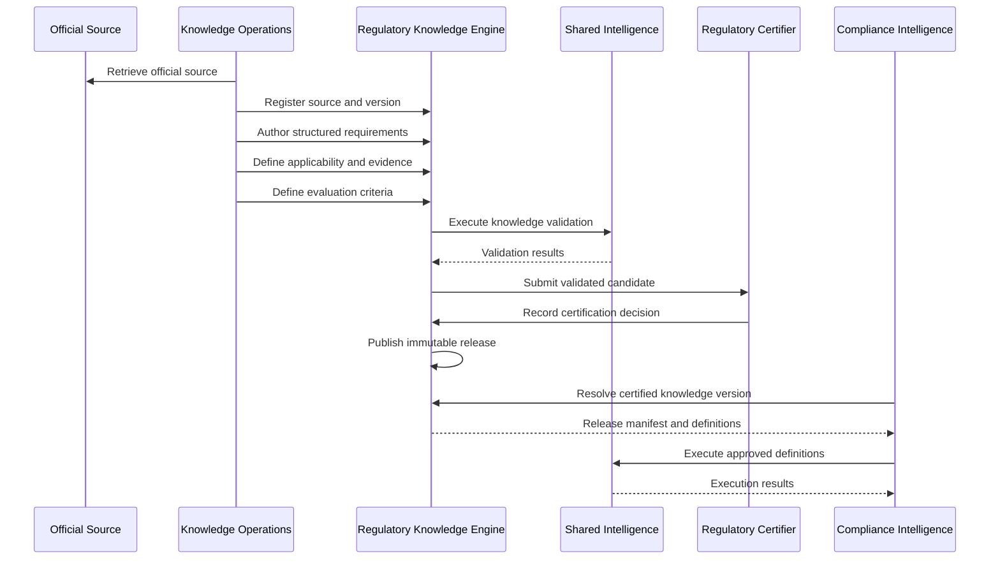

# ENG-016 — Regulatory Knowledge Engine: Detailed Component Specifications

**Organization:** McCaskill Projects  
**Platform:** Regulatory Intelligence Platform  
**Document ID:** ENG-016  
**Version:** 1.0 — Draft  
**Classification:** Engineering Design Specification  
**Proposed Path:** `docs/engineering/16-regulatory-knowledge-engine-specification.md`  
**Design Approach:** Architecture-first, repository-independent  
**Implementation Authorization:** Not Granted

---

# 1. Executive Design Statement

The Regulatory Knowledge Engine (RKE) is the authoritative regulatory knowledge subsystem of the Regulatory Intelligence Platform.

Its purpose is to transform authoritative regulatory sources into structured, validated, reviewed, certified, versioned, and published regulatory knowledge that other platform components can consume.

The RKE must support multiple jurisdictions, authorities, programs, industries, and regulatory domains without changing its underlying architecture.

Texas Home and Community-based Services (HCS) is the first planned regulatory Knowledge Pack, but Texas-specific concepts must not become universal engine assumptions.

The engine governs what regulatory requirements mean, when they apply, which evidence they require, and which evaluation definitions are authorized for use.

It does not own operational records, execute customer compliance workflows, issue financial determinations, or independently replace human regulatory judgment.

## 1.1 Primary architectural rule

**No regulatory feature may become an authoritative compliance capability until its governing regulatory requirements are represented in the Regulatory Knowledge Engine.**

The RKE is the regulatory source of truth.

- The Knowledge Engine defines approved regulatory knowledge.
- Operational Domains maintain factual business records.
- Shared Validation executes approved definitions.
- Compliance Intelligence orchestrates evaluations and manages results.
- The database persists records and history.
- The user interface displays and manages authorized workflows.
- AI assists with extraction, analysis, drafting, and explanation under human governance.

## 1.2 Design objectives

The engine shall provide:

1. Authoritative source traceability.
2. Jurisdiction-neutral regulatory modeling.
3. Structured requirements and applicability.
4. Evidence and evaluation definitions.
5. Dependency-aware validation.
6. Controlled human review.
7. Independent certification.
8. Immutable published knowledge versions.
9. Effective-date resolution.
10. Regulatory change detection and impact analysis.
11. Stable consumption contracts.
12. Historical reproducibility.
13. Secure multi-tenant consumption.
14. Auditable AI-assisted knowledge operations.
15. Reliable publication and rollback-by-supersession.

---

# 2. Architectural Placement and Boundaries

## 2.1 WHAT

The RKE is one of the platform's two independent knowledge authorities.

The other is the Financial Knowledge Engine (FKE).

The RKE owns regulatory definitions. The FKE owns financial methodology and reporting definitions.

## 2.2 WHEN

The RKE is involved when regulatory sources are acquired, interpreted, modeled, reviewed, certified, published, updated, or resolved for an authorized consumer.

## 2.3 WHERE

Architectural Layer 3 — Knowledge Authorities.

Its governance workflows integrate with Layer 4 Shared Intelligence services.

## 2.4 WHY

Regulatory policy must not be scattered among UI components, operational services, database procedures, or customer-specific code.

## 2.5 HOW



### Owned by the RKE

- Regulatory source metadata and provenance.
- Source versions.
- Regulatory requirements.
- Applicability definitions.
- Evidence specifications.
- Regulatory evaluation definitions.
- Knowledge Packs and releases.
- Knowledge dependencies.
- Regulatory interpretations and decisions.
- Validation policy for knowledge artifacts.
- Regulatory certification records.
- Regulatory publication metadata.
- Regulatory change relationships.
- Regulatory impact specifications.

### Not owned by the RKE

- Provider operational records.
- Residential or ISS service records.
- Employee and consumer records.
- Customer compliance findings.
- Corrective action plans.
- Financial classification and allocation methodology.
- Financial report calculations.
- General document storage infrastructure.
- Generic workflow execution infrastructure.
- Customer-specific UI state.

## 2.6 VERIFICATION

Architecture tests and design reviews must establish that the RKE does not depend on Compliance Intelligence, Financial Intelligence, or frontend implementation details.

---

# 3. Regulatory Knowledge Engine Component Catalog

## 3.1 WHAT

The RKE is decomposed into eleven logical components, aligned with the RK-01 through RK-11 service family from ENG-008.

| ID | Component | Core responsibility |
|---|---|---|
| RKE-01 | Regulatory Source Registry | Authoritative source identity and provenance |
| RKE-02 | Source Version Manager | Official source revisions and temporal history |
| RKE-03 | Requirement Modeling Service | Structured regulatory obligations |
| RKE-04 | Applicability Definition Service | Conditions determining regulatory applicability |
| RKE-05 | Evidence Specification Service | Evidence required to evaluate obligations |
| RKE-06 | Evaluation Definition Service | Declarative regulatory evaluation logic |
| RKE-07 | Knowledge Pack Assembly Service | Packaging related regulatory knowledge |
| RKE-08 | Knowledge Validation Service | Structural and semantic validation |
| RKE-09 | Regulatory Review and Certification Service | Controlled expert review and certification |
| RKE-10 | Publication and Resolution Service | Immutable releases and consumer resolution |
| RKE-11 | Regulatory Change and Impact Service | Change analysis and affected knowledge identification |

These are logical components. They need not be eleven separately deployed applications.

## 3.2 WHEN

The catalog governs all detailed RKE design and implementation planning.

## 3.3 WHERE

The Regulatory Knowledge Engine subsystem.

## 3.4 WHY

Stable component ownership avoids overlapping responsibilities and enables independent testing.

## 3.5 HOW

Each component has:

- An explicit authoritative data boundary.
- Defined commands and queries.
- Invariants.
- Security requirements.
- Failure behavior.
- Events.
- Dependencies.
- Acceptance tests.

## 3.6 VERIFICATION

Each component must have a complete contract before implementation authorization.

---

# 4. Universal Regulatory Knowledge Domain Model

## 4.1 WHAT

The domain model represents regulatory knowledge without requiring Texas-specific tables or properties in the universal core.

## 4.2 WHEN

Used during source registration, knowledge authoring, certification, publication, and resolution.

## 4.3 WHERE

RKE-owned persistence and published knowledge artifacts.

## 4.4 WHY

A universal domain model allows additional regulatory programs to be introduced through Knowledge Packs rather than structural redesign.

## 4.5 HOW

### Core entities

| Entity | Purpose |
|---|---|
| Jurisdiction | Geographic or legal scope |
| RegulatoryAuthority | Organization empowered to issue or administer requirements |
| RegulatoryProgram | Governed regulatory program or subject area |
| RegulatorySource | Identifiable official legal or administrative source |
| RegulatorySourceVersion | Captured version of a source |
| RegulatoryProvision | Specific provision within a source version |
| RegulatoryRequirement | Structured obligation or prohibition |
| RegulatoryInterpretation | Reviewed meaning of a requirement |
| ApplicabilityDefinition | Conditions under which a requirement applies |
| EvidenceSpecification | Evidence expected for a requirement |
| EvaluationDefinition | Declarative criteria for determining a result |
| KnowledgeDependency | Relationship between knowledge artifacts |
| KnowledgePack | Logical collection of governed knowledge |
| KnowledgePackVersion | Immutable versioned package after publication |
| ValidationReport | Results of knowledge validation |
| ReviewRecord | Human review and disposition |
| CertificationRecord | Authorized certification decision |
| PublicationRecord | Publication and effective-status metadata |
| RegulatoryChangeRecord | Detected or registered regulatory change |
| ImpactAssessment | Effects of changes on governed knowledge and consumers |
| KnowledgeResolutionRecord | Optional auditable record of version resolution |

### Universal identifiers

All entities require stable identifiers independent of display labels and source citation strings.

Recommended identifier categories:

- `jurisdictionId`
- `authorityId`
- `programId`
- `sourceId`
- `sourceVersionId`
- `provisionId`
- `requirementId`
- `interpretationId`
- `applicabilityId`
- `evidenceSpecificationId`
- `evaluationDefinitionId`
- `knowledgePackId`
- `knowledgePackVersionId`

Identifier types and physical representations will be finalized during implementation design.

### Mandatory provenance

Every published regulatory requirement must be traceable to:

1. Its governing source.
2. The applicable source version.
3. One or more provisions.
4. Its interpretation and review history.
5. The certified Knowledge Pack version containing it.

## 4.6 VERIFICATION

No published requirement may exist without valid provenance and approved relationships.

---

# 5. Universal Knowledge Artifact Contract

## 5.1 WHAT

All RKE knowledge artifacts share common metadata.

## 5.2 WHEN

Used when creating, editing, reviewing, validating, publishing, or resolving knowledge.

## 5.3 WHERE

RKE domain contracts and published artifact schemas.

## 5.4 WHY

Consistent metadata enables reliable versioning, traceability, and lifecycle governance.

## 5.5 HOW

### Conceptual artifact interface

```typescript
interface RegulatoryKnowledgeArtifact {
  id: string;
  artifactType: string;
  stableCode: string;
  title: string;
  description?: string;

  jurisdictionId: string;
  authorityId: string;
  programId?: string;

  sourceReferences: RegulatorySourceReference[];

  lifecycleStatus: KnowledgeLifecycleStatus;

  validFrom?: string;
  validTo?: string;

  createdAt: string;
  createdBy: string;
  updatedAt: string;
  updatedBy: string;

  revision: number;
}
```

### Source reference

```typescript
interface RegulatorySourceReference {
  sourceId: string;
  sourceVersionId: string;
  provisionId?: string;
  citation: string;
  referenceType: "PRIMARY" | "SUPPORTING" | "INTERPRETIVE";
}
```

### Design requirements

- Stable codes must not be reused for unrelated meanings.
- Display titles may change without changing identity.
- Source references must resolve.
- Dates must have explicitly defined temporal semantics.
- Draft revisions must be distinguishable from published versions.
- Published artifact content must be immutable.
- Lifecycle transitions must be authorized.

These interfaces are conceptual design contracts, not repository code.

## 5.6 VERIFICATION

Schema tests must reject invalid identities, missing required metadata, and broken references.

---

# 6. RKE-01 — Regulatory Source Registry

## 6.1 WHAT

The Source Registry maintains the identity, authority, origin, and provenance of regulatory sources.

## 6.2 WHEN

A source is first introduced, verified, updated, or referenced by knowledge artifacts.

## 6.3 WHERE

RKE-owned source registry and associated protected document references.

## 6.4 WHY

Every regulatory determination must be traceable to an identifiable authoritative source.

## 6.5 HOW

### Responsibilities

- Register jurisdictions and authorities.
- Register regulatory programs.
- Register official source identities.
- Maintain canonical source references.
- Record source classification.
- Record issuing authority.
- Maintain source verification status.
- Associate official publication references.
- Detect duplicate source identities.
- Record provenance evidence.

### Source classification

Examples include:

- Statute.
- Regulation.
- Administrative rule.
- Official agency directive.
- Official guidance.
- Official form or instruction.
- Interpretive publication.

A source's classification does not automatically make it legally binding.

### Required commands

- Register source.
- Update source metadata.
- Verify source authority.
- Associate official reference.
- Deprecate source identity where appropriate.

### Required queries

- Retrieve source.
- Search by jurisdiction, authority, program, and citation.
- Retrieve source provenance.
- Retrieve source versions.

### Invariants

- Source identity is stable.
- Source metadata cannot fabricate official authority.
- Source provenance is preserved.
- Source deletion must not break published knowledge history.

### Failure behavior

Invalid or unverifiable source metadata blocks source verification.

## 6.6 VERIFICATION

Tests must cover duplicate registration, invalid authority relationships, provenance preservation, and unauthorized updates.

---

# 7. RKE-02 — Source Version Manager

## 7.1 WHAT

Manages versions of regulatory sources and their effective relationships.

## 7.2 WHEN

An official source is amended, replaced, repealed, corrected, or newly captured.

## 7.3 WHERE

RKE source-version persistence.

## 7.4 WHY

Compliance history depends on the exact regulatory source version applicable to an evaluation.

## 7.5 HOW

### Required metadata

- Source version identifier.
- Parent source identifier.
- Official publication date.
- Effective date.
- End or repeal date, when known.
- Capture date.
- Verification date.
- Official source reference.
- Content integrity digest.
- Supersession relationship.
- Provenance status.

### Temporal distinction

The system must distinguish:

- When the authority published a source.
- When the source became legally effective.
- When the platform discovered or captured it.
- When the platform verified it.
- When a knowledge release incorporating it was published.

These dates are not interchangeable.

### Version behavior

- Preserve earlier source versions.
- Represent amendments and repeals explicitly.
- Support future-effective changes.
- Support historical source retrieval.
- Detect overlapping or contradictory effective periods requiring review.

## 7.6 VERIFICATION

Temporal boundary, supersession, integrity, and historical retrieval tests must pass.

---

# 8. RKE-03 — Requirement Modeling Service

## 8.1 WHAT

Converts reviewed regulatory provisions into structured requirements.

## 8.2 WHEN

During knowledge authoring and regulatory change processing.

## 8.3 WHERE

RKE requirement domain.

## 8.4 WHY

Unstructured legal text cannot reliably support repeatable applicability and evaluation.

## 8.5 HOW

### Requirement properties

```typescript
interface RegulatoryRequirementDefinition {
  requirementId: string;
  stableCode: string;

  obligationType:
    | "REQUIRED"
    | "PROHIBITED"
    | "CONDITIONAL"
    | "PERMITTED"
    | "INFORMATIONAL";

  subjectType: string;
  actionOrCondition: string;

  applicabilityDefinitionIds: string[];
  evidenceSpecificationIds: string[];
  evaluationDefinitionIds: string[];

  sourceReferences: RegulatorySourceReference[];

  interpretationId?: string;
  dependencies: string[];

  severityPolicyId?: string;
}
```

### Modeling rules

- One requirement must have a coherent, independently testable meaning.
- Complex provisions may produce multiple requirements.
- Multiple provisions may support one requirement when legally justified.
- Interpretive decisions must be documented.
- Ambiguous provisions must be flagged for review.
- Severity assignments must be governed rather than guessed by the execution service.

### Non-evaluable requirements

Some requirements may be informational or require manual judgment.

They must remain representable without forcing an artificial automated pass/fail result.

## 8.6 VERIFICATION

Requirement validation must detect missing source links, invalid dependency references, and incompatible definitions.

---

# 9. RKE-04 — Applicability Definition Service

## 9.1 WHAT

Defines whether a regulatory requirement applies to a particular regulated subject and context.

## 9.2 WHEN

During knowledge modeling and when a consumer requests an applicable requirement set.

## 9.3 WHERE

RKE applicability definitions, executed through authorized evaluation infrastructure.

## 9.4 WHY

A requirement may apply only to certain programs, settings, services, time periods, populations, or conditions.

## 9.5 HOW

### Applicability inputs

Potential inputs include:

- Jurisdiction.
- Regulatory program.
- Provider classification.
- Service type.
- Location type.
- Subject type.
- Relevant effective date.
- Defined operational attributes.
- Other certified regulatory conditions.

### Declarative condition model

```typescript
interface ApplicabilityDefinition {
  id: string;
  version: string;
  subjectType: string;
  expression: RegulatoryExpression;
  requiredInputs: string[];
  unknownInputPolicy: "UNDETERMINED";
}
```

### Result model

```typescript
type ApplicabilityResult =
  | "APPLICABLE"
  | "NOT_APPLICABLE"
  | "UNDETERMINED";
```

### Evaluation rules

- Missing required facts must not silently produce Not Applicable.
- Applicability must use a certified definition.
- Inputs must be explicitly typed.
- Results must retain the applicable definition version.
- Applicability must be evaluated for the relevant regulatory effective period.

### Expression security

Definitions must use an approved declarative expression grammar.

They must not execute arbitrary code or untrusted scripts.

## 9.6 VERIFICATION

Tests must cover applicable, not applicable, missing-input, effective-date, and conflicting-condition scenarios.

---

# 10. RKE-05 — Evidence Specification Service

## 10.1 WHAT

Defines the evidence needed to assess regulatory requirements.

## 10.2 WHEN

During knowledge modeling and compliance evaluation preparation.

## 10.3 WHERE

RKE evidence specifications; evidence instances remain in Shared Evidence or their owning Operational Domains.

## 10.4 WHY

The platform must distinguish what evidence is required from the actual records submitted or retrieved.

## 10.5 HOW

### Evidence specification properties

- Evidence specification ID.
- Associated requirement IDs.
- Evidence category.
- Expected source domain.
- Required fields.
- Temporal requirements.
- Completeness criteria.
- Accepted evidence forms.
- Conditional requirements.
- Manual-review requirements.
- Confidentiality classification.
- Version.

### Evidence categories

Examples:

- Operational record.
- Signed document.
- Inspection record.
- Training record.
- Service record.
- Incident record.
- Attestation.
- Manual observation.

### Ownership rule

The RKE defines evidence requirements.

It does not own the underlying provider documents or operational records.

## 10.6 VERIFICATION

Tests must ensure evidence definitions are valid, referenced domains are known, and missing evidence produces the intended result.

---

# 11. RKE-06 — Evaluation Definition Service

## 11.1 WHAT

Defines declarative regulatory evaluation criteria.

## 11.2 WHEN

After requirements and applicability have been modeled and reviewed.

## 11.3 WHERE

RKE evaluation definitions, executed by Shared Validation under Compliance Intelligence orchestration.

## 11.4 WHY

Evaluation behavior must be governed knowledge rather than hidden application logic.

## 11.5 HOW

### Evaluation definition

```typescript
interface RegulatoryEvaluationDefinition {
  id: string;
  requirementId: string;
  version: string;

  applicabilityDefinitionId: string;
  evidenceSpecificationIds: string[];

  requiredInputs: string[];
  expression: RegulatoryExpression;

  outcomeMapping: Record<string, string>;
  explanationTemplateId?: string;
}
```

### Supported outcome semantics

The design must distinguish:

- Compliant.
- Noncompliant.
- Not applicable.
- Insufficient information.
- Requires manual review.
- Evaluation error.

An execution error must not be converted into a compliance failure.

### Rules

- Only approved expressions may execute.
- All input contracts must be explicit.
- Evaluation definitions must be deterministic for identical inputs and governing versions.
- Manual review must be available where automated determination is inappropriate.
- Evaluation outputs must identify the governing definition and source references.

## 11.6 VERIFICATION

Golden fixtures must verify each outcome, invalid input handling, and deterministic execution.

---

# 12. RKE-07 — Knowledge Pack Assembly Service

## 12.1 WHAT

Organizes related regulatory artifacts into versioned Knowledge Packs.

## 12.2 WHEN

During pack authoring, review, certification, and release preparation.

## 12.3 WHERE

RKE Knowledge Pack domain.

## 12.4 WHY

Consumers need coherent, governed sets of requirements rather than isolated rule fragments.

## 12.5 HOW

### Knowledge Pack metadata

```typescript
interface RegulatoryKnowledgePack {
  id: string;
  stableCode: string;
  name: string;

  jurisdictionIds: string[];
  authorityIds: string[];
  programIds: string[];

  version: string;
  lifecycleStatus: KnowledgeLifecycleStatus;

  requirementIds: string[];
  applicabilityDefinitionIds: string[];
  evidenceSpecificationIds: string[];
  evaluationDefinitionIds: string[];

  dependencyPackVersions: string[];

  effectiveFrom?: string;
  effectiveTo?: string;
}
```

### Pack assembly rules

- Every referenced artifact must exist.
- Required dependency versions must be resolvable.
- A pack must not contain contradictory active definitions without an explicit resolution.
- Pack composition must be deterministic.
- Certified release content must be frozen.
- Shared universal engine components must not be copied into customer-specific packs.

### Pack examples

- Texas HCS.
- Texas ISS.
- Future state-specific service programs.
- Future federal regulatory domains.

## 12.6 VERIFICATION

Pack assembly tests must cover missing artifacts, dependency conflicts, duplicate identities, and reproducible manifests.

---

# 13. RKE-08 — Knowledge Validation Service

## 13.1 WHAT

Validates the structural, semantic, relational, and temporal integrity of regulatory knowledge.

## 13.2 WHEN

During authoring, before review, before certification, and before publication.

## 13.3 WHERE

RKE validation policy and validation orchestration, using Shared Validation infrastructure where appropriate.

## 13.4 WHY

Invalid knowledge must never become an authoritative published release.

## 13.5 HOW

### Validation stages

**Stage 1 — Schema validation**

Check required fields, types, identifiers, and allowed values.

**Stage 2 — Reference validation**

Check source, requirement, evidence, applicability, and evaluation references.

**Stage 3 — Dependency validation**

Check missing dependencies, incompatible versions, and cycles.

**Stage 4 — Semantic validation**

Check logical consistency, duplicate definitions, and conflicting meanings requiring review.

**Stage 5 — Temporal validation**

Check effective dates, supersession relationships, and conflicting active periods.

**Stage 6 — Execution definition validation**

Check expression grammar, required inputs, outcome mapping, and unsupported operations.

**Stage 7 — Governance validation**

Check review readiness, provenance, and mandatory certification prerequisites.

### Validation report

```typescript
interface KnowledgeValidationReport {
  reportId: string;
  artifactId: string;
  artifactVersion: string;

  status: "VALID" | "INVALID";

  errors: ValidationFinding[];
  warnings: ValidationFinding[];

  validatorVersion: string;
  generatedAt: string;
  contentDigest: string;
}

interface ValidationFinding {
  code: string;
  severity: "ERROR" | "WARNING";
  artifactPath: string;
  message: string;
  relatedArtifactIds?: string[];
}
```

### Validation invariants

- Validation must be deterministic for identical inputs and validator versions.
- Errors block certification.
- Warnings require disposition according to approved governance rules.
- A valid report does not constitute regulatory certification.
- Validation results must be tied to the exact content digest.
- Changes after validation invalidate the affected validation approval.

## 13.6 VERIFICATION

A golden fixture suite must test all validation stages, including malformed and adversarial knowledge inputs.

---

# 14. RKE-09 — Regulatory Review and Certification Service

## 14.1 WHAT

Controls human regulatory review and formal certification decisions.

## 14.2 WHEN

After successful validation and before authoritative publication.

## 14.3 WHERE

RKE certification domain, using Shared Approval and Audit infrastructure.

## 14.4 WHY

Software validation cannot independently establish the legal accuracy of regulatory interpretations.

## 14.5 HOW

### Review roles

- Knowledge Author.
- Regulatory Reviewer.
- Regulatory Certifier.
- Publication Approver.
- Knowledge Administrator.

These are logical actor categories; exact permissions are governed by ENG-010.

### Review requirements

- Verified source provenance.
- Reviewed requirement interpretation.
- Reviewed applicability.
- Reviewed evidence specifications.
- Reviewed evaluation definitions.
- Resolved validation warnings.
- Recorded reviewer decisions.
- Required independent approvals.

### Certification record

```typescript
interface RegulatoryCertificationRecord {
  certificationId: string;
  knowledgePackId: string;
  candidateVersion: string;

  contentDigest: string;
  validationReportId: string;

  decision: "CERTIFIED" | "REJECTED";
  decisionBy: string;
  decisionAt: string;

  reviewRecordIds: string[];
  rationale: string;
}
```

### Separation of duties

Where independent certification is required, the same actor must not author and independently certify the same release.

Certification must apply to a specific immutable candidate digest.

## 14.6 VERIFICATION

Tests must reject unauthorized certification, stale validation, altered candidates, and prohibited self-certification.

---

# 15. RKE-10 — Publication and Resolution Service

## 15.1 WHAT

Publishes certified Knowledge Pack versions and resolves the correct version for authorized consumers.

## 15.2 WHEN

After certification and whenever an authorized consumer needs regulatory knowledge.

## 15.3 WHERE

RKE publication registry and read APIs.

## 15.4 WHY

Operational evaluations must use known, certified, reproducible knowledge versions.

## 15.5 HOW

### Publication prerequisites

- Valid candidate manifest.
- Passing validation report.
- Certification of matching content digest.
- Approved effective-period metadata.
- Resolved dependencies.
- Authorized publication decision.

### Publication behavior

1. Verify candidate identity and digest.
2. Verify certification.
3. Resolve dependency versions.
4. Create immutable release manifest.
5. Persist publication record.
6. Activate release according to approved effective rules.
7. Emit publication event.
8. Preserve all earlier published releases.

### Version resolution inputs

```typescript
interface KnowledgeResolutionRequest {
  jurisdictionId: string;
  authorityId?: string;
  programId: string;
  effectiveAt: string;
  knowledgePackCode?: string;
  pinnedVersionId?: string;
}
```

### Resolution result

```typescript
interface KnowledgeResolutionResult {
  knowledgePackVersionId: string;
  contentDigest: string;
  effectiveFrom: string;
  effectiveTo?: string;
  certificationId: string;
  dependencyVersions: string[];
}
```

### Resolution policy

- Explicit pinned versions take precedence when authorized and valid for the requested purpose.
- Historical evaluations retain the version originally used.
- Multiple conflicting releases must not be silently selected.
- A future-effective release must not be treated as currently effective.
- Publication does not mutate previous release content.

### Withdrawal and supersession

A release may be withdrawn from future selection or superseded according to governance policy.

Historical records and referenced release artifacts must remain retrievable under applicable retention controls.

## 15.6 VERIFICATION

Tests must cover future-effective releases, historical resolution, conflicting versions, withdrawal, immutability, and unauthorized access.

---

# 16. RKE-11 — Regulatory Change and Impact Service

## 16.1 WHAT

Detects, registers, analyzes, and routes changes in regulatory sources.

## 16.2 WHEN

When a new source version is discovered or an existing source changes.

## 16.3 WHERE

RKE change management domain.

## 16.4 WHY

Regulatory knowledge must remain current while preserving historical interpretations.

## 16.5 HOW

### Change categories

- New requirement.
- Amendment.
- Repeal.
- Effective-date change.
- Official correction.
- Interpretive clarification.
- Source replacement.
- Authority or program restructuring.

### Change workflow



### Impact assessment

Must identify, where determinable:

- Affected requirements.
- Applicability definitions.
- Evidence specifications.
- Evaluation definitions.
- Knowledge Packs.
- Dependent published releases.
- Potentially affected consuming workflows.
- Effective dates.
- Required review actions.

### Change automation boundary

AI or automated comparison may suggest affected artifacts.

Only governed review and certification may authorize a revised regulatory interpretation.

## 16.6 VERIFICATION

Tests must verify change detection records, dependency traversal, impact completeness, and historical preservation.

---

# 17. Knowledge Lifecycle State Machine

## 17.1 WHAT

Defines the permitted lifecycle of a regulatory knowledge candidate.

## 17.2 WHEN

From initial authoring through publication or rejection.

## 17.3 WHERE

RKE lifecycle governance.

## 17.4 WHY

Knowledge must not bypass validation or certification.

## 17.5 HOW

### Candidate states

- Draft.
- Ready for Validation.
- Validation Failed.
- Validated.
- In Review.
- Changes Requested.
- Approved for Certification.
- Certified.
- Publication Pending.
- Published.
- Rejected.

### Lifecycle diagram



### Critical invariants

- Published content is immutable.
- A modified candidate returns to a validation-required state.
- Certification references a fixed digest.
- Publication requires matching certification.
- Rejection must preserve review history.
- A new version is created for subsequent changes.

## 17.6 VERIFICATION

Transition tests must cover all authorized and prohibited state changes.

---

# 18. Regulatory Expression and Evaluation Language

## 18.1 WHAT

Defines a safe declarative representation for regulatory conditions.

## 18.2 WHEN

Used by Applicability and Evaluation Definitions.

## 18.3 WHERE

RKE-owned expression schemas and Shared Validation execution.

## 18.4 WHY

Arbitrary executable code inside Knowledge Packs would create security, reproducibility, and governance risks.

## 18.5 HOW

### Proposed expression categories

- Boolean operations.
- Comparisons.
- Set membership.
- Presence and absence.
- Date comparisons.
- Numeric thresholds.
- Aggregations over explicitly defined collections.
- References to approved input fields.
- Approved reusable expression operators.

### Example conceptual expression

```json
{
  "operator": "AND",
  "conditions": [
    {
      "operator": "EQUALS",
      "field": "location.type",
      "value": "THREE_PERSON"
    },
    {
      "operator": "EXISTS",
      "field": "emergencyPlan.currentVersion"
    }
  ]
}
```

This example illustrates the expression structure only. It is not a certified Texas HCS requirement.

### Execution constraints

- Strictly typed inputs.
- Versioned operator semantics.
- No arbitrary filesystem access.
- No network access from expressions.
- No dynamic code evaluation.
- Bounded execution.
- Deterministic outcomes.
- Explicit handling of unknown values.

### Compatibility

Changes to expression semantics require versioning and regression tests.

## 18.6 VERIFICATION

Expression tests must cover valid operations, malformed definitions, unknown inputs, execution limits, and deterministic results.

---

# 19. Knowledge Versioning and Temporal Semantics

## 19.1 WHAT

Defines how the RKE preserves historical meaning.

## 19.2 WHEN

During source changes, certification, publication, and historical evaluations.

## 19.3 WHERE

RKE versioned artifacts and release manifests.

## 19.4 WHY

A regulatory evaluation must be explainable using the knowledge that governed it at the relevant time.

## 19.5 HOW

### Distinct version dimensions

1. Official source version.
2. Regulatory requirement revision.
3. Interpretation revision.
4. Evaluation definition version.
5. Knowledge Pack release version.
6. Expression engine version.
7. Validator version.

### Required historical references

A governed evaluation should retain sufficient information to identify:

- Knowledge Pack version.
- Applicable requirement versions.
- Evaluation definition versions.
- Expression semantics.
- Source references.
- Effective-date context.

### Temporal rules

- Publication time and regulatory effective time are distinct.
- A source may become effective before the platform discovers it.
- A later correction may require reassessment without rewriting original results.
- Historical queries must support explicitly pinned releases.

## 19.6 VERIFICATION

Historical reproduction tests must return consistent knowledge for pinned releases.

---

# 20. Knowledge Dependencies

## 20.1 WHAT

Defines relationships among requirements, definitions, and Knowledge Packs.

## 20.2 WHEN

During authoring, validation, publication, and change analysis.

## 20.3 WHERE

RKE dependency registry.

## 20.4 WHY

A change to one requirement may affect multiple definitions and consumers.

## 20.5 HOW

### Dependency types

- Requires.
- References.
- Refines.
- Supersedes.
- Conflicts with.
- Applies when.
- Provides evidence for.
- Depends on Knowledge Pack version.

### Dependency rules

- References must resolve.
- Prohibited cycles must be rejected.
- Version constraints must be explicit.
- Dependency graphs must be traversable.
- Publication must resolve the complete required dependency set.

## 20.6 VERIFICATION

Dependency tests must detect missing nodes, invalid versions, conflicts, and prohibited cycles.

---

# 21. Regulatory Knowledge APIs

## 21.1 WHAT

Defines the logical command and query interfaces of the RKE.

## 21.2 WHEN

Used by Knowledge Administration, Compliance Intelligence, and authorized governance services.

## 21.3 WHERE

Versioned platform APIs and internal service contracts.

## 21.4 WHY

Consumers need stable interfaces without direct access to RKE persistence.

## 21.5 HOW

### Proposed API families

| Family | Example operations |
|---|---|
| Sources | Register, retrieve, verify, list versions |
| Requirements | Create draft, revise, retrieve |
| Applicability | Create definition, validate, retrieve |
| Evidence | Create specification, retrieve |
| Evaluations | Create definition, validate, retrieve |
| Knowledge Packs | Assemble, inspect, validate |
| Reviews | Submit, request changes, approve |
| Certification | Certify, reject, retrieve decision |
| Publication | Publish, retrieve release |
| Resolution | Resolve applicable version |
| Changes | Register change, assess impact |

### Example conceptual routes

```text
POST /api/v1/regulatory/sources
GET  /api/v1/regulatory/sources/{sourceId}

POST /api/v1/regulatory/knowledge-packs
POST /api/v1/regulatory/knowledge-packs/{id}/validate
POST /api/v1/regulatory/knowledge-packs/{id}/submit-review
POST /api/v1/regulatory/knowledge-packs/{id}/certify
POST /api/v1/regulatory/knowledge-packs/{id}/publish

POST /api/v1/regulatory/knowledge/resolve
GET  /api/v1/regulatory/knowledge/releases/{versionId}
```

These are proposed contracts, not claims about existing endpoints.

### API requirements

- Backend authorization.
- Explicit error responses.
- Concurrency protection.
- Idempotency for publication.
- Audit and correlation identifiers.
- Pagination for collections.
- Versioned response contracts.
- Tenant and resource scoping where applicable.

## 21.6 VERIFICATION

API contract tests must cover authorized behavior, invalid requests, conflicts, and forbidden operations.

---

# 22. Regulatory Knowledge Events

## 22.1 WHAT

Defines events emitted by RKE lifecycle operations.

## 22.2 WHEN

After committed knowledge state changes.

## 22.3 WHERE

Approved platform event infrastructure.

## 22.4 WHY

Other components need to react to knowledge changes without coupling directly to RKE internals.

## 22.5 HOW

### Proposed events

| Event | Trigger |
|---|---|
| RegulatorySourceRegistered | Source registered |
| RegulatorySourceVersionVerified | Official version verified |
| RegulatoryRequirementRevised | Draft requirement changed |
| KnowledgeValidationCompleted | Validation completed |
| RegulatoryReviewCompleted | Review decision recorded |
| KnowledgePackCertified | Candidate certified |
| KnowledgePackPublished | Release published |
| KnowledgePackWithdrawn | Release withdrawn from permitted selection |
| RegulatoryChangeRegistered | Source change registered |
| RegulatoryImpactAssessed | Impact assessment completed |

Event identifiers must be reconciled with ENG-001 and ENG-009 before implementation.

### Event envelope

Every event should include:

- Event ID.
- Event type and schema version.
- Aggregate ID.
- Occurrence time.
- Correlation ID.
- Causation ID.
- Actor or service identity.
- Relevant knowledge version.
- Tenant context where applicable.

### Reliability

- Publish after committed state transitions.
- Use transactional outbox or equivalent reliability mechanism where required.
- Consumers must handle duplicate delivery.
- Events must not contain unnecessary protected source data.

## 22.6 VERIFICATION

Event contract, duplicate delivery, ordering-sensitive, and recovery tests must pass.

---

# 23. Security and Authorization

## 23.1 WHAT

Protects knowledge authoring, review, certification, publication, and consumption.

## 23.2 WHEN

At every command, query, lifecycle transition, and document access.

## 23.3 WHERE

Platform Authorization and RKE service boundaries.

## 23.4 WHY

Unauthorized knowledge changes could affect many customers and regulatory evaluations.

## 23.5 HOW

### Permission categories

- Source read.
- Source register.
- Source verify.
- Requirement author.
- Requirement review.
- Knowledge validate.
- Knowledge certify.
- Knowledge publish.
- Release read.
- Historical release read.
- Impact assessment manage.

### Security invariants

- Certification and publication require explicit authorization.
- Human approval identity must be attributable.
- Separation of duties must be enforced where required.
- Platform-global knowledge must not be editable by ordinary tenant users.
- Tenant-specific overlays, if introduced, must remain separately governed and cannot silently modify certified universal knowledge.
- Consumers receive only authorized knowledge.
- Administrative actions are audited.

## 23.6 VERIFICATION

Security tests must cover privilege escalation, unauthorized publication, tenant boundaries, and approval conflicts.

---

# 24. AI-Assisted Regulatory Knowledge Operations

## 24.1 WHAT

Defines permitted AI assistance in knowledge acquisition and maintenance.

## 24.2 WHEN

During source comparison, extraction, drafting, impact analysis, and explanation.

## 24.3 WHERE

Governed Knowledge Operations workflows.

## 24.4 WHY

AI can accelerate regulatory analysis but must not become the legal authority.

## 24.5 HOW

### Permitted assistance

- Extract candidate provisions.
- Suggest structured requirements.
- Identify possible applicability conditions.
- Suggest evidence mappings.
- Compare source versions.
- Identify potential dependencies.
- Draft impact assessments.
- Explain published requirements.

### Prohibited autonomous authority

AI must not independently:

- Declare an unverified source authoritative.
- Certify regulatory interpretations.
- Publish knowledge releases.
- Override human review.
- Change certified release content.
- Issue unsupported compliance conclusions.

### Provenance

AI-assisted artifacts should record:

- Source inputs.
- Model or tool version where relevant.
- Generation time.
- Human reviewer.
- Accepted and rejected suggestions.

## 24.6 VERIFICATION

Tests and governance reviews must demonstrate that AI output cannot bypass certification or publication controls.

---

# 25. Failure Handling and Recovery

## 25.1 WHAT

Defines failure behavior for RKE operations.

## 25.2 WHEN

During source processing, validation, review, publication, and resolution.

## 25.3 WHERE

RKE services and shared infrastructure.

## 25.4 WHY

A partial failure must not create inconsistent or falsely certified knowledge.

## 25.5 HOW

### Required failure cases

| Failure | Required behavior |
|---|---|
| Source unavailable | Record retrieval failure; do not fabricate provenance |
| Invalid source version | Block verification |
| Missing requirement reference | Block validation |
| Dependency conflict | Block certification or publication |
| Validator failure | Preserve candidate; report technical failure |
| Stale review decision | Reject transition |
| Candidate changed after certification | Require renewed validation and certification |
| Publication conflict | Reject conflicting release or require governed resolution |
| Event delivery failure | Recover without duplicating committed publication |
| Knowledge resolution ambiguity | Return explicit ambiguity/error |
| Historical artifact unavailable | Raise integrity incident; do not silently substitute another version |

### Recovery principles

- Preserve durable state.
- Make retries idempotent where necessary.
- Keep complete audit history.
- Prevent partially published releases.
- Separate operational errors from regulatory determinations.

## 25.6 VERIFICATION

Failure injection and recovery tests must cover critical lifecycle operations.

---

# 26. Data Integrity and Storage

## 26.1 WHAT

Defines persistence requirements for authoritative knowledge.

## 26.2 WHEN

During RKE data architecture and implementation design.

## 26.3 WHERE

RKE-owned PostgreSQL data and approved protected storage infrastructure.

## 26.4 WHY

Knowledge integrity is foundational to compliance reproducibility.

## 26.5 HOW

### Required controls

- Stable primary identifiers.
- Referential integrity.
- Unique stable codes within defined namespaces.
- Explicit version relationships.
- Content digests.
- Immutable published manifests.
- Audit trails.
- Transactional lifecycle changes.
- Retention and legal hold support.
- Backup and recovery.

### Storage separation

The RKE owns knowledge metadata and authoritative definitions.

Shared Document infrastructure may store source copies and supporting review artifacts under controlled references.

### Database ownership

Other domains must not directly mutate RKE-owned authoritative tables.

## 26.6 VERIFICATION

Integrity, transaction, historical retrieval, backup, and recovery tests must pass.

---

# 27. Observability and Operational Metrics

## 27.1 WHAT

Defines how RKE health and quality are monitored.

## 27.2 WHEN

During validation, publication, change processing, and runtime resolution.

## 27.3 WHERE

Platform observability infrastructure.

## 27.4 WHY

Knowledge failures must be detectable before they affect customer workflows.

## 27.5 HOW

### Proposed metrics

- Source verification backlog.
- Draft requirements awaiting review.
- Validation failure rate.
- Certification rejection rate.
- Publication success and failure.
- Knowledge resolution latency.
- Ambiguous resolution count.
- Unresolved dependency count.
- Regulatory change processing backlog.
- Source-to-publication elapsed time.
- Historical retrieval failures.

### Logging

Logs must include correlation identifiers and appropriate artifact references without exposing unnecessary protected content.

## 27.6 VERIFICATION

Monitoring tests must confirm that critical failures generate observable signals.

---

# 28. Performance and Scalability

## 28.1 WHAT

Defines performance characteristics for a universal knowledge authority.

## 28.2 WHEN

During implementation and capacity planning.

## 28.3 WHERE

RKE validation, dependency traversal, publication, and resolution services.

## 28.4 WHY

The engine must scale to multiple authorities and Knowledge Packs without requiring customer-specific forks.

## 28.5 HOW

### Design requirements

- Efficient indexed source lookup.
- Bounded dependency traversal.
- Deterministic validation.
- Cacheable immutable published releases.
- Version-aware cache keys.
- Controlled cache invalidation.
- Paginated administration queries.
- Asynchronous processing for long-running change analysis where appropriate.

### Performance targets

Specific latency, throughput, and volume targets must be approved before implementation rather than invented in this specification.

## 28.6 VERIFICATION

Performance tests must measure against approved targets and realistic knowledge volumes.

---

# 29. Testing and Quality Strategy

## 29.1 WHAT

Defines RKE-specific verification requirements under ENG-013.

## 29.2 WHEN

Throughout component implementation and before publication or release.

## 29.3 WHERE

Unit, integration, contract, security, and end-to-end test suites.

## 29.4 WHY

Knowledge correctness requires stronger controls than ordinary data-entry functionality.

## 29.5 HOW

### Required test suites

**T-RKE-01 — Source integrity**

Official source identity, provenance, and versioning.

**T-RKE-02 — Requirement integrity**

Required fields, references, and dependency correctness.

**T-RKE-03 — Applicability**

Applicable, not applicable, and undetermined cases.

**T-RKE-04 — Evidence specifications**

Required evidence, missing evidence, and temporal conditions.

**T-RKE-05 — Evaluation definitions**

Outcome mappings, determinism, and invalid inputs.

**T-RKE-06 — Knowledge Pack assembly**

Dependency completeness and reproducible manifests.

**T-RKE-07 — Validation**

Structural, semantic, relational, and temporal checks.

**T-RKE-08 — Certification**

Human review, authorization, and separation of duties.

**T-RKE-09 — Publication**

Immutable releases and effective-date resolution.

**T-RKE-10 — Regulatory change**

Source revisions, impact assessment, and supersession.

**T-RKE-11 — Security**

Unauthorized actions, tenant isolation, and access revocation.

**T-RKE-12 — Historical reproducibility**

Pinned releases and original governing versions.

**T-RKE-13 — Failure recovery**

Partial failures, retries, and publication consistency.

**T-RKE-14 — AI governance**

AI suggestions cannot become certified knowledge without required human controls.

## 29.6 VERIFICATION

All mandatory test suites must pass before the relevant RKE capability is accepted.

---

# 30. Texas HCS as the First Knowledge Pack

## 30.1 WHAT

Texas HCS is the first planned implementation of the universal RKE model.

## 30.2 WHEN

After the relevant universal engine components and governance controls are ready.

## 30.3 WHERE

A separately governed Texas HCS Knowledge Pack.

## 30.4 WHY

Texas HCS provides a practical regulatory domain for validating the universal architecture.

## 30.5 HOW

### Knowledge Pack contents

The pack may include:

- Texas regulatory authority metadata.
- Verified HCS regulatory sources.
- Program definitions.
- Structured requirements.
- Applicability definitions.
- Evidence specifications.
- Evaluation definitions.
- Dependencies.
- Source-effective dates.
- Review and certification records.

### First complete regulatory vertical slice

Texas HCS Emergency Preparedness.

The implementation sequence must follow:

1. Verify official sources.
2. Model requirements.
3. Define applicability.
4. Define evidence.
5. Define evaluation logic.
6. Validate.
7. Review.
8. Certify.
9. Publish.
10. Connect operational records.
11. Execute compliance evaluation.
12. Manage findings and reassessment.

### Boundary

This document does not certify specific Texas regulatory interpretations.

Those require separate source verification and regulatory review.

## 30.6 VERIFICATION

The Texas HCS pack must pass universal engine validation without introducing Texas-specific assumptions into the core.

---

# 31. Regulatory Knowledge Engine End-to-End Sequence

## 31.1 WHAT

Defines the complete lifecycle from authoritative source to consumer use.

## 31.2 WHEN

Used for integration design and end-to-end acceptance.

## 31.3 WHERE

RKE, Shared Intelligence, and Compliance Intelligence.

## 31.4 WHY

A complete sequence ensures that no governance stage is omitted.

## 31.5 HOW



## 31.6 VERIFICATION

The integrated lifecycle must preserve source-to-result traceability.

---

# 32. Component Dependency Order

## 32.1 WHAT

Defines the recommended order for implementing RKE components.

## 32.2 WHEN

During future implementation planning.

## 32.3 WHERE

ENG-015 sprint planning and detailed implementation packages.

## 32.4 WHY

Certain components depend on stable upstream contracts.

## 32.5 HOW

### Dependency order

**Foundation**

- RKE-01 Source Registry.
- RKE-02 Source Version Manager.
- RKE-03 Requirement Modeling.

**Definition layer**

- RKE-04 Applicability.
- RKE-05 Evidence.
- RKE-06 Evaluation.

**Packaging and governance**

- RKE-07 Knowledge Pack Assembly.
- RKE-08 Validation.
- RKE-09 Review and Certification.

**Publication and maintenance**

- RKE-10 Publication and Resolution.
- RKE-11 Change and Impact.

### Parallel development

Parallel implementation may occur when interfaces and dependencies are approved.

## 32.6 VERIFICATION

No component may be accepted if its mandatory upstream contracts remain undefined or unverified.

---

# 33. RKE Acceptance Matrix

| Component | Required acceptance evidence |
|---|---|
| RKE-01 Source Registry | Verified source identity and provenance |
| RKE-02 Source Version Manager | Historical and temporal integrity |
| RKE-03 Requirement Modeling | Structured, traceable requirements |
| RKE-04 Applicability | Deterministic applicability fixtures |
| RKE-05 Evidence Specifications | Valid and complete evidence contracts |
| RKE-06 Evaluation Definitions | Deterministic approved evaluation logic |
| RKE-07 Knowledge Pack Assembly | Reproducible dependency-complete manifests |
| RKE-08 Knowledge Validation | Passing structural and semantic suites |
| RKE-09 Review and Certification | Authorized independent certification |
| RKE-10 Publication and Resolution | Immutable releases and correct resolution |
| RKE-11 Change and Impact | Traceable change and dependency impact |

### Overall RKE completion criteria

- [ ] Jurisdiction-neutral core.
- [ ] Explicit authority and source provenance.
- [ ] Versioned regulatory requirements.
- [ ] Declarative applicability.
- [ ] Declarative evaluation definitions.
- [ ] Evidence specifications.
- [ ] Knowledge Pack assembly.
- [ ] Deterministic validation.
- [ ] Independent human certification.
- [ ] Immutable publication.
- [ ] Effective-date resolution.
- [ ] Historical reproduction.
- [ ] Change impact analysis.
- [ ] Backend authorization.
- [ ] Audit traceability.
- [ ] AI governance controls.
- [ ] API and event contracts.
- [ ] Failure recovery.
- [ ] Required test suites.
- [ ] Successful first Knowledge Pack validation.

---

# 34. Relationship to Existing Engineering Specifications

ENG-016 is governed by the architectural and engineering contracts established in:

- ENG-001 — Master Workflow Catalog.
- ENG-002 — Workflow Diagrams and State Machines.
- ENG-003 — Master Entity Catalog.
- ENG-004 — Entity Relationship Model.
- ENG-005 — Nx Workspace Architecture.
- ENG-006 — Technology Implementation Standards.
- ENG-007 — Frontend State Management Architecture.
- ENG-008 — Service and Module Catalog.
- ENG-009 — API and Event Contracts.
- ENG-010 — Authorization and Permission Matrix.
- ENG-011 — User Interface and Workspace Specification.
- ENG-012 — Data Architecture.
- ENG-013 — Testing and Quality Strategy.
- ENG-014 — Team Work Packages.
- ENG-015 — Sprint Implementation Packages.

### Contract reconciliation

Before implementation, the following must be reconciled across the blueprint:

- RKE-01 through RKE-11 component identifiers and ENG-008 RK service identifiers.
- Event names and ENG-001/ENG-009 event IDs.
- API families and ENG-009 contracts.
- Entity relationships and ENG-003/ENG-004.
- Permission names and ENG-010.
- State transitions and ENG-002.
- Test requirements and ENG-013.

Reconciliation must preserve the two independent knowledge authorities and the jurisdiction-neutral architecture.

---

# 35. Implementation Authorization

**Status: Not Granted**

ENG-016 defines the intended Regulatory Knowledge Engine independently of the existing repository.

It does not authorize:

- Creating or modifying source files.
- Changing Nx libraries.
- Creating database tables.
- Running migrations.
- Publishing regulatory knowledge.
- Changing API contracts.
- Modifying authorization.
- Deploying services.

Implementation decisions and repository comparison occur only after design approval.

---

# 36. Final Engineering Position

The Regulatory Knowledge Engine is a governed regulatory authority within the platform, not merely a collection of compliance rules.

Its complete responsibility is:

**Official Sources → Structured Requirements → Applicability and Evidence → Evaluation Definitions → Validation → Human Review → Certification → Immutable Publication → Authorized Consumption → Change Management**

This design allows McCaskill Projects to add new jurisdictions, programs, and regulatory domains through governed knowledge without redesigning the platform's foundational architecture.

**End of ENG-016 — Regulatory Knowledge Engine: Detailed Component Specifications**