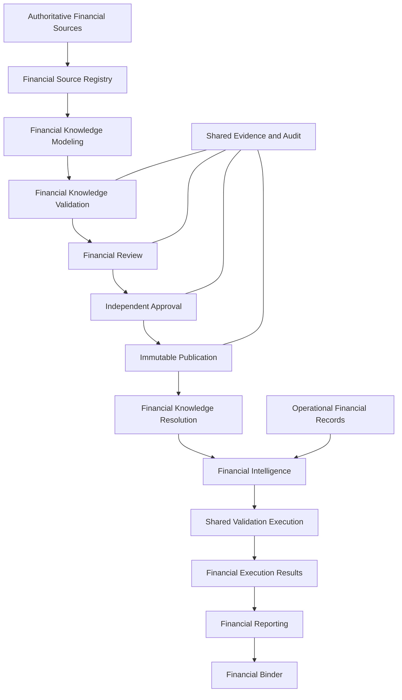
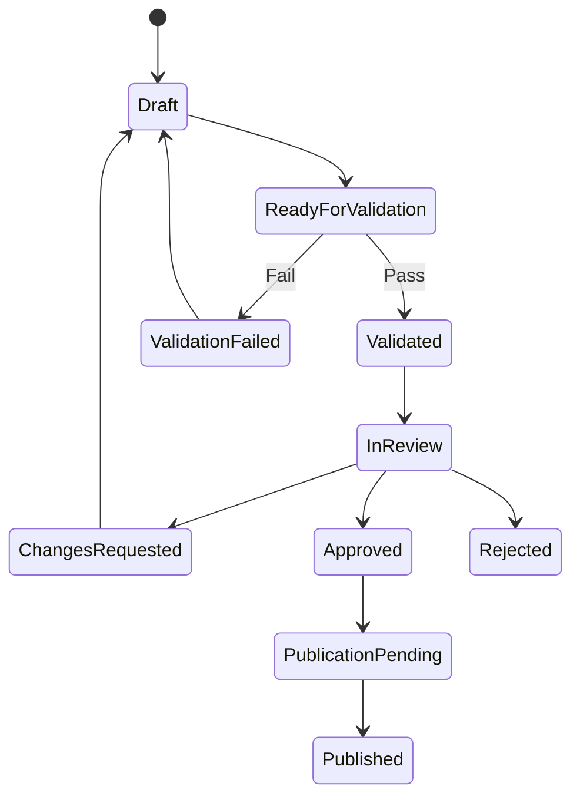
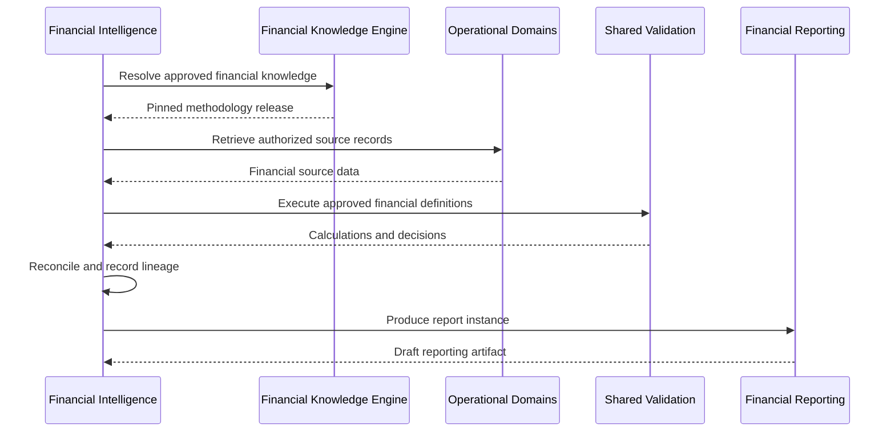
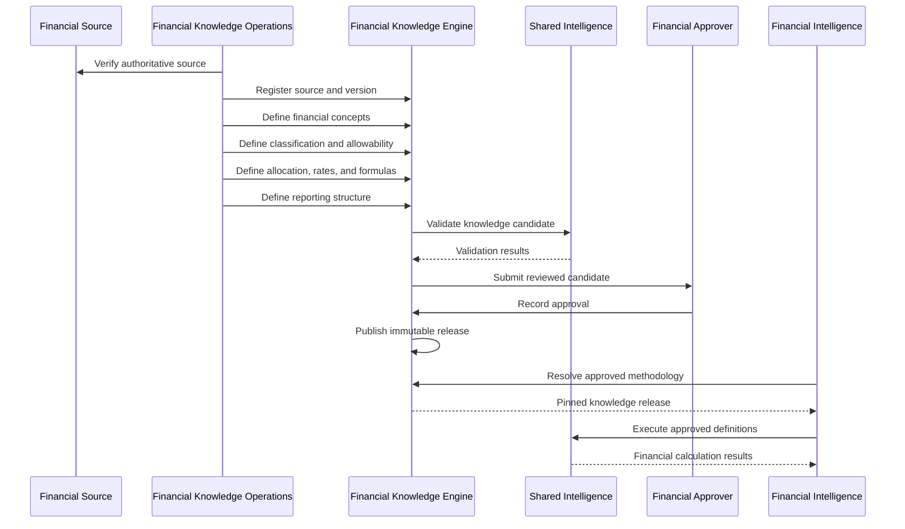

# ENG-017 — Financial Knowledge Engine: Detailed Component Specifications

**Organization:** McCaskill Projects  
**Platform:** Regulatory Intelligence Platform  
**Document ID:** ENG-017  
**Version:** 1.0 — Draft  
**Classification:** Engineering Design Specification  
**Proposed Path:** `docs/engineering/17-financial-knowledge-engine-specification.md`  
**Design Approach:** Architecture-first, repository-independent  
**Implementation Authorization:** Not Granted

---

# 1. Executive Design Statement

The Financial Knowledge Engine (FKE) is the authoritative financial knowledge subsystem of the Regulatory Intelligence Platform.

Its purpose is to transform authoritative financial sources, reporting instructions, cost principles, reimbursement methodologies, accounting requirements, and approved financial interpretations into structured, validated, reviewed, approved, versioned, and published financial knowledge.

The engine must support multiple jurisdictions, authorities, programs, industries, reporting frameworks, and financial domains without redesigning its universal architecture.

Texas Home and Community-based Services (HCS) Cost Reporting is the first planned financial vertical slice.

The FKE governs financial definitions and methodologies.

It does not own customer financial transactions, payroll records, operational service data, or the execution of customer-specific financial calculations.

## 1.1 Primary architectural rule

**No financial methodology-dependent feature may become authoritative until its governing financial definitions are represented and approved in the Financial Knowledge Engine.**

The Financial Knowledge Engine is the financial methodology source of truth.

- The FKE defines approved financial rules and methodologies.
- Operational Domains maintain source financial records.
- Shared Validation executes approved definitions.
- Financial Intelligence orchestrates financial calculations and reporting.
- Shared Evidence maintains supporting evidence relationships.
- Shared Approval supports governed review and approval workflows.
- Binder Management organizes approved reporting artifacts.
- The database persists financial knowledge and execution history.
- The user interface displays authorized financial workflows.
- AI assists with extraction, classification suggestions, analysis, and explanation under human governance.

## 1.2 Design objectives

The engine shall provide:

1. Authoritative financial source provenance.
2. Jurisdiction-neutral financial modeling.
3. Structured financial definitions.
4. Financial applicability rules.
5. Cost classification methodologies.
6. Allowability and exclusion rules.
7. Cost allocation methodologies.
8. Reimbursement rate definitions.
9. Calculation and formula definitions.
10. Reporting schedules and line definitions.
11. Precision and rounding policies.
12. Dependency-aware validation.
13. Controlled financial review.
14. Independent approval.
15. Immutable published financial knowledge.
16. Effective-period resolution.
17. Historical calculation reproducibility.
18. Financial change impact analysis.
19. Secure multi-tenant consumption.
20. Auditable AI-assisted financial knowledge operations.

---

# 2. Architectural Placement and Authority

## 2.1 WHAT

The FKE is one of the platform's two independent knowledge authorities.

The Regulatory Knowledge Engine (RKE) governs regulatory obligations, applicability, evidence requirements, and regulatory evaluation definitions.

The Financial Knowledge Engine governs financial methodology, financial applicability, classification, allowability, allocation, rates, calculations, and reporting definitions.

## 2.2 WHEN

The FKE participates when financial sources are registered, financial methodologies are defined or updated, knowledge is reviewed and approved, published versions are resolved, or financial executions require approved methodology.

## 2.3 WHERE

Architectural Layer 3 — Knowledge Authorities.

It integrates with Shared Intelligence in Layer 4 and Financial Intelligence in Layer 5.

## 2.4 WHY

Financial rules must not be embedded directly into accounting imports, payroll services, reporting screens, or calculation procedures.

## 2.5 HOW



### FKE ownership

The FKE owns:

- Financial source identities and provenance.
- Financial source versions.
- Financial terms and definitions.
- Financial applicability.
- Classification methodologies.
- Cost allowability rules.
- Allocation methodologies.
- Rate schedules and rate definitions.
- Formula and calculation definitions.
- Precision and rounding policies.
- Reporting definitions.
- Financial Knowledge Packs.
- Validation requirements.
- Financial methodology review and approval records.
- Published financial knowledge versions.
- Financial change and impact definitions.

### Excluded ownership

The FKE does not own:

- Customer bank transactions.
- Payroll transactions.
- General ledger entries.
- Invoices.
- Service encounters.
- Consumer service statistics.
- Contract operational records.
- Customer-specific calculated results.
- Financial report instances.
- Financial Binder instances.
- Compliance findings.
- Regulatory certification decisions.

## 2.6 VERIFICATION

Architecture review must establish that Financial Intelligence consumes approved FKE definitions without modifying them.

---

# 3. Financial Knowledge Engine Component Catalog

## 3.1 WHAT

The FKE is composed of thirteen logical components, aligned conceptually with the FK-01 through FK-13 service family defined in ENG-008.

| ID | Component | Responsibility |
|---|---|---|
| FKE-01 | Financial Source Registry | Source identity, authority, and provenance |
| FKE-02 | Financial Source Version Manager | Source revisions and effective periods |
| FKE-03 | Financial Definition Registry | Financial terms, categories, and concepts |
| FKE-04 | Financial Applicability Service | Conditions governing methodology applicability |
| FKE-05 | Classification Methodology Service | Classification rules and account mappings |
| FKE-06 | Allowability and Exclusion Service | Allowable, disallowed, conditional cost treatment |
| FKE-07 | Allocation Methodology Service | Cost distribution methods and allocation bases |
| FKE-08 | Rate and Parameter Service | Rates, thresholds, limits, and parameters |
| FKE-09 | Calculation and Formula Service | Declarative financial calculations |
| FKE-10 | Reporting Definition Service | Report schedules, lines, and reporting relationships |
| FKE-11 | Financial Knowledge Validation Service | Structural, semantic, and mathematical validation |
| FKE-12 | Financial Review, Approval, and Publication Service | Governance and immutable releases |
| FKE-13 | Financial Change, Impact, and Resolution Service | Change analysis and approved version resolution |

These are logical ownership boundaries, not mandatory separate deployments.

## 3.2 WHEN

Used throughout financial knowledge design, implementation, and governance.

## 3.3 WHERE

The Financial Knowledge Engine subsystem.

## 3.4 WHY

Explicit component responsibilities prevent duplicate financial methodology implementations.

## 3.5 HOW

Every component must define:

- Inputs and outputs.
- Commands and queries.
- Owned knowledge entities.
- Validation rules.
- Invariants.
- Authorization requirements.
- Failure behavior.
- Versioning.
- Dependencies.
- Acceptance tests.

## 3.6 VERIFICATION

Each component must have a complete approved contract before implementation.

---

# 4. Universal Financial Knowledge Domain Model

## 4.1 WHAT

The domain model represents financial knowledge independently of any specific government cost report or accounting system.

## 4.2 WHEN

During financial knowledge authoring, validation, approval, publication, and consumption.

## 4.3 WHERE

FKE-owned knowledge persistence.

## 4.4 WHY

Financial methodology must be reusable across jurisdictions and reporting frameworks.

## 4.5 HOW

### Core entities

| Entity | Purpose |
|---|---|
| FinancialAuthority | Organization issuing or governing financial methodology |
| FinancialFramework | Accounting, reimbursement, or reporting framework |
| FinancialProgram | Program governed by a framework |
| FinancialSource | Official or authoritative financial reference |
| FinancialSourceVersion | Versioned financial source |
| FinancialDefinition | Structured financial concept |
| FinancialApplicabilityDefinition | Conditions determining methodology applicability |
| ClassificationDefinition | Financial classification rule |
| AllowabilityDefinition | Allowable or excluded cost treatment |
| AllocationMethodology | Approved allocation procedure |
| AllocationBaseDefinition | Defined allocation denominator or driver |
| RateDefinition | Approved rate or parameter |
| FormulaDefinition | Declarative calculation |
| PrecisionPolicy | Numeric precision and rounding |
| ReportingDefinition | Governed report structure |
| ReportingScheduleDefinition | Report schedule structure |
| ReportingLineDefinition | Individual reporting line definition |
| FinancialDependency | Relationship among financial artifacts |
| FinancialKnowledgePack | Logical financial knowledge collection |
| FinancialKnowledgePackVersion | Immutable published release |
| FinancialValidationReport | Knowledge validation outcome |
| FinancialReviewRecord | Human methodology review |
| FinancialApprovalRecord | Authorized approval decision |
| FinancialPublicationRecord | Publication metadata |
| FinancialChangeRecord | Source or methodology change |
| FinancialImpactAssessment | Affected financial definitions and consumers |

### Core relationships

- One Financial Authority may govern multiple frameworks.
- One framework may govern multiple programs.
- A program may reference multiple sources.
- A financial definition may depend on multiple source provisions.
- Classification and allowability definitions may depend on financial applicability.
- Allocation methodologies depend on approved bases and formulas.
- Reporting lines reference approved calculation or aggregation definitions.
- A published Knowledge Pack contains fixed versions of its dependencies.

## 4.6 VERIFICATION

Entity integrity tests must verify source traceability, version relationships, and valid dependency references.

---

# 5. Universal Financial Artifact Contract

## 5.1 WHAT

Defines shared metadata for financial knowledge artifacts.

## 5.2 WHEN

Used throughout authoring, review, approval, publication, and resolution.

## 5.3 WHERE

FKE domain contracts.

## 5.4 WHY

Consistent metadata supports governance, auditability, and historical reproducibility.

## 5.5 HOW

### Conceptual TypeScript contract

```typescript
interface FinancialKnowledgeArtifact {
  id: string;
  artifactType: string;
  stableCode: string;
  title: string;
  description?: string;

  authorityId: string;
  frameworkId: string;
  programId?: string;

  sourceReferences: FinancialSourceReference[];

  lifecycleStatus: FinancialKnowledgeLifecycleStatus;

  effectiveFrom?: string;
  effectiveTo?: string;

  revision: number;

  createdAt: string;
  createdBy: string;
  updatedAt: string;
  updatedBy: string;
}
```

### Financial source reference

```typescript
interface FinancialSourceReference {
  sourceId: string;
  sourceVersionId: string;
  provisionReference?: string;
  citation: string;

  referenceType:
    | "PRIMARY"
    | "SUPPORTING"
    | "INTERPRETIVE";
}
```

### Invariants

- Stable identities cannot be reassigned to unrelated definitions.
- Published definitions are immutable.
- Source references must resolve.
- Effective periods must be explicit.
- Draft and published revisions must be distinguishable.
- Every authoritative methodology must have approved provenance.

## 5.6 VERIFICATION

Schema and referential integrity tests must reject malformed or incomplete artifacts.

---

# 6. FKE-01 — Financial Source Registry

## WHAT

Registers and maintains authoritative financial sources.

## WHEN

When introducing, verifying, updating, or referencing financial guidance.

## WHERE

FKE source registry.

## WHY

Financial methodology must be traceable to a verified source or explicitly documented approved internal policy.

## HOW

### Supported source categories

- Statutes and regulations.
- Official cost-report instructions.
- Reimbursement methodology documents.
- Rate schedules.
- Accounting standards.
- Official agency guidance.
- Contractual financial requirements.
- Approved organizational financial policies.

### Source authority classification

Each source must identify whether it is:

- Legally binding.
- Official administrative guidance.
- Contractually binding.
- Accounting standard.
- Approved internal methodology.
- Supporting reference.

These categories must not be treated as interchangeable.

### Commands

- Register source.
- Verify source.
- Update metadata.
- Associate official reference.
- Register provenance.
- Deprecate source identity.

### Queries

- Retrieve source.
- Search by authority, framework, program, and citation.
- Retrieve provenance.
- Retrieve source versions.

### Invariants

- Source authority must not be inferred solely from a document title.
- Source provenance must be preserved.
- An internal policy must not be represented as a government-issued requirement.

## VERIFICATION

Duplicate, invalid authority, provenance, and unauthorized modification tests must pass.

---

# 7. FKE-02 — Financial Source Version Manager

## WHAT

Maintains revisions and effective periods of financial sources.

## WHEN

When financial instructions, rates, standards, or methodologies change.

## WHERE

FKE source-version domain.

## WHY

Financial reports must use the methodology applicable to the correct reporting period.

## HOW

### Required metadata

- Source version ID.
- Parent source ID.
- Publication date.
- Effective-from date.
- Effective-to date.
- Reporting-period applicability.
- Verification date.
- Capture date.
- Supersession relationship.
- Content digest.

### Temporal dimensions

The system must distinguish:

1. Source publication date.
2. Source effective date.
3. Reporting period governed.
4. Platform capture date.
5. Platform approval date.
6. Knowledge publication date.

### Rules

- Preserve previous versions.
- Support future-effective methodologies.
- Support retroactive corrections through governed supersession.
- Reject unresolved conflicting applicability.
- Preserve historical reporting references.

## VERIFICATION

Effective-period, historical retrieval, and source integrity tests must pass.

---

# 8. FKE-03 — Financial Definition Registry

## WHAT

Maintains universal financial concepts and definitions.

## WHEN

Before classification, allowability, allocation, or reporting definitions reference them.

## WHERE

FKE definition registry.

## WHY

Financial calculations require consistent meanings for terms such as direct cost, indirect cost, revenue, allocation base, and reporting period.

## HOW

### Financial definition properties

```typescript
interface FinancialDefinition {
  id: string;
  stableCode: string;
  name: string;
  description: string;

  definitionType:
    | "COST"
    | "REVENUE"
    | "ASSET"
    | "LIABILITY"
    | "EQUITY"
    | "SERVICE_STATISTIC"
    | "REPORTING_CONCEPT"
    | "OTHER";

  unitOfMeasure?: string;
  sourceReferences: FinancialSourceReference[];
  dependencies: string[];
}
```

### Rules

- Definitions must be scoped to an applicable framework when meanings differ.
- Conflicting definitions must not be silently merged.
- A definition may have multiple approved revisions.
- Internal terminology must not overwrite authoritative terminology.

## VERIFICATION

Definition consistency, namespace, version, and dependency tests must pass.

---

# 9. FKE-04 — Financial Applicability Service

## WHAT

Defines when a financial methodology applies.

## WHEN

During methodology selection and financial execution preparation.

## WHERE

FKE applicability definitions.

## WHY

Different reporting periods, provider types, programs, contracts, and funding sources may require different financial treatments.

## HOW

### Applicability inputs

- Jurisdiction.
- Financial authority.
- Framework.
- Program.
- Provider classification.
- Contract classification.
- Reporting period.
- Cost category.
- Funding source.
- Service type.
- Other approved financial attributes.

### Result semantics

```typescript
type FinancialApplicabilityResult =
  | "APPLICABLE"
  | "NOT_APPLICABLE"
  | "UNDETERMINED";
```

### Requirements

- Missing required facts produce Undetermined.
- Conflicting methodologies produce an explicit resolution error.
- Effective periods are mandatory for time-sensitive definitions.
- Applicable knowledge versions must be recorded.

## VERIFICATION

Applicability fixtures must cover valid, excluded, missing-data, and conflicting scenarios.

---

# 10. FKE-05 — Classification Methodology Service

## WHAT

Defines how financial source items are classified.

## WHEN

Before financial reporting or methodology-dependent calculations.

## WHERE

FKE classification definitions.

## WHY

The same source transaction may require a specific reporting classification that differs from its original accounting label.

## HOW

### Classification model

```typescript
interface ClassificationDefinition {
  id: string;
  stableCode: string;
  version: string;

  applicabilityDefinitionId: string;
  sourceCategory: string;
  targetCategory: string;

  expression: FinancialExpression;
  priority: number;

  sourceReferences: FinancialSourceReference[];
}
```

### Required capabilities

- Classification hierarchies.
- Source-to-target mappings.
- Conditional classification.
- Precedence rules.
- Exception definitions.
- Unclassified-item handling.
- Historical methodology selection.

### Invariants

- Classification must be explainable.
- Conflicting active rules must not be silently resolved by arbitrary execution order.
- Unclassified items must remain visible as exceptions.
- The original source record must not be overwritten.

## VERIFICATION

Tests must cover expected classification, ambiguous mappings, unclassified transactions, and historical rule selection.

---

# 11. FKE-06 — Allowability and Exclusion Service

## WHAT

Defines whether financial costs are allowable, disallowed, conditionally allowable, or require review under an applicable framework.

## WHEN

During financial methodology execution.

## WHERE

FKE allowability definitions.

## WHY

Financial reporting may require cost treatment beyond ordinary bookkeeping classification.

## HOW

### Outcome semantics

```typescript
type AllowabilityResult =
  | "ALLOWABLE"
  | "DISALLOWED"
  | "CONDITIONALLY_ALLOWABLE"
  | "REQUIRES_REVIEW"
  | "UNDETERMINED";
```

### Required definition properties

- Cost category.
- Applicability.
- Governing source.
- Conditions.
- Limits.
- Exclusions.
- Required evidence.
- Effective period.
- Treatment instructions.

### Rules

- Missing evidence cannot automatically produce an allowable outcome.
- Conditional allowability must retain the unmet or satisfied conditions.
- Disallowed costs remain traceable to their source records.
- Final execution outcomes must identify the governing rule version.

## VERIFICATION

Golden fixtures must cover allowable, disallowed, conditional, review-required, and missing-information scenarios.

---

# 12. FKE-07 — Allocation Methodology Service

## WHAT

Defines how shared costs are distributed among programs, services, cost centers, or reporting categories.

## WHEN

When financial reporting requires cost allocation.

## WHERE

FKE allocation methodologies.

## WHY

Allocation decisions must be consistent, supportable, and reproducible.

## HOW

### Allocation methodology

```typescript
interface AllocationMethodology {
  id: string;
  stableCode: string;
  version: string;

  applicabilityDefinitionId: string;

  sourceCostCategoryIds: string[];
  targetCostCategoryIds: string[];

  allocationBaseDefinitionId: string;
  formulaDefinitionId: string;

  precisionPolicyId: string;
  sourceReferences: FinancialSourceReference[];
}
```

### Allocation base examples

- Service units.
- Employee hours.
- Square footage.
- Authorized cost pools.
- Other approved measurable drivers.

These examples are not automatically allowable for any particular reporting framework.

### Required controls

- Explicit numerator and denominator.
- Allocation period.
- Missing-driver handling.
- Zero-denominator handling.
- Residual amount treatment.
- Reconciliation to source totals.
- Approved methodology version.

### Core invariant

Allocated totals must reconcile to the applicable source pool, subject to explicitly governed exclusions and rounding adjustments.

## VERIFICATION

Allocation tests must cover normal distributions, zero denominators, missing drivers, residuals, and reconciliation.

---

# 13. FKE-08 — Rate and Parameter Service

## WHAT

Maintains governed rates, limits, thresholds, and numeric parameters.

## WHEN

When financial formulas or reporting definitions require approved values.

## WHERE

FKE rate and parameter registry.

## WHY

Rates and thresholds change over time and must not be hardcoded in execution services.

## HOW

### Rate definition

```typescript
interface FinancialRateDefinition {
  id: string;
  stableCode: string;
  version: string;

  value: string;
  currency?: string;
  unitOfMeasure?: string;

  applicabilityDefinitionId: string;

  effectiveFrom: string;
  effectiveTo?: string;

  sourceReferences: FinancialSourceReference[];
}
```

### Requirements

- Store exact decimal values.
- Define units and currency.
- Define effective periods.
- Define applicability.
- Preserve superseded rates.
- Reject ambiguous overlapping rates unless governed precedence exists.

### Precision

Rates must not be stored as binary floating-point values when exact decimal behavior is required.

## VERIFICATION

Rate resolution, precision, overlap, and historical tests must pass.

---

# 14. FKE-09 — Calculation and Formula Service

## WHAT

Defines declarative financial calculations.

## WHEN

During methodology authoring and financial execution.

## WHERE

FKE formula definitions and Shared Validation execution infrastructure.

## WHY

Financial calculations must be versioned knowledge rather than hidden service code.

## HOW

### Formula definition

```typescript
interface FinancialFormulaDefinition {
  id: string;
  stableCode: string;
  version: string;

  inputDefinitions: string[];
  expression: FinancialExpression;

  outputType: string;
  unitOfMeasure?: string;

  precisionPolicyId: string;
  applicabilityDefinitionId: string;

  sourceReferences: FinancialSourceReference[];
}
```

### Supported operations

- Addition.
- Subtraction.
- Multiplication.
- Division.
- Conditional expressions.
- Aggregation.
- Percentage calculation.
- Approved rate application.
- Approved allocation operators.
- Explicit rounding operations.

### Expression restrictions

- No arbitrary code execution.
- No network access.
- No filesystem access.
- No unbounded recursion.
- No implicit numeric coercion.
- No uncontrolled floating-point rounding.
- No undocumented formula changes.

### Example conceptual formula

```json
{
  "operator": "DIVIDE",
  "numerator": {
    "reference": "approvedCostPool"
  },
  "denominator": {
    "reference": "approvedAllocationUnits"
  },
  "zeroDenominatorPolicy": "ERROR"
}
```

This illustrates the expression grammar and does not establish an HCS-specific calculation.

## VERIFICATION

Golden fixtures, precision, invalid input, division-by-zero, and deterministic execution tests must pass.

---

# 15. Precision, Rounding, and Units

## 15.1 WHAT

Defines how financial calculations preserve numerical accuracy.

## 15.2 WHEN

Whenever values are calculated, allocated, aggregated, converted, or reported.

## 15.3 WHERE

FKE Precision Policies and execution infrastructure.

## 15.4 WHY

Small rounding differences can create material reporting and reconciliation problems.

## 15.5 HOW

### Precision policy

```typescript
interface FinancialPrecisionPolicy {
  id: string;
  stableCode: string;

  internalScale: number;
  outputScale: number;

  roundingMode:
    | "HALF_UP"
    | "HALF_EVEN"
    | "DOWN"
    | "UP";

  roundingStage:
    | "PER_OPERATION"
    | "PER_LINE"
    | "FINAL_TOTAL";

  residualHandling:
    | "ASSIGN_BY_RULE"
    | "REPORT_EXCEPTION";
}
```

### Requirements

- Use decimal-safe arithmetic.
- Preserve exact source amounts.
- Define currency and units.
- Prohibit implicit unit conversions.
- Define rounding at the appropriate calculation stage.
- Track rounding residuals.
- Reconcile rounded outputs according to approved methodology.

### Important distinction

Internal calculation precision and displayed report precision may differ.

The governing financial methodology determines the correct behavior.

## 15.6 VERIFICATION

Precision tests must cover fractional cents, aggregation order, allocation residuals, and large values.

---

# 16. FKE-10 — Reporting Definition Service

## WHAT

Defines financial report structures, schedules, lines, dependencies, and calculations.

## WHEN

Before Financial Intelligence generates authoritative reports.

## WHERE

FKE reporting definitions.

## WHY

A financial report is a governed financial artifact, not merely a formatted spreadsheet.

## HOW

### Reporting hierarchy

```text
Financial Reporting Framework
        |
        v
Report Definition
        |
        v
Reporting Schedule
        |
        v
Reporting Section
        |
        v
Reporting Line
        |
        v
Classification / Allocation / Formula References
```

### Reporting line contract

```typescript
interface FinancialReportingLineDefinition {
  id: string;
  stableCode: string;
  version: string;

  scheduleId: string;
  label: string;

  calculationDefinitionId?: string;
  sourceCategoryIds?: string[];

  required: boolean;
  precisionPolicyId: string;

  applicabilityDefinitionId?: string;
  sourceReferences: FinancialSourceReference[];
}
```

### Required capabilities

- Report versions.
- Reporting periods.
- Schedules and sections.
- Required and conditional lines.
- Cross-schedule dependencies.
- Formula references.
- Completeness rules.
- Reconciliation rules.
- Presentation metadata.
- Export mapping contracts.

### Ownership boundary

The FKE owns the report definition.

Financial Intelligence owns the generated customer report instance.

## VERIFICATION

Tests must verify report structure, required lines, dependencies, calculations, and version resolution.

---

# 17. Financial Knowledge Pack Assembly

## 17.1 WHAT

Defines how financial artifacts are assembled into governed financial Knowledge Packs.

## 17.2 WHEN

During preparation for review, approval, and publication.

## 17.3 WHERE

FKE knowledge packaging capability, coordinated by FKE-11 and FKE-12.

## 17.4 WHY

Consumers require complete methodology sets with resolved dependencies.

## 17.5 HOW

### Knowledge Pack contract

```typescript
interface FinancialKnowledgePack {
  id: string;
  stableCode: string;
  name: string;

  authorityIds: string[];
  frameworkIds: string[];
  programIds: string[];

  version: string;

  definitionIds: string[];
  applicabilityDefinitionIds: string[];
  classificationDefinitionIds: string[];
  allowabilityDefinitionIds: string[];
  allocationMethodologyIds: string[];
  rateDefinitionIds: string[];
  formulaDefinitionIds: string[];
  reportingDefinitionIds: string[];

  dependencyPackVersions: string[];

  effectiveFrom?: string;
  effectiveTo?: string;
}
```

### Rules

- All dependencies must resolve.
- No required methodology may be omitted.
- Formula dependencies must be acyclic unless explicitly supported by a governed calculation model.
- Published pack content is immutable.
- Pack manifests must be reproducible.
- Tenant-specific execution data must not be embedded in universal financial knowledge.

## 17.6 VERIFICATION

Pack assembly tests must detect missing references, conflicting versions, and incomplete reporting dependencies.

---

# 18. FKE-11 — Financial Knowledge Validation Service

## WHAT

Validates financial knowledge before review, approval, and publication.

## WHEN

During authoring, review preparation, approval preparation, and publication.

## WHERE

FKE validation policy and Shared Validation infrastructure.

## WHY

Financial knowledge must be mathematically and structurally sound before becoming authoritative.

## HOW

### Validation stages

**Stage 1 — Schema validation**

Validate required fields, identifiers, types, and allowed values.

**Stage 2 — Source validation**

Validate provenance and governing references.

**Stage 3 — Dependency validation**

Validate relationships, versions, and formula dependencies.

**Stage 4 — Applicability validation**

Detect unresolved overlaps and missing conditions.

**Stage 5 — Classification validation**

Detect ambiguous or conflicting classification rules.

**Stage 6 — Allowability validation**

Check outcome completeness and required conditions.

**Stage 7 — Allocation validation**

Check allocation bases, denominator policies, and reconciliation definitions.

**Stage 8 — Formula validation**

Check expression grammar, types, units, and precision.

**Stage 9 — Reporting validation**

Check schedule structure, required lines, and cross-line dependencies.

**Stage 10 — Governance validation**

Check review prerequisites, required approvals, and publication readiness.

### Validation report

```typescript
interface FinancialKnowledgeValidationReport {
  reportId: string;
  knowledgePackId: string;
  candidateVersion: string;

  contentDigest: string;
  validatorVersion: string;

  status: "VALID" | "INVALID";

  errors: FinancialValidationFinding[];
  warnings: FinancialValidationFinding[];

  generatedAt: string;
}
```

### Rules

- Errors block approval.
- Warnings require governed disposition.
- Validation must be deterministic.
- Validation must reference the exact candidate digest.
- A valid report does not itself constitute financial approval.

## VERIFICATION

Golden validation fixtures must cover structural, mathematical, temporal, and governance failures.

---

# 19. FKE-12 — Financial Review, Approval, and Publication

## WHAT

Controls expert financial review, independent approval, and immutable publication.

## WHEN

After successful validation and before authoritative financial consumption.

## WHERE

FKE governance services and Shared Approval infrastructure.

## WHY

Financial methodology requires independent verification and controlled authorization.

## HOW

### Logical governance roles

- Financial Knowledge Author.
- Financial Methodology Reviewer.
- Financial Approver.
- Publication Approver.
- Financial Knowledge Administrator.

### Required review

- Source authority.
- Financial interpretation.
- Applicability.
- Classification.
- Allowability.
- Allocation.
- Rates and formulas.
- Precision and rounding.
- Reporting definitions.
- Golden calculation fixtures.

### Approval contract

```typescript
interface FinancialKnowledgeApprovalRecord {
  approvalId: string;
  knowledgePackId: string;
  candidateVersion: string;

  contentDigest: string;
  validationReportId: string;

  decision: "APPROVED" | "REJECTED";

  approvedBy: string;
  approvedAt: string;

  reviewRecordIds: string[];
  rationale: string;
}
```

### Publication sequence

1. Validate candidate.
2. Complete financial review.
3. Obtain required independent approval.
4. Verify matching content digest.
5. Resolve dependencies.
6. Create immutable release manifest.
7. Commit publication.
8. Emit publication event.
9. Preserve historical releases.

### Separation of duties

Independent approval must be enforced where required by governance policy.

The same actor must not bypass required review by holding multiple roles.

## VERIFICATION

Unauthorized approval, stale validation, modified candidates, and prohibited self-approval must be rejected.

---

# 20. Financial Knowledge Lifecycle

## 20.1 WHAT

Defines the lifecycle of a financial knowledge candidate.

## 20.2 WHEN

From initial authoring through publication or rejection.

## 20.3 WHERE

FKE governance.

## 20.4 WHY

Financial methodologies must not become authoritative without validation and approval.

## 20.5 HOW

### States

- Draft.
- Ready for Validation.
- Validation Failed.
- Validated.
- In Review.
- Changes Requested.
- Approved.
- Publication Pending.
- Published.
- Rejected.

### State machine



### Invariants

- Published releases are immutable.
- Candidate modification invalidates prior validation and approval.
- Approval references a fixed content digest.
- Publication requires matching approval.
- Rejected candidates preserve their history.
- Revised methodology requires a new version.

## 20.6 VERIFICATION

State-transition tests must reject prohibited actions and stale decisions.

---

# 21. FKE-13 — Financial Change, Impact, and Resolution

## WHAT

Maintains financial change awareness and resolves approved methodology versions.

## WHEN

When financial sources change or Financial Intelligence requests applicable knowledge.

## WHERE

FKE change and resolution services.

## WHY

Financial rules may change between reporting periods, and historical reports must remain reproducible.

## HOW

### Change categories

- Rate change.
- Classification change.
- Allowability change.
- Allocation change.
- Formula change.
- Reporting instruction change.
- Reporting line change.
- Effective-period correction.
- Source repeal or replacement.

### Impact analysis

Must identify affected:

- Financial definitions.
- Classification rules.
- Allowability rules.
- Allocation methodologies.
- Rates.
- Formulas.
- Reporting schedules.
- Knowledge Packs.
- Financial execution contracts.
- Potentially affected reports.

### Resolution request

```typescript
interface FinancialKnowledgeResolutionRequest {
  authorityId?: string;
  frameworkId: string;
  programId?: string;

  reportingPeriodStart: string;
  reportingPeriodEnd: string;

  knowledgePackCode?: string;
  pinnedVersionId?: string;
}
```

### Resolution response

```typescript
interface FinancialKnowledgeResolutionResult {
  knowledgePackVersionId: string;
  contentDigest: string;

  applicablePeriodStart: string;
  applicablePeriodEnd: string;

  approvalId: string;
  dependencyVersions: string[];
}
```

### Resolution rules

- Resolve against the applicable reporting period.
- Support explicitly pinned historical versions.
- Reject ambiguous overlapping methodologies.
- Do not silently substitute newer knowledge for historical reports.
- Preserve withdrawn or superseded versions for authorized historical use.
- Handle reporting periods crossing methodology boundaries through explicitly governed segmentation or resolution rules.

## VERIFICATION

Tests must cover historical periods, future-effective methodologies, conflicting versions, and change impact traversal.

---

# 22. Financial Expression Language

## 22.1 WHAT

Defines a safe declarative language for financial methodologies.

## 22.2 WHEN

Used in classification, allowability, allocation, formulas, and reporting.

## 22.3 WHERE

FKE definitions and Shared Validation execution.

## 22.4 WHY

Arbitrary executable code inside financial knowledge would compromise security and reproducibility.

## 22.5 HOW

### Expression types

- Boolean conditions.
- Comparisons.
- Set membership.
- Numeric arithmetic.
- Decimal aggregation.
- Date and period comparison.
- Conditional selection.
- Rate application.
- Allocation.
- Explicit rounding.
- Approved field references.

### Execution requirements

- Typed operands.
- Exact decimal semantics.
- Versioned operators.
- Bounded evaluation.
- No arbitrary code execution.
- No external network access.
- No filesystem access.
- Explicit missing-value behavior.
- Deterministic results.

### Formula dependency resolution

Formula references must resolve to approved versions.

Cycles must be rejected unless an explicitly approved calculation model defines their semantics.

## 22.6 VERIFICATION

Expression tests must cover valid calculations, malformed inputs, unit mismatches, and execution limits.

---

# 23. Financial Knowledge APIs

## 23.1 WHAT

Defines the logical FKE command and query interfaces.

## 23.2 WHEN

Used by Knowledge Administration, Financial Intelligence, and authorized governance services.

## 23.3 WHERE

Versioned platform APIs and internal contracts.

## 23.4 WHY

Financial consumers must not directly modify FKE persistence.

## 23.5 HOW

### API families

| Family | Operations |
|---|---|
| Sources | Register, verify, retrieve, version |
| Definitions | Create, revise, retrieve |
| Applicability | Define, validate, retrieve |
| Classification | Define and retrieve |
| Allowability | Define and retrieve |
| Allocation | Define and retrieve |
| Rates | Register and resolve |
| Formulas | Define and validate |
| Reporting | Define schedules and lines |
| Knowledge Packs | Assemble and validate |
| Reviews | Submit and review |
| Approvals | Approve or reject |
| Publication | Publish and retrieve |
| Resolution | Resolve applicable version |
| Changes | Register and assess impact |

### Proposed routes

```text
POST /api/v1/financial/sources
GET  /api/v1/financial/sources/{sourceId}

POST /api/v1/financial/definitions
POST /api/v1/financial/knowledge-packs

POST /api/v1/financial/knowledge-packs/{id}/validate
POST /api/v1/financial/knowledge-packs/{id}/submit-review
POST /api/v1/financial/knowledge-packs/{id}/approve
POST /api/v1/financial/knowledge-packs/{id}/publish

POST /api/v1/financial/knowledge/resolve
GET  /api/v1/financial/knowledge/releases/{versionId}
```

### API requirements

- Backend authorization.
- Resource scoping.
- Versioned contracts.
- Explicit errors.
- Concurrency protection.
- Idempotent publication.
- Correlation identifiers.
- Audit records.
- Pagination where applicable.

## 23.6 VERIFICATION

API contract and authorization tests must pass.

---

# 24. Financial Knowledge Events

## 24.1 WHAT

Defines events emitted by financial knowledge lifecycle changes.

## 24.2 WHEN

After committed financial knowledge state transitions.

## 24.3 WHERE

Approved platform event infrastructure.

## 24.4 WHY

Financial Intelligence and other consumers must respond to changes without directly coupling to FKE persistence.

## 24.5 HOW

### Proposed events

- FinancialSourceRegistered.
- FinancialSourceVersionVerified.
- FinancialDefinitionRevised.
- FinancialKnowledgeValidationCompleted.
- FinancialReviewCompleted.
- FinancialKnowledgeApproved.
- FinancialKnowledgePublished.
- FinancialKnowledgeWithdrawn.
- FinancialMethodologyChanged.
- FinancialImpactAssessed.

### Event requirements

Every event must contain:

- Event ID.
- Event type.
- Schema version.
- Aggregate identifier.
- Occurrence time.
- Correlation identifier.
- Causation identifier.
- Actor or service identity.
- Relevant knowledge version.
- Tenant context where applicable.

### Reliability

Use committed-state publication and reliable delivery mechanisms.

Consumers must be idempotent.

Event identifiers must be reconciled with ENG-001 and ENG-009 before implementation.

## 24.6 VERIFICATION

Event contract, duplicate delivery, and recovery tests must pass.

---

# 25. Security and Authorization

## 25.1 WHAT

Protects financial knowledge from unauthorized changes and consumption.

## 25.2 WHEN

At every command, query, review, approval, and publication transition.

## 25.3 WHERE

Platform Authorization and FKE service boundaries.

## 25.4 WHY

An unauthorized methodology change could affect financial reports across many customers.

## 25.5 HOW

### Permission categories

- Financial source read.
- Financial source register.
- Financial source verify.
- Financial definition author.
- Financial methodology review.
- Financial knowledge validate.
- Financial knowledge approve.
- Financial knowledge publish.
- Published knowledge read.
- Historical knowledge read.
- Financial impact assessment manage.

### Invariants

- Financial approval requires explicit authorization.
- Publication requires separate authorization.
- Required independent review cannot be bypassed.
- Platform-global knowledge is not editable by ordinary tenant users.
- Tenant-specific approved overlays cannot silently modify universal published methodology.
- Every privileged decision is auditable.

## 25.6 VERIFICATION

Tests must cover unauthorized modification, privilege escalation, approval conflicts, and tenant isolation.

---

# 26. Historical Reproducibility

## 26.1 WHAT

Defines the information required to reproduce historical financial calculations and reports.

## 26.2 WHEN

Whenever Financial Intelligence executes approved methodologies.

## 26.3 WHERE

FKE versioned releases and Financial Intelligence execution records.

## 26.4 WHY

A report must remain explainable even after rates, formulas, classifications, or instructions change.

## 26.5 HOW

### Required references

Financial execution records must retain:

- Financial Knowledge Pack version.
- Classification versions.
- Allowability versions.
- Allocation methodology versions.
- Rate versions.
- Formula versions.
- Precision policy versions.
- Reporting definition versions.
- Expression engine version.
- Relevant source snapshot references.
- Reporting period.
- Execution timestamp.
- Calculation lineage.

### Invariants

- Historical calculations do not silently adopt newer methodologies.
- Published knowledge remains retrievable.
- Recalculation is distinguished from the original execution.
- Corrections create new traceable results rather than overwriting historical reports.

## 26.6 VERIFICATION

Historical golden fixtures must reproduce expected results using pinned knowledge and source snapshots.

---

# 27. Integration with Financial Intelligence

## 27.1 WHAT

Defines the contract between financial authority and financial execution.

## 27.2 WHEN

During classification, allowability, allocation, calculation, reconciliation, and reporting.

## 27.3 WHERE

FKE, Financial Intelligence, Operational Domains, and Shared Intelligence.

## 27.4 WHY

Financial Intelligence must execute approved methodology without becoming its author.

## 27.5 HOW

### Execution sequence



### Required boundaries

- FKE returns approved definitions.
- Operational Domains return authorized source facts.
- Shared Validation executes approved definitions.
- Financial Intelligence owns execution records and reconciliation.
- Financial Reporting owns report instances.
- Binder Management owns binder instances.

## 27.6 VERIFICATION

Cross-domain tests must verify authority boundaries and source-to-result traceability.

---

# 28. HCS Cost Reporting as the First Financial Vertical Slice

## 28.1 WHAT

Texas HCS Cost Reporting is the first complete financial use case.

## 28.2 WHEN

After the universal FKE, source contracts, Shared Intelligence, and Financial Intelligence capabilities are ready.

## 28.3 WHERE

A governed Texas HCS Financial Knowledge Pack and Financial Reporting workflows.

## 28.4 WHY

HCS Cost Reporting tests the entire financial knowledge-to-reporting architecture.

## 28.5 HOW

### Required workflow

1. Verify authoritative HCS cost-reporting sources.
2. Register source versions.
3. Model financial definitions.
4. Define applicability.
5. Define cost classifications.
6. Define allowability.
7. Define allocation methods.
8. Define rates and formulas.
9. Define reporting schedules and lines.
10. Validate financial knowledge.
11. Obtain independent methodology approval.
12. Publish immutable Financial Knowledge Pack.
13. Resolve applicable reporting-period methodology.
14. Retrieve authorized operational financial records.
15. Execute classification and allowability.
16. Execute allocation and formulas.
17. Reconcile calculations.
18. Generate report instance.
19. Review and approve the report.
20. Assemble the Financial Binder.
21. Preserve historical report lineage.

### Knowledge Pack boundary

The Texas HCS Financial Knowledge Pack contains methodology definitions, not a customer's financial transactions.

### Reporting boundary

The platform must distinguish:

- Draft report.
- Internally reviewed report.
- Approved report.
- Released report.
- Officially submitted report, if supported by a separately authorized submission workflow.
- Accepted report, only when supported by authoritative acknowledgment.

## 28.6 VERIFICATION

A complete HCS Cost Reporting golden fixture must trace each reported amount to its source records, governing methodology, and calculation history.

---

# 29. Financial Binder Integration

## 29.1 WHAT

Defines how approved financial reports and supporting evidence are organized into a Financial Binder.

## 29.2 WHEN

During financial reporting review, approval, release, and historical retrieval.

## 29.3 WHERE

Shared Binder Management and Financial Intelligence.

## 29.4 WHY

Financial reporting requires a controlled, reviewable evidence package.

## 29.5 HOW

### Binder contents may include

- Reporting-period information.
- Approved report instance.
- Source summaries.
- Reconciliation records.
- Allocation schedules.
- Calculation lineage.
- Approval records.
- Supporting evidence.
- Exception dispositions.
- Release history.

### Ownership

The FKE defines methodology.

Financial Intelligence owns calculations and report instances.

Binder Management owns binder lifecycle and composition.

### Security

Access to a binder does not automatically grant access to every underlying protected source record.

## 29.6 VERIFICATION

Binder completeness, source authorization, approval, release, and historical retrieval tests must pass.

---

# 30. AI-Assisted Financial Knowledge Operations

## 30.1 WHAT

Defines how AI may assist financial knowledge authoring and maintenance.

## 30.2 WHEN

During source extraction, methodology comparison, draft definition generation, and impact analysis.

## 30.3 WHERE

Governed Financial Knowledge Operations.

## 30.4 WHY

AI can accelerate analysis but cannot replace approved financial methodology authority.

## 30.5 HOW

### Permitted assistance

- Extract financial definitions from sources.
- Suggest classifications.
- Identify possible exclusions.
- Suggest allocation models.
- Compare rate schedules.
- Draft formula definitions.
- Identify reporting line changes.
- Suggest impact assessments.
- Explain approved methodology.

### Prohibited autonomous actions

AI must not independently:

- Declare an unverified source authoritative.
- Approve financial methodology.
- Publish Financial Knowledge Packs.
- Change published formulas.
- Override financial reviewer decisions.
- Represent unverified calculations as official results.

### Governance

AI-assisted proposals require source traceability and human review.

## 30.6 VERIFICATION

AI governance tests must demonstrate that generated suggestions cannot bypass approval or publication controls.

---

# 31. Failure Handling and Recovery

## 31.1 WHAT

Defines required failure behavior.

## 31.2 WHEN

During knowledge validation, approval, publication, resolution, and execution integration.

## 31.3 WHERE

FKE services and Shared Intelligence infrastructure.

## 31.4 WHY

Financial knowledge failures must not silently corrupt reporting results.

## 31.5 HOW

| Failure | Required behavior |
|---|---|
| Unverified financial source | Block authoritative use |
| Invalid classification definition | Block validation |
| Conflicting allowability rules | Require explicit resolution |
| Missing allocation base | Return incomplete methodology or execution error |
| Zero denominator | Apply approved policy or fail explicitly |
| Invalid formula | Block publication |
| Unknown rate period | Return unresolved methodology |
| Stale validation | Require revalidation |
| Modified approved candidate | Invalidate approval |
| Publication conflict | Reject or require governed resolution |
| Historical version unavailable | Raise integrity incident |
| Financial source data missing | Report incomplete input, not fabricated values |
| Event delivery failure | Recover without duplicating publication |

### Recovery requirements

- Idempotent publication.
- Durable approval history.
- Transactional state transitions.
- Immutable release preservation.
- Explicit error classification.
- Audit and correlation records.

## 31.6 VERIFICATION

Failure injection and recovery tests must cover critical knowledge lifecycle operations.

---

# 32. Performance and Scalability

## 32.1 WHAT

Defines scalability requirements for multi-program financial knowledge.

## 32.2 WHEN

During implementation and enterprise capacity planning.

## 32.3 WHERE

FKE validation, publication, resolution, and dependency services.

## 32.4 WHY

The engine must support many frameworks and reporting periods without customer-specific forks.

## 32.5 HOW

### Requirements

- Indexed knowledge lookup.
- Bounded dependency traversal.
- Deterministic validation.
- Immutable release caching.
- Version-aware cache keys.
- Paginated administrative queries.
- Efficient effective-period resolution.
- Asynchronous change analysis where appropriate.

Performance targets must be measured and approved before implementation.

## 32.6 VERIFICATION

Performance tests must meet approved latency, throughput, and volume objectives.

---

# 33. Observability and Operational Metrics

## 33.1 WHAT

Defines operational visibility into financial knowledge quality.

## 33.2 WHEN

During knowledge operations and runtime consumption.

## 33.3 WHERE

Platform monitoring and audit infrastructure.

## 33.4 WHY

Methodology problems must be identified before they affect customer reporting.

## 33.5 HOW

### Proposed metrics

- Unverified financial sources.
- Draft definitions awaiting review.
- Validation failure rate.
- Approval rejection rate.
- Publication failures.
- Methodology resolution latency.
- Conflicting rate definitions.
- Unresolved allocation dependencies.
- Formula validation errors.
- Financial change backlog.
- Historical resolution failures.

## 33.6 VERIFICATION

Critical failure scenarios must produce observable events and actionable diagnostics.

---

# 34. Financial Knowledge Testing Strategy

## 34.1 WHAT

Defines FKE-specific quality requirements under ENG-013.

## 34.2 WHEN

Throughout implementation and before financial knowledge publication.

## 34.3 WHERE

Unit, integration, contract, security, and end-to-end test suites.

## 34.4 WHY

Financial methodology must be mathematically accurate, governed, and reproducible.

## 34.5 HOW

### Required test suites

| Test ID | Area | Verification |
|---|---|---|
| T-FKE-01 | Source integrity | Provenance and authority |
| T-FKE-02 | Source versioning | Effective periods and history |
| T-FKE-03 | Financial definitions | Definition consistency |
| T-FKE-04 | Applicability | Correct methodology selection |
| T-FKE-05 | Classification | Deterministic classification |
| T-FKE-06 | Allowability | Correct cost treatment |
| T-FKE-07 | Allocation | Allocation and reconciliation |
| T-FKE-08 | Rates | Correct temporal rate resolution |
| T-FKE-09 | Formulas | Mathematical accuracy |
| T-FKE-10 | Precision | Decimal and rounding correctness |
| T-FKE-11 | Reporting | Schedule and line completeness |
| T-FKE-12 | Knowledge validation | Structural and semantic integrity |
| T-FKE-13 | Approval | Authorization and separation of duties |
| T-FKE-14 | Publication | Immutable releases |
| T-FKE-15 | Resolution | Historical and current applicability |
| T-FKE-16 | Change impact | Dependency traversal |
| T-FKE-17 | Security | Unauthorized access rejection |
| T-FKE-18 | Reproducibility | Pinned historical calculations |
| T-FKE-19 | Recovery | Publication and resolution failure handling |
| T-FKE-20 | AI governance | Human approval controls |
| T-FKE-21 | HCS Cost Reporting | Complete financial vertical slice |

### Golden fixtures

Financial test fixtures must include independently reviewed expected results.

Expected amounts must not be generated by the same algorithm being tested without independent verification.

## 34.6 VERIFICATION

Required test suites must pass before the corresponding financial capability is accepted.

---

# 35. Financial Knowledge End-to-End Lifecycle

## 35.1 WHAT

Defines the complete financial knowledge lifecycle.

## 35.2 WHEN

From financial source acquisition to authoritative reporting consumption.

## 35.3 WHERE

FKE, Shared Intelligence, Operational Domains, and Financial Intelligence.

## 35.4 WHY

The complete lifecycle must preserve governance and traceability.

## 35.5 HOW



## 35.6 VERIFICATION

The integrated lifecycle must preserve financial source-to-report lineage.

---

# 36. Component Implementation Dependency Order

## 36.1 WHAT

Defines the logical implementation sequence for the thirteen FKE components.

## 36.2 WHEN

During future sprint planning.

## 36.3 WHERE

ENG-015 and future component implementation packages.

## 36.4 WHY

Financial execution cannot reliably consume undefined or unapproved methodology.

## 36.5 HOW

### Stage A — Source and definition foundation

- FKE-01 Financial Source Registry.
- FKE-02 Financial Source Version Manager.
- FKE-03 Financial Definition Registry.

### Stage B — Methodology definition

- FKE-04 Financial Applicability.
- FKE-05 Classification.
- FKE-06 Allowability.
- FKE-07 Allocation.
- FKE-08 Rates and Parameters.
- FKE-09 Formulas.

### Stage C — Reporting and validation

- FKE-10 Reporting Definitions.
- FKE-11 Financial Knowledge Validation.

### Stage D — Governance and publication

- FKE-12 Review, Approval, and Publication.

### Stage E — Change and consumption

- FKE-13 Change, Impact, and Resolution.

Parallel work is permitted when approved contracts are stable.

## 36.6 VERIFICATION

No dependent component may be accepted without its mandatory upstream definitions.

---

# 37. FKE Acceptance Matrix

| Component | Acceptance evidence |
|---|---|
| FKE-01 | Verified source provenance |
| FKE-02 | Historical source version integrity |
| FKE-03 | Valid financial definitions |
| FKE-04 | Deterministic applicability |
| FKE-05 | Correct classification fixtures |
| FKE-06 | Correct allowability fixtures |
| FKE-07 | Reconciled allocation fixtures |
| FKE-08 | Exact rate and period resolution |
| FKE-09 | Correct formulas and precision |
| FKE-10 | Complete reporting definitions |
| FKE-11 | Passing financial knowledge validation |
| FKE-12 | Authorized approval and immutable publication |
| FKE-13 | Correct change impact and historical resolution |

### Overall completion criteria

- [ ] Independent financial knowledge authority.
- [ ] Jurisdiction-neutral domain model.
- [ ] Authoritative source provenance.
- [ ] Versioned financial definitions.
- [ ] Financial applicability.
- [ ] Classification methodology.
- [ ] Allowability methodology.
- [ ] Allocation methodology.
- [ ] Rates and parameters.
- [ ] Declarative formulas.
- [ ] Precision and rounding governance.
- [ ] Reporting definitions.
- [ ] Dependency validation.
- [ ] Independent financial approval.
- [ ] Immutable publication.
- [ ] Historical methodology resolution.
- [ ] Financial change impact analysis.
- [ ] Secure APIs and events.
- [ ] Financial execution integration.
- [ ] Historical reproducibility.
- [ ] AI governance controls.
- [ ] Required test suites.
- [ ] Complete HCS Cost Reporting vertical-slice acceptance.

---

# 38. Relationship to Other Engineering Specifications

ENG-017 is governed by:

- ENG-001 — Master Workflow Catalog.
- ENG-002 — Workflow Diagrams and State Machines.
- ENG-003 — Master Entity Catalog.
- ENG-004 — Entity Relationship Model.
- ENG-005 — Nx Workspace Architecture.
- ENG-006 — Technology Implementation Standards.
- ENG-007 — Frontend State Management Architecture.
- ENG-008 — Service and Module Catalog.
- ENG-009 — API and Event Contracts.
- ENG-010 — Authorization and Permission Matrix.
- ENG-011 — User Interface and Workspace Specification.
- ENG-012 — Data Architecture.
- ENG-013 — Testing and Quality Strategy.
- ENG-014 — Team Work Packages.
- ENG-015 — Sprint Implementation Packages.
- ENG-016 — Regulatory Knowledge Engine: Detailed Component Specifications.

### Required contract reconciliation

Before implementation:

- Align FKE-01 through FKE-13 with ENG-008 FK service identifiers.
- Align event names with ENG-001 and ENG-009.
- Align APIs with ENG-009.
- Align permissions with ENG-010.
- Align entities with ENG-003 and ENG-004.
- Align lifecycle transitions with ENG-002.
- Align test requirements with ENG-013.

---

# 39. Implementation Authorization

**Status: Not Granted**

ENG-017 defines the Financial Knowledge Engine independently of existing code.

It does not authorize:

- Creating or modifying source files.
- Changing Nx libraries.
- Creating or modifying database schemas.
- Running migrations.
- Publishing financial knowledge.
- Changing APIs.
- Modifying authorization.
- Deploying functionality.

Implementation decisions occur after engineering design approval.

---

# 40. Final Engineering Position

The Financial Knowledge Engine is the financial methodology authority for the Regulatory Intelligence Platform.

Its complete lifecycle is:

**Authoritative Financial Sources → Financial Definitions → Applicability → Classification → Allowability → Allocation → Rates and Formulas → Reporting Definitions → Validation → Independent Approval → Immutable Publication → Authorized Financial Execution → Historical Reproduction**

Together, ENG-016 and ENG-017 establish the platform's two independent knowledge authorities.

The Regulatory Knowledge Engine governs regulatory meaning and requirements.

The Financial Knowledge Engine governs financial meaning and methodology.

Both use shared execution and governance infrastructure without surrendering their independent authority.

**End of ENG-017 — Financial Knowledge Engine: Detailed Component Specifications**