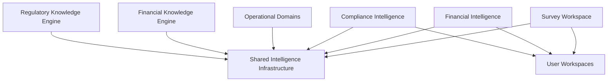
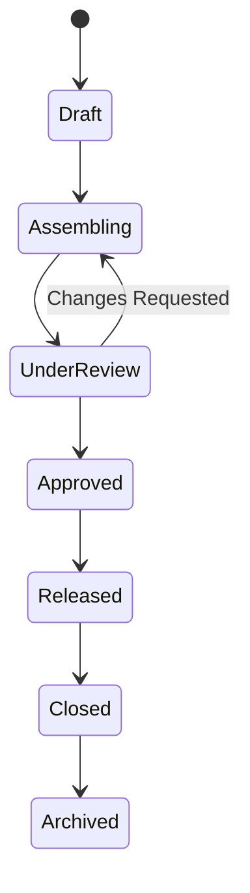
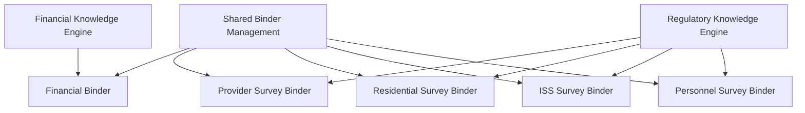
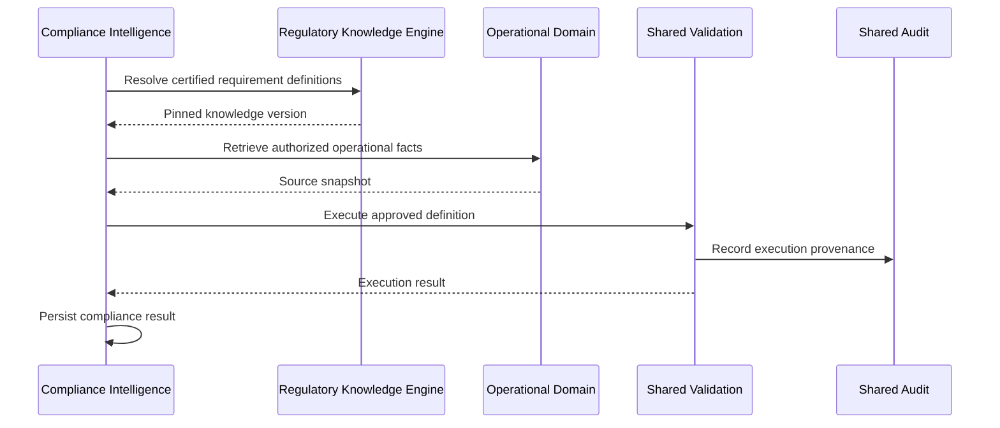
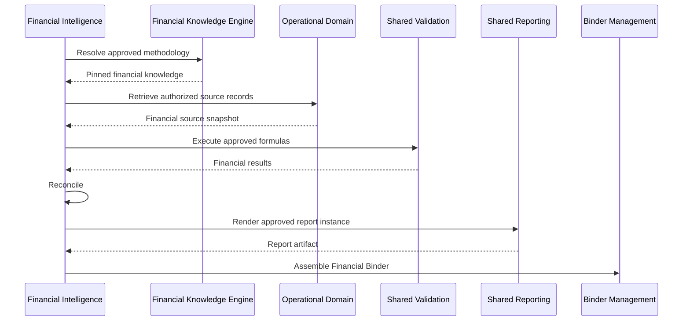
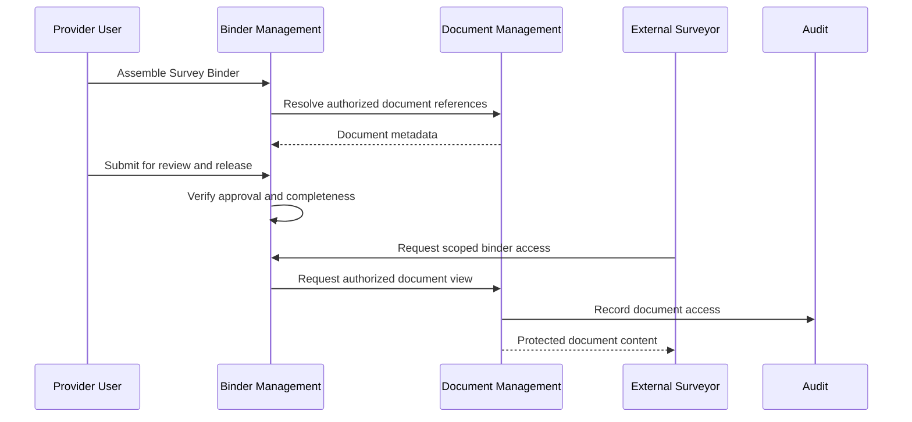

# ENG-018 — Shared Intelligence Infrastructure: Detailed Component Specifications

**Organization:** McCaskill Projects  
**Platform:** Regulatory Intelligence Platform  
**Document ID:** ENG-018  
**Version:** 1.0 — Draft  
**Classification:** Engineering Design Specification  
**Proposed Path:** `docs/engineering/18-shared-intelligence-infrastructure-specification.md`  
**Design Approach:** Architecture-first, repository-independent  
**Implementation Authorization:** Not Granted

---

# 1. Executive Design Statement

Shared Intelligence Infrastructure (SII) is the common execution, evidence, governance, traceability, document, reporting, and binder infrastructure of the Regulatory Intelligence Platform.

Its purpose is to provide reusable capabilities that support both independent Knowledge Engines, Operational Domains, Compliance Intelligence, Financial Intelligence, and authorized user workspaces.

Shared Intelligence is not a third Knowledge Engine.

It does not independently define regulatory obligations, determine financial allowability, establish reimbursement methodologies, or own customer operational facts.

Instead, it provides controlled services that execute approved definitions, preserve evidence, manage approval workflows, maintain audit history, and organize authorized information.

## 1.1 Primary architectural rule

**Shared Intelligence provides reusable execution and governance capabilities without assuming ownership of the knowledge or operational records it processes.**

The division of responsibility is:

- **Regulatory Knowledge Engine:** Regulatory definitions and certified regulatory knowledge.
- **Financial Knowledge Engine:** Financial definitions and approved financial methodology.
- **Operational Domains:** Customer source records and operational facts.
- **Shared Intelligence:** Execution infrastructure, evidence, documents, audit, approvals, reporting infrastructure, and binder lifecycle.
- **Compliance Intelligence:** Regulatory evaluation orchestration, results, findings, and corrective actions.
- **Financial Intelligence:** Financial execution orchestration, calculations, reconciliation, and report instances.
- **User Experience:** Authorized interfaces for these capabilities.

## 1.2 Design objectives

Shared Intelligence shall provide:

1. Evidence management and traceability.
2. Governed validation execution.
3. Audit and immutable activity history.
4. Document metadata and protected storage integration.
5. Version and change infrastructure.
6. Review and approval workflow infrastructure.
7. Shared reporting execution infrastructure.
8. Binder Management for multiple binder types.
9. Secure information exchange.
10. Notification and workflow coordination.
11. Event and integration reliability.
12. Historical reproducibility support.
13. Multi-tenant authorization and isolation.
14. Operational observability and recovery.
15. Reusable contracts that preserve domain ownership.

---

# 2. Architectural Placement

## 2.1 WHAT

Shared Intelligence occupies Layer 4 of the six-layer platform architecture.

| Layer | Responsibility |
|---|---|
| 1 | Platform Foundation |
| 2 | Operational Domains |
| 3 | Regulatory and Financial Knowledge Authorities |
| 4 | Shared Intelligence Infrastructure |
| 5 | Applied Intelligence and Operations |
| 6 | User Experience |

## 2.2 WHEN

Shared Intelligence is used when the platform must execute governed definitions, store evidence references, manage documents, record auditable activity, coordinate approvals, produce reusable report outputs, or manage binders.

## 2.3 WHERE

Shared Intelligence services, owned persistence, APIs, and event contracts.

## 2.4 WHY

Without a shared infrastructure layer, Compliance Intelligence, Financial Intelligence, and operational workspaces would duplicate document management, validation execution, approval, and audit logic.

## 2.5 HOW



The diagram represents logical integration, not a requirement for direct bidirectional service dependencies.

Knowledge Engines supply approved definitions and governance decisions.

Shared Intelligence executes authorized requests through defined contracts.

## 2.6 VERIFICATION

Architecture tests must verify that Shared Intelligence does not independently author or certify regulatory or financial knowledge.

---

# 3. Shared Intelligence Component Catalog

## 3.1 WHAT

Shared Intelligence consists of fifteen logical components, aligned with the SI-01 through SI-15 service family in ENG-008.

| ID | Component | Primary responsibility |
|---|---|---|
| SII-01 | Evidence Management Service | Evidence references, relationships, and integrity |
| SII-02 | Validation Execution Service | Execution of approved declarative definitions |
| SII-03 | Audit and Traceability Service | Auditable activities, decisions, and lineage |
| SII-04 | Document Management Service | Document metadata, versions, and protected access |
| SII-05 | Change and Version Infrastructure | Shared change records and version coordination |
| SII-06 | Review and Approval Workflow Service | Reusable approval lifecycle execution |
| SII-07 | Reporting Infrastructure Service | Reusable report assembly and rendering infrastructure |
| SII-08 | Binder Management Service | Binder definitions, instances, and lifecycle |
| SII-09 | Binder Completeness and Assembly Service | Section/item requirements and assembly |
| SII-10 | Secure Information Exchange Service | Controlled requests, responses, and file exchange |
| SII-11 | Notification and Task Coordination Service | Workflow notifications and assignments |
| SII-12 | Event and Integration Reliability Service | Reliable event publication and processing |
| SII-13 | Execution History and Reproducibility Service | Execution manifests and historical replay support |
| SII-14 | Shared Authorization Context Service | Propagation and verification of access context |
| SII-15 | Shared Intelligence Operations Service | Monitoring, diagnostics, and recovery coordination |

These components are logical service boundaries.

They may be deployed together or separately according to approved infrastructure architecture.

## 3.2 WHEN

The catalog applies throughout detailed service design and implementation planning.

## 3.3 WHERE

Shared Intelligence Infrastructure.

## 3.4 WHY

Clear component ownership prevents the shared layer from becoming an uncontrolled collection of business logic.

## 3.5 HOW

Each component must have:

- Explicit ownership.
- Stable interfaces.
- Input and output contracts.
- Defined state transitions.
- Authorization requirements.
- Error behavior.
- Audit obligations.
- Testing requirements.
- Acceptance criteria.

## 3.6 VERIFICATION

All fifteen components must be reconciled with ENG-008 before implementation.

---

# 4. Shared Infrastructure Ownership Model

## 4.1 WHAT

Defines the information and behavior Shared Intelligence may own.

## 4.2 WHEN

Whenever a cross-domain capability is introduced.

## 4.3 WHERE

Shared service contracts and data ownership boundaries.

## 4.4 WHY

Shared services must not absorb responsibilities that belong to authoritative domains.

## 4.5 HOW

| Information or capability | Authoritative owner | Shared Intelligence responsibility |
|---|---|---|
| Regulatory requirement | RKE | Execute approved definition when requested |
| Financial methodology | FKE | Execute approved definition when requested |
| Payroll record | Operational Domain | Reference authorized record |
| Service record | Operational Domain | Reference authorized record |
| Compliance finding | Compliance Intelligence | Preserve supporting evidence and audit |
| Financial calculation result | Financial Intelligence | Preserve execution manifest |
| Report definition | RKE or FKE, as applicable | Render approved report structure |
| Report instance | Owning Applied Intelligence domain | Render, package, and retain references |
| Document metadata | Document Management | Own shared metadata and versions |
| Document content | Protected storage under document governance | Secure storage and retrieval |
| Evidence relationship | Evidence Management | Own evidence linkage metadata |
| Approval workflow instance | Shared Approval | Execute authorized approval process |
| Approval decision authority | Owning domain's governance policy | Enforce approved decision policy |
| Binder instance | Binder Management | Own binder lifecycle and composition |
| Audit record | Audit Service | Preserve attributable history |

### Boundary rule

A shared service may record that an approved domain decision occurred.

It must not invent that decision.

## 4.6 VERIFICATION

Contract reviews must verify that each shared service respects authoritative ownership.

---

# 5. Universal Shared Intelligence Data Model

## 5.1 WHAT

Defines common entities required across Shared Intelligence services.

## 5.2 WHEN

During shared infrastructure design and persistence modeling.

## 5.3 WHERE

Shared Intelligence-owned data structures.

## 5.4 WHY

Consistent models support reusable services and cross-domain traceability.

## 5.5 HOW

### Core entities

| Entity | Purpose |
|---|---|
| EvidenceRecord | Evidence metadata and identity |
| EvidenceRelationship | Link between evidence and an authorized subject |
| EvidenceRequirementMatch | Relationship to a governed evidence specification |
| ValidationExecution | Individual execution request and result |
| ValidationExecutionStep | Detailed execution trace |
| AuditEvent | Attributable recorded activity |
| TraceRelationship | Lineage relationship between artifacts |
| DocumentRecord | Logical document identity |
| DocumentVersion | Immutable document content version |
| DocumentAccessGrant | Scoped document access |
| ChangeRecord | Shared change metadata |
| VersionReference | Cross-domain version reference |
| ApprovalWorkflowDefinition | Reusable approval workflow structure |
| ApprovalWorkflowInstance | Specific workflow execution |
| ApprovalDecision | Recorded review or approval decision |
| ReportRenderJob | Rendering operation |
| ReportArtifact | Generated output metadata |
| BinderDefinition | Binder type configuration |
| BinderInstance | Specific binder |
| BinderSection | Binder organizational section |
| BinderItem | Document, evidence, or record reference |
| BinderCompletenessResult | Completeness evaluation |
| InformationRequest | Controlled information request |
| InformationResponse | Authorized response |
| NotificationRecord | Workflow notification |
| WorkflowTask | Assigned action |
| OutboxEvent | Pending committed event publication |
| InboxReceipt | Event deduplication record |
| ExecutionManifest | Historical execution provenance |
| AuthorizationContextReference | Access-context metadata |
| OperationalIncident | Infrastructure incident or recovery record |

### Entity ownership

Each entity has exactly one authoritative service owner.

Cross-domain relationships use stable references rather than uncontrolled shared-table mutation.

## 5.6 VERIFICATION

Entity relationships, ownership, and referential integrity must be validated.

---

# 6. Universal Shared Service Contract

## 6.1 WHAT

Defines common request and response metadata.

## 6.2 WHEN

Whenever Shared Intelligence processes a request.

## 6.3 WHERE

Shared service interfaces and API/event contracts.

## 6.4 WHY

Consistent contracts enable secure execution and traceability.

## 6.5 HOW

### Conceptual request envelope

```typescript
interface SharedServiceRequest<TPayload> {
  requestId: string;
  correlationId: string;

  tenantId?: string;
  actorId: string;

  resourceScope: ResourceScope;

  requestedAt: string;
  payload: TPayload;
}
```

### Resource scope

```typescript
interface ResourceScope {
  providerId?: string;
  organizationId?: string;
  locationId?: string;
  personId?: string;
  employeeId?: string;
  reportingPeriodId?: string;
  binderId?: string;
  surveyEventId?: string;
}
```

### Conceptual response envelope

```typescript
interface SharedServiceResponse<TResult> {
  requestId: string;
  correlationId: string;

  status: "SUCCESS" | "PARTIAL" | "FAILED";

  result?: TResult;
  errors?: SharedServiceError[];

  completedAt: string;
}
```

### Contract requirements

- Actor identity must be authenticated.
- Tenant context must be verified when applicable.
- Resource scope must be authorized.
- Correlation identifiers must be propagated.
- Shared services must not trust caller-supplied scope without verification.
- Partial results must identify incomplete operations.
- Errors must be typed and actionable.

## 6.6 VERIFICATION

Contract tests must cover invalid scope, unauthorized requests, missing context, and partial failures.

---

# 7. SII-01 — Evidence Management Service

## 7.1 WHAT

Manages evidence identities, metadata, relationships, and integrity.

## 7.2 WHEN

When evidence supports regulatory evaluations, financial calculations, findings, approvals, or binders.

## 7.3 WHERE

Shared Evidence Management.

## 7.4 WHY

Evidence must be reusable without duplicating or transferring ownership of source records.

## 7.5 HOW

### Responsibilities

- Register evidence references.
- Maintain evidence metadata.
- Associate evidence with authorized subjects.
- Track evidence versions.
- Record evidence provenance.
- Manage evidence status.
- Link evidence to governing specifications.
- Support completeness queries.
- Preserve historical relationships.

### Evidence contract

```typescript
interface EvidenceRecord {
  id: string;
  evidenceType: string;

  sourceDomain: string;
  sourceRecordId: string;
  sourceVersionId?: string;

  documentVersionId?: string;

  collectedAt?: string;
  validFrom?: string;
  validTo?: string;

  integrityDigest?: string;

  classification: string;
  status: EvidenceStatus;
}
```

### Evidence states

- Registered.
- Available.
- Under Review.
- Accepted.
- Rejected.
- Superseded.
- Archived.

### Invariants

- Evidence acceptance does not automatically establish compliance.
- Evidence references must remain attributable.
- Evidence access requires source-level authorization.
- Historical evidence relationships must be preserved.
- Deletion must respect retention and legal holds.

### Required operations

- Register evidence.
- Link evidence.
- Retrieve authorized evidence.
- Evaluate evidence completeness.
- Record review status.
- Supersede evidence.
- Retrieve evidence history.

## 7.6 VERIFICATION

Tests must cover evidence integrity, unauthorized access, missing source records, version changes, and historical retrieval.

---

# 8. SII-02 — Validation Execution Service

## 8.1 WHAT

Executes approved regulatory, financial, and operational validation definitions.

## 8.2 WHEN

When an authorized owning domain requests validation execution.

## 8.3 WHERE

Shared Validation Execution Infrastructure.

## 8.4 WHY

A common execution engine avoids duplicate evaluation technology while preserving independent policy ownership.

## 8.5 HOW

### Validation authorities

| Validation category | Definition authority |
|---|---|
| Regulatory | Regulatory Knowledge Engine |
| Financial | Financial Knowledge Engine |
| Operational | Owning Operational Domain |

### Execution request

```typescript
interface ValidationExecutionRequest {
  executionId: string;

  definitionAuthority:
    | "REGULATORY"
    | "FINANCIAL"
    | "OPERATIONAL";

  definitionId: string;
  definitionVersion: string;

  subjectReference: string;

  inputSnapshotReference: string;
  executionContext: Record<string, unknown>;

  requestedBy: string;
  correlationId: string;
}
```

### Execution result

```typescript
interface ValidationExecutionResult {
  executionId: string;

  definitionId: string;
  definitionVersion: string;

  status:
    | "COMPLETED"
    | "FAILED"
    | "CANCELLED";

  outcomeCode?: string;

  executionManifestId: string;
  completedAt?: string;

  errors?: SharedServiceError[];
}
```

### Execution sequence

1. Authenticate requester.
2. Authorize subject and execution.
3. Resolve approved definition.
4. Verify definition version and integrity.
5. Resolve authorized input snapshot.
6. Validate input schema.
7. Execute approved declarative expression.
8. Produce typed outcome.
9. Record execution history.
10. Return result to owning domain.

### Critical invariants

- Shared Validation cannot create regulatory rules.
- Shared Validation cannot create financial methodology.
- Shared Validation cannot reinterpret approved definitions.
- Execution failures must not be represented as noncompliance.
- Financial arithmetic must use approved decimal semantics.
- Regulatory and financial results must preserve knowledge version references.
- Operational validation definitions remain owned by their operational domain.

### Execution security

- No arbitrary code execution.
- Bounded runtime.
- Approved operator registry.
- Explicit type checking.
- Controlled resource usage.
- No unauthorized network or filesystem access.

## 8.6 VERIFICATION

Tests must cover all authority categories, version resolution, deterministic execution, failure isolation, and prohibited definition changes.

---

# 9. SII-03 — Audit and Traceability Service

## 9.1 WHAT

Records attributable activities, decisions, and relationships across the platform.

## 9.2 WHEN

During privileged operations, knowledge governance, execution, document access, approval, binder release, and survey activity.

## 9.3 WHERE

Shared Audit and Traceability Infrastructure.

## 9.4 WHY

The platform must explain who performed an action, what changed, under which authority, and what information was affected.

## 9.5 HOW

### Audit event contract

```typescript
interface AuditEvent {
  id: string;
  occurredAt: string;

  actorId: string;
  actorType: string;

  tenantId?: string;

  action: string;
  resourceType: string;
  resourceId: string;

  outcome: "SUCCESS" | "DENIED" | "FAILED";

  correlationId: string;
  causationId?: string;

  beforeVersion?: string;
  afterVersion?: string;

  metadata?: Record<string, unknown>;
}
```

### Audit categories

- Authentication and authorization.
- Knowledge authoring.
- Knowledge validation.
- Regulatory certification.
- Financial approval.
- Knowledge publication.
- Validation execution.
- Evidence review.
- Document access.
- Binder review and release.
- Surveyor activity.
- Financial report approval.
- Administrative changes.

### Traceability relationships

The service must support relationships such as:

```text
Source
  → Knowledge Definition
  → Published Knowledge Version
  → Execution
  → Result
  → Finding or Report
  → Evidence
  → Approval
  → Binder
```

### Invariants

- Audit records are append-only under normal operations.
- Authorized corrections create new audit records.
- Sensitive data must not be unnecessarily duplicated in logs.
- Audit access must be separately authorized.
- Retention and legal holds must be enforced.

## 9.6 VERIFICATION

Tests must verify attribution, tamper detection, authorization, and complete critical workflow traces.

---

# 10. SII-04 — Document Management Service

## 10.1 WHAT

Manages logical documents, immutable content versions, metadata, and protected retrieval.

## 10.2 WHEN

Whenever a domain stores or retrieves documents through shared infrastructure.

## 10.3 WHERE

Shared Document Management and protected object storage.

## 10.4 WHY

Documents are used by many domains and require consistent security, integrity, and version control.

## 10.5 HOW

### Document record

```typescript
interface DocumentRecord {
  id: string;
  tenantId?: string;

  owningDomain: string;
  owningResourceId: string;

  documentType: string;
  classification: string;

  currentVersionId: string;

  createdAt: string;
  createdBy: string;
}
```

### Document version

```typescript
interface DocumentVersion {
  id: string;
  documentId: string;

  versionNumber: number;

  storageObjectId: string;
  contentDigest: string;

  mediaType: string;
  sizeBytes: number;

  createdAt: string;
  createdBy: string;
}
```

### Required capabilities

- Secure upload.
- Malware and content validation.
- Content integrity checks.
- Immutable document versions.
- Protected download.
- Authorized preview.
- Large-file streaming.
- Retention.
- Legal holds.
- Access logging.
- Document supersession.

### Authorization rule

Document access requires authorization for the document and, where applicable, its owning source resource.

A binder or survey event reference does not automatically grant unrestricted source access.

## 10.6 VERIFICATION

Tests must cover upload validation, content integrity, large-file access, revocation, version history, and tenant isolation.

---

# 11. SII-05 — Change and Version Infrastructure

## 11.1 WHAT

Provides reusable change records, version references, and dependency tracking.

## 11.2 WHEN

When governed artifacts or workflows require controlled changes.

## 11.3 WHERE

Shared Change and Version Infrastructure.

## 11.4 WHY

Multiple domains require consistent change history without surrendering ownership of their authoritative content.

## 11.5 HOW

### Shared responsibilities

- Record change requests.
- Associate affected artifacts.
- Maintain version references.
- Track change dispositions.
- Support impact relationships.
- Coordinate notifications.
- Preserve change history.

### Ownership boundary

- RKE owns regulatory source and knowledge version semantics.
- FKE owns financial methodology version semantics.
- Operational Domains own their source record versions.
- Shared Change Infrastructure records cross-domain change coordination.

### Change states

- Proposed.
- Under Review.
- Approved.
- Rejected.
- Implemented.
- Verified.
- Closed.

### Invariants

- A shared change record cannot directly publish knowledge.
- Domain approval policies remain authoritative.
- Changes must preserve historical references.

## 11.6 VERIFICATION

Tests must verify lifecycle integrity, authorized decisions, and historical change relationships.

---

# 12. SII-06 — Review and Approval Workflow Service

## 12.1 WHAT

Executes reusable human review and approval workflows.

## 12.2 WHEN

During regulatory certification, financial approval, report approval, binder release, and other governed decisions.

## 12.3 WHERE

Shared Approval Infrastructure.

## 12.4 WHY

Approval execution should be reusable while decision authority remains domain-specific.

## 12.5 HOW

### Workflow definition

```typescript
interface ApprovalWorkflowDefinition {
  id: string;
  stableCode: string;
  version: string;

  owningDomain: string;

  stages: ApprovalStageDefinition[];

  separationOfDutiesPolicyId?: string;
  escalationPolicyId?: string;
}
```

### Workflow instance

```typescript
interface ApprovalWorkflowInstance {
  id: string;
  definitionId: string;
  definitionVersion: string;

  subjectType: string;
  subjectId: string;
  subjectVersion: string;

  status: ApprovalWorkflowStatus;

  startedAt: string;
  completedAt?: string;
}
```

### Workflow states

- Draft.
- Submitted.
- Under Review.
- Changes Requested.
- Approved.
- Rejected.
- Cancelled.

### Required controls

- Authorized reviewer assignment.
- Required review stages.
- Separation of duties.
- Decision attribution.
- Subject-version locking.
- Stale approval rejection.
- Delegation restrictions.
- Escalation.
- Audit history.

### Critical distinction

The shared service records and enforces an approval workflow.

The owning domain determines what approval means.

For example:

- RKE determines regulatory certification requirements.
- FKE determines financial methodology approval requirements.
- Financial Intelligence determines report approval requirements.
- Binder Management determines binder release requirements.

## 12.6 VERIFICATION

Tests must cover authorized approval, self-approval restrictions, stale subjects, escalation, and rejected transitions.

---

# 13. SII-07 — Reporting Infrastructure Service

## 13.1 WHAT

Provides reusable report assembly, formatting, rendering, and output management.

## 13.2 WHEN

When authorized domains generate reports.

## 13.3 WHERE

Shared Reporting Infrastructure.

## 13.4 WHY

Report rendering technology should not be duplicated across financial, compliance, operational, and survey workspaces.

## 13.5 HOW

### Responsibilities

- Accept approved report specifications.
- Resolve authorized report data.
- Render approved layouts.
- Produce supported output formats.
- Track rendering jobs.
- Record output metadata.
- Associate generated artifacts with owning domains.
- Preserve rendering version information.

### Reporting boundary

The shared service does not establish:

- Financial report line formulas.
- Regulatory compliance conclusions.
- Operational source facts.
- Official submission status.

### Render request

```typescript
interface ReportRenderRequest {
  reportDefinitionId: string;
  reportDefinitionVersion: string;

  owningDomain: string;
  sourceSnapshotReference: string;

  outputFormat: string;

  requestedBy: string;
  correlationId: string;
}
```

### Output metadata

- Render job ID.
- Report artifact ID.
- Definition version.
- Source snapshot reference.
- Renderer version.
- Output digest.
- Creation time.
- Authorization scope.

## 13.6 VERIFICATION

Tests must cover deterministic rendering, authorized data access, output integrity, and failure recovery.

---

# 14. SII-08 — Binder Management Service

## 14.1 WHAT

Provides the universal binder lifecycle and composition model.

## 14.2 WHEN

When authorized workflows require controlled collections of documents, evidence, reports, and approvals.

## 14.3 WHERE

Shared Binder Management.

## 14.4 WHY

Financial Binder and Survey Binder are peer capabilities that should share infrastructure rather than duplicate it.

## 14.5 HOW

### Supported binder types

Initial planned types include:

- Financial Binder.
- Provider Survey Binder.
- Residential Survey Binder.
- ISS Survey Binder.
- Personnel Survey Binder.

The core must support additional binder types through configuration and approved extensions.

### Binder definition

```typescript
interface BinderDefinition {
  id: string;
  stableCode: string;
  version: string;

  binderType: string;
  owningDomain: string;

  sectionDefinitionIds: string[];
  approvalWorkflowDefinitionId?: string;

  retentionPolicyId?: string;
}
```

### Binder instance

```typescript
interface BinderInstance {
  id: string;
  binderDefinitionId: string;
  binderDefinitionVersion: string;

  tenantId: string;
  owningResourceId: string;

  status: BinderLifecycleStatus;

  createdAt: string;
  createdBy: string;

  approvedAt?: string;
  releasedAt?: string;
  closedAt?: string;
  archivedAt?: string;
}
```

### Binder lifecycle



### Lifecycle invariants

- Release requires approval.
- Closure requires approved closure conditions.
- Released binder content must be versioned or frozen.
- Post-release corrections must preserve the released snapshot.
- Retention and legal holds must be enforced.
- Access to a binder does not grant unrestricted access to source records.

## 14.6 VERIFICATION

Tests must cover binder lifecycle, approval, release snapshots, source authorization, and historical retrieval.

---

# 15. SII-09 — Binder Completeness and Assembly Service

## 15.1 WHAT

Determines whether a binder contains the required sections and items.

## 15.2 WHEN

During binder assembly, review, approval, and release preparation.

## 15.3 WHERE

Shared Binder Completeness and Assembly.

## 15.4 WHY

A binder must be checked against approved requirements before release.

## 15.5 HOW

### Completeness inputs

- Binder definition version.
- Binder instance.
- Required section definitions.
- Required item definitions.
- Conditional item rules.
- Evidence and document references.
- Authorized source status.

### Completeness outcomes

- Complete.
- Incomplete.
- Requires Review.
- Not Applicable, where allowed by approved rules.
- Evaluation Error.

### Requirements

- Identify missing items.
- Identify invalid references.
- Identify expired evidence where relevant.
- Evaluate conditional requirements.
- Preserve completeness history.
- Block release when mandatory conditions fail.

### Authority boundary

The Binder service executes completeness definitions.

Regulatory or financial requirements governing binder content must originate from the applicable Knowledge Engine when they represent authoritative regulatory or financial rules.

## 15.6 VERIFICATION

Tests must cover missing items, conditional requirements, source access, and release blocking.

---

# 16. SII-10 — Secure Information Exchange Service

## 16.1 WHAT

Provides controlled information requests, responses, and associated evidence exchange.

## 16.2 WHEN

During surveys, audits, financial reviews, or other authorized information exchanges.

## 16.3 WHERE

Shared Secure Information Exchange.

## 16.4 WHY

Information exchange must be attributable, scoped, and auditable.

## 16.5 HOW

### Information request

```typescript
interface InformationRequest {
  id: string;

  owningDomain: string;
  owningEventId: string;

  requestedBy: string;
  assignedTo?: string;

  description: string;
  dueAt?: string;

  status: InformationRequestStatus;
}
```

### Request lifecycle

- Draft.
- Open.
- In Progress.
- Responded.
- Accepted.
- Rejected.
- Closed.
- Cancelled.

### Required capabilities

- Authorized request creation.
- Scoped assignment.
- Evidence attachment.
- Response submission.
- Review and acceptance.
- Deadline tracking.
- Audit history.
- Expiration and revocation of external access.

### Security

External surveyors must be individually authenticated and restricted to approved provider, location, person, document, and survey-event scope.

## 16.6 VERIFICATION

Tests must cover cross-tenant denial, expired access, unauthorized evidence, request transitions, and complete audit history.

---

# 17. SII-11 — Notification and Task Coordination Service

## 17.1 WHAT

Provides reusable notifications, assignments, and task status tracking.

## 17.2 WHEN

When workflow events require human attention or action.

## 17.3 WHERE

Shared Task and Notification Infrastructure.

## 17.4 WHY

Knowledge reviews, corrective actions, financial approvals, and survey requests require consistent coordination.

## 17.5 HOW

### Notification categories

- Knowledge validation completed.
- Regulatory review required.
- Financial approval required.
- Evidence missing.
- Finding assigned.
- Binder review requested.
- Survey information request received.
- Report approval pending.
- Workflow deadline approaching.

### Task model

- Task ID.
- Owning domain.
- Related resource.
- Assigned actor or group.
- Priority.
- Due date.
- Status.
- Completion record.

### Rules

- Notifications do not independently authorize actions.
- A notification link must recheck resource access.
- Notification content must respect data classification.
- Tasks must preserve ownership and audit history.

## 17.6 VERIFICATION

Tests must cover assignment, delivery, authorization, duplicate events, and expired task links.

---

# 18. SII-12 — Event and Integration Reliability Service

## 18.1 WHAT

Provides reliable event delivery and integration coordination.

## 18.2 WHEN

When services communicate through domain events or asynchronous workflows.

## 18.3 WHERE

Shared event infrastructure.

## 18.4 WHY

Cross-domain workflows must tolerate transient failures without losing committed business events.

## 18.5 HOW

### Required capabilities

- Transactional outbox or equivalent.
- Event schema versioning.
- Inbox deduplication.
- Retry policies.
- Dead-letter handling.
- Delivery status.
- Correlation and causation.
- Consumer failure isolation.
- Replay controls.

### Event envelope

```typescript
interface PlatformDomainEvent {
  eventId: string;
  eventType: string;
  schemaVersion: string;

  aggregateType: string;
  aggregateId: string;

  occurredAt: string;

  correlationId: string;
  causationId?: string;

  actorId?: string;
  tenantId?: string;

  payload: Record<string, unknown>;
}
```

### Reliability principles

- At-least-once delivery must be safe for consumers.
- Idempotency is mandatory for side-effecting consumers.
- Ordering assumptions must be explicit.
- Failed consumers must not corrupt committed source transactions.
- Event replay must not bypass current authorization and governance policies.

## 18.6 VERIFICATION

Tests must cover duplicate events, retry exhaustion, delayed delivery, recovery, and replay.

---

# 19. SII-13 — Execution History and Reproducibility Service

## 19.1 WHAT

Preserves execution provenance and supports historical reproduction.

## 19.2 WHEN

Whenever governed regulatory or financial definitions are executed.

## 19.3 WHERE

Shared execution history infrastructure.

## 19.4 WHY

The platform must explain how an earlier result was produced, even after knowledge or operational data changes.

## 19.5 HOW

### Execution manifest

```typescript
interface ExecutionManifest {
  id: string;
  executionId: string;

  authorityType:
    | "REGULATORY"
    | "FINANCIAL"
    | "OPERATIONAL";

  definitionId: string;
  definitionVersion: string;

  knowledgePackVersionId?: string;

  inputSnapshotReference: string;
  inputDigest: string;

  executionEngineVersion: string;

  outputDigest?: string;

  executedAt: string;
  correlationId: string;
}
```

### Required provenance

- Governing definition.
- Governing version.
- Input snapshot.
- Input digest.
- Execution engine version.
- Output digest.
- Execution timestamp.
- Actor/service identity.
- Correlation identifier.

### Reproduction modes

**Historical inspection:** Retrieve the original inputs, definitions, and results.

**Deterministic replay:** Re-execute the original definition and input snapshot where supported.

**Current-methodology reassessment:** Execute newer approved knowledge and create a new result.

These modes must remain distinct.

## 19.6 VERIFICATION

Historical replay tests must reproduce expected results or return explicit, auditable reasons why replay is unavailable.

---

# 20. SII-14 — Shared Authorization Context Service

## 20.1 WHAT

Provides consistent authorization context propagation and verification for shared workflows.

## 20.2 WHEN

When requests cross service boundaries or access protected resources.

## 20.3 WHERE

Shared Intelligence integration with Platform Authorization.

## 20.4 WHY

A valid login does not automatically grant access to every resource referenced in a workflow.

## 20.5 HOW

### Context elements

- Authenticated actor.
- Tenant.
- Provider.
- Organization.
- Location.
- Person or employee.
- Reporting period.
- Binder.
- Survey event.
- Permitted actions.
- Expiration.
- Correlation identifier.

### Rules

- Platform Authorization remains the authority for access decisions.
- Shared Authorization Context does not create independent permissions.
- Context must be validated at service boundaries.
- External survey access must expire and be revocable.
- Source document access must be independently checked.
- Cached authorization decisions must honor revocation requirements.

## 20.6 VERIFICATION

Tests must cover forged scope, expired context, privilege escalation, cross-tenant access, and revocation.

---

# 21. SII-15 — Shared Intelligence Operations Service

## 21.1 WHAT

Provides operational health monitoring, diagnostics, and recovery coordination for Shared Intelligence.

## 21.2 WHEN

During normal operations, incidents, maintenance, and recovery.

## 21.3 WHERE

Shared Intelligence observability and operations infrastructure.

## 21.4 WHY

Failures in shared services may affect multiple platform capabilities.

## 21.5 HOW

### Required capabilities

- Service health checks.
- Execution queue monitoring.
- Validation failure monitoring.
- Document delivery monitoring.
- Event backlog monitoring.
- Binder assembly monitoring.
- Approval workflow diagnostics.
- Incident recording.
- Recovery coordination.
- Operational metrics.

### Proposed metrics

- Validation execution latency.
- Validation error rate.
- Document retrieval failures.
- Evidence integrity failures.
- Approval workflow backlog.
- Binder completeness failures.
- Event retry backlog.
- Dead-letter queue volume.
- Historical replay failures.
- Authorization denials.

### Recovery requirements

- Explicit incident ownership.
- Durable failure records.
- Safe retries.
- No silent data loss.
- No bypass of approval controls.
- Documented recovery procedures.

## 21.6 VERIFICATION

Monitoring and failure-injection tests must demonstrate detection and recovery for critical shared workflows.

---

# 22. Cross-Domain Execution Contract

## 22.1 WHAT

Defines how an owning domain requests Shared Intelligence services.

## 22.2 WHEN

During regulatory, financial, and operational workflows.

## 22.3 WHERE

Service APIs and events.

## 22.4 WHY

Cross-domain execution must preserve knowledge and data ownership.

## 22.5 HOW

### Regulatory execution

```text
Compliance Intelligence
    → Resolve certified Regulatory Knowledge
    → Retrieve authorized Operational Facts
    → Request Shared Validation
    → Receive Execution Result
    → Persist Compliance Result
    → Manage Finding and Corrective Action
```

### Financial execution

```text
Financial Intelligence
    → Resolve approved Financial Knowledge
    → Retrieve authorized Financial Source Records
    → Request Shared Validation
    → Receive Calculation Result
    → Reconcile
    → Generate Report Instance
    → Assemble Financial Binder
```

### Operational execution

```text
Operational Domain
    → Resolve owned Operational Validation Definition
    → Request Shared Validation
    → Receive Result
    → Apply Operational Workflow Rules
```

### Non-negotiable boundary

Shared Validation returns execution results.

The requesting domain owns the business meaning and subsequent workflow.

## 22.6 VERIFICATION

Integration tests must verify the three execution categories independently.

---

# 23. Financial Binder and Survey Binder Architecture

## 23.1 WHAT

Defines how multiple binder capabilities share one universal binder infrastructure.

## 23.2 WHEN

During financial reporting, survey preparation, and external review.

## 23.3 WHERE

Binder Management and owning domain extensions.

## 23.4 WHY

A single binder engine supports consistency without forcing every binder to have the same contents or approval policies.

## 23.5 HOW



### Shared capabilities

- Binder definitions.
- Sections.
- Items.
- Completeness.
- Review.
- Approval.
- Release.
- Closure.
- Archive.
- Retention.
- Access control.
- Audit.

### Domain-specific extensions

**Financial Binder**

- Reporting periods.
- Financial report instances.
- Reconciliation.
- Calculation evidence.
- Financial approvals.

**Survey Binder**

- Survey event scope.
- Survey-required records.
- External access grants.
- Survey requests.
- Document review history.

### Access rule

Binder release and source-document access are separate authorization decisions.

## 23.6 VERIFICATION

Tests must verify common binder behavior and type-specific extension behavior.

---

# 24. Reporting Infrastructure Boundaries

## 24.1 WHAT

Clarifies the relationship between report definitions, rendering, and generated report instances.

## 24.2 WHEN

Whenever a reporting capability is designed.

## 24.3 WHERE

Knowledge Engines, Shared Reporting, and Applied Intelligence.

## 24.4 WHY

Reporting infrastructure must not become a hidden authority for financial or regulatory calculations.

## 24.5 HOW

| Concern | Owner |
|---|---|
| Financial report methodology | Financial Knowledge Engine |
| Regulatory reporting requirement | Regulatory Knowledge Engine |
| Operational report source facts | Operational Domain |
| Financial report calculation | Financial Intelligence |
| Compliance result | Compliance Intelligence |
| Report rendering | Shared Reporting Infrastructure |
| Generated report instance | Owning Applied Intelligence or Operational Domain |
| Report approval | Owning domain using Shared Approval |
| Binder composition | Binder Management |

## 24.6 VERIFICATION

Architecture and integration tests must confirm these boundaries.

---

# 25. Shared Intelligence Security Model

## 25.1 WHAT

Defines security requirements across Shared Intelligence.

## 25.2 WHEN

For every shared service operation.

## 25.3 WHERE

Platform Authorization, Shared Intelligence APIs, and storage access.

## 25.4 WHY

Shared services process sensitive records across many domains and tenants.

## 25.5 HOW

### Mandatory controls

- Authenticated identities.
- Backend authorization.
- Tenant isolation.
- Resource-level access checks.
- Least privilege.
- Scoped service identities.
- Encryption in transit.
- Encryption at rest.
- Sensitive-data minimization.
- Auditable privileged actions.
- Time-limited external access.
- Revocation enforcement.
- Retention and legal holds.

### Access principle

A shared workflow reference is not a universal access grant.

A user must have permission for the requested action and underlying protected resource.

## 25.6 VERIFICATION

Security testing must cover unauthorized access, scope escalation, document leakage, and cross-tenant data exposure.

---

# 26. Shared Intelligence Data Architecture

## 26.1 WHAT

Defines persistence and data ownership requirements.

## 26.2 WHEN

During database and service implementation planning.

## 26.3 WHERE

PostgreSQL, approved object storage, and service-owned persistence.

## 26.4 WHY

Shared infrastructure must preserve integrity without creating uncontrolled shared data ownership.

## 26.5 HOW

### Persistence principles

- Service-owned authoritative tables.
- Stable cross-domain references.
- Referential integrity within ownership boundaries.
- Transactional state transitions.
- Immutable released artifacts where required.
- Append-only audit history.
- Versioned documents.
- Controlled retention.
- Legal hold enforcement.
- Backup and recovery.

### Storage categories

**Relational storage**

- Evidence metadata.
- Validation executions.
- Audit records.
- Approval workflows.
- Binder records.
- Information requests.
- Tasks.
- Event delivery state.
- Execution manifests.

**Protected object storage**

- Document content.
- Generated reports.
- Large supporting files.
- Released binder exports where supported.

### Migration requirements

All schema changes require explicit migration and recovery planning.

## 26.6 VERIFICATION

Database integrity, migration, backup, and restoration tests must pass.

---

# 27. Shared Intelligence API Architecture

## 27.1 WHAT

Defines proposed API families.

## 27.2 WHEN

When Shared Intelligence capabilities are consumed by authorized services and workspaces.

## 27.3 WHERE

Versioned platform APIs and internal contracts.

## 27.4 WHY

Shared services must expose stable interfaces rather than require direct database access.

## 27.5 HOW

### Proposed API families

```text
/api/v1/evidence
/api/v1/validation
/api/v1/audit
/api/v1/documents
/api/v1/changes
/api/v1/approvals
/api/v1/reporting
/api/v1/binders
/api/v1/information-exchange
/api/v1/notifications
/api/v1/tasks
/api/v1/executions
```

### API requirements

- Authentication.
- Resource authorization.
- Tenant scoping.
- Typed requests and responses.
- Idempotency for side-effecting operations.
- Optimistic concurrency where required.
- Pagination.
- Correlation identifiers.
- Audit logging.
- Explicit error semantics.

### Contract alignment

Final API paths must be reconciled with ENG-009.

## 27.6 VERIFICATION

API contract and security tests must pass.

---

# 28. Shared Intelligence Events

## 28.1 WHAT

Defines proposed events for shared workflow transitions.

## 28.2 WHEN

After committed state changes.

## 28.3 WHERE

Approved event infrastructure.

## 28.4 WHY

Other services need reliable notification of shared workflow activity.

## 28.5 HOW

### Proposed event families

**Evidence**

- EvidenceRegistered.
- EvidenceLinked.
- EvidenceReviewed.
- EvidenceSuperseded.

**Validation**

- ValidationRequested.
- ValidationCompleted.
- ValidationFailed.

**Documents**

- DocumentVersionCreated.
- DocumentAccessRevoked.

**Approvals**

- ApprovalRequested.
- ApprovalDecisionRecorded.
- ApprovalWorkflowCompleted.

**Binders**

- BinderCreated.
- BinderCompletenessEvaluated.
- BinderApproved.
- BinderReleased.
- BinderClosed.
- BinderArchived.

**Information exchange**

- InformationRequestOpened.
- InformationResponseSubmitted.
- InformationRequestClosed.

**Execution**

- ExecutionManifestRecorded.
- HistoricalReplayCompleted.

### Event requirements

- Versioned schema.
- Stable identifiers.
- Committed-state publication.
- Idempotent consumers.
- Correlation and causation.
- Appropriate data minimization.

Event identifiers must be reconciled with ENG-001 and ENG-009.

## 28.6 VERIFICATION

Event contract and reliability tests must pass.

---

# 29. Error Classification and Recovery

## 29.1 WHAT

Defines common failure categories.

## 29.2 WHEN

Whenever a Shared Intelligence operation fails.

## 29.3 WHERE

Shared service APIs, execution results, and operational diagnostics.

## 29.4 WHY

A technical failure must not be confused with a business determination.

## 29.5 HOW

### Error categories

- Authentication Error.
- Authorization Error.
- Invalid Input.
- Missing Dependency.
- Invalid Knowledge Definition.
- Execution Failure.
- Version Conflict.
- Stale Approval.
- Document Integrity Failure.
- Storage Failure.
- Event Delivery Failure.
- Timeout.
- Recovery Required.

### Recovery principles

- Preserve committed state.
- Prevent duplicate side effects.
- Reject unauthorized retries.
- Record failures.
- Expose actionable diagnostics.
- Maintain audit history.
- Avoid partial publication or release.
- Preserve historical records.

## 29.6 VERIFICATION

Failure-injection tests must cover critical shared workflows and recovery behavior.

---

# 30. Historical Reproducibility Architecture

## 30.1 WHAT

Defines the shared infrastructure necessary to reproduce historical governed results.

## 30.2 WHEN

During compliance evaluation, financial execution, report generation, and binder release.

## 30.3 WHERE

Execution History, Document Management, Audit, and owning domain persistence.

## 30.4 WHY

Regulatory and financial outcomes must remain explainable after knowledge, source data, or system versions change.

## 30.5 HOW

### Historical reproducibility chain

```text
Knowledge Version
       +
Source Snapshot
       +
Execution Definition
       +
Execution Engine Version
       |
       v
Execution Manifest
       |
       v
Result / Report
       |
       v
Evidence and Audit
       |
       v
Historical Reproduction
```

### Requirements

- Preserve immutable governing references.
- Preserve input snapshots or reconstructable references.
- Preserve execution engine version.
- Preserve output digests.
- Preserve approval history.
- Preserve released binder snapshots.
- Distinguish historical replay from current reassessment.

## 30.6 VERIFICATION

Historical reproduction tests must validate complete provenance and deterministic replay where supported.

---

# 31. Shared Intelligence End-to-End Workflows

## 31.1 WHAT

Defines representative integrated workflows.

## 31.2 WHEN

During system integration and acceptance testing.

## 31.3 WHERE

Knowledge Engines, Operational Domains, Shared Intelligence, and Applied Intelligence.

## 31.4 WHY

Cross-domain integration must preserve the authority and ownership of each layer.

## 31.5 HOW

### Workflow A — Regulatory evaluation



### Workflow B — Financial reporting



### Workflow C — Survey review



## 31.6 VERIFICATION

Each workflow must pass authorization, traceability, failure recovery, and historical integrity tests.

---

# 32. Shared Intelligence Testing Strategy

## 32.1 WHAT

Defines Shared Intelligence-specific quality requirements under ENG-013.

## 32.2 WHEN

Throughout component implementation and integration.

## 32.3 WHERE

Unit, integration, contract, security, resilience, and end-to-end suites.

## 32.4 WHY

Shared infrastructure failures can affect many otherwise independent platform capabilities.

## 32.5 HOW

| Test ID | Component | Required verification |
|---|---|---|
| T-SII-01 | Evidence | Integrity, linkage, and source access |
| T-SII-02 | Validation | Governed execution and deterministic results |
| T-SII-03 | Audit | Attribution and traceability |
| T-SII-04 | Documents | Versioning, protected access, and streaming |
| T-SII-05 | Change | Lifecycle and version coordination |
| T-SII-06 | Approval | Authorization and separation of duties |
| T-SII-07 | Reporting | Rendering and output integrity |
| T-SII-08 | Binder | Lifecycle and release snapshots |
| T-SII-09 | Completeness | Required and conditional items |
| T-SII-10 | Exchange | Requests, responses, and access scope |
| T-SII-11 | Notifications | Assignment and secure links |
| T-SII-12 | Events | Delivery, deduplication, and recovery |
| T-SII-13 | Reproducibility | Execution manifests and replay |
| T-SII-14 | Authorization | Tenant isolation and revocation |
| T-SII-15 | Operations | Monitoring and incident recovery |
| T-SII-16 | Regulatory Integration | RKE-to-Compliance execution |
| T-SII-17 | Financial Integration | FKE-to-Financial execution |
| T-SII-18 | Binder Integration | Financial and Survey Binder |
| T-SII-19 | Historical Integrity | Pinned versions and released snapshots |
| T-SII-20 | Failure Recovery | Cross-service resilience |

## 32.6 VERIFICATION

All mandatory component and integration tests must pass before the corresponding capability is accepted.

---

# 33. Performance and Scalability

## 33.1 WHAT

Defines enterprise performance requirements.

## 33.2 WHEN

During capacity planning and implementation.

## 33.3 WHERE

Shared services, database, storage, and event infrastructure.

## 33.4 WHY

Shared services must support multiple providers and workloads without becoming bottlenecks.

## 33.5 HOW

### Performance areas

- Validation throughput.
- Evidence query latency.
- Document upload and retrieval.
- Large-file streaming.
- Binder assembly.
- Report rendering.
- Approval workflow throughput.
- Event backlog recovery.
- Historical replay.

### Requirements

- Bounded execution.
- Efficient indexing.
- Asynchronous processing where appropriate.
- Backpressure.
- Resource limits.
- Tenant workload isolation.
- Version-aware caching.
- Controlled retries.

Specific numeric performance targets must be approved before implementation.

## 33.6 VERIFICATION

Performance tests must measure realistic workloads against approved objectives.

---

# 34. Implementation Dependency Order

## 34.1 WHAT

Defines the recommended implementation sequence for Shared Intelligence components.

## 34.2 WHEN

During future sprint planning.

## 34.3 WHERE

ENG-015 and subsequent implementation packages.

## 34.4 WHY

Shared capabilities have dependencies that should be established before dependent workspaces.

## 34.5 HOW

### Stage A — Security, audit, and document foundation

- SII-14 Shared Authorization Context.
- SII-03 Audit and Traceability.
- SII-04 Document Management.
- SII-12 Event and Integration Reliability.

### Stage B — Evidence and execution

- SII-01 Evidence Management.
- SII-02 Validation Execution.
- SII-13 Execution History and Reproducibility.

### Stage C — Governance

- SII-05 Change and Version Infrastructure.
- SII-06 Review and Approval.

### Stage D — Reporting and binders

- SII-07 Reporting Infrastructure.
- SII-08 Binder Management.
- SII-09 Binder Completeness and Assembly.

### Stage E — Collaboration and operations

- SII-10 Secure Information Exchange.
- SII-11 Notification and Task Coordination.
- SII-15 Shared Intelligence Operations.

Parallel development is permitted where interfaces are approved and dependencies are stable.

## 34.6 VERIFICATION

Each component must satisfy its required dependencies before acceptance.

---

# 35. Shared Intelligence Acceptance Matrix

| Component | Acceptance evidence |
|---|---|
| SII-01 | Evidence integrity and authorization |
| SII-02 | Governed, deterministic validation execution |
| SII-03 | Complete audit and lineage |
| SII-04 | Secure document versioning and access |
| SII-05 | Controlled change history |
| SII-06 | Authorized review and approval |
| SII-07 | Correct report rendering |
| SII-08 | Universal binder lifecycle |
| SII-09 | Binder completeness enforcement |
| SII-10 | Secure information exchange |
| SII-11 | Reliable notifications and tasks |
| SII-12 | Reliable event delivery |
| SII-13 | Historical execution reproduction |
| SII-14 | Verified authorization context |
| SII-15 | Operational monitoring and recovery |

### Overall acceptance checklist

- [ ] Shared Intelligence does not become a third Knowledge Engine.
- [ ] Regulatory Knowledge remains authoritative for regulatory definitions.
- [ ] Financial Knowledge remains authoritative for financial methodology.
- [ ] Operational Domains retain source record ownership.
- [ ] Shared Validation executes only approved definitions.
- [ ] Evidence references preserve source ownership.
- [ ] Document access is independently authorized.
- [ ] Audit history is attributable and protected.
- [ ] Approval workflows enforce domain policies.
- [ ] Report rendering does not redefine financial or regulatory calculations.
- [ ] Binder Management supports multiple binder types.
- [ ] Binder release requires approval.
- [ ] Released binder snapshots are preserved.
- [ ] External information exchange is scoped and auditable.
- [ ] Event delivery supports recovery and idempotency.
- [ ] Historical execution manifests are preserved.
- [ ] Tenant isolation is enforced.
- [ ] Required test suites pass.
- [ ] Critical failure recovery is verified.
- [ ] Cross-domain contracts are approved.

---

# 36. Relationship to Other Engineering Specifications

ENG-018 is governed by:

- ENG-001 — Master Workflow Catalog.
- ENG-002 — Workflow Diagrams and State Machines.
- ENG-003 — Master Entity Catalog.
- ENG-004 — Entity Relationship Model.
- ENG-005 — Nx Workspace Architecture.
- ENG-006 — Technology Implementation Standards.
- ENG-007 — Frontend State Management Architecture.
- ENG-008 — Service and Module Catalog.
- ENG-009 — API and Event Contracts.
- ENG-010 — Authorization and Permission Matrix.
- ENG-011 — User Interface and Workspace Specification.
- ENG-012 — Data Architecture.
- ENG-013 — Testing and Quality Strategy.
- ENG-014 — Team Work Packages.
- ENG-015 — Sprint Implementation Packages.
- ENG-016 — Regulatory Knowledge Engine Specifications.
- ENG-017 — Financial Knowledge Engine Specifications.

### Required reconciliation

Before implementation:

- Align SII-01 through SII-15 with ENG-008 SI service identifiers.
- Align shared APIs with ENG-009.
- Align events with ENG-001 and ENG-009.
- Align authorization with ENG-010.
- Align entities with ENG-003 and ENG-004.
- Align lifecycle states with ENG-002.
- Align tests with ENG-013.
- Align sprint dependencies with ENG-015.

---

# 37. Implementation Authorization

**Status: Not Granted**

ENG-018 is an architecture-first, repository-independent design specification.

It does not authorize:

- Creating or modifying source files.
- Creating Nx libraries.
- Changing backend services.
- Modifying Angular applications.
- Creating database tables.
- Running migrations.
- Changing authorization.
- Publishing knowledge.
- Deploying infrastructure.

Implementation begins only after the relevant engineering specifications are approved and implementation authorization is explicitly granted.

---

# 38. Final Engineering Position

Shared Intelligence Infrastructure is the platform's common execution and governance foundation.

Its responsibility is:

**Evidence → Authorized Execution → Audit and Traceability → Documents → Change Management → Approval → Reporting Infrastructure → Binder Management → Secure Information Exchange → Historical Reproducibility**

It connects both independent Knowledge Engines to Operational Domains and Applied Intelligence without replacing their authority.

The Regulatory Knowledge Engine determines regulatory meaning.

The Financial Knowledge Engine determines financial methodology.

Shared Intelligence provides the trusted infrastructure that allows those definitions to be executed, reviewed, traced, and preserved.

**End of ENG-018 — Shared Intelligence Infrastructure: Detailed Component Specifications**