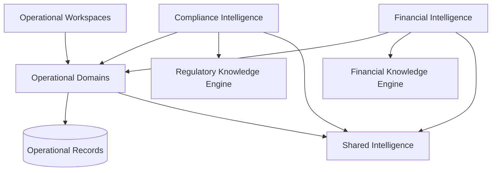
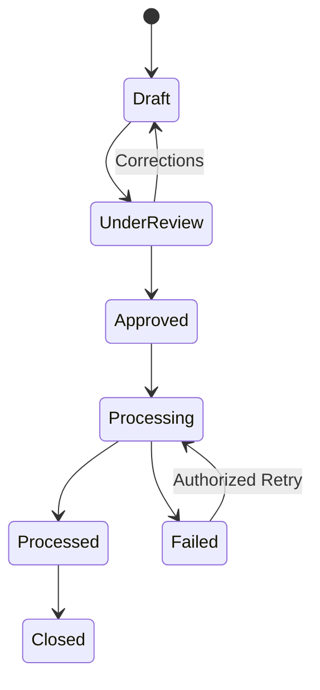
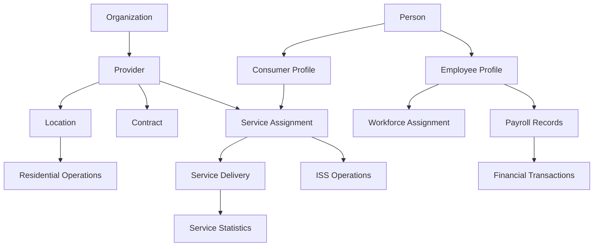
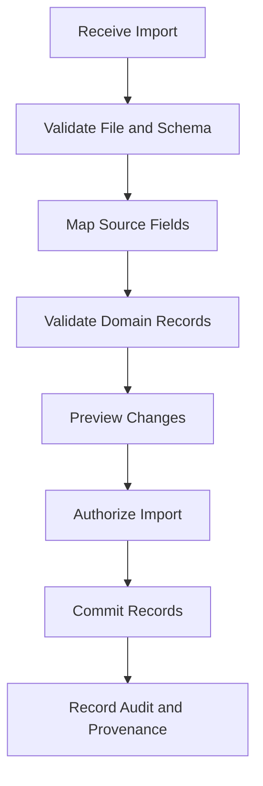
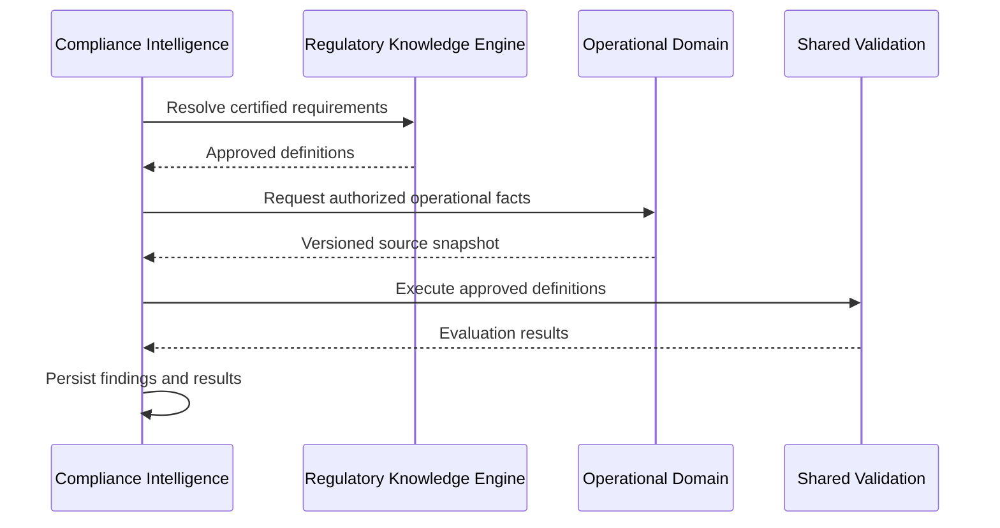
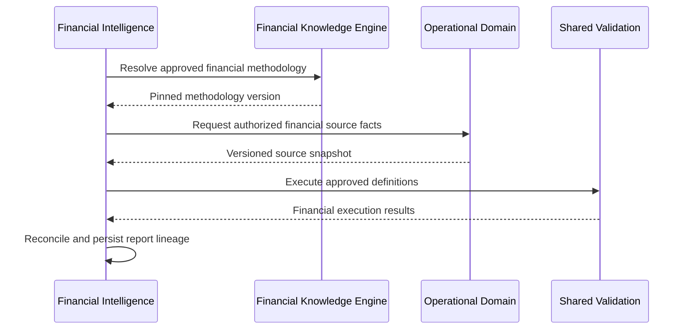

# ENG-019 — Operational Domains: Detailed Component Specifications

**Organization:** McCaskill Projects  
**Platform:** Regulatory Intelligence Platform  
**Document ID:** ENG-019  
**Version:** 1.0 — Draft  
**Classification:** Engineering Design Specification  
**Proposed Path:** `docs/engineering/19-operational-domains-specification.md`  
**Design Approach:** Architecture-first, repository-independent  
**Implementation Authorization:** Not Granted

---

# 1. Executive Design Statement

Operational Domains form the authoritative business-record and workflow layer of the Regulatory Intelligence Platform.

Their purpose is to capture, organize, validate, maintain, and expose the factual information generated by organizations operating under regulatory, financial, and contractual requirements.

Operational Domains are reusable across jurisdictions, authorities, programs, and industries.

They must not be designed exclusively around Texas HCS, Texas ISS, or any single regulatory program.

Texas HCS and Texas ISS serve as initial operational use cases, not as constraints on the universal architecture.

## 1.1 Primary architectural rule

**Operational Domains own facts. Knowledge Engines own governing definitions. Applied Intelligence owns governed determinations.**

For example:

- Residential Operations records that a fire drill occurred.
- The Regulatory Knowledge Engine defines the applicable fire-drill requirements.
- Shared Validation executes the certified definition.
- Compliance Intelligence determines and records the compliance evaluation result.

Similarly:

- Payroll Operations records employee compensation and payroll activity.
- The Financial Knowledge Engine defines applicable financial classification and reporting methodology.
- Financial Intelligence executes and reconciles approved financial calculations.

Operational validation may ensure that a record is structurally complete or internally consistent. It must not silently substitute for a regulatory or financial determination.

## 1.2 Design objectives

The Operational Domains shall provide:

1. Universal organization and provider modeling.
2. Location and facility management.
3. Person and relationship management.
4. Employee and workforce management.
5. Service definitions and delivery records.
6. Contract and authorization management.
7. Payroll source records.
8. Financial transaction records.
9. Service statistics.
10. Document and evidence integration.
11. Residential Operations.
12. Individualized Skills and Socialization Operations.
13. Operational workflows and state transitions.
14. Multi-tenant authorization.
15. Data quality and source provenance.
16. Historical record integrity.
17. Stable contracts for Applied Intelligence.
18. Extensibility through program-specific configurations.

---

# 2. Architectural Placement and Ownership

## 2.1 WHAT

Operational Domains occupy Layer 2 of the platform architecture.

| Layer | Responsibility |
|---|---|
| 1 | Platform Foundation |
| 2 | Operational Domains |
| 3 | Regulatory and Financial Knowledge Authorities |
| 4 | Shared Intelligence Infrastructure |
| 5 | Applied Intelligence and Operations |
| 6 | User Experience |

## 2.2 WHEN

Operational Domains participate whenever an organization creates, modifies, retrieves, or manages business records and operational activities.

## 2.3 WHERE

Domain-owned services, persistence, contracts, and workflows.

## 2.4 WHY

Operational records must remain independent of the regulatory or financial methodologies subsequently applied to them.

## 2.5 HOW



### Ownership boundaries

Operational Domains own:

- Business identities and relationships.
- Operational records.
- Operational record lifecycle.
- Source-data integrity.
- Operational workflow assignments.
- Domain-owned validation definitions.
- Historical operational facts.

They do not own:

- Regulatory requirement definitions.
- Regulatory applicability determinations.
- Regulatory certification.
- Financial allowability methodology.
- Financial cost allocation methodology.
- Official financial reporting definitions.
- Compliance findings.
- Financial report calculations.
- Shared document storage infrastructure.
- Binder lifecycle infrastructure.

## 2.6 VERIFICATION

Architecture reviews must confirm that Operational Domains do not embed authoritative regulatory or financial rules.

---

# 3. Operational Component Catalog

## 3.1 WHAT

The operational architecture contains twelve logical components, aligned conceptually with the OP-01 through OP-12 service family in ENG-008.

| ID | Component | Primary responsibility |
|---|---|---|
| OP-01 | Organization and Provider Management | Organization identities and provider relationships |
| OP-02 | Location and Facility Management | Locations, facilities, and operational assignments |
| OP-03 | Person and Relationship Management | People, identities, contacts, and relationships |
| OP-04 | Employee and Workforce Management | Employee profiles, assignments, and workforce records |
| OP-05 | Service and Delivery Management | Service definitions, delivery, and encounters |
| OP-06 | Contract and Authorization Management | Contracts, authorizations, and effective periods |
| OP-07 | Payroll Operations | Payroll source records and processing state |
| OP-08 | Financial Transaction Operations | Transactions, accounts, and source financial activity |
| OP-09 | Service Statistics Management | Units, attendance, utilization, and operational measures |
| OP-10 | Operational Document and Evidence Coordination | Domain document references and evidence linkage |
| OP-11 | Residential Operations | Residential assignments and residential activity records |
| OP-12 | ISS Operations | Individualized Skills and Socialization activities and progress |

These are logical components, not mandatory independently deployed services.

## 3.2 WHEN

The catalog governs detailed operational design and future implementation planning.

## 3.3 WHERE

The Operational Domains layer.

## 3.4 WHY

Explicit ownership prevents overlapping source records and duplicate workflows.

## 3.5 HOW

Each component must define:

- Owned entities.
- Commands and queries.
- Lifecycle transitions.
- Validation rules.
- Authorization scope.
- Event contracts.
- Integration boundaries.
- Historical requirements.
- Acceptance tests.

## 3.6 VERIFICATION

All component identifiers must be reconciled with ENG-008 before implementation.

---

# 4. Universal Operational Data Principles

## 4.1 WHAT

Defines common requirements for all operational records.

## 4.2 WHEN

Whenever an Operational Domain creates or maintains data.

## 4.3 WHERE

Operational persistence and API contracts.

## 4.4 WHY

Consistent records support reliable regulatory and financial evaluation.

## 4.5 HOW

### Common record metadata

```typescript
interface OperationalRecord {
  id: string;
  tenantId: string;
  owningDomain: string;

  createdAt: string;
  createdBy: string;

  updatedAt: string;
  updatedBy: string;

  revision: number;

  effectiveFrom?: string;
  effectiveTo?: string;

  status: string;
}
```

### Core requirements

- Stable identities.
- Explicit tenant ownership.
- Source attribution.
- Record versioning.
- Optimistic concurrency.
- Historical preservation.
- Typed lifecycle states.
- Authorization.
- Auditable changes.
- Controlled deletion and retention.

### Temporal distinctions

Operational records may require separate:

- Event date.
- Effective date.
- Entry date.
- Modification date.
- Approval date.
- Correction date.

These dates must not be conflated.

## 4.6 VERIFICATION

Shared operational contract tests must verify identity, authorization, concurrency, and historical integrity.

---

# 5. OP-01 — Organization and Provider Management

## WHAT

Maintains organization identities, provider entities, and business relationships.

## WHEN

During organization onboarding, provider configuration, and organizational change.

## WHERE

Organization and Provider domain.

## WHY

A provider may operate multiple programs, locations, and contractual relationships.

## HOW

### Core entities

- Organization.
- Provider.
- OrganizationRelationship.
- ProviderProgramEnrollment.
- ProviderIdentifier.
- BusinessUnit.
- OrganizationalContact.
- ProviderStatusHistory.

### Required capabilities

- Register organization.
- Register provider.
- Associate provider with organization.
- Manage program enrollments.
- Maintain organizational hierarchy.
- Manage provider identifiers.
- Record effective periods.
- Preserve provider status history.

### Key invariants

- Provider identity must be stable.
- External identifiers must be scoped to their issuing authority.
- Program participation is not equivalent to regulatory certification.
- Organizational relationships must be historically traceable.
- Tenant ownership must be enforced.

### Example contract

```typescript
interface ProviderRecord {
  id: string;
  tenantId: string;
  organizationId: string;

  legalName: string;
  displayName?: string;

  identifiers: ProviderIdentifier[];

  status: string;
  effectiveFrom?: string;
  effectiveTo?: string;
}
```

## VERIFICATION

Tests must cover duplicate identifiers, organizational relationships, historical status, and tenant isolation.

---

# 6. OP-02 — Location and Facility Management

## WHAT

Maintains operational locations and facility information.

## WHEN

When organizations establish, modify, close, or assign activities to locations.

## WHERE

Location and Facility domain.

## WHY

A provider may operate different location types under multiple programs.

## HOW

### Core entities

- Location.
- Facility.
- LocationType.
- LocationAddress.
- LocationRelationship.
- LocationAssignment.
- LocationStatusHistory.

### Required capabilities

- Create location.
- Assign location to provider.
- Maintain location type.
- Manage addresses.
- Track operational status.
- Associate services and people.
- Preserve location history.

### Key invariants

- Location identifiers are provider-scoped when required.
- Location type is not inherently jurisdiction-specific.
- Closing a location must not erase historical records.
- Location access must be authorized.

### Example contract

```typescript
interface LocationRecord {
  id: string;
  tenantId: string;
  providerId: string;

  locationCode: string;
  locationType: string;

  name: string;
  status: string;

  effectiveFrom?: string;
  effectiveTo?: string;
}
```

## VERIFICATION

Tests must cover provider scoping, location identity, assignment history, and lifecycle transitions.

---

# 7. OP-03 — Person and Relationship Management

## WHAT

Maintains people, identities, contacts, and relationships.

## WHEN

When organizations manage consumers, employees, guardians, contacts, or other individuals.

## WHERE

Person and Relationship domain.

## WHY

A person may participate in multiple operational roles without requiring duplicate person identities.

## HOW

### Core entities

- Person.
- PersonIdentifier.
- ConsumerProfile.
- ContactProfile.
- GuardianRelationship.
- LegalRepresentativeRelationship.
- CareTeamRelationship.
- EmergencyContact.
- PersonStatusHistory.

### Required capabilities

- Register person.
- Maintain identifiers.
- Associate operational roles.
- Manage contacts.
- Maintain relationships.
- Track effective periods.
- Preserve historical identity changes.

### Key invariants

- A person is not inherently a consumer or employee.
- Roles are modeled through relationships and profiles.
- Sensitive identifiers require additional protection.
- Relationship authority must not be inferred from a label alone.
- Historical relationships must be preserved.

### Example contract

```typescript
interface PersonRecord {
  id: string;
  tenantId: string;

  givenName: string;
  familyName: string;

  identifiers: PersonIdentifier[];

  status: string;
}
```

## VERIFICATION

Tests must cover duplicate identity handling, relationship scoping, sensitive data access, and historical changes.

---

# 8. OP-04 — Employee and Workforce Management

## WHAT

Maintains employee profiles, workforce assignments, qualifications, and operational staffing information.

## WHEN

During hiring, assignment, scheduling, training, and workforce management.

## WHERE

Employee and Workforce domain.

## WHY

Operational staffing facts are required by many regulated programs.

## HOW

### Core entities

- EmployeeProfile.
- EmploymentRelationship.
- Position.
- JobAssignment.
- WorkSchedule.
- TimeRecord.
- TrainingRecord.
- QualificationRecord.
- CredentialRecord.
- WorkforceStatusHistory.

### Required capabilities

- Maintain employee profile.
- Assign employee to organization or location.
- Record work schedules.
- Record time worked.
- Maintain qualifications.
- Maintain training completion.
- Track credential dates.
- Preserve employment history.

### Key invariants

- Employment identity is separate from universal person identity.
- Training completion is an operational fact.
- Regulatory training sufficiency is determined through the RKE and Compliance Intelligence.
- Payroll compensation calculations remain distinct from workforce source records.
- Sensitive workforce information must be access-controlled.

## VERIFICATION

Tests must cover employee assignment, time records, credential history, authorization, and historical retrieval.

---

# 9. OP-05 — Service and Delivery Management

## WHAT

Maintains operational service definitions, assignments, encounters, and delivery records.

## WHEN

Whenever services are scheduled, delivered, documented, or corrected.

## WHERE

Service and Delivery domain.

## WHY

Service delivery facts support operational management, billing, compliance, and financial reporting.

## HOW

### Core entities

- ServiceCatalogItem.
- ServiceAssignment.
- ServiceAuthorizationReference.
- ServiceSchedule.
- ServiceEncounter.
- ServiceDeliveryRecord.
- ServiceParticipant.
- ServiceStatusHistory.

### Required capabilities

- Define operational service catalog.
- Assign services.
- Schedule service activity.
- Record delivery.
- Track participants.
- Record start and end times.
- Preserve corrections.
- Expose service facts through authorized APIs.

### Key invariants

- Service delivery does not automatically establish billability.
- Operational service catalogs do not define regulatory eligibility.
- Corrections preserve original records.
- Service dates and documentation dates are distinct.

## VERIFICATION

Tests must cover delivery records, corrections, authorization, and source-data consistency.

---

# 10. OP-06 — Contract and Authorization Management

## WHAT

Maintains contractual relationships, operational authorizations, and effective periods.

## WHEN

During contract creation, amendment, renewal, suspension, and service authorization changes.

## WHERE

Contract and Authorization domain.

## WHY

Operational services and financial activity often depend on contractual or authorization context.

## HOW

### Core entities

- Contract.
- ContractParty.
- ContractIdentifier.
- ContractVersion.
- ContractAmendment.
- ServiceAuthorization.
- AuthorizationPeriod.
- ContractStatusHistory.

### Required capabilities

- Register contract.
- Associate contract parties.
- Record amendments.
- Manage authorization periods.
- Track contract status.
- Preserve supporting documents.
- Expose authorized contract facts.

### Key invariants

- Contract status is an operational fact.
- Regulatory contract compliance is determined through governed regulatory knowledge.
- Financial methodology remains governed by the FKE.
- Historical amendments must remain retrievable.
- Contract identifiers must be properly scoped.

## VERIFICATION

Tests must cover contract history, overlapping authorization periods, amendment relationships, and access control.

---

# 11. OP-07 — Payroll Operations

## WHAT

Maintains payroll source records, pay periods, earnings, deductions, and processing state.

## WHEN

During payroll preparation, processing, correction, and historical retrieval.

## WHERE

Payroll Operations domain.

## WHY

Payroll records provide essential source information for workforce management and financial reporting.

## HOW

### Core entities

- PayrollPeriod.
- PayrollRun.
- PayrollEmployeeRecord.
- EarningsRecord.
- DeductionRecord.
- EmployerContributionRecord.
- PayrollAdjustment.
- PayrollPaymentRecord.
- PayrollStatusHistory.

### Required capabilities

- Define payroll periods.
- Associate employee records.
- Record earnings and deductions.
- Maintain payroll processing state.
- Record payment status.
- Preserve payroll corrections.
- Expose authorized payroll source data.

### Key invariants

- Payroll source records must remain historically traceable.
- Payroll calculations must use applicable approved payroll rules and authorized calculation services.
- FKE governs financial reporting classification and methodology; it does not automatically replace payroll tax law or a dedicated payroll tax calculation authority.
- Payroll payment status must not be inferred from a draft payroll record.
- Sensitive payroll data requires restricted access.

### Payroll lifecycle



### Required correction behavior

Corrections must retain:

- Original payroll run.
- Adjustment reason.
- Authorized actor.
- Correction timestamp.
- Updated resulting values.
- Relationship to affected payment records.

## VERIFICATION

Tests must cover payroll lifecycle, duplicate prevention, adjustments, payment status, historical integrity, and access control.

---

# 12. OP-08 — Financial Transaction Operations

## WHAT

Maintains source financial transactions and accounting relationships.

## WHEN

When financial activity is imported, recorded, reviewed, reconciled, or corrected.

## WHERE

Financial Transaction Operations domain.

## WHY

Financial Intelligence requires reliable source transactions without taking ownership of bookkeeping records.

## HOW

### Core entities

- FinancialAccount.
- Transaction.
- TransactionLine.
- TransactionSource.
- TransactionImportBatch.
- TransactionReconciliation.
- TransactionAdjustment.
- TransactionStatusHistory.

### Required capabilities

- Register financial accounts.
- Import transactions.
- Record transaction lines.
- Preserve source references.
- Detect duplicates.
- Track reconciliation status.
- Record corrections.
- Expose authorized financial facts.

### Key invariants

- Original transaction source data must be preserved.
- Bookkeeping categorization and regulated reporting classification are distinct.
- FKE governs regulated reporting classification and allowability.
- Financial Intelligence owns methodology-dependent calculations.
- Imported records must retain source provenance.
- Corrections must be auditable.

### Example contract

```typescript
interface FinancialTransactionRecord {
  id: string;
  tenantId: string;

  accountId: string;
  transactionDate: string;

  amount: string;
  currency: string;

  sourceReference?: string;
  description?: string;

  status: string;
}
```

Amounts use exact decimal representations.

## VERIFICATION

Tests must cover import idempotency, duplicates, reconciliation, corrections, and tenant isolation.

---

# 13. OP-09 — Service Statistics Management

## WHAT

Maintains operational statistics used in service management, reporting, and financial analysis.

## WHEN

When service activities produce measurable units or utilization data.

## WHERE

Service Statistics domain.

## WHY

Accurate service statistics are essential for cost reporting and operational analysis.

## HOW

### Core entities

- StatisticDefinition.
- StatisticObservation.
- ServiceUnitRecord.
- AttendanceRecord.
- UtilizationRecord.
- CensusRecord.
- StatisticAggregation.
- StatisticCorrection.

### Example measures

- Service units.
- Attendance.
- Hours delivered.
- Days of service.
- Authorized capacity.
- Actual utilization.
- Participant counts.

### Key invariants

- Every statistic must have a defined unit.
- Source and aggregation periods must be explicit.
- Aggregated statistics must preserve source lineage.
- Service units do not automatically establish billable units.
- Financial allocation eligibility is governed by approved FKE methodology.
- Regulatory sufficiency is governed by approved RKE requirements.

## VERIFICATION

Tests must cover aggregation, units, period boundaries, corrections, and reproducibility.

---

# 14. OP-10 — Operational Document and Evidence Coordination

## WHAT

Connects operational records to Shared Document and Evidence services.

## WHEN

Whenever an operational workflow requires supporting documentation.

## WHERE

Operational Domain adapters and Shared Intelligence interfaces.

## WHY

Operational Domains must reference documents without duplicating the common storage infrastructure.

## HOW

### Responsibilities

- Associate documents with operational records.
- Register evidence references.
- Request authorized document access.
- Maintain domain-specific document classifications.
- Track document completeness as an operational workflow.
- Preserve document-to-record relationships.

### Ownership

- Operational Domain owns the business record.
- Shared Document Management owns document metadata and versions.
- Shared Evidence Management owns evidence linkage metadata.
- RKE defines regulatory evidence requirements.
- FKE defines financial evidence requirements.

### Key invariants

- Document existence does not establish regulatory compliance.
- Evidence acceptance does not establish financial allowability.
- Access requires authorization for the document and owning record.
- Historical document versions remain traceable.

## VERIFICATION

Tests must cover document linkage, version changes, source authorization, and evidence history.

---

# 15. OP-11 — Residential Operations

## 15.1 WHAT

Provides reusable operational capabilities for residential service settings.

## 15.2 WHEN

When a provider manages residential locations, assignments, safety activities, and residential records.

## 15.3 WHERE

Residential Operations domain.

## 15.4 WHY

Residential operational workflows must remain reusable across programs while regulatory rules remain in jurisdiction-specific Knowledge Packs.

## 15.5 HOW

### Core entities

- ResidentialSetting.
- ResidentialAssignment.
- ResidentialOccupancyRecord.
- ResidentialSafetyActivity.
- FireDrillRecord.
- EmergencyPlanRecord.
- HotWaterTemperatureRecord.
- MedicationAdministrationRecord.
- ResidentialMaintenanceRecord.
- ResidentialIncidentReference.
- ResidentialStatusHistory.

### Residential setting types

The universal domain must support configurable setting types.

Texas HCS examples include:

- Three-person residence.
- Four-person residence.
- Host home.

These examples must not become universal enum assumptions.

### Residential assignments

Required capabilities:

- Assign person to residential setting.
- Record assignment start and end dates.
- Preserve assignment history.
- Detect conflicting active assignments according to operational constraints.
- Record authorized transfers.
- Associate residential services.

### Fire drills

The domain records:

- Drill date and time.
- Location.
- Participants.
- Staff present.
- Observed activity.
- Completion details.
- Supporting documents.
- Corrections.

The Texas HCS Knowledge Pack determines applicable fire-drill regulatory requirements.

### Emergency plans

The domain records:

- Plan identity.
- Location or organizational scope.
- Plan version.
- Effective dates.
- Review activity.
- Staff acknowledgment where applicable.
- Supporting documents.

The RKE determines regulatory sufficiency.

### Hot-water records

The domain records:

- Measurement date and time.
- Measurement location.
- Temperature.
- Measurement unit.
- Recorder.
- Corrective operational activity.

The RKE determines applicable regulatory thresholds.

### Medication records

The domain records:

- Medication-related operational facts.
- Administration or refusal events.
- Authorized support activities.
- Record corrections.
- Supporting documentation.

Clinical authority, individual rights, and regulatory requirements must remain governed by their appropriate authoritative sources and workflows.

### Residential workbench integration

The Residential Module Workbench should organize correction areas first:

1. Fire Drills.
2. Emergency Plans.
3. Hot Water.
4. Medication.

Affected locations appear beneath the relevant correction area.

The workbench consumes Compliance Intelligence results rather than embedding regulatory evaluation rules.

## 15.6 VERIFICATION

Tests must cover assignments, residential record history, authorization, source-data integrity, and RKE/Compliance Intelligence integration.

---

# 16. OP-12 — Individualized Skills and Socialization Operations

## 16.1 WHAT

Provides reusable operational capabilities for individualized skills development, socialization, community participation, and progress documentation.

## 16.2 WHEN

When a provider plans, delivers, and documents individualized services.

## 16.3 WHERE

ISS Operations domain.

## 16.4 WHY

Individualized services require measurable goals, structured activities, and defensible documentation while remaining adaptable to multiple regulatory programs.

## 16.5 HOW

### Core entities

- IndividualServiceProfile.
- IndividualGoal.
- GoalObjective.
- ObjectiveTemplate.
- SkillDomain.
- SkillAssessment.
- ActivityDefinition.
- ActivityPlan.
- ActivitySession.
- ActivityParticipation.
- SkillProgressObservation.
- CommunityParticipationRecord.
- SupportLevelRecord.
- ServiceDocumentation.
- IndividualPlanReference.
- ProgressReview.

### Nine configurable skill domains

The initial ISS design includes nine skill domains.

Their exact approved names and definitions must be maintained in the ISS domain configuration and reconciled with the approved ISS curriculum specification.

The universal platform must support additional domains without schema redesign.

### Objective template library

The initial ISS design includes 72 objective templates.

Templates must support:

- Stable objective identity.
- Skill-domain association.
- Measurable criteria.
- Suggested activities.
- Support requirements.
- Progress measurement.
- Versioning.
- Individual customization.

A template is not automatically an authorized goal for every individual.

### Individualized goals

Each goal should include:

- Individual reference.
- Goal statement.
- Baseline.
- Measurable target.
- Start date.
- Review date.
- Support requirements.
- Progress criteria.
- Relevant individual-plan linkage.
- Status and history.

### Support progression

The initial progression model is:

**Guided → Supported → Independent**

This progression is a configurable instructional model, not an automatic regulatory standard.

### Activity planning

The operational model supports flexible weekly adventure schedules organized around individual goals.

A six-hour conceptual activity day may be used for planning.

**A planned six-hour day does not automatically establish six billable hours.**

Billing eligibility and documentation requirements must be resolved through the appropriate authorized program and financial or billing rules.

### Community participation

Required operational records may include:

- Activity.
- Location.
- Date.
- Duration.
- Participants.
- Individual goals addressed.
- Support provided.
- Individual response.
- Progress observations.
- Staff documentation.

### Individual-plan linkage

Goals and activities must be linkable to the applicable individual plan, including PDP-related references where relevant.

### Customer separation

LevelUp Adventures is a potential customer organization using ISS Operations.

It is not the name or identity of the universal ISS engine.

### Regulatory boundary

The Texas ISS Knowledge Pack governs applicable Texas requirements.

Its source references and interpretations must be verified before certification.

## 16.6 VERIFICATION

Tests must cover individualized goals, objective templates, support progression, activity documentation, progress tracking, authorization, and separation of operational planning from regulatory and billing determinations.

---

# 17. Operational Workflow Lifecycle Standards

## 17.1 WHAT

Defines reusable lifecycle requirements for operational records.

## 17.2 WHEN

Whenever a domain introduces a stateful workflow.

## 17.3 WHERE

Operational Domain services and state machines.

## 17.4 WHY

Consistent lifecycle modeling prevents unauthorized or ambiguous state transitions.

## 17.5 HOW

### Common conceptual states

- Draft.
- Active.
- Under Review.
- Approved, where applicable.
- Completed.
- Corrected.
- Cancelled.
- Archived.

Not every record uses every state.

Each domain must define its own permitted transitions.

### Requirements

- Authorized transitions.
- State-change audit.
- Concurrency protection.
- Historical preservation.
- Explicit correction behavior.
- Rejection of invalid transitions.

## 17.6 VERIFICATION

State-machine tests must cover permitted and prohibited transitions.

---

# 18. Operational Validation Boundaries

## 18.1 WHAT

Defines which validations Operational Domains may own.

## 18.2 WHEN

During data entry, updates, imports, and operational workflow execution.

## 18.3 WHERE

Operational Domain services and Shared Validation.

## 18.4 WHY

Operational integrity must not be confused with compliance or financial methodology.

## 18.5 HOW

### Permitted operational validations

- Required field presence.
- Data type correctness.
- Identifier uniqueness.
- Valid relationship references.
- Chronological consistency.
- Record status consistency.
- Duplicate prevention.
- Internal record completeness.
- Approved operational workflow constraints.

### Not independently permitted

- Declaring regulatory compliance.
- Establishing regulatory thresholds.
- Determining financial allowability.
- Establishing regulated allocation methods.
- Certifying official financial reports.

### Execution model

Operational Domains may execute simple integrity checks directly or submit domain-owned declarative definitions to Shared Validation.

## 18.6 VERIFICATION

Tests must ensure operational validation does not create unauthorized regulatory or financial determinations.

---

# 19. Cross-Domain Identity and Relationship Model

## 19.1 WHAT

Defines how operational entities relate without duplicating identities.

## 19.2 WHEN

During cross-domain workflows and integration.

## 19.3 WHERE

Operational identity and relationship contracts.

## 19.4 WHY

A single person, location, or organization may participate in multiple workflows.

## 19.5 HOW



### Requirements

- Stable entity identities.
- Explicit relationship types.
- Effective-dated relationships.
- Tenant isolation.
- No uncontrolled identity duplication.
- Historical relationship retrieval.

## 19.6 VERIFICATION

Relationship tests must cover valid associations, conflicting assignments, and historical changes.

---

# 20. Operational APIs

## 20.1 WHAT

Defines proposed operational API families.

## 20.2 WHEN

When authorized workspaces or Applied Intelligence services access operational records.

## 20.3 WHERE

Versioned platform APIs.

## 20.4 WHY

Operational data must be accessed through domain contracts rather than uncontrolled database access.

## 20.5 HOW

### Proposed API families

```text
/api/v1/organizations
/api/v1/providers
/api/v1/locations
/api/v1/people
/api/v1/employees
/api/v1/services
/api/v1/contracts
/api/v1/payroll
/api/v1/transactions
/api/v1/service-statistics
/api/v1/residential
/api/v1/iss
```

### Required capabilities

- Create.
- Retrieve.
- Update.
- Search.
- Version retrieval.
- Authorized state transitions.
- Import where applicable.
- Historical retrieval.
- Scoped exports.

### API requirements

- Authentication.
- Backend authorization.
- Tenant and resource scoping.
- Typed contracts.
- Optimistic concurrency.
- Idempotency for appropriate operations.
- Pagination.
- Audit and correlation identifiers.

Final endpoint contracts must align with ENG-009.

## 20.6 VERIFICATION

API contract, authorization, and historical retrieval tests must pass.

---

# 21. Operational Domain Events

## 21.1 WHAT

Defines events emitted by operational state changes.

## 21.2 WHEN

After committed operational transactions.

## 21.3 WHERE

Approved platform event infrastructure.

## 21.4 WHY

Applied Intelligence and other consumers need reliable notifications of changed operational facts.

## 21.5 HOW

### Proposed event families

**Organizations**

- ProviderRegistered.
- ProviderStatusChanged.

**Locations**

- LocationCreated.
- LocationStatusChanged.

**People and workforce**

- PersonRegistered.
- EmployeeAssignmentChanged.
- TrainingRecordUpdated.

**Services**

- ServiceAssigned.
- ServiceDeliveryRecorded.
- ServiceDeliveryCorrected.

**Contracts**

- ContractActivated.
- ContractAmended.

**Payroll**

- PayrollRunApproved.
- PayrollRunProcessed.
- PayrollAdjustmentRecorded.

**Transactions**

- TransactionImported.
- TransactionCorrected.

**Residential**

- ResidentialAssignmentChanged.
- FireDrillRecorded.
- EmergencyPlanVersionRecorded.
- HotWaterMeasurementRecorded.

**ISS**

- IndividualGoalCreated.
- ActivitySessionCompleted.
- SkillProgressRecorded.

### Event rules

- Events represent committed facts.
- Consumers must be idempotent.
- Event payloads must minimize sensitive data.
- Event IDs and names must reconcile with ENG-001 and ENG-009.

## 21.6 VERIFICATION

Event contract, duplicate delivery, and recovery tests must pass.

---

# 22. Operational Security and Authorization

## 22.1 WHAT

Defines operational access controls.

## 22.2 WHEN

At every command, query, import, export, and document access.

## 22.3 WHERE

Platform Authorization and Operational Domain boundaries.

## 22.4 WHY

Operational Domains contain sensitive personal, workforce, financial, and service information.

## 22.5 HOW

### Required scope dimensions

- Tenant.
- Organization.
- Provider.
- Location.
- Person.
- Employee.
- Contract.
- Service.
- Reporting period.

### Mandatory controls

- Least privilege.
- Backend authorization.
- Resource-level access checks.
- Sensitive field protection.
- Tenant isolation.
- Scoped service identities.
- Audit logging.
- Export controls.
- Retention and legal holds.
- Access revocation.

### Security rule

A user's ability to access a provider dashboard does not automatically grant unrestricted access to every person, employee, payroll record, or document within that provider.

## 22.6 VERIFICATION

Security tests must cover cross-tenant denial, unauthorized sensitive data access, and resource scope escalation.

---

# 23. Operational Data Architecture

## 23.1 WHAT

Defines operational persistence requirements.

## 23.2 WHEN

During data model and database implementation planning.

## 23.3 WHERE

Domain-owned PostgreSQL persistence and protected document references.

## 23.4 WHY

Operational source data must remain accurate, recoverable, and independently governed.

## 23.5 HOW

### Requirements

- Domain-owned tables.
- Stable identifiers.
- Explicit foreign-key relationships within ownership boundaries.
- Effective-dated records.
- Concurrency control.
- Transactional updates.
- Auditable corrections.
- Historical preservation.
- Data retention.
- Backup and recovery.

### Data categories

- Organization and provider.
- Location.
- Person.
- Workforce.
- Service.
- Contract.
- Payroll.
- Transactions.
- Service statistics.
- Residential.
- ISS.

### Migration requirements

All schema changes require controlled migrations, compatibility review, and recovery planning.

## 23.6 VERIFICATION

Data integrity, migration, historical retrieval, and backup tests must pass.

---

# 24. Data Import and Integration

## 24.1 WHAT

Defines how external operational data enters the platform.

## 24.2 WHEN

During onboarding, system integration, payroll imports, transaction imports, or bulk record updates.

## 24.3 WHERE

Operational import adapters and domain services.

## 24.4 WHY

Imported records must meet the same integrity and authorization standards as manually entered records.

## 24.5 HOW

### Import lifecycle



### Requirements

- Source attribution.
- Import batch identity.
- Duplicate detection.
- Validation errors.
- Preview.
- Authorized commit.
- Idempotency.
- Partial failure handling.
- Correction and rollback strategy.
- Import history.

## 24.6 VERIFICATION

Tests must cover malformed imports, duplicate records, unauthorized imports, partial failures, and recovery.

---

# 25. Operational Integration with Regulatory Knowledge

## 25.1 WHAT

Defines how operational facts support regulatory evaluation.

## 25.2 WHEN

When Compliance Intelligence evaluates applicable requirements.

## 25.3 WHERE

Operational Domains, RKE, Shared Validation, and Compliance Intelligence.

## 25.4 WHY

Operational Domains must not directly decide whether records satisfy regulatory obligations.

## 25.5 HOW



### Required traceability

- Requirement version.
- Operational source record version.
- Evaluation definition.
- Execution manifest.
- Compliance result.
- Evidence references.

## 25.6 VERIFICATION

Integration tests must verify source-to-result traceability and correct authority boundaries.

---

# 26. Operational Integration with Financial Knowledge

## 26.1 WHAT

Defines how operational financial records support governed financial calculations.

## 26.2 WHEN

During financial classification, allocation, reporting, and reconciliation.

## 26.3 WHERE

Operational Domains, FKE, Shared Validation, and Financial Intelligence.

## 26.4 WHY

Financial source records must remain independent of regulated reporting methodology.

## 26.5 HOW



### Required traceability

- Source transaction or payroll record.
- Applicable financial methodology.
- Rate and formula versions.
- Allocation inputs.
- Execution manifest.
- Report instance.

## 26.6 VERIFICATION

Integration tests must verify calculation lineage, source ownership, and historical reproducibility.

---

# 27. Operational Workspace Requirements

## 27.1 WHAT

Defines the user-facing operational workspace principles.

## 27.2 WHEN

During Angular frontend design and implementation.

## 27.3 WHERE

Layer 6 — User Experience.

## 27.4 WHY

Operational workflows must be usable without exposing internal service complexity.

## 27.5 HOW

### Shared workspace requirements

- Consistent navigation.
- Provider and location context.
- Role-aware access.
- Search and filtering.
- Record detail pages.
- Historical timelines.
- Document and evidence panels.
- Validation feedback.
- Import workflows.
- Audit indicators.
- Accessible forms and tables.

### Provider-wide dashboard

The Provider Intelligence Center must support provider-wide views without requiring `locationId`.

### Residential workspace

Residential correction areas must be grouped by issue type, with affected locations displayed beneath each issue.

### ISS workspace

ISS Operations must support:

- Individual profiles.
- Individualized goals.
- Objective templates.
- Weekly activity plans.
- Daily session documentation.
- Progress tracking.
- Community participation.
- Plan linkage.

### Financial operations

Payroll and transaction workspaces must distinguish source records from governed financial reporting outcomes.

## 27.6 VERIFICATION

Frontend acceptance tests must cover authorization, usability, workflow completion, and source-to-result navigation.

---

# 28. Operational Testing Strategy

## 28.1 WHAT

Defines operational quality requirements under ENG-013.

## 28.2 WHEN

Throughout implementation and before operational capability release.

## 28.3 WHERE

Unit, integration, contract, security, and end-to-end test suites.

## 28.4 WHY

Applied Intelligence depends on accurate operational facts.

## 28.5 HOW

| Test ID | Component | Required verification |
|---|---|---|
| T-OP-01 | Organizations | Identity and hierarchy |
| T-OP-02 | Locations | Scope and assignment history |
| T-OP-03 | People | Identity and relationships |
| T-OP-04 | Workforce | Assignments and time records |
| T-OP-05 | Services | Delivery and corrections |
| T-OP-06 | Contracts | Authorization periods and amendments |
| T-OP-07 | Payroll | Processing lifecycle and adjustments |
| T-OP-08 | Transactions | Import, reconciliation, and provenance |
| T-OP-09 | Statistics | Units, aggregation, and period accuracy |
| T-OP-10 | Documents | Evidence linkage and access |
| T-OP-11 | Residential | Safety records and assignments |
| T-OP-12 | ISS | Goals, activities, and progress |
| T-OP-13 | Security | Tenant and resource isolation |
| T-OP-14 | Historical Integrity | Versioned operational facts |
| T-OP-15 | Regulatory Integration | RKE/Compliance Intelligence boundaries |
| T-OP-16 | Financial Integration | FKE/Financial Intelligence boundaries |
| T-OP-17 | Imports | Idempotency and recovery |
| T-OP-18 | Workflow Recovery | State and transaction integrity |

## 28.6 VERIFICATION

All mandatory component and integration tests must pass before acceptance.

---

# 29. Failure Handling and Recovery

## 29.1 WHAT

Defines operational failure behavior.

## 29.2 WHEN

During data entry, import, workflow transitions, and integration.

## 29.3 WHERE

Operational Domain services.

## 29.4 WHY

Operational errors must not silently corrupt source records or downstream evaluations.

## 29.5 HOW

| Failure | Required behavior |
|---|---|
| Duplicate identity | Reject or enter governed resolution |
| Invalid relationship | Reject transition |
| Missing required field | Return validation error |
| Concurrent update | Return version conflict |
| Unauthorized record access | Deny and audit |
| Import failure | Preserve batch history and recovery state |
| Missing source document | Record missing reference or controlled error |
| Service integration failure | Retry safely or return explicit failure |
| Historical version unavailable | Raise integrity incident |
| Invalid operational transition | Reject and preserve state |

## 29.6 VERIFICATION

Failure-injection tests must verify data integrity and safe recovery.

---

# 30. Performance and Scalability

## 30.1 WHAT

Defines operational performance requirements.

## 30.2 WHEN

During capacity planning and implementation.

## 30.3 WHERE

Operational services, persistence, and integration infrastructure.

## 30.4 WHY

The platform must support multiple organizations, locations, employees, and service records.

## 30.5 HOW

### Performance areas

- Provider-wide queries.
- Person and employee search.
- Service record retrieval.
- Payroll processing.
- Transaction imports.
- Statistics aggregation.
- Residential activity history.
- ISS activity and progress retrieval.

### Requirements

- Efficient indexes.
- Pagination.
- Scoped queries.
- Bounded aggregation.
- Asynchronous imports.
- Controlled concurrency.
- Tenant workload isolation.
- Version-aware caching where appropriate.

Specific numerical targets require separate approval.

## 30.6 VERIFICATION

Performance tests must meet approved workload and latency objectives.

---

# 31. Operational Component Dependency Order

## 31.1 WHAT

Defines the recommended implementation sequence.

## 31.2 WHEN

During future sprint planning.

## 31.3 WHERE

ENG-015 and detailed implementation packages.

## 31.4 WHY

Specialized operational capabilities depend on stable core identities and relationships.

## 31.5 HOW

### Stage A — Identity and organization

- OP-01 Organization and Provider.
- OP-02 Location and Facility.
- OP-03 Person and Relationship.

### Stage B — Workforce and service foundation

- OP-04 Employee and Workforce.
- OP-05 Service and Delivery.
- OP-06 Contract and Authorization.

### Stage C — Financial source operations

- OP-07 Payroll.
- OP-08 Financial Transactions.
- OP-09 Service Statistics.

### Stage D — Shared document integration

- OP-10 Operational Document and Evidence Coordination.

### Stage E — Specialized operational domains

- OP-11 Residential Operations.
- OP-12 ISS Operations.

Parallel development is permitted when approved contracts are stable.

## 31.6 VERIFICATION

Each component must satisfy its required upstream contracts.

---

# 32. Operational Acceptance Matrix

| Component | Acceptance evidence |
|---|---|
| OP-01 | Organization and provider identity integrity |
| OP-02 | Location lifecycle and assignment history |
| OP-03 | Person identity and relationship integrity |
| OP-04 | Workforce and qualification records |
| OP-05 | Service delivery source records |
| OP-06 | Contract and authorization history |
| OP-07 | Payroll source integrity |
| OP-08 | Transaction source integrity |
| OP-09 | Service statistics accuracy |
| OP-10 | Secure document and evidence linkage |
| OP-11 | Residential operational workflows |
| OP-12 | ISS goals, activities, and progress |

### Overall acceptance checklist

- [ ] Jurisdiction-neutral operational foundation.
- [ ] Stable organization and provider identities.
- [ ] Configurable locations.
- [ ] Unified person model.
- [ ] Workforce management.
- [ ] Service delivery records.
- [ ] Contract and authorization management.
- [ ] Payroll source records.
- [ ] Financial transaction records.
- [ ] Service statistics.
- [ ] Document and evidence integration.
- [ ] Residential Operations.
- [ ] ISS Operations.
- [ ] Operational validation boundaries.
- [ ] Multi-tenant security.
- [ ] Historical record integrity.
- [ ] Regulatory integration.
- [ ] Financial integration.
- [ ] Required tests.
- [ ] Recovery procedures.
- [ ] Approved cross-domain contracts.

---

# 33. Relationship to Other Engineering Specifications

ENG-019 is governed by:

- ENG-001 — Master Workflow Catalog.
- ENG-002 — Workflow Diagrams and State Machines.
- ENG-003 — Master Entity Catalog.
- ENG-004 — Entity Relationship Model.
- ENG-005 — Nx Workspace Architecture.
- ENG-006 — Technology Implementation Standards.
- ENG-007 — Frontend State Management Architecture.
- ENG-008 — Service and Module Catalog.
- ENG-009 — API and Event Contracts.
- ENG-010 — Authorization and Permission Matrix.
- ENG-011 — User Interface and Workspace Specification.
- ENG-012 — Data Architecture.
- ENG-013 — Testing and Quality Strategy.
- ENG-014 — Team Work Packages.
- ENG-015 — Sprint Implementation Packages.
- ENG-016 — Regulatory Knowledge Engine Specifications.
- ENG-017 — Financial Knowledge Engine Specifications.
- ENG-018 — Shared Intelligence Infrastructure Specifications.

### Required reconciliation

Before implementation:

- Align OP-01 through OP-12 with ENG-008.
- Align operational entities with ENG-003 and ENG-004.
- Align APIs and events with ENG-009.
- Align authorization with ENG-010.
- Align UI requirements with ENG-011.
- Align testing with ENG-013.
- Align implementation dependencies with ENG-015.

---

# 34. Implementation Authorization

**Status: Not Granted**

ENG-019 defines the intended Operational Domains independently of existing code.

It does not authorize:

- Creating or modifying source files.
- Changing Nx libraries.
- Creating database tables.
- Running migrations.
- Modifying APIs.
- Changing authorization.
- Deploying services.
- Implementing program-specific regulatory rules.

Implementation decisions occur after engineering design approval.

---

# 35. Final Engineering Position

Operational Domains form the factual foundation of the Regulatory Intelligence Platform.

Their responsibility is:

**Organizations → Locations → People → Workforce → Services → Contracts → Payroll and Transactions → Service Statistics → Residential and ISS Operations → Authorized Source Data**

The Regulatory Knowledge Engine determines regulatory meaning.

The Financial Knowledge Engine determines financial methodology.

Shared Intelligence provides reusable execution and governance infrastructure.

Compliance Intelligence and Financial Intelligence transform authorized operational facts into governed determinations.

This separation allows McCaskill Projects to support multiple programs and jurisdictions without redesigning the core operational platform.

**End of ENG-019 — Operational Domains: Detailed Component Specifications**