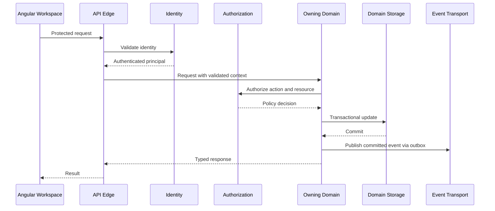

# ENG-021 — Platform Foundation: Detailed Component Specifications

**Organization:** McCaskill Projects  
**Platform:** Regulatory Intelligence Platform  
**Document ID:** ENG-021  
**Version:** 1.0 — Draft  
**Classification:** Engineering Design Specification  
**Proposed repository path:** `docs/engineering/21-platform-foundation-specification.md`  
**Design approach:** Architecture-first, repository-independent  
**Implementation authorization:** **Not Granted**

---

## 1. Executive design statement

Platform Foundation is the common technical substrate for the Regulatory Intelligence Platform. It provides identity, tenancy, authorization, security, API infrastructure, persistence infrastructure, integration, observability, deployment, and operational resilience. It does not own regulatory definitions, financial methodologies, operational business records, compliance findings, financial results, or binder business lifecycle decisions.

**Fundamental rule:** Platform Foundation supplies trusted technical capabilities; domain services retain authoritative business ownership. The Regulatory Knowledge Engine (RKE) and Financial Knowledge Engine (FKE) remain the only two knowledge authorities.

The specification is independent of the current repository. Existing implementation may later be assessed for reuse, modification, or replacement, but must not constrain this design.

## 2. Architecture and scope

The six-layer model is: (1) Platform Foundation; (2) Operational Domains; (3) RKE and FKE; (4) Shared Intelligence; (5) Applied Intelligence and Operations; (6) User Experience. Foundation services may be consumed by every higher layer through explicit interfaces. Cross-layer consumption must not permit direct writes into another domain's owned data.

**In scope:** authentication, tenant and organization isolation, authorization enforcement, API edge and contracts, secrets and cryptographic controls, data and object storage infrastructure, event transport and integrations, telemetry, deployment and disaster recovery.

**Out of scope:** defining Texas HCS regulations, ISS requirements, financial allocation rules, operational service delivery facts, compliance findings, report approval meaning, or survey binder requirements.

## 3. Component catalog

The following nine logical components are proposed for reconciliation with ENG-008 PF-01–PF-09. These are design boundaries, not mandates for nine deployable services.

| ID | Component | Ownership |
|---|---|---|
| PF-01 | Identity and Authentication | User and service authentication, sessions, MFA |
| PF-02 | Tenant and Organization Context | Tenant identity, boundaries, membership context |
| PF-03 | Authorization and Policy Enforcement | Permission evaluation and enforcement contracts |
| PF-04 | API Gateway and Contract Infrastructure | Versioning, request policies, edge protection |
| PF-05 | Security, Secrets, and Cryptographic Services | Key custody, encryption, secret rotation |
| PF-06 | Data and Object Storage Infrastructure | Database and object-store platform capabilities |
| PF-07 | Integration and Messaging Infrastructure | Event transport, external adapters, reliability primitives |
| PF-08 | Observability and Platform Operations | Logs, metrics, traces, alerts, incident operations |
| PF-09 | Build, Deployment, and Resilience Infrastructure | CI/CD, environments, backup, recovery, release controls |

Every component below follows **WHAT / WHEN / WHERE / WHY / HOW / VERIFICATION**.

## 4. Universal platform context

**WHAT:** A trustworthy request context for authenticated, scoped operations.  
**WHEN:** On every protected request, job, and service-to-service operation.  
**WHERE:** API boundary and downstream service contracts.  
**WHY:** A provider-wide workflow must coexist with strict person-, location-, and document-level access restrictions.

**HOW:**

```typescript
interface PlatformContext {
  requestId: string;
  correlationId: string;
  actor: { id: string; kind: 'USER' | 'SERVICE' };
  tenantId?: string;
  organizationId?: string;
  providerId?: string;
  scopes: {
    locationIds?: string[];
    personIds?: string[];
    employeeIds?: string[];
    surveyEventIds?: string[];
  };
  authenticatedAt: string;
  authorizationContextVersion: string;
}
```

The context is a validated server-side representation, not an authorization grant merely because fields are present. Service identities must be constrained to declared operations and audiences. Correlation IDs are propagated, while personal identifiers are minimized in logs.

**VERIFICATION:** Forged context, missing tenant, cross-provider references, expired sessions, and privilege escalation must be denied in automated tests.

## 5. PF-01 — Identity and Authentication

**WHAT:** Authenticate human users and machine principals.  
**WHEN:** Login, session refresh, sensitive action, service communication.  
**WHERE:** Identity provider integration and authentication boundary.  
**WHY:** Identity must be independently established before domain access decisions.

**HOW:** Support federated identity where appropriate, verified user identity, strong password policy where passwords are used, MFA for privileged and external survey access, short-lived credentials, refresh-token rotation or equivalent session security, service-to-service credentials, session revocation, account recovery, and audit of authentication events. Distinguish a user from their organization memberships and roles. Avoid placing sensitive personal records in access tokens. Sensitive operations may require step-up authentication.

**VERIFICATION:** Test MFA enforcement, replayed refresh credentials, revoked sessions, disabled users, service audience restrictions, and account recovery abuse.

## 6. PF-02 — Tenant and Organization Context

**WHAT:** Establish tenant boundaries and authorized organizational membership.  
**WHEN:** Onboarding, user membership, tenant-scoped query, provider context switching.  
**WHERE:** Tenant registry and request-context resolution.  
**WHY:** One customer may have multiple providers and locations, while the same platform serves unrelated customers.

**HOW:** Maintain Tenant, TenantMembership, TenantStatus, OrganizationScopeAssignment, and TenantConfiguration records. Tenant ID must be explicit in tenant-owned data and validated against actor membership. Provider-wide views must not require a location ID; location-specific actions require an authorized location scope. Use effective-dated memberships where necessary. Tenant suspension and offboarding must have controlled, auditable workflows and retention handling.

**VERIFICATION:** Query isolation, cross-tenant join prevention, provider-wide authorized access, tenant switching, suspended tenants, and historical membership tests.

## 7. PF-03 — Authorization and Policy Enforcement

**WHAT:** Provide centralized policy decision contracts and distributed enforcement.  
**WHEN:** Every protected command, query, export, file retrieval, approval, and external access.  
**WHERE:** API guards, domain service checks, background jobs, and storage access brokers.  
**WHY:** Authentication, role labels, and binder membership are insufficient to authorize a sensitive resource.

**HOW:** Use action-resource-context authorization, including tenant, provider, location, person, employee, record classification, workflow state, and event-specific external access. Support role-based assignments with resource-scoped constraints and explicit policy versioning. Domain services enforce ownership-specific decisions. Deny by default, prevent privilege escalation, and audit consequential denials and grants. Approval permissions must support separation of duties. Source-document authorization remains required even when a document is referenced by a binder.

**VERIFICATION:** Permission-matrix tests aligned to ENG-010; negative tests for cross-tenant, cross-person, expired survey grants, self-approval, and direct-object-reference access.

## 8. PF-04 — API Gateway and Contract Infrastructure

**WHAT:** Secure and standardize external API access.  
**WHEN:** Browser, service, partner, and integration requests.  
**WHERE:** Versioned `/api/v1` edge and application interfaces.  
**WHY:** Stable contracts allow independent development of the platform's subsystems.

**HOW:** Provide authentication mediation, request size limits, input validation, rate limiting, CORS controls, standardized error envelopes, correlation IDs, pagination conventions, idempotency keys for side-effecting operations, and API version lifecycle. Define OpenAPI contracts and generated types where approved. Public endpoints must not expose internal persistence entities. Use explicit resource identifiers; avoid trusting client-supplied tenant IDs without validation.

```typescript
interface ApiError {
  code: string;
  message: string;
  correlationId: string;
  details?: Array<{ field?: string; reason: string }>;
}
```

**VERIFICATION:** Contract compatibility, malformed payload, rate limit, authorization, idempotency, and backward-compatibility tests.

## 9. PF-05 — Security, Secrets, and Cryptographic Services

**WHAT:** Provide secure secret management and cryptographic controls.  
**WHEN:** Credentials, protected storage, key rotation, integrations, and signed artifacts.  
**WHERE:** Managed secret and key services with platform security policy.  
**WHY:** The platform handles sensitive healthcare, workforce, and financial information.

**HOW:** Encrypt in transit and at rest; use managed secret storage; separate environments; rotate keys and credentials; minimize secrets in CI; redact sensitive logs; establish classification and data-handling policies; scan dependencies and images; maintain vulnerability remediation SLAs; document cryptographic signing and digest verification for immutable artifacts. Establish incident response and breach assessment procedures with qualified legal/compliance review. Do not presume every customer record is subject to identical legal regimes; apply documented classification and applicable obligations.

**VERIFICATION:** Secret scanning, key rotation rehearsal, access reviews, dependency scans, encryption configuration checks, and incident exercises.

## 10. PF-06 — Data and Object Storage Infrastructure

**WHAT:** Provide reliable relational and protected object storage primitives.  
**WHEN:** Domain persistence, document storage, reporting outputs, and historical snapshots.  
**WHERE:** PostgreSQL and approved protected object storage, with service-owned schemas or boundaries.  
**WHY:** The platform requires durable state without collapsing domain ownership.

**HOW:** PostgreSQL and TypeORM are target technologies; service ownership, migration discipline, encryption, backups, retention, and recovery matter more than physical deployment shape. Implement explicit tenant-scoped access patterns, database roles, controlled migrations, index standards, transactional boundaries, optimistic concurrency, backup validation, and disaster recovery. Object storage must support versioned content, integrity digests, protected access, retention/legal holds, and large-file streaming. Shared storage infrastructure does not own domain semantics or document business approval.

**VERIFICATION:** Migration forward/backward compatibility, backup restoration, data isolation, object integrity, concurrency, and retention tests.

## 11. PF-07 — Integration and Messaging Infrastructure

**WHAT:** Provide transport and external integration infrastructure.  
**WHEN:** Asynchronous domain events, imports, exports, external data exchange.  
**WHERE:** Messaging transport, outbox/inbox adapters, and integration gateways.  
**WHY:** A failure in an external dependency must not corrupt committed business transactions.

**HOW:** Support schema-versioned events, transactional outbox integration, idempotent consumers, retries with backoff, dead-letter handling, correlation and causation IDs, replay controls, and monitored backlogs. Separate transport from event ownership: domain services define event meaning; Shared Intelligence may coordinate workflow reliability; Platform Foundation operates messaging transport and external connectivity. External adapters must enforce authentication, request limits, mapping validation, and data provenance.

**VERIFICATION:** Duplicate delivery, delayed messages, broker outage, poison message, replay, schema evolution, and integration failure tests.

## 12. PF-08 — Observability and Platform Operations

**WHAT:** Provide common operational telemetry and incident management.  
**WHEN:** Continuous operation and incident investigation.  
**WHERE:** Centralized logs, metrics, traces, dashboards, and alerting.  
**WHY:** The platform must diagnose failures spanning several independent domains.

**HOW:** Standardize structured logs, distributed traces, correlation IDs, service-level indicators, health/readiness checks, dashboards, alert ownership, incident severity, runbooks, and post-incident reviews. Exclude unnecessary personal data and secrets from telemetry. Track tenant-safe metrics for API latency, authorization denials, database health, message backlog, document failures, knowledge resolution, validation execution, financial jobs, and binder assembly. Domain-specific business metrics remain owned by their domains.

**VERIFICATION:** Trace continuity, alert drills, log redaction, outage simulation, and runbook exercises.

## 13. PF-09 — Build, Deployment, and Resilience Infrastructure

**WHAT:** Define reproducible build, delivery, and recovery capabilities.  
**WHEN:** Every code change, release, rollback, and recovery.  
**WHERE:** Nx workspace, CI/CD, frontend and backend hosting, database infrastructure.  
**WHY:** Regulated workflows require reliable releases and recoverable history.

**HOW:** Target Nx monorepo, Angular 20 standalone frontend, NgRx, NestJS backend, TypeORM/PostgreSQL, Vercel frontend and Render backend, subject to approved architecture review. Use isolated environments, reproducible builds, lockfiles, test gates, security scans, migration checks, artifact provenance, protected release approvals, feature flags, health-based rollout, rollback plans, and verified backups. Database rollback must not assume every migration is reversible; use forward-recovery procedures where appropriate. Every sprint updates the Software Change Register.

**VERIFICATION:** Clean-environment build, automated test gates, deployment rehearsal, rollback/forward-recovery rehearsal, restoration exercise, and release traceability.

## 14. Foundation domain model

Conceptual entities include UserIdentityReference, ServicePrincipal, AuthenticationSession, Tenant, TenantMembership, TenantConfiguration, PolicyAssignment, PolicyVersionReference, ApiClient, CredentialReference, SecretRotationRecord, StorageResourceReference, IntegrationEndpoint, EventTransportReceipt, TelemetryIncident, DeploymentRelease, MigrationRecord, BackupJob, RestoreVerification, and PlatformChangeRecord.

Foundation data must be limited to technical authority and operations. Person demographics, payroll amounts, clinical records, financial calculations, and regulatory knowledge remain outside Foundation ownership.

## 15. Authorization decision contract

```typescript
interface AuthorizationDecisionRequest {
  actorId: string;
  action: string;
  resourceType: string;
  resourceId: string;
  tenantId?: string;
  context: Record<string, unknown>;
}
interface AuthorizationDecision {
  permitted: boolean;
  policyVersion: string;
  decisionId: string;
  reasonCode?: string;
}
```

Enforcement must occur at the final resource-owning service. A gateway authorization check may be an additional control, never a substitute for ownership-aware checks. Permission decisions must not be cached beyond a safe revocation policy.

## 16. Data tenancy and isolation

Tenant boundaries apply to relational records, object keys, indexes, background jobs, queues, caches, exports, telemetry, and temporary artifacts. All tenant-scoped queries must be constrained by validated context. Cross-tenant administrative support requires explicit privileged policy, justification, and audit. Automated tests must include intentionally malicious tenant identifiers and indirect access through binder/document references.

## 17. Identity and membership lifecycle

User invitation → Identity verification → Membership assignment → Active → Suspended/Revoked. User identity can survive changes in organizational membership. Membership revocation must invalidate effective access to tenant resources, including external file links and background operations where practicable. Historical audit attribution must remain intact after revocation.

## 18. External surveyor access

Surveyors require individual identity, MFA, explicit event-specific grants, limited provider/location/person/document scope, expiry, revocation, and auditable access. A binder invitation cannot bypass source-record authorization. Large documents require protected streaming and access logging. Surveyor access must not be implemented as a shared provider login.

## 19. Knowledge authority integration

RKE and FKE are independent knowledge authorities. Foundation authenticates their services, protects their storage, and transports their events. It must not modify a certified requirement, approve a financial methodology, or determine applicability. Knowledge publication must use separate domain-governed approval paths and immutable version references. Cross-authority use of facts requires explicit contracts.

## 20. Shared Intelligence integration

Foundation supplies storage, authentication, policy enforcement, transport, and observability. Shared Intelligence owns evidence links, validation execution orchestration, audit semantics, document metadata, approval workflow execution, report rendering, and binder lifecycle. Responsibilities that appear similar must be separated by contract: e.g., PF-07 operates event transport while SII-12 owns shared workflow delivery/reliability coordination; PF-08 operates telemetry while SII-15 defines Shared Intelligence operational diagnostics.

## 21. Operational Domains integration

Operational Domains remain authoritative for organizations, locations, people, employees, services, contracts, payroll, transactions, service statistics, Residential Operations, and ISS Operations. Foundation provides authenticated context and infrastructure; it must not create operational business rules. Provider-wide dashboards may query across authorized locations without requiring a location ID.

## 22. Applied Intelligence integration

Compliance Intelligence and Financial Intelligence use Foundation for secure execution, persistence infrastructure, and events. They resolve knowledge through RKE/FKE and operational facts through owning domains. Results must retain knowledge version, input snapshot, execution engine version, and actor/correlation context. Foundation cannot substitute for the owning intelligence domain's decisions.

## 23. API and service-to-service trust

All externally reachable APIs require transport security and an explicit authentication strategy. Internal calls use scoped service credentials or equivalent verified workload identity. Trust is based on validated identity and authorization, not network location alone. Include timeouts, bounded retries, circuit breaking where appropriate, and structured failure responses. Contracts must be versioned and tested independently.

## 24. Event ownership and delivery

Events are published only after authoritative state commits. The source domain owns event meaning and schema; Foundation supplies transport; Shared Intelligence supplies common workflow reliability facilities. Consumer side effects must be idempotent. Event replay must be controlled, audited, and safe against duplicate financial or approval actions. Final event names/IDs reconcile with ENG-001 and ENG-009.

## 25. Environment strategy

Separate local development, integration/test, staging, and production. Production secrets and personal data must not be copied into lower environments without an approved protected-data process. Each environment has documented service endpoints, identity settings, storage, database migrations, telemetry, and release controls. Non-production tests should use synthetic or appropriately de-identified fixtures.

## 26. CI/CD quality gates

Required gates include lint/typecheck, unit tests, domain contract tests, security/dependency scans, database migration validation, authorization negative tests, integration tests, and applicable end-to-end tests. Knowledge Pack publication has additional independent certification gates. Financial methodology publication has its own independent approval gates. Failed mandatory gates block release unless a documented exception is explicitly approved under governance.

## 27. Backup, disaster recovery, and continuity

Define approved recovery point objective (RPO), recovery time objective (RTO), backup frequency, retention, immutable/offsite backup strategy where appropriate, restore verification, and incident communications. Numeric targets are not invented in this draft. Restore tests must validate relational records, document content, audit continuity, event state, knowledge version references, and released binder snapshots.

## 28. Data retention and deletion

Retention and deletion are policy-driven and must consider jurisdiction, contractual obligations, legal holds, and applicable privacy requirements. Deletion requests cannot silently destroy required audit trails, certified knowledge history, released binder snapshots, or retained source records. Support lawful deletion, archival, restricted access, and documented exceptions as separately governed actions.

## 29. Security threat model

Threat categories include credential theft, session hijacking, broken object-level authorization, cross-tenant query leakage, insecure file links, malicious uploads, injection, supply-chain compromise, secret exposure, message replay, approval forgery, and unauthorized historical snapshot access. Every high-risk boundary requires explicit mitigations and adversarial tests. Security review precedes production authorization.

## 30. Operational incident lifecycle

Detected → Triaged → Contained → Remediated → Verified → Closed. Incidents must record severity, impacted services, tenant scope where relevant, timeline, responsible owner, corrective actions, and evidence. Security incidents require additional legal/privacy assessment under applicable obligations. Incident handling must not overwrite business evidence or audit history.

## 31. Cross-cutting failure handling

| Failure | Required behavior |
|---|---|
| Invalid or expired identity | Deny, log appropriately, require reauthentication |
| Missing tenant membership | Deny access; do not default to another tenant |
| Authorization service unavailable | Fail closed for protected operations |
| Database outage | Preserve transaction integrity; return typed failure |
| Object store unavailable | Do not falsely report successful upload/release |
| Event broker unavailable | Persist outbox; retry with monitored backlog |
| Invalid API schema | Reject with structured error |
| Migration failure | Halt unsafe deployment; follow recovery plan |
| Partial deployment | Block incompatible workflows or roll forward safely |
| Backup verification failure | Raise operational incident and remediate |

## 32. Performance and capacity

Establish measurable objectives for API response time, authentication, authorization decisions, provider-wide queries, storage throughput, event backlog recovery, and availability. Capacity planning must include multi-tenant fairness and large-document workloads. Specific numeric SLOs require approval and empirical testing rather than arbitrary values.

## 33. Observability and audit separation

Operational logs are not the same as legally or procedurally significant audit records. Foundation operates telemetry and secure log transport. Shared Audit owns attributable business audit records. A telemetry retention policy cannot substitute for audit retention. Correlation identifiers connect both without exposing sensitive payloads.

## 34. Reference execution sequence



The diagram is conceptual. Transport publication may occur asynchronously after the outbox commit.

## 35. Testing matrix

| Test ID | Area | Required verification |
|---|---|---|
| T-PF-01 | Authentication | MFA, sessions, revocation, recovery |
| T-PF-02 | Tenancy | Tenant/provider isolation and switching |
| T-PF-03 | Authorization | Resource scope, denial, separation of duties |
| T-PF-04 | API | Contracts, rate limits, idempotency |
| T-PF-05 | Cryptography | Key/secret handling, encryption, rotation |
| T-PF-06 | Storage | Integrity, migration, backup, retention |
| T-PF-07 | Messaging | Outbox, duplicates, retries, replay |
| T-PF-08 | Observability | Correlation, alerting, redaction |
| T-PF-09 | Deployment | Reproducible builds, rollout, recovery |
| T-PF-10 | External access | Survey MFA, scope, expiry, revocation |
| T-PF-11 | Cross-domain | Knowledge and operational ownership boundaries |
| T-PF-12 | Resilience | Dependency outages and safe failure |
| T-PF-13 | Historical integrity | Knowledge and source version preservation |
| T-PF-14 | Security | Threat-model negative tests |
| T-PF-15 | Disaster recovery | Verified restoration of critical artifacts |

## 36. Implementation dependencies

**Stage A:** Identity, tenancy, policy contracts, secure configuration.  
**Stage B:** API edge, relational/object storage primitives, migration discipline.  
**Stage C:** Messaging transport, outbox/inbox integration, observability.  
**Stage D:** CI/CD, deployment controls, backup/restore, incident operations.  
**Stage E:** Cross-domain security and resilience validation.

These are logical dependency stages, not new sprint assignments. Align final delivery with ENG-015. Early knowledge-specific governance may precede full shared approval infrastructure, but must preserve independent RKE/FKE authority and later integration contracts.

## 37. Component acceptance criteria

- [ ] PF-01 identities, MFA, sessions, and service principals verified.
- [ ] PF-02 tenant/provider memberships and boundaries verified.
- [ ] PF-03 policy decisions enforced at owning service boundaries.
- [ ] PF-04 versioned APIs and structured errors verified.
- [ ] PF-05 secrets, encryption, and rotation verified.
- [ ] PF-06 database and object storage integrity verified.
- [ ] PF-07 reliable event transport and external adapter controls verified.
- [ ] PF-08 logs, metrics, traces, and incidents verified.
- [ ] PF-09 CI/CD, recovery, and deployment gates verified.
- [ ] Cross-tenant and external survey negative security tests pass.
- [ ] RKE and FKE remain the only knowledge authorities.
- [ ] Domain-owned records remain under domain ownership.
- [ ] Historical source and knowledge references remain reproducible.
- [ ] Applicable ENG-013 quality gates pass.

## 38. Engineering cross-references and reconciliation

Reconcile ENG-021 with ENG-001 workflow/events, ENG-002 state machines, ENG-003 entities, ENG-004 relationships, ENG-005 Nx boundaries, ENG-006 technology standards, ENG-007 frontend state, ENG-008 PF-01–PF-09 catalog, ENG-009 API/events, ENG-010 authorization, ENG-011 UX, ENG-012 data architecture, ENG-013 testing, ENG-014 work packages, ENG-015 sprint plan, ENG-016 RKE, ENG-017 FKE, ENG-018 Shared Intelligence, ENG-019 Operational Domains, and ENG-020 Applied Intelligence.

Specific reconciliation issues: (a) confirm PF identifier/name correspondence with ENG-008; (b) align event names with ENG-001 and ENG-009; (c) clarify PF-07 transport versus SII-12 reliability coordination; (d) clarify PF-08 telemetry versus SII-15 shared operations; (e) ensure 0–47 is described accurately as **48 numbered sprint slots**, not 47; (f) align security and data retention requirements across all documents.

## 39. Architecture approval and implementation authorization

**Status: Draft. Implementation authorization: Not Granted.**

This specification does not authorize repository edits, Nx library creation, database migrations, cloud provisioning, production configuration, code deployment, or changes to existing user data. After architecture approval, a **separate verified repository inventory and gap analysis** may compare current implementation with the independently approved design and recommend reuse, modification, or replacement. Any implementation requires explicit authorization and a Software Change Register entry.

## 40. Final engineering position

Platform Foundation establishes the trusted technical substrate of McCaskill Projects' Regulatory Intelligence Platform:

**Identity → Tenancy → Authorization → APIs → Security → Storage → Messaging → Observability → Deployment and Recovery.**

It enables every subsystem while preserving authoritative boundaries. **RKE governs regulatory knowledge; FKE governs financial methodology; Operational Domains own source facts; Shared Intelligence supplies common execution and governance; Applied Intelligence owns governed outcomes.**

**End of ENG-021 — Platform Foundation: Detailed Component Specifications**
