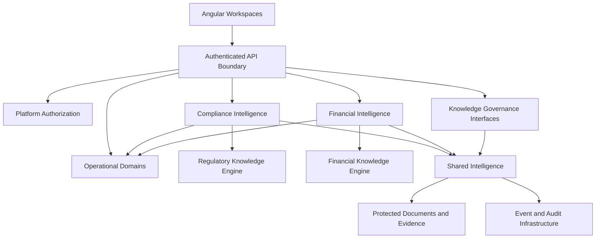
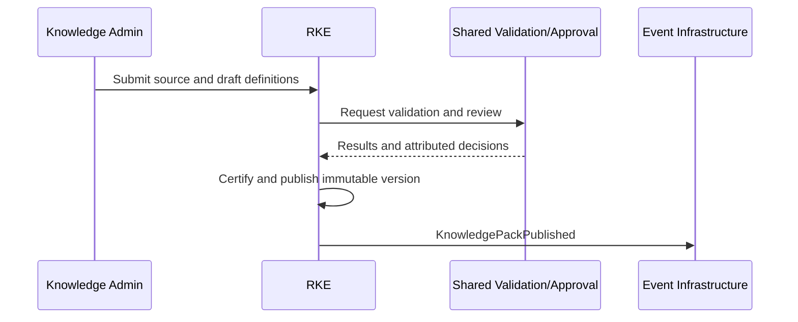
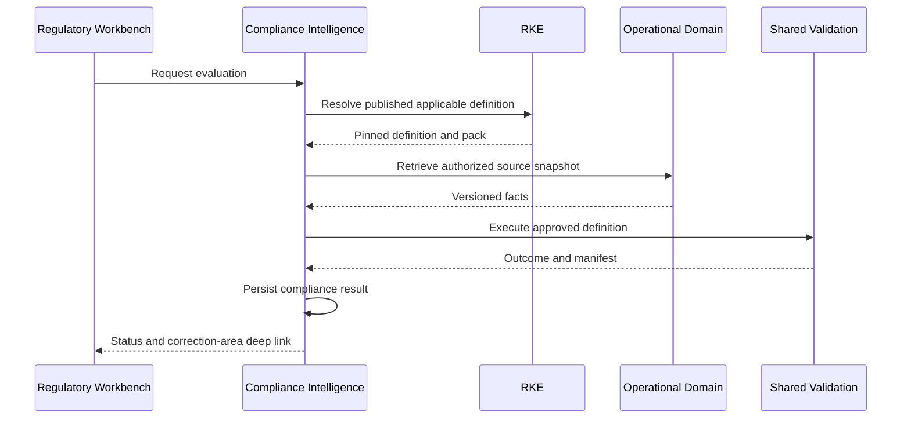
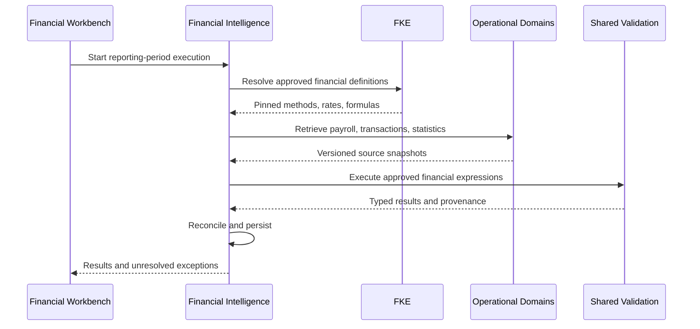

# ENG-023 — Platform Integration and End-to-End Workflow Specifications

**Organization:** McCaskill Projects  
**Platform:** Regulatory Intelligence Platform  
**Document ID:** ENG-023  
**Version:** 1.0 — Draft  
**Classification:** Engineering Design Specification  
**Proposed repository path:** `docs/engineering/23-platform-integration-and-end-to-end-workflow-specifications.md`  
**Design approach:** Architecture-first, repository-independent  
**Implementation authorization:** Not Granted

---

## 1. Executive design statement

ENG-023 defines how the platform's six logical layers interact through explicit contracts, orchestration boundaries, state transitions, events, security context, provenance, and recovery. It does not redefine the individual subsystem designs in ENG-016–022. Its purpose is to make cross-system behavior independently testable before repository reconciliation or implementation.

**Non-negotiable:** The Regulatory Knowledge Engine (RKE) and Financial Knowledge Engine (FKE) are the only two knowledge authorities. Operational Domains own source facts. Shared Intelligence supplies execution and governance infrastructure. Compliance Intelligence and Financial Intelligence own applied determinations. User Experience presents authorized workflows. No cross-layer convenience call may bypass those boundaries.

## 2. Scope and architectural layers

| Layer | Owner responsibilities | Principal integration role |
|---|---|---|
| 1. Platform Foundation | Identity, tenancy, authorization, API gateway, persistence infrastructure, events, observability | Secure and reliable transport and enforcement |
| 2. Operational Domains | Providers, locations, people, employees, services, contracts, payroll, transactions, statistics, Residential and ISS records | Authoritative versioned source facts |
| 3. Knowledge Authorities | RKE: regulatory knowledge; FKE: financial methodology | Approved, effective-dated definitions |
| 4. Shared Intelligence | Evidence, validation execution, audit, documents, approvals, reporting rendering, binders, secure exchange | Reusable governed infrastructure |
| 5. Applied Intelligence | Compliance results, findings, CAP/recheck; financial classifications, allocations, reconciliations, reports | Own decisions and derived artifacts |
| 6. User Experience | Provider Intelligence Center, workbenches, survey, binder, knowledge administration | Scoped commands, queries, explanations |

**Out of scope:** implementing source code; certifying unverified Texas rules; establishing reimbursement rates; granting access rights; selecting repository files for modification.

## 3. Cross-layer integration principles

1. **Single authoritative owner:** Every record, definition, decision, and workflow instance has one owning service.
2. **Explicit versioning:** Governed executions pin definition, pack, input snapshot, engine, and output versions.
3. **Temporal correctness:** Effective date, transaction date, entry date, evaluation date, and publication date remain distinct.
4. **Authorization at every boundary:** A valid caller token is insufficient without resource-level access.
5. **Idempotency:** Commands and asynchronous consumers must tolerate retries and duplicate delivery.
6. **Immutable release history:** Published knowledge, approved reports, and released binder snapshots are never silently rewritten.
7. **No inference of compliance from record existence:** Data completeness, regulatory compliance, and financial allowability are separate conclusions.
8. **Human-governed authority:** AI may assist with extraction, explanation, and drafting, never self-certify knowledge or release governed artifacts.
9. **Traceability:** Every important outcome links back to authoritative knowledge and operational inputs.
10. **Failure honesty:** Technical errors produce error states, not false pass/fail or financial zero values.

## 4. System context and trust boundaries



The arrows represent authorized contract interactions, not shared database access. RKE and FKE may reference one another's approved facts through explicit cross-authority contracts; neither inherits the other's certification authority.

## 5. Integration ownership and command matrix

| Command or result | Originating client | Authoritative handler | Dependencies |
|---|---|---|---|
| Create provider or location | Operational workspace | Operational Domain | Platform authorization, audit |
| Record fire drill | Residential workspace | Residential Operations | Document/evidence services |
| Publish regulatory pack | Knowledge administration | RKE governance | Shared validation/approval/audit |
| Publish financial pack | Knowledge administration | FKE governance | Shared validation/approval/audit |
| Evaluate regulatory requirement | Compliance workspace or scheduler | Compliance Intelligence | RKE, operational facts, shared validation |
| Record finding/CAP/recheck | Compliance workspace | Compliance Intelligence | Evidence, audit, tasks |
| Execute cost classification/allocation | Financial workspace | Financial Intelligence | FKE, operational facts, shared validation |
| Approve financial report | Financial workspace | Financial Intelligence governance | Shared approval and audit |
| Assemble/release binder | Binder workspace | Binder Management | Source references, completeness, approval |
| Grant surveyor access | Survey workspace | Survey access owner with Platform Authorization | Binder, document, audit |

## 6. Common command envelope

```typescript
interface IntegrationCommand<T> {
  commandId: string;
  idempotencyKey: string;
  correlationId: string;
  causationId?: string;
  actorId: string;
  tenantId: string;
  resourceScope: {
    providerId?: string;
    locationId?: string;
    personId?: string;
    reportingPeriodId?: string;
    surveyEventId?: string;
    binderId?: string;
  };
  expectedRevision?: number;
  requestedAt: string;
  payload: T;
}
```

The server resolves and verifies the effective actor, tenant, and scope; untrusted caller fields are never accepted as proof of permission. Internal service identities must be constrained to specific actions and resources.

## 7. Common response and error contracts

```typescript
interface IntegrationResult<T> {
  correlationId: string;
  status: 'SUCCEEDED' | 'PARTIAL' | 'FAILED' | 'PENDING';
  resourceId?: string;
  revision?: number;
  result?: T;
  errors?: Array<{
    code: string;
    category: 'AUTH' | 'VALIDATION' | 'CONFLICT' | 'DEPENDENCY' | 'EXECUTION' | 'INTEGRITY';
    message: string;
    retryable: boolean;
  }>;
}
```

Error classes must distinguish denied access, missing source data, unavailable approved definitions, invalid input, stale versions, execution failure, and failed external integration. Partial outcomes require explicit completeness and compensation status.

## 8. Event publication and processing

Events are emitted only after the owning service commits its state transition. Use transactional outbox or an equivalent durable mechanism. Consumers deduplicate by event ID, track schema version, preserve correlation and causation, and avoid sensitive payloads where references suffice. Retry with bounded exponential backoff; send unrecoverable events to a governed dead-letter workflow. Replay cannot bypass authorization, approval, or temporal rules.

```typescript
interface IntegrationEvent<T> {
  eventId: string;
  eventType: string;
  schemaVersion: string;
  aggregateId: string;
  aggregateRevision: number;
  tenantId?: string;
  occurredAt: string;
  correlationId: string;
  causationId?: string;
  payload: T;
}
```

Event names here are conceptual; canonical identifiers must be reconciled with ENG-001 and ENG-009 before approval.

## 9. Version and effective-date resolution

Every governed execution resolves: (1) requested evaluation date; (2) governing authority and program; (3) applicable published knowledge pack version; (4) exact definition versions; (5) source record snapshot; (6) execution engine version. If resolution is ambiguous or a required definition is unavailable, execution stops with an explicit resolution error. A newer pack does not silently rewrite earlier evaluations.

## 10. Historical execution manifest

```typescript
interface GovernedExecutionManifest {
  executionId: string;
  authority: 'REGULATORY' | 'FINANCIAL';
  knowledgePackVersionId: string;
  definitionVersionIds: string[];
  evaluationEffectiveAt: string;
  sourceSnapshotIds: string[];
  sourceDigests: string[];
  engineVersion: string;
  outputDigest: string;
  initiatedBy: string;
  correlationId: string;
  completedAt: string;
}
```

Historical inspection, deterministic replay, and current-knowledge reassessment are distinct operations. Each reassessment creates a new record linked to the earlier one.

## 11. Workflow WF-01 — Regulatory knowledge lifecycle

**Trigger:** An authoritative regulatory source is added or changes. **Owner:** RKE. **Inputs:** Source and version, jurisdiction, authority, program, effective dates. **Sequence:** source registration → extraction and drafting → applicability and requirement modeling → validation → human review/certification → publication → impact event → consumer refresh. **Outputs:** Published immutable Knowledge Pack version and provenance. **Failure gates:** Unverified source, incomplete citations, failed validation, missing reviewer authorization, conflicting effective dates. **Verification:** Rejected packs cannot publish; consumers resolve only authorized published versions.



## 12. Workflow WF-02 — Financial knowledge lifecycle

**Trigger:** A financial authority, reporting methodology, formula, classification, rate, or schedule changes. **Owner:** FKE. **Sequence:** authoritative source registration → definition authoring → classification/allowability/allocation/formula validation → independent financial review → approval → publication → change impact. **Outputs:** Approved, versioned financial Knowledge Pack. **Failure gates:** Unverified rate, unsafe formula, ambiguous rounding policy, incomplete source provenance, unapproved methodology. **Verification:** Financial execution cannot use draft or superseded definitions outside explicit historical replay.

## 13. Workflow WF-03 — Customer and organizational onboarding

**Owner:** Operational Organization/Provider domain. **Sequence:** authenticate authorized administrator → create organization and provider → establish tenant association → register identifiers/programs → add locations → assign users and roles → upload authorized supporting records → audit onboarding. **Outputs:** Active, scoped organizational records. **Failure gates:** Duplicate identity, invalid provider relationship, unauthorized tenant assignment. **Verification:** Provider-wide navigation works without a mandatory location ID, while location-restricted actions still enforce location scope.

## 14. Workflow WF-04 — Operational source capture

**Owner:** Relevant Operational Domain. **Sequence:** open authorized record → validate structural integrity → save with optimistic concurrency → preserve revision and source provenance → attach documents/evidence references → publish committed fact event. **Outputs:** Versioned operational record. **Failure gates:** Stale revision, invalid relationship, inaccessible attachment, duplicate import. **Verification:** Record correction does not erase the original and downstream consumers can identify which revision they evaluated.

## 15. Workflow WF-05 — Compliance evaluation

**Owner:** Compliance Intelligence. **Inputs:** Provider/subject, evaluation effective date, certified regulatory definitions, authorized operational snapshots. **Sequence:** resolve applicability → pin RKE version → retrieve facts → request Shared Validation → record execution manifest → persist compliance result → update dashboard and deep links → create or update finding when warranted. **Outputs:** Attributable compliance results and findings. **Failure gates:** Missing source or failed engine execution must produce an indeterminate/error outcome, not an automatic failure or pass.



## 16. Workflow WF-05A — Finding, CAP, and recheck

**Owner:** Compliance Intelligence. **States:** Open → Assigned → CAP Draft → CAP Submitted → Under Review → Remediation In Progress → Ready for Recheck → Rechecked → Closed; explicit rejection/reopen paths. **Rules:** A CAP describes remediation, not proof of completion. Recheck is a new pinned execution against current authorized facts and the explicitly selected applicable knowledge version. Closure requires permitted review and verified criteria. **Verification:** Findings cannot close merely because evidence was uploaded or a task was marked complete.

## 17. Workflow WF-06 — Financial execution

**Owner:** Financial Intelligence. **Inputs:** Approved FKE pack, payroll/transaction/service statistics, reporting period. **Sequence:** resolve approved methodology → validate and snapshot inputs → classify → apply allowability/exclusions → allocate costs → apply rates/formulas/precision → reconcile → persist results and execution manifest. **Outputs:** Versioned financial calculations and reconciliation results. **Failure gates:** Missing rate, unbalanced reconciliation, unsupported allocation base, inconsistent source period, or failed formula evaluation. **Verification:** Decimal-safe arithmetic and independently reviewed golden fixtures.



## 18. Workflow WF-06A — Financial report and approval

**Owner:** Financial Intelligence for report instances; Shared Reporting for rendering; Shared Approval for workflow execution. **Sequence:** assemble approved definition and reconciled results → render report → review exceptions → request financial approval → lock report version → create approved report artifact. **Rules:** A rendered report is not automatically an approved or officially submitted report. Revisions after approval create a new report version and require the applicable approval process. **Verification:** Reconciliation and approval gates prevent unauthorized release.

## 19. Workflow WF-07 — Binder assembly and release

**Owner:** Binder Management. **Sequence:** create binder instance from versioned definition → resolve authorized document/evidence/report references → evaluate required/conditional sections → submit for review → approve → freeze release snapshot → release to authorized audience → close/archive under policy. **States:** Draft → Assembling → Under Review → Approved → Released → Closed → Archived, with governed return paths. **Rules:** Binder membership does not grant unrestricted source-record access; released versions are immutable; retention/legal holds survive closure.

## 20. Workflow WF-07A — External survey access and exchange

**Owner:** Survey Workspace for event scope, Shared Information Exchange for requests, Platform Authorization for access enforcement. **Sequence:** register survey event → verify individual external identity/MFA → grant time-limited provider/location/person/document scope → present released authorized binder items → record views/downloads → accept information requests/responses → revoke/expire access. **Failure gates:** Expired grant, inaccessible source document, unapproved binder, out-of-scope person or location. **Verification:** Cross-tenant denial, revocation, and complete audit trail.

## 21. Workflow WF-08 — Governance and executive intelligence

**Owner:** Each authoritative domain for its data; executive read models aggregate authorized results. **Sequence:** collect published compliance and financial status → calculate clearly labeled management indicators → preserve source references and freshness timestamps → present provider-wide trends, exceptions, approvals, and workflow queues. **Rules:** Dashboard summaries are not independent compliance or official financial determinations. **Verification:** No provider-wide location requirement; all drilldowns enforce underlying access.

## 22. Texas HCS Emergency Preparedness vertical slice

1. Verify official Texas HCS sources and effective dates.
2. Author requirement, applicability, evidence, and evaluation definitions in RKE.
3. Validate, review, certify, and publish Texas HCS Knowledge Pack version.
4. Create provider, location, and emergency plan operational records.
5. Associate versioned plan documents and staff-related evidence where authorized.
6. Resolve applicable published definitions for the evaluation date.
7. Execute governed compliance evaluation.
8. Produce compliance result, evidence links, and execution manifest.
9. Present correction-area-first workbench with affected locations.
10. If needed, create finding, CAP, and reassessment workflow.
11. Assemble authorized Survey Binder section and enforce release approval.

**Acceptance:** Every result links to a certified source definition and the exact operational record versions. No unverified regulatory threshold is hardcoded into Residential Operations.

## 23. Texas HCS Cost Reporting vertical slice

1. Verify official financial reporting sources, schedules, methodologies, and effective periods.
2. Author classification, allowability, allocation, rate, precision, formula, and reporting definitions in FKE.
3. Validate with independently reviewed fixtures; approve and publish FKE pack.
4. Capture payroll, transactions, contracts, and service statistics in Operational Domains.
5. Resolve reporting period and source snapshots.
6. Execute classifications and financial methodologies through Financial Intelligence and Shared Validation.
7. Reconcile source totals, exclusions, allocations, and report lines.
8. Produce report instance, exception log, and execution manifest.
9. Render through Shared Reporting; obtain required approval.
10. Assemble Financial Binder with supporting schedules, evidence, and approved report.
11. Release under approved access and retention policies.

**Acceptance:** An auditor can trace a report line through formula, methodology, allocation, and source transactions. Unverified rates or instructions block authoritative execution.

## 24. ISS Operations vertical slice

1. Establish provider, location, person, and authorized service relationships.
2. Create individualized goals linked to an applicable individual plan.
3. Select or customize versioned objective templates.
4. Plan weekly activities and conceptual six-hour adventure schedules.
5. Record actual activity delivery, support level, community participation, and measurable progress.
6. Preserve source records, corrections, and evidence.
7. Apply certified Texas ISS regulatory definitions through Compliance Intelligence only when available.
8. Apply approved financial/billing rules separately; planned duration does not establish billability.
9. Assemble an ISS Survey Binder from authorized records.

**Acceptance:** The universal ISS domain is not branded as a specific customer; regulatory and billing decisions remain governed by their authorities.

## 25. Provider Intelligence Center integration

The provider dashboard aggregates scoped compliance and financial read models without requiring `locationId`. Location is an optional filter and may be required only for actions that target a particular location. Each result carries a source owner, update timestamp, status category, and authorized deep-link metadata. The Residential Workbench groups correction areas first (Fire Drills, Emergency Plans, Hot Water, Medication) and then affected locations.

## 26. Cross-authority references

RKE and FKE may need to reference the same source authority or approved facts. Cross-authority references must include authority type, artifact ID, version, effective date, and purpose. Such references do not transfer ownership or imply that one authority's approval certifies the other's methodology. Circular dependencies must be detected before publication.

## 27. Source snapshots and data freshness

Snapshot contracts must identify the owning domain, query criteria, source revision set, period, extraction time, digest, and authorization scope. Consumers must explicitly decide whether a newer source revision requires reevaluation. A dashboard's freshness timestamp does not prove its governing knowledge version is current; both must be visible in lineage.

## 28. Approval and segregation of duties

RKE certification, FKE methodology approval, financial report approval, binder release, and survey access authorization are separate decisions. Shared Approval executes versioned workflows and records actors, roles, decisions, reasons, and subject versions. Self-approval restrictions and delegation rules are defined by each owning governance policy. Changes to an approved subject invalidate stale approvals where required.

## 29. Authorization and tenancy matrix

| Operation | Minimum enforcement |
|---|---|
| Provider-wide summary | Tenant/provider membership and authorized aggregated fields |
| View person or employee | Person/employee scope and sensitive-field policy |
| View payroll | Payroll-specific permission and provider/period scope |
| Evaluate compliance | Compliance execution permission plus source and knowledge access |
| Run financial calculation | Financial execution permission plus source and methodology access |
| Approve knowledge | Authority-specific reviewer permission and separation of duties |
| Release binder | Binder approval, completeness, and audience permission |
| External survey download | Individual grant, MFA policy, event/document scope, expiry |

Authorization is rechecked on each protected operation, including signed-link creation, document preview, download, and background jobs.

## 30. Data classification and privacy

Classify records by sensitivity and apply minimum necessary access. Do not place sensitive person, health, payroll, or financial details in event envelopes, URLs, telemetry, or broad dashboard caches. Use encryption in transit and at rest, retention schedules, legal holds, protected object storage, and auditable export controls. AI-assisted workflows receive only explicitly authorized, appropriately minimized context.

## 31. Integration failure and compensation

| Failure | Required response |
|---|---|
| No applicable approved knowledge | Block governed evaluation; record resolution error |
| Missing operational snapshot | Mark incomplete; do not infer pass/fail |
| Shared Validation timeout | Record execution failure; allow safe retry |
| Duplicate event | Deduplicate; do not duplicate findings or payments |
| Approval subject changed | Reject stale approval and require review |
| Report reconciliation mismatch | Block report approval/release as defined by policy |
| Binder document inaccessible | Report missing/inaccessible item; block release when mandatory |
| External survey access revoked | Deny subsequent access and audit |
| Event consumer outage | Preserve outbox, retry, monitor backlog |
| Partial multi-service workflow | Persist durable step state and execute governed compensation |

No workflow may claim success until its owning service has committed the required state.

## 32. Long-running workflow coordination

Long-running activities use durable orchestration or explicit state machines, not in-memory browser state. Each workflow instance records step identity, input versions, retry count, last error, actor, and correlation ID. Compensation is domain-specific: canceling a pending task is possible, but deleting an approved knowledge publication or released binder is not a valid generic rollback.

## 33. Consistency and concurrency

Commands changing operational or governance state use expected revisions or equivalent concurrency control. Cross-service reads may be eventually consistent; user interfaces must display pending and stale states where relevant. Critical approval, publication, and release transitions require authoritative revalidation immediately before commit. Read-model lag must not be mistaken for absent source data.

## 34. Observability and service objectives

Trace commands across API, domain, knowledge, Shared Validation, events, and read models using correlation IDs. Monitor failed knowledge resolution, execution latency, outbox backlog, stale read models, approval queue age, binder assembly failures, survey access denials, and replay integrity. Numeric service-level objectives, recovery point objectives, and recovery time objectives require separate approval based on workload and risk.

## 35. API and event compatibility

APIs are versioned under the approved `/api/v1` convention unless ENG-009 authorizes otherwise. Breaking changes require compatibility planning and consumer contract tests. Events carry independent schema versions; consumers tolerate additive fields and reject unsupported semantic changes. ENG-001 event identifiers and ENG-009 naming must be reconciled into a canonical event registry before implementation.

## 36. Test strategy and acceptance suites

| ID | Test suite | Minimum acceptance |
|---|---|---|
| T-INT-01 | Architecture boundaries | No third knowledge authority; no shared-table ownership bypass |
| T-INT-02 | Authentication and scope | Cross-tenant and resource escalation denied |
| T-INT-03 | Regulatory publication | Only validated, certified versions publish |
| T-INT-04 | Financial publication | Only approved methodology versions publish |
| T-INT-05 | Source capture | Correct revision and provenance |
| T-INT-06 | Compliance execution | Pinned RKE + source versions and attributable result |
| T-INT-07 | CAP and recheck | New execution and verified closure gates |
| T-INT-08 | Financial execution | Decimal-safe golden fixtures and lineage |
| T-INT-09 | Financial report | Reconciliation and approval enforcement |
| T-INT-10 | Binder lifecycle | Completeness, approval, immutable release |
| T-INT-11 | External survey | Individual scope, MFA, expiry, revocation, audit |
| T-INT-12 | Event reliability | Retry, deduplication, replay, dead-letter recovery |
| T-INT-13 | Temporal resolution | Effective-date and supersession correctness |
| T-INT-14 | Historical replay | Exact manifest and deterministic reproduction |
| T-INT-15 | Emergency Preparedness | End-to-end RKE-to-CI-to-Survey trace |
| T-INT-16 | HCS Cost Reporting | FKE-to-FI-to-Financial Binder trace |
| T-INT-17 | ISS | Individual goals, delivery, progress, governance separation |
| T-INT-18 | Dashboard | Provider-wide access without required locationId |
| T-INT-19 | Failure injection | No false success or lost committed event |
| T-INT-20 | Accessibility | Keyboard, screen reader, focus, and error handling |

Golden fixtures must be independently reviewed and must not encode unverified Texas requirements or rates.

## 37. Integration acceptance gates

**Gate A — Contracts:** Owners, API schemas, events, error semantics, and version policies approved.  
**Gate B — Security:** Tenant isolation, resource authorization, service identity, and audit verified.  
**Gate C — Knowledge:** Independent RKE/FKE publication and effective-date resolution verified.  
**Gate D — Operational:** Source identities, revisions, and snapshots verified.  
**Gate E — Execution:** Shared Validation and applied-result ownership verified.  
**Gate F — Governance:** Approval, release, and retention controls verified.  
**Gate G — End-to-end:** Emergency Preparedness, HCS Cost Reporting, and ISS workflows pass.  
**Gate H — Recovery:** Duplicate delivery, partial failure, replay, and disaster-recovery exercises pass.

No downstream gate substitutes for a failed upstream gate.

## 38. Implementation dependency sequence

1. Approve canonical ownership, identifiers, contracts, and authorization matrix.
2. Establish Platform Foundation security, API, storage, event, and audit infrastructure.
3. Establish Operational Domain identities, source records, and snapshots.
4. Establish RKE and FKE publication/resolution contracts.
5. Establish Shared Validation, Evidence, Document, Approval, and execution manifests.
6. Implement Compliance Intelligence and Financial Intelligence orchestration against approved contracts.
7. Integrate reporting, binders, survey exchange, and notifications.
8. Integrate Angular workspaces and provider-wide read models.
9. Validate vertical slices, resilience, historical replay, and enterprise readiness.

This is a dependency design, not authorization to implement or a revision to ENG-015 sprint assignments.

## 39. Cross-document reconciliation register

Before implementation, reconcile:

- ENG-001 WF-01–08 and EVT-001–042 with ENG-009/ENG-023 event names and lifecycle semantics.
- ENG-008 SI-01–15, OP-01–12, CI-01–07, FI-01–11, BM-01–09, PF-01–09 and ENG-016–022 component labels.
- ENG-002 state machines with the precise approval, publication, CAP, report, and binder transitions.
- ENG-003/004 entities and relationships with all execution manifests, snapshot references, and binder instances.
- ENG-005 Nx dependency rules with allowed cross-domain contracts.
- ENG-010 authorization policies with source access, survey grants, and delegated approvals.
- ENG-012 retention and immutable history requirements with replay and legal holds.
- ENG-013 testing obligations with the twenty integration suites above.
- ENG-014 team work packages with cross-domain ownership.
- ENG-015 roadmap references: sprints 0–47 comprise **48 numbered sprint slots**, not 47.
- The earlier RKE/FKE governance schedule with later Shared Approval infrastructure: identify minimum authority-specific approval capability before first publication, then integrate shared workflow infrastructure without retroactive loss of history.

Reconciliation is a design approval activity. It must not silently rewrite earlier specifications.

## 40. Component and workflow acceptance checklist

- [ ] Every artifact and decision has a single authoritative owner.
- [ ] RKE and FKE remain separate independent knowledge authorities.
- [ ] Operational Domains do not contain hidden regulatory/financial determinations.
- [ ] Every governed execution pins knowledge and source versions.
- [ ] Shared Validation cannot author or certify definitions.
- [ ] Compliance results and financial calculations have complete provenance.
- [ ] Errors are not converted into pass/fail or zero values.
- [ ] Findings, CAP, and rechecks follow approved state machines.
- [ ] Financial reconciliation and report approval are separate gates.
- [ ] Binder release requires authorized completeness and approval.
- [ ] External survey access is individually scoped, expiring, revocable, and audited.
- [ ] Provider dashboard works without mandatory locationId.
- [ ] Residential corrections are grouped by issue before location.
- [ ] ISS planning does not imply regulatory sufficiency or billability.
- [ ] Outbox, idempotency, retries, and dead-letter recovery are tested.
- [ ] Historical replay and current reassessment are distinguishable.
- [ ] Cross-document inconsistencies are explicitly reconciled.
- [ ] End-to-end vertical slices have independently reviewed fixtures.
- [ ] No implementation begins without explicit authorization.

## 41. Relationship to the engineering blueprint

ENG-023 integrates ENG-001 through ENG-022, especially ENG-016 (RKE), ENG-017 (FKE), ENG-018 (Shared Intelligence), ENG-019 (Operational Domains), ENG-020 (Applied Intelligence), ENG-021 (Platform Foundation), and ENG-022 (User Experience/Application Shell). It supplements, but does not supersede, the domain-specific specifications or their approval requirements.

## 42. Implementation authorization

**Status: NOT GRANTED.** This is a proposed, repository-independent architecture specification. It does not authorize code changes, Nx libraries, database migrations, external integrations, deployments, knowledge certification, or production access changes. After design approval, a separate verified repository inventory and gap analysis may determine what to reuse, modify, replace, or create.

## 43. Final engineering position

The complete platform must demonstrate one controlled chain:

**Authoritative Knowledge + Versioned Operational Facts → Authorized Shared Execution → Owned Applied Determination → Evidence and Audit → Review and Approval → Reporting and Binder Release → Historical Reproducibility.**

That chain must work for both regulatory and financial intelligence without blending their authorities or compromising source ownership.

**End of ENG-023 — Platform Integration and End-to-End Workflow Specifications**
