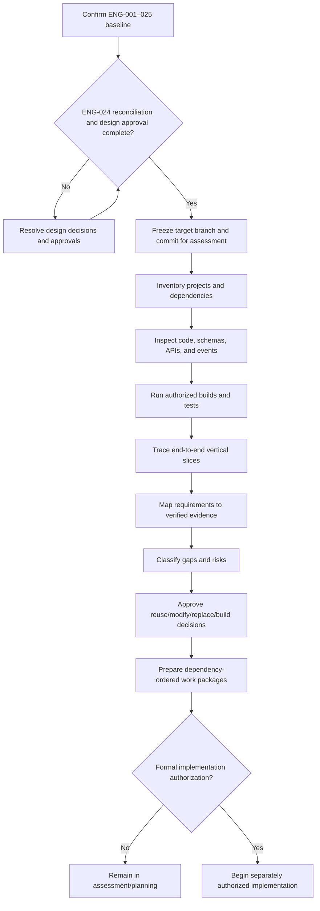

# ENG-026 — Repository Gap Analysis and Implementation Readiness

**Organization:** McCaskill Projects  
**Platform:** Regulatory Intelligence Platform  
**Document ID:** ENG-026  
**Version:** 1.0 — Draft  
**Proposed repository path:** `docs/engineering/26-repository-gap-analysis-and-implementation-readiness.md`  
**Status:** Assessment methodology defined; repository not inspected  
**Implementation Authorization:** Not Granted

---

## 1. Executive purpose

ENG-026 defines the controlled transition from the **independently designed target architecture** in ENG-001–025 to an evidence-based assessment of the actual repository. It does **not** redesign the target architecture around legacy code. It does **not** assert that any feature exists or works until the relevant repository artifacts, builds, and tests are inspected.

The outputs will be a verified repository inventory, a requirement-to-code traceability matrix, a reuse/modify/replace/build decision register, a prioritized remediation backlog, and a formal implementation-readiness recommendation.

## 2. Entry gates and prerequisites

Before a final implementation-readiness determination:

1. Confirm the authoritative ENG-001–025 document set and revisions.
2. Complete the cross-document reconciliation specified in ENG-024.
3. Record unresolved architecture decisions and their owners.
4. Approve the target design baseline through the designated governance process.
5. Approve verification criteria from ENG-025.
6. Obtain repository read access, identify the target branch and commit, and record the assessment date.

**Current gate state:** None of these approvals or repository checks is asserted complete by this document. Inventory preparation may proceed, but no implementation authorization follows from it.

## 3. Assessment principles

- **Design-first:** ENG-001–025 form the target; observed code is assessed against it.
- **Evidence-first:** Every existence, completeness, or quality claim links to a file, commit, command result, or test artifact.
- **No assumptions:** A planned module, a README claim, or a passing unit test alone is not proof of end-to-end capability.
- **No unapproved modifications:** Repository inspection is read-only unless separately authorized.
- **Preserve provenance:** Every finding identifies branch, commit, toolchain, environment, and date.
- **Security first:** Do not print secrets, production personal data, or connection credentials in the report.
- **Historical reproducibility:** Record exact commands and outputs; distinguish not-run, blocked, failed, and passed.

## 4. Assessment scope

The inventory covers the complete Nx monorepo and its deployment/integration surfaces, including:

| Architecture area | Required inventory |
|---|---|
| Platform Foundation | Identity, tenant isolation, authorization, API gateway, security, storage, messaging, observability, deployment |
| Operational Domains | Organization/provider, location, person, workforce, service, contract, payroll, transactions, statistics, documents, Residential, ISS |
| Regulatory Knowledge Engine | Sources, versions, applicability, requirements, packs, validation, certification, publication, resolution, change |
| Financial Knowledge Engine | Sources, classifications, allowability, allocations, rates, formulas, reporting, approval, publication, resolution |
| Shared Intelligence | Evidence, validation execution, audit, documents, change, approvals, reporting infrastructure, binders, exchange, events |
| Applied Intelligence | Compliance evaluations/findings/CAPs; financial calculations/reconciliations/report instances |
| User Experience | Application shell, provider-wide dashboard, workbenches, knowledge administration, financial/survey binders, external survey access |
| Cross-cutting | Contracts, events, migrations, tests, CI/CD, data protection, documentation, release controls |

## 5. Repository identity and baseline capture

Capture before inspection:

```text
Repository URL / local root: NOT YET VERIFIED
Target branch: NOT YET VERIFIED
Commit SHA: NOT YET VERIFIED
Assessment timestamp: NOT YET VERIFIED
Node / package manager / Nx versions: NOT YET VERIFIED
Frontend / backend / database versions: NOT YET VERIFIED
Environment and test-data classification: NOT YET VERIFIED
```

Suggested **read-only** commands, subject to access and security policy:

```bash
git rev-parse --show-toplevel
git branch --show-current
git rev-parse HEAD
git status --short
node --version
npx nx report
npx nx show projects
```

Do not publish `.env` values, access tokens, passwords, database URLs, or private keys. Do not execute migrations or deployment commands during inventory.

## 6. Repository inventory: required per-library record

Each library, application, and infrastructure package receives a separate inventory record:

| Field | Required content |
|---|---|
| Project/library | Exact workspace name and path |
| Purpose | Verified responsibilities from code and configuration |
| Owner | Known team or unassigned |
| Architecture mapping | ENG requirement IDs and target component IDs |
| Status | Present / Partial / Stub / Missing / Obsolete / Unverified |
| Completed | Verified functionality, with file and test evidence |
| Incomplete | Missing flows, TODOs, failing tests, absent contracts |
| Next files | Specific files needed for the approved target, not speculative implementation |
| Dependencies | Actual imports and intended target dependencies |
| APIs/events | Exported contracts, handlers, producers, consumers |
| Persistence | Entities, migrations, indexes, data ownership |
| Security | Guards, resource checks, tenant scope, sensitive data handling |
| Tests | Exact suite, command, date, outcome |
| Build | Exact command, date, outcome |
| Recommendation | Reuse / Modify / Replace / Build / Retire / Investigate |
| Evidence | Commit, paths, line references, logs, and assessor |

**Example (illustrative only; not an actual repository finding):**

```yaml
project: libs/example-domain
path: libs/example-domain
purpose: Example source-record service
status: UNVERIFIED
architecture_requirements: [ENG-019:OP-05]
completed: []
incomplete: ["Inspection not performed"]
next_files: []
dependencies: []
api_contracts: []
persistence: []
security_evidence: []
tests: {status: NOT_RUN}
build: {status: NOT_RUN}
recommendation: INVESTIGATE
evidence: []
```

## 7. Source-code inspection protocol

1. Enumerate applications and libraries from workspace configuration.
2. Inspect package boundaries and dependency graph.
3. Inspect source exports and public interfaces.
4. Trace backend route → guard → service → persistence → event behavior.
5. Trace frontend route → component → state → data access → backend behavior.
6. Verify entities against migrations and actual schemas in a safe test environment.
7. Identify stubs, TODOs, unreachable paths, duplicate models, and unreferenced services.
8. Record file-level evidence, not just directory names.
9. Compare each observed capability with the corresponding approved ENG contract.
10. Independently review high-risk conclusions.

## 8. Requirement-to-implementation traceability

Each architecture requirement must map to zero or more verified implementation artifacts and tests.

| Field | Meaning |
|---|---|
| Requirement ID | Stable ENG document and section/component identifier |
| Acceptance criterion | Approved, testable behavior |
| Code evidence | File paths and commit-specific references |
| Test evidence | Test IDs and observed outcomes |
| Coverage | Full / Partial / None / Unverified |
| Gap | Exact deviation from target |
| Risk | Severity, exposure, affected workflows |
| Decision | Reuse / Modify / Replace / Build / Retire / Investigate |
| Owner | Responsible implementation team |
| Dependency | Required preceding change |
| Gate | Required verification before acceptance |

A feature is **fully covered** only when the necessary code, contracts, authorization, persistence, and acceptance evidence are present; a passing compilation alone is insufficient.

## 9. Decision framework: reuse, modify, replace, build

| Decision | Criteria |
|---|---|
| **Reuse** | Meets approved behavior, boundaries, security, maintainability, and test gates |
| **Modify** | Fundamentally compatible; bounded changes can close identified gaps |
| **Replace** | Architecture/security incompatibility or modification cost/risk exceeds replacement |
| **Build** | No suitable existing implementation |
| **Retire** | Duplicative, obsolete, or incompatible with approved target |
| **Investigate** | Evidence insufficient for a responsible decision |

Each decision requires rationale, alternatives, migration impact, estimated effort, risk, and approval. **Existing code is never automatically preferred over the approved architecture.**

## 10. Architecture boundary checks

Verify the following independently:

- Regulatory requirements originate in the RKE, not hardcoded in Operational Domains or UI.
- Financial classifications, allowability, allocations, rates, and formulas originate in the FKE.
- Shared Validation executes governed definitions but does not author them.
- Operational Domains own source facts and histories.
- Compliance Intelligence owns compliance results, findings, CAPs, and reassessment workflows.
- Financial Intelligence owns calculation and report instances, not the methodology.
- Shared Audit, Evidence, Document, Approval, Reporting, and Binder services do not become hidden knowledge authorities.
- Provider-wide dashboard does not require `locationId`.
- Residential Workbench groups correction areas before affected locations.
- Financial Binder and Survey Binder share infrastructure but preserve type-specific rules.
- External survey access is individually authenticated, scoped, revocable, and audited.
- Historical results retain pinned definitions, inputs, engine versions, and approval provenance.

## 11. Build and test verification

Use the repository's actual supported commands, rather than assuming command names. For each command capture:

```text
Command:
Working directory:
Branch / commit:
Environment:
Start/end time:
Exit code:
Outcome: PASS | FAIL | BLOCKED | NOT_RUN
Log artifact:
Failure classification:
Follow-up:
```

Verification levels include dependency graph, typecheck, lint, unit, integration, contract, migration, security, end-to-end, accessibility, performance, and historical replay. Do not equate `NOT_RUN` with `PASS`. Use synthetic or authorized test data; never modify production data to assess readiness.

## 12. Data and migration assessment

Inspect entities, migrations, constraints, indexes, tenant scoping, temporal fields, audit, retention, and document storage references. Compare actual database state with declared migrations only in an authorized environment. Flag schema drift, destructive migration risks, ambiguous ownership, missing backfills, and rollback gaps. Do not execute migration changes during read-only assessment.

## 13. API and event reconciliation

For each endpoint and event, record the observed contract, target ENG-009/023 contract, auth policy, idempotency behavior, versioning, error semantics, producer/consumer, and test evidence. Reconcile event naming and IDs against ENG-001 before assigning final identifiers. Distinguish implemented events from planned events and dead code.

## 14. Security and privacy readiness

Assess identity, authentication, resource authorization, tenant isolation, service identities, secrets management, sensitive-field handling, document access, audit, surveyor access, revocation, and retention. A critical cross-tenant or unauthorized sensitive-data exposure blocks readiness regardless of feature completeness. Findings should describe the risk without publishing exploit-enabling secrets or private data.

## 15. End-to-end vertical-slice assessment

### A. Texas HCS Emergency Preparedness

Trace authoritative source → certified RKE pack/version → operational emergency plan and evidence → Shared Validation → Compliance Intelligence result → finding/CAP/reassessment → provider workbench → survey binder. Regulatory interpretation and source currency require separate official verification.

### B. Texas HCS Cost Reporting

Trace approved FKE methodology → payroll/transactions/service statistics → authorized snapshots → calculation and allocation → reconciliation → report instance → approval → Financial Binder → historical reproduction. Do not infer rates, reporting lines, or allowability from code without authoritative source verification.

### C. Texas ISS Operations

Trace individual plan → goals/objectives → activities and participation → progress observations → documentation/evidence → applicable certified requirements → reporting/survey readiness. Planned hours are not automatically billable hours.

### D. External survey access

Trace survey event → binder release → scoped external identity → MFA and authorization → document view/download → information requests/responses → audit → expiry/revocation.

Each slice receives a workflow-level evidence report and explicit PASS / FAIL / BLOCKED / NOT_RUN outcome.

## 16. Gap classification and prioritization

| Severity | Meaning |
|---|---|
| Critical | Tenant isolation, authority violation, sensitive-data exposure, data loss, or unreproducible high-stakes decisions |
| High | Core workflow unavailable, incorrect calculation/compliance outcome, broken approvals, migration risk |
| Medium | Partial workflow, inconsistent contracts, inadequate observability, incomplete tests |
| Low | Documentation, polish, or low-risk maintainability gap |

Priority additionally considers dependency position, customer impact, effort, reversibility, and whether a gap blocks an ENG-025 acceptance criterion.

## 17. Implementation package construction

Only after approved design and verified findings, prepare work packages containing:

- Target requirement and acceptance criteria.
- Observed current-state evidence.
- Decision and approved rationale.
- Specific files/components to change.
- API/event/schema impact.
- Data migration and rollback plan.
- Security and test requirements.
- Dependencies and owners.
- Estimated effort and risk.
- Definition of Done.
- Software Change Register reference.

Packages must be sequenced by dependency gates, not by the convenience of existing code organization.

## 18. Readiness gates

| Gate | Exit evidence |
|---|---|
| G-026-01 Design baseline | ENG-024 reconciliation completed; target approved |
| G-026-02 Inventory | All in-scope projects classified with evidence |
| G-026-03 Contracts | API, events, entities, ownership reconciled |
| G-026-04 Security | Critical authorization/tenant issues assessed and dispositioned |
| G-026-05 Verification | Build/test results captured; gaps to ENG-025 criteria recorded |
| G-026-06 Vertical slices | Four critical workflow traces assessed |
| G-026-07 Decisions | Reuse/modify/replace/build register reviewed |
| G-026-08 Backlog | Dependency-ordered packages and estimates approved |
| G-026-09 Authorization | Explicit implementation approval recorded |

A gate may be **OPEN, BLOCKED, PASSED, or WAIVED WITH APPROVAL**. Security-critical gates may not be silently waived.

## 19. Required deliverables

1. **Verified Repository Inventory** — every application/library and relevant infrastructure component.
2. **Current-State Architecture Map** — actual dependency graph and ownership boundaries.
3. **Requirement Traceability Matrix** — ENG-001–025 to code and tests.
4. **Build and Test Evidence Register** — reproducible commands and outcomes.
5. **API/Event/Entity Contract Gap Register** — target versus observed.
6. **Security and Data Risk Register** — prioritized risks and controls.
7. **Vertical-Slice Evidence Reports** — Emergency Preparedness, Cost Reporting, ISS, external survey.
8. **Reuse/Modify/Replace/Build Decision Register** — evidence and approvals.
9. **Implementation Work Package Backlog** — dependencies, estimates, acceptance gates.
10. **Readiness and Authorization Record** — explicit disposition and sign-off.

## 20. Repository inventory master template

| Project | Purpose | Status | Completed | Incomplete | Next files | Dependencies | Build | Tests | Recommendation | Evidence |
|---|---|---|---|---|---|---|---|---|---|---|
| **NOT INSPECTED** | — | Unverified | — | Inventory pending | — | — | NOT_RUN | NOT_RUN | Investigate | — |

Populate one row per project after inspecting its actual implementation. Do not use illustrative rows as factual findings.

## 21. Initial known architecture reconciliation risks

The following are **design-document consistency checks**, not verified repository defects:

- Sprint numbers 0–47 constitute **48 numbered slots**; older references to a “47-sprint roadmap” require correction.
- ENG-008 `RK-01–11` and `FK-01–13` nomenclature must align with ENG-016 `RKE-01–11` and ENG-017 `FKE-01–13`.
- ENG-001 event IDs `EVT-001–042` require reconciliation with event names/IDs proposed in ENG-009 and subsystem specifications.
- Knowledge-specific approval in earlier sprints versus later Shared Approval infrastructure requires explicit minimum-viable governance sequencing.
- ENG-008 component catalog, ENG-014 work packages, and ENG-015 sprint assignments require a one-to-one coverage review.
- Operational payroll tax calculations must not be conflated with FKE regulated financial reporting methodologies.
- Binder source-record authorization must remain separate from binder access.

These checks must be resolved in the approved architecture baseline before being treated as implementation requirements.

## 22. Assessment execution sequence



## 23. Responsibilities and approvals

| Role | Responsibility |
|---|---|
| Architecture owner | Approves target architecture and boundary decisions |
| Repository assessor | Collects file/commit/build evidence |
| Domain owners | Verify operational and knowledge ownership |
| Security reviewer | Reviews tenant, identity, sensitive data, and external access risks |
| QA lead | Verifies test coverage and evidence quality |
| Data owner | Reviews migrations, integrity, and retention |
| Delivery lead | Estimates and sequences work packages |
| Authorized sponsor | Grants or withholds implementation approval |

No individual may self-certify critical security or financial/regulatory correctness without the required independent review.

## 24. Definition of assessment complete

ENG-026 assessment is complete only when all in-scope repository components are inventoried, material claims are evidenced, ENG-024 design issues are dispositioned, ENG-025 criteria are mapped to observed outcomes, critical workflow slices are traced, gaps are prioritized, implementation packages are approved, and the readiness record is signed.

**Assessment completion is not the same as implementation readiness.** A complete assessment may conclude **NOT READY**.

## 25. Current assessment status

| Item | Status |
|---|---|
| ENG-026 methodology | Drafted |
| ENG-001–025 document verification | Not performed in this document |
| ENG-024 reconciliation completion | Not verified |
| Architecture approval | Not verified |
| Repository branch and commit | Not provided |
| Repository inventory | Not performed |
| Builds and tests | Not run |
| Security assessment | Not performed |
| Vertical-slice verification | Not performed |
| Implementation readiness | Undetermined |
| Implementation authorization | **Not Granted** |

## 26. Final engineering position

ENG-026 protects the architecture-first strategy by separating **what the platform must become** from **what the repository currently contains**. The target design remains authoritative unless changed through approved governance. Existing code is reusable only when evidence demonstrates compatibility with that design.

**The next operational action is not coding. It is confirming the approved architecture baseline, then conducting a read-only, commit-specific repository inventory.**

---

**End of ENG-026 — Repository Gap Analysis and Implementation Readiness**
