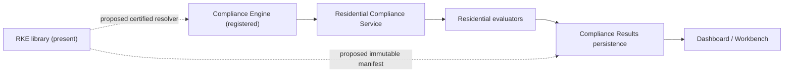

# REC-016 — RKE Consumer Dependency and Backend Integration Trace

**Status:** Static repository evidence assessment; no implementation approval.  **Evidence source:** `hhscCompliance-develop.zip` inspected 2026-11-02.  **Proposed path:** `docs/governance/reconciliation/rec-016-rke-consumer-dependency-and-backend-integration-trace.md`.

## 01. Executive determination

The archive contains a defined RKE library and a separate registered NestJS compliance engine. Direct consumption of the RKE library by backend or frontend code was **not identified** in the scanned TypeScript files outside the RKE library. This is a static reference finding, not proof that no runtime integration could occur through configuration or dynamic loading.

## 02. Purpose

Trace actual RKE consumers and dependency boundaries; distinguish operational compliance evaluation from certified knowledge resolution; specify evidence and closure tests for integration.

## 03. Governing decisions

AD-001–AD-012 and REC-001 D1–D5 are architectural governance inputs. REC-007–REC-015 are assessment and proposed-contract inputs. Their existence does not imply implementation or contract ratification.

## 04. Evidence method

Inspected the uploaded ZIP with Python `zipfile`, enumerated TypeScript and JSON paths, searched exact RKE class names and likely pack symbols, and opened targeted source. No package installation, compilation, service startup, database connection, or HTTP execution was performed.

## 05. Evidence scope

1002 TypeScript/JSON paths searched; targeted review of 23 candidate paths. Scope is this archive snapshot only; newer local branches and untracked files are outside scope.

## 06. RKE library public surface

`libs/regulatory/knowledge/src/index.ts` exports models, enums, engine/repository interfaces, memory repository, validator, loader, service, Texas HCS pack and document-generation service. This is an export surface, not evidence of consumers.

## 07. RKE runtime composition

`KnowledgeEngineService` accepts a `KnowledgeRepository` through its constructor. `KnowledgeRepository` provides in-memory-oriented register/unregister/clear and synchronous get methods. The inspected interface has no certification, tenant-context, effective-date, or revision-ID resolver methods.

## 08. RKE loader boundary

The loader validates and registers a pack into a supplied repository. No independently authorized certification or publication gate is demonstrated by the inspected loader.

## 09. RKE package consumers

Exact `KnowledgeEngineService`, `KnowledgePackLoader`, and `MemoryKnowledgeRepository` references appeared only within RKE library source and RKE tests in the archive scan. No direct references were found outside `libs/regulatory/knowledge`.

## 10. NestJS integration placeholders

`server/src/app/regulatory/knowledge/regulatory-knowledge.controller.ts`, `.module.ts`, and `.service.ts` contain whitespace only in the uploaded snapshot. They provide no observed NestJS controllers, providers, routes, or dependency-injection bindings.

## 11. Root application module

`server/src/app/app.module.ts` imports and registers `ComplianceEngineModule`, `ComplianceResultsModule`, and `DashboardModule`, among others. It does not import or register a `RegulatoryKnowledgeModule` in the inspected source.

## 12. Compliance Engine module

`server/src/app/compliance/engine/compliance-engine.module.ts` imports `ResidentialComplianceModule` and `SecurityModule`, declares `ComplianceEngineController`, and provides/exports `ComplianceEngineService`. No RKE module/provider import appears.

## 13. Compliance Engine orchestration

`ComplianceEngineService.evaluateLocation(locationId)` and `evaluateResidential(locationId)` delegate to `ResidentialComplianceService.evaluate(locationId)` and return results. No certified-knowledge resolver or version manifest is passed.

## 14. Residential evaluation module

The residential module has evaluator files for emergency plans, fire drills, four-person, home environment, hot water, infection control, life safety, medication, and nursing. Presence of these files is not evidence that their rules are derived from certified RKE knowledge.

## 15. Emergency Preparedness vertical slice

`emergency-plans.evaluator.ts` is a backend evaluator candidate. `libs/regulatory/knowledge/src/lib/packs/texas-hcs/rules/emergency-preparedness.rule.ts` is a distinct RKE knowledge definition. Their coexistence does not establish a linked source-of-truth chain.

## 16. Fire Drill vertical slice

`fire-drills.evaluator.ts` and Texas HCS knowledge pack definitions exist in separate locations. A direct dependency or revision manifest is not established by the inspected import/reference search.

## 17. Compliance results persistence

`ComplianceResultsModule` registers `ComplianceResultEntity` and `ProviderEntity` with TypeORM and exposes `ComplianceResultsService`. Persisted findings are an operational output; their existence alone does not establish immutable certified-knowledge provenance.

## 18. Dashboard boundary

The root app registers a dashboard module, and frontend data-access has dashboard and module-workbench services. These are presentation/aggregation paths, not automatically RKE consumers.

## 19. Frontend compliance API

`libs/data-access/src/lib/compliance/src/services/compliance-results.api.ts` exists as a frontend API adapter. No direct RKE engine class reference was identified in this adapter.

## 20. Frontend dashboard API

`libs/data-access/src/lib/dashboard/src/services/compliance-dashboard.service.ts` and `module-workbench.service.ts` exist. Their use of compliance result APIs should not be conflated with direct certified-knowledge lookup.

## 21. Nx dependency status

Static import scan provides negative evidence for direct RKE consumers; actual Nx graph validation was not run. The presence of `project.json` files does not establish that enforce-module-boundaries rules are passing.

## 22. API route status

Compliance engine controllers exist in source; actual registered routes, guards, response contracts, and network behavior have not been exercised. RKE integration controller is empty in this snapshot.

## 23. Authentication boundary

SecurityModule is imported by the compliance engine module. This does not independently prove all routes enforce tenant/provider authorization. RKE read/certify endpoints are not implemented in the inspected placeholder files.

## 24. Tenant isolation

RKE access contracts must distinguish globally authoritative knowledge from tenant-owned determinations, approvals, and evidence. Tenant-bound reads must fail closed; no runtime tests were executed.

## 25. Data dependency direction

Proposed flow: authoritative RKE revision → certified version resolver → Applied Compliance Intelligence evaluator → immutable determination manifest → compliance results → dashboard/workbench. Operational data flows independently into evaluator inputs.

## 26. Prohibited dependency inversion

UI and operational data services must not declare regulatory truth. Evaluators must not silently embed replacement legal thresholds when certified RKE knowledge is missing. AI may explain, not certify.



## 27. Current-state integration diagram

See Mermaid diagram below; solid edges reflect inspected source relationships; dashed edges are proposed and unverified.

## 28. Evidence classification

**PRESENT:** file/class/method exists in source. **WIRED:** explicit import/constructor/module connection observed. **NOT IDENTIFIED:** searched within stated scope, no match. **UNVERIFIED:** requires runtime, graph, database, or broader source evidence. **PROPOSED:** not implemented.

## 29. Source-to-consumer matrix

The table below separates observed producer/consumer relationships from intended contracts.

## 30. Gap G01 — Missing RKE NestJS provider wiring

Three empty integration files and no root module registration. Closure: implemented NestJS module with explicit provider factory and approved dependency boundary, followed by module-boot and endpoint tests.

## 31. Gap G02 — Evaluator knowledge linkage

No direct external RKE class references identified. Closure: trace each evaluator to immutable certified rule revision and enforce fail-closed behavior on unresolved versions.

## 32. Gap G03 — Version manifest propagation

`evaluateLocation` accepts only `locationId`; no certified-knowledge version context is visible at orchestration boundary. Closure: explicit resolver request and immutable manifest captured per evaluation.

## 33. Gap G04 — Historical replay path

No direct RKE revision lookup/replay contract is demonstrated in inspected interfaces. Closure: approved historical resolver, deterministic replay service, and as-of/known-at tests.

## 34. Gap G05 — RKE API authorization

Empty controller/module/service do not establish routes, guards, roles, or certification permissions. Closure: permission matrix and negative authorization tests.

## 35. Gap G06 — Frontend knowledge provenance

Existing compliance and dashboard adapters do not establish certified rule metadata exposure. Closure: version/source citations in findings UI, preserving provider-wide vs location-level workflow boundaries.

## 36. Gap G07 — Nx dependency enforcement

No successful Nx project graph or lint run recorded here. Closure: runnable graph/lint evidence and allowed-edge registry ratification.

## 37. Gap G08 — Certification separation

No reviewed certification command/provider wiring was found in the inspected integration files. Closure: role-separated certification lifecycle and immutable publication tests.

## 38. Proposed backend composition

Create a dedicated RKE integration adapter that depends on approved RKE interfaces, not on frontend data-access. Inject certified resolver into Applied Intelligence evaluator orchestration; do not make regulatory library import operational entities.

## 39. Proposed contract handoff

Evaluator input should include `providerId`, `locationId?`, `evaluationAt`, `knownAt`, operational snapshot references, and a certified knowledge selection context. Output must include knowledge revision IDs, evaluator version, evidence digest, outcome digest, and correlation ID.

## 40. Migration strategy

Stage 0 ratify contracts; stage 1 add immutable persistence without changing evaluator behavior; stage 2 expose certified resolver; stage 3 wire one emergency-preparedness evaluator; stage 4 persist manifest; stage 5 historical replay; stage 6 expand coverage. Each stage requires approval.

## 41. Acceptance tests

A01 provider boot with RKE module; A02 knowledge provider injection; A03 unknown revision fail-closed; A04 effective-date boundary; A05 known-at boundary; A06 tenant cross-read denial; A07 certifier separation; A08 evaluator manifest persisted; A09 replay old revision after publication of new one; A10 dashboard citation links; A11 Nx boundary checks; A12 compliance engine regression; A13 audit correlation; A14 rollback and idempotent migration.

## 42. Verification evidence requirements

For each acceptance test record command, commit SHA, environment, fixture, execution timestamp, result, logs, database assertions, reviewer, and artifact digest. No acceptance result is claimed in this document.

## 43. Release gates

RG1 ratified contracts; RG2 repository graph and build; RG3 persistence migrations and backfill validation; RG4 security and tenant tests; RG5 certification controls; RG6 temporal/replay tests; RG7 end-to-end Emergency Preparedness trace; RG8 formal implementation authorization.

## 44. Risk register

R1 evaluator drift from RKE; R2 inaccurate historical claims; R3 version replacement in memory; R4 accidental cross-tenant data disclosure; R5 duplicated regulatory rules; R6 over-broad certification privileges; R7 failed migrations; R8 dashboard displaying uncited findings. All remain open until evidence-backed closure.

## 45. Decision requests

DR1 approved RKE backend adapter owner; DR2 certified resolver API/DTO; DR3 evaluator integration mode; DR4 immutable manifest storage owner; DR5 tenant scoping rules; DR6 migration and backfill policy; DR7 first vertical slice acceptance scope. Decisions are requested, not presumed approved.

## 46. Non-claims and limitations

No compilation, unit/e2e test, migration, database inspection, deployed route test, security penetration test, or runtime replay was performed. Static absence of imports is not proof of absence of every possible dynamic integration. No implementation authorized.

## 47. Conclusion

The RKE source library and the compliance engine are independently present. The inspected snapshot does not establish a wired certified-RKE-to-compliance evaluation chain. The next action is to ratify the integration contract and verify the first complete vertical slice against code and tests.

## 48. Next document

**REC-017 — Emergency Preparedness RKE-to-Evaluator Vertical Slice Contract and Evidence Matrix**, mapping the existing emergency preparedness knowledge model to the actual emergency plans evaluator, result persistence, and frontend provenance requirements.

## Source-to-consumer trace matrix

| Source | Observed relationship | Classification | Evidence |
|---|---|---|---|
| RKE public index | Exports knowledge engine, loader, repository, pack | PRESENT | `libs/regulatory/knowledge/src/index.ts` |
| KnowledgeEngineService | Constructor injects KnowledgeRepository | WIRED within RKE | `libs/regulatory/knowledge/src/lib/services/knowledge-engine.service.ts` |
| RKE backend module | Empty file; not registered in AppModule | NOT IDENTIFIED | `server/src/app/regulatory/knowledge/*.ts`; `server/src/app/app.module.ts` |
| ComplianceEngineModule | Imports ResidentialComplianceModule, SecurityModule | WIRED | `server/src/app/compliance/engine/compliance-engine.module.ts` |
| ComplianceEngineService | Delegates to ResidentialComplianceService | WIRED | `server/src/app/compliance/engine/compliance-engine.service.ts` |
| Compliance evaluator → RKE | No direct reference identified outside RKE library | NOT IDENTIFIED | TypeScript reference scan across archive |
| ComplianceResultsModule | TypeORM feature registration | WIRED | `server/src/app/compliance/compliance-results.module.ts` |
| Frontend data-access → RKE | No direct engine class reference found | NOT IDENTIFIED | TypeScript reference scan across archive |
| Historical replay | No observed integrated execution path | UNVERIFIED | No runtime or DB verification |

## Targeted source reference excerpts

The following source line matches are extracted from the archive and are **not** runtime evidence.

### `server/src/app/app.module.ts`

- L4: `import { TypeOrmModule } from '@nestjs/typeorm';`
- L10: `import { AppController } from './app.controller';`
- L11: `import { AppService } from './app.service';`
- L25: `import { ComplianceEngineModule } from './compliance/engine/compliance-engine.module';`
- L37: `imports: [`
- L57: `TypeOrmModule.forRootAsync(typeOrmAsyncConfig),`
- L73: `ComplianceEngineModule,`
- L77: `controllers: [AppController],`

### `server/src/app/compliance/engine/compliance-engine.module.ts`

- L3: `import { ComplianceEngineController } from './compliance-engine.controller';`
- L4: `import { ComplianceEngineService } from './compliance-engine.service';`
- L6: `import { ResidentialComplianceModule } from './residential/residential-compliance.module';`
- L7: `import { AuthorizationService } from '../../security/services/authorization.service';`
- L11: `imports: [`
- L12: `ResidentialComplianceModule,SecurityModule`
- L14: `controllers: [`
- L15: `ComplianceEngineController,`

### `server/src/app/compliance/engine/compliance-engine.service.ts`

- L3: `import { ResidentialComplianceService } from './residential/residential-compliance.service';`
- L18: `export class ComplianceEngineService {`
- L20: `private readonly residentialCompliance: ResidentialComplianceService,`
- L28: `results.push(...(await this.residentialCompliance.evaluate(locationId)));`
- L37: `return this.residentialCompliance.evaluate(locationId);`

### `server/src/app/compliance/engine/residential/residential-compliance.module.ts`

- L2: `import { TypeOrmModule } from '@nestjs/typeorm';`
- L9: `import { ResidentialComplianceService } from './residential-compliance.service';`
- L22: `imports: [`
- L23: `TypeOrmModule.forFeature([`
- L30: `ResidentialComplianceService,`
- L41: `exports: [`
- L42: `ResidentialComplianceService,`
- L45: `export class ResidentialComplianceModule {}`

### `server/src/app/compliance/engine/residential/residential-compliance.service.ts`

- L26: `export class ResidentialComplianceService {`
- L39: `async evaluate(locationId: string): Promise<EvalResult[]> {`
- L42: `results.push(await this.fireDrills.evaluate(locationId));`
- L43: `results.push(await this.emergencyPlans.evaluate(locationId));`
- L44: `results.push(await this.hotWater.evaluate(locationId));`
- L45: `results.push(await this.homeEnvironment.evaluate(locationId));`
- L46: `results.push(await this.lifeSafety.evaluate(locationId));`
- L47: `results.push(await this.medication.evaluate(locationId));`

### `server/src/app/compliance/engine/residential/evaluators/emergency-plans.evaluator.ts`

- L5: `import { ComplianceResultsService } from '../../../compliance-results.service';`
- L31: `private readonly compliance: ComplianceResultsService,`
- L78: `async evaluate(locationId: string) {`

### `server/src/app/compliance/engine/residential/evaluators/fire-drills.evaluator.ts`

- L6: `import { ComplianceResultsService } from '../../../compliance-results.service';`
- L45: `private readonly compliance: ComplianceResultsService,`
- L154: `async evaluate(locationId: string) {`

### `server/src/app/compliance/compliance-results.service.ts`

- L5: `import { AuditService } from '../audit/audit.service';`
- L118: `export class ComplianceResultsService {`
- L126: `private readonly audit: AuditService,`

### `server/src/app/dashboard/dashboard.module.ts`

- L6: `import { DashboardController } from './dashboard.controller';`
- L8: `import { DashboardService } from './services/dashboard.service';`
- L9: `import { CaseManagerWorkQueueService } from './services/case-manager-work-queue.service';`
- L10: `import { DashboardSummaryService } from './services/dashboard-summary.service';`
- L11: `import { EntityWorkbenchService } from './services/entity-workbench.service';`
- L12: `import { ModuleCorrectionService } from './services/module-correction.service';`
- L14: `import { ProviderIntelligenceService } from './services/provider-intelligence.service';`
- L15: `import { ProviderAlertService } from './services/provider-intelligence/provider-alert.service';`

### `libs/regulatory/knowledge/src/index.ts`

- L5: `export * from './lib/models/knowledge-pack.model';`
- L14: `export * from './lib/interfaces/knowledge-engine.interface';`
- L16: `export * from './lib/repositories/knowledge-repository.interface';`
- L17: `export * from './lib/repositories/memory-knowledge.repository';`
- L19: `export * from './lib/validators/knowledge-pack.validator';`
- L20: `export * from './lib/loaders/knowledge-pack.loader';`
- L21: `export * from './lib/services/knowledge-engine.service';`
- L23: `export * from './lib/packs/texas-hcs/texas-hcs.knowledge-pack';`

### `libs/regulatory/knowledge/src/lib/interfaces/knowledge-engine.interface.ts`

- L3: `import { KnowledgePack } from '../models/knowledge-pack.model';`
- L12: `export interface RequirementKnowledge {`
- L28: `export interface RuleKnowledge {`
- L33: `requirements: RequirementKnowledge[];`
- L36: `export interface KnowledgeEngine {`
- L37: `// Knowledge Packs`
- L40: `): KnowledgePack | undefined;`
- L94: `getRequirementKnowledge(`

### `libs/regulatory/knowledge/src/lib/services/knowledge-engine.service.ts`

- L2: `KnowledgeEngine,`
- L3: `RequirementKnowledge,`
- L4: `RuleKnowledge,`
- L5: `} from '../interfaces/knowledge-engine.interface';`
- L7: `import { KnowledgeRepository } from '../repositories/knowledge-repository.interface';`
- L9: `import { KnowledgePack } from '../models/knowledge-pack.model';`
- L20: `export class KnowledgeEngineService implements KnowledgeEngine {`
- L22: `private readonly repository: KnowledgeRepository,`

### `libs/regulatory/knowledge/src/lib/repositories/knowledge-repository.interface.ts`

- L3: `import { KnowledgePack } from '../models/knowledge-pack.model';`
- L12: `export interface KnowledgeRepository {`
- L13: `register(pack: KnowledgePack): void;`
- L14: `unregister(packId: string): void;`
- L18: `getPack(packId: string): KnowledgePack | undefined;`
- L19: `getAllPacks(): KnowledgePack[];`

### `libs/regulatory/knowledge/src/lib/repositories/memory-knowledge.repository.ts`

- L3: `import { KnowledgePack } from '../models/knowledge-pack.model';`
- L11: `import { KnowledgeRepository } from './knowledge-repository.interface';`
- L13: `export class MemoryKnowledgeRepository implements KnowledgeRepository {`
- L14: `private readonly packs = new Map<string, KnowledgePack>();`
- L31: `register(pack: KnowledgePack): void {`
- L32: `this.unregister(pack.metadata.id);`
- L61: `unregister(packId: string): void {`
- L112: `getPack(packId: string): KnowledgePack | undefined {`

### `libs/regulatory/knowledge/src/lib/loaders/knowledge-pack.loader.ts`

- L1: `import { KnowledgePack } from '../models/knowledge-pack.model';`
- L2: `import { KnowledgeRepository } from '../repositories/knowledge-repository.interface';`
- L4: `KnowledgePackValidationResult,`
- L5: `KnowledgePackValidator,`
- L6: `} from '../validators/knowledge-pack.validator';`
- L8: `export class KnowledgePackLoadError extends Error {`
- L11: `public readonly validation: KnowledgePackValidationResult,`
- L14: `Knowledge pack "${packId}" failed validation with ${validation.errors.length} error(s).,`

### `libs/regulatory/knowledge/src/lib/packs/texas-hcs/texas-hcs.knowledge-pack.ts`

- L1: `import { KnowledgePack } from '../../models/knowledge-pack.model';`
- L16: `export const TEXAS_HCS_KNOWLEDGE_PACK_ID = 'texas-hcs';`
- L17: `export const TEXAS_HCS_KNOWLEDGE_PACK_VERSION = '1.0.0';`
- L19: `export const texasHcsKnowledgePack: KnowledgePack = {`
- L21: `id: TEXAS_HCS_KNOWLEDGE_PACK_ID,`
- L23: `name: 'Texas Home and Community-Based Services',`
- L25: `'Texas HHSC Home and Community-Based Services Regulatory Knowledge Pack.',`
- L27: `industry: 'Health and Human Services',`

### `libs/data-access/src/lib/compliance/src/services/compliance-results.api.ts`

- L5: `import { BaseApiService } from '../../../api-core/base-api.service';`
- L23: `export class ComplianceResultsApi extends BaseApiService {`

### `libs/data-access/src/lib/dashboard/src/services/compliance-dashboard.service.ts`

- L4: `import { BaseApiService } from '../../../api-core/base-api.service';`
- L157: `export class ComplianceDashboardService extends BaseApiService {`

### `libs/data-access/src/lib/dashboard/src/services/module-workbench.service.ts`

- L6: `import { EntityWorkbenchView, ModuleCorrectionEntityType } from './compliance-dashboard.service';`
- L11: `export class ModuleWorkbenchService {`


## Reproducible inspection recipe

```bash
python -m zipfile -l hhscCompliance-develop.zip
# Extract into an isolated directory, then search:
rg -n "KnowledgeEngineService|KnowledgePackLoader|MemoryKnowledgeRepository" --glob "*.ts" .
rg -n "RegulatoryKnowledgeModule|ResidentialComplianceService|evaluateLocation" --glob "*.ts" .
# Separately run Nx graph/build/tests only in an approved dependency-ready environment.
```
